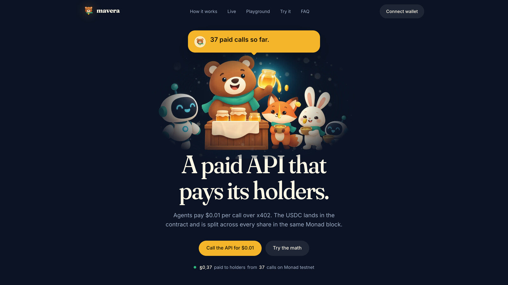
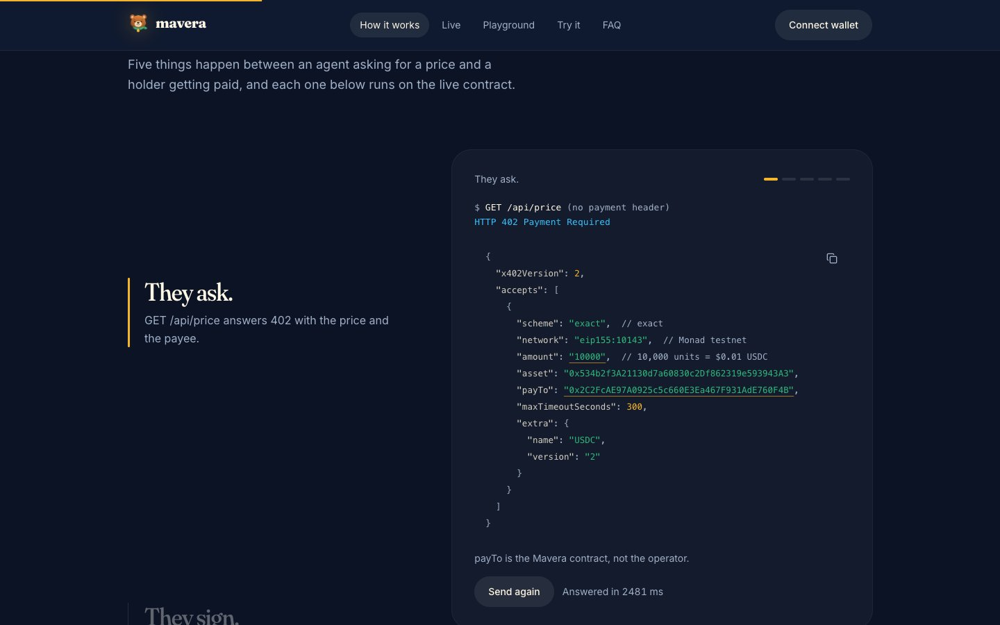
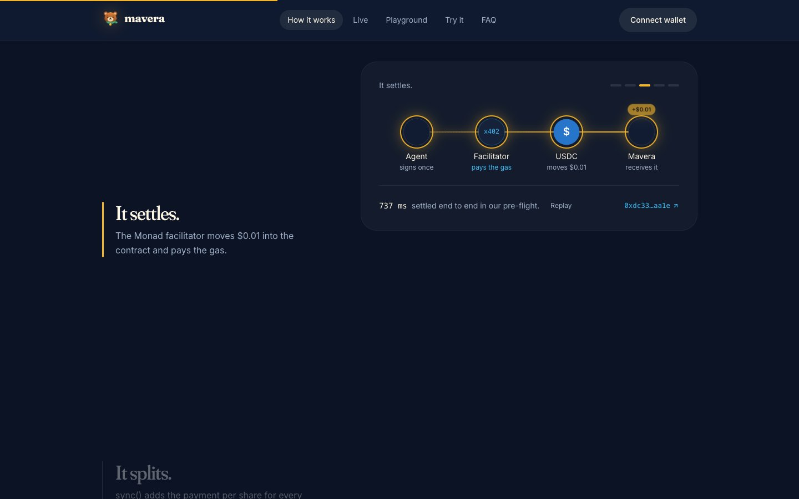
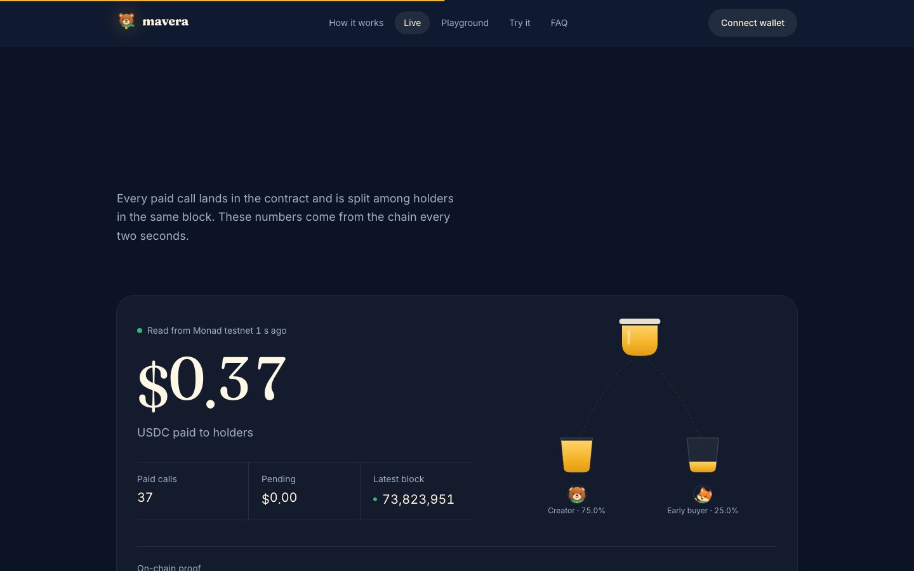
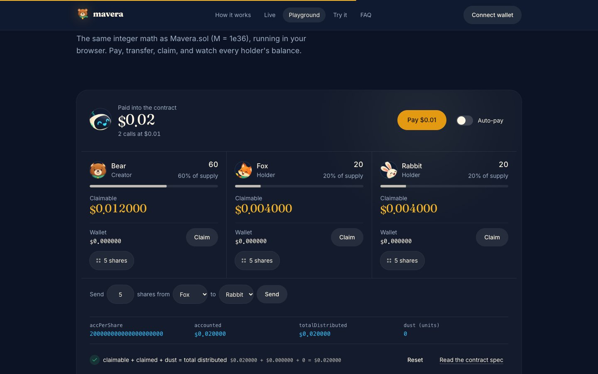
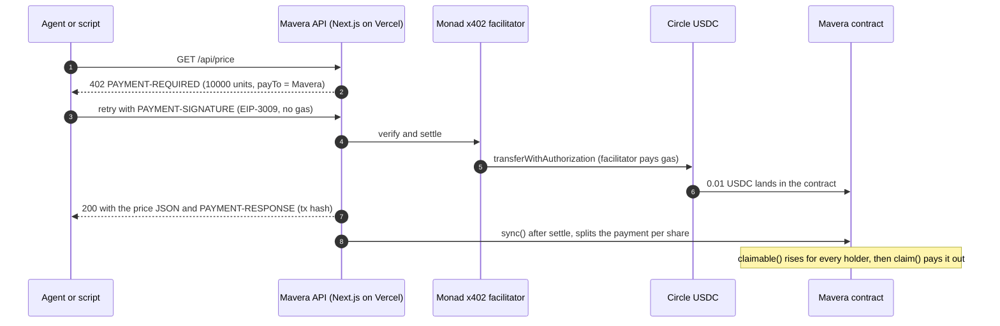
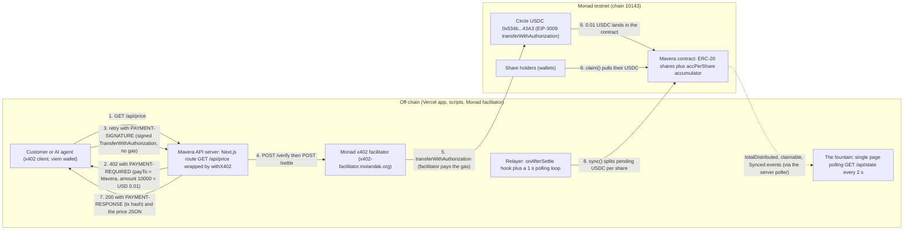

# Mavera

**Mavera turns a paid API into shares; every x402 call pays the holders within one Monad block.** Mavera is one permissionless contract on Monad testnet: a developer sells a slice of an API's future revenue as ERC-20 shares, machine customers (AI agents, scripts) pay USD 0.01 per call through x402 straight into that contract, and every payment is split pro rata among the holders of record, who pull their USDC whenever they like. The operator never holds the money, the cap table is a transferable token, and the whole loop (call, settlement, distribution, claim) is visible on-chain in well under a second. This README is written for two readers: a juror who needs the idea in 60 seconds, and the team on event day who needs exact names and commands.

Monad Blitz Ankara v4 · 24 Oct 2026 · Monad testnet (chain 10143) · event-day build: contract deployed and Sourcify-verified at [`0x2C2FcAE97A0925c5c660E3Ea467F931AdE760F4B`](https://testnet.monadscan.com/address/0x2C2FcAE97A0925c5c660E3Ea467F931AdE760F4B), live app at https://mavera-ruby.vercel.app

<p align="center">
  <a href="https://mavera-ruby.vercel.app"></a>
</p>

<p align="center">
  <a href="https://mavera-ruby.vercel.app"><b>Live app</b></a> ·
  <a href="https://testnet.monadscan.com/address/0x2C2FcAE97A0925c5c660E3Ea467F931AdE760F4B"><b>Contract on Monadscan</b></a> ·
  <a href="https://testnet.monadscan.com/tx/0xdc3384666636bf00ee33e1a683faea03c55ad1b5c07759ae49272d438862aa1e"><b>First x402 settlement</b></a> ·
  <a href="docs/02-CONTRACT-SPEC.md"><b>Contract spec</b></a> ·
  <a href="docs/03-X402-FLOW.md"><b>x402 flow</b></a>
</p>

## In 60 seconds

- **What:** one contract, `Mavera`, is both the ERC-20 cap table of an API and the x402 `payTo` address of that API. `GET /api/price` (MON/USD from two oracles) costs USD 0.01 in USDC per call.
- **Who pays:** machine customers (AI agents, scripts) sign an EIP-3009 USDC authorization; the Monad facilitator settles it on-chain and pays the gas.
- **Who earns:** holders of `mPRICE` shares. `sync()` splits every payment pro rata (within one 300 ms block); each holder pulls with `claim()`. The creator earns from the primary sale `buy()`.
- **What is on-chain:** share balances, revenue custody, the split and the payout. Off-chain: the API data, the facilitator and the dashboard poller.
- **Where to click:** https://mavera-ruby.vercel.app (buy, call the API, watch the fountain, claim) and the [addresses and proofs](#addresses-and-proofs) table with the deploy, settlement, `sync()` and `claim()` transactions.

## Who earns, and why this needs a chain

Most blockchain apps that only use the chain as a payment rail lose to a card form. Mavera uses it for what a card form cannot do: the contract is the **payee, the cap table and the escrow** at once, so the payment and the dividend are one atomic flow.

- **API builders** sell a slice of an endpoint's future revenue as ERC-20 shares and raise money against usage, not promises.
- **Holders** earn from every single call, pro rata, and can sell or transfer the claim like any token; revenue accrued before a transfer stays with the seller.
- **Agents** pay per call with one signature: no account, no API key, no gas.

## Judging map

| Criterion | Where to verify it |
| --- | --- |
| Execution | Live app, 37+ settled x402 calls, `sync()` and `claim()` on-chain ([proofs](#addresses-and-proofs)); 38 Foundry tests incl. 10 invariants; 16 web unit tests including a BigInt mirror of the contract math checked against the spec's worked example |
| On-chain necessity | `payTo` is the contract itself; the split (`accPerShare`), custody and payout live in `Mavera.sol`; the operator never touches the money |
| Monad fit | One distribution costs about USD 0.0004 at a 200,000-gas limit and the 100 MON-gwei floor; blocks are visible in about 300 ms and final in about 600 ms; Monad runs the x402 facilitator |
| Problem and promise | Pay-per-call APIs for agents, with shared upside for the people who fund them |
| Originality | Per-call revenue distribution to ERC-20 holders, paid through x402 straight into the share contract ([prior art](#prior-art-and-honesty)) |
| Presentation | One-page app with the live 402, a scroll-driven explainer on real data, a live fountain and an in-browser contract-math playground |

## The product, on screen

| | |
| --- | --- |
|  |  |
| **They ask.** The real `PAYMENT-REQUIRED` challenge from `GET /api/price`, decoded: amount 10,000 units, `payTo` = the contract. | **It settles.** The facilitator moves $0.01 of USDC into the contract and pays the gas (737 ms end to end in our pre-flight). |
|  |  |
| **Live.** Totals are read from the contract on Monad testnet every two seconds. | **Playground.** An in-browser simulation that runs the exact integer math of `Mavera.sol`: pay, drag shares between holders, claim. |

## One paid call, step by step



## The loop in one picture



One paid HTTP call becomes one USDC transfer into the share contract, one `sync()` that raises every holder's claimable balance, and a counter that climbs on the fountain panel.

## How it works

1. **Buy shares.** `buy(shares)` pulls `cost = ceil(shares x sharePrice / 1e18)` USDC from the buyer to the creator (this is the capital raise) and mints ERC-20 shares up to `maxSupply`. The constructor mints `creatorShares` to the creator, so total supply is never zero and revenue can never be stranded. `buy()` calls `sync()` first, so revenue that arrived before the purchase stays with the earlier holders.
2. **Calls pay.** A customer requests `GET /api/price`. The server answers `402` with a `PAYMENT-REQUIRED` header: scheme `exact`, network `eip155:10143`, asset Circle USDC, amount `10000` atomic units (6 decimals, USD 0.01), `payTo` = the Mavera contract. The client signs an EIP-712 `TransferWithAuthorization` (EIP-3009) and retries with a `PAYMENT-SIGNATURE` header. The Monad facilitator verifies and settles the transfer on-chain and pays the gas; the server returns `200` with the MON/USD payload and a `PAYMENT-RESPONSE` header carrying the settlement transaction hash. Settlement only happens after the handler succeeded. `sync()` is permissionless and idempotent: it takes `pending = usdc.balanceOf(this) - accounted` and adds `pending / totalSupply` to the per-share accumulator; a server hook and a 1-second relayer loop both trigger it.
3. **Holders claim.** `claimable(holder)` already includes pending revenue, so the number on screen is exactly what `claim()` pays. `claim()` transfers USDC to the holder (pull-based, gas-safe at any holder count) and reverts with `NothingToClaim()` when there is nothing. Transfers of shares keep both parties' entitlements correct through signed per-holder corrections (the ERC-1726 pattern): revenue accrued before a transfer stays with the previous holder.

Out of scope for the hackathon (roadmap only): factory or launchpad UI, bonding curve, in-app secondary market, several APIs, governance, ERC-8004 registration, mainnet. See [docs/00-OVERVIEW.md](docs/00-OVERVIEW.md).

## What is on-chain and what is off-chain

| Concern | Where | Why there |
| --- | --- | --- |
| Share ownership and transfers (ERC-20 balances) | On-chain, `Mavera` contract | The cap table must be permissionless, global and transferable |
| Revenue custody (x402 `payTo`) | On-chain, the contract itself is the payee | The operator never touches the money; payment and dividend are one flow |
| Distribution math (`accPerShare`, corrections, `claimed`, `accounted`) | On-chain, `sync()` | Every payment is split among holders of record; anyone can trigger it |
| Payout | On-chain, pull-based `claim()` | No loops over holders; works at any holder count |
| Payment authorization | Off-chain EIP-712 signature by the customer, settled on-chain by the facilitator | Gasless for the customer; the signature binds `to`, `value` and a one-time nonce |
| Payment verification and settlement | Off-chain Monad x402 facilitator, settling on-chain | Standard x402 v2 role; it pays the settlement gas |
| The product sold by the API (MON/USD median of Pyth and Stork via one Multicall3 `eth_call`, plus chain heartbeat fields) | Off-chain server reads on-chain oracles | The chain does not need to serve the data; it needs to hold the money |
| State for the fountain (`GET /api/state`, cached about 1 s) | Off-chain server poller | Browsers must not each hit the public RPC (25 requests/s `eth_call` cap) |
| Route lock (`payTo` must equal `MAVERA_ADDRESS`) | Client-side check before signing, plus trivial on-chain `payTo()` and `endpoint()` views | The chain cannot force a server's `payTo`; the payer refuses to pay anything else |

## Why a blockchain, why not Stripe

- **Holders do not have to trust the developer.** With Stripe the operator receives the money and promises to pay out. With Mavera the x402 `payTo` is the share contract, so payment and dividend are one atomic flow. x402commit states the problem the same way: "The operator can redirect payments to any wallet at any time, so the token trades on hype, not income." (https://x402commit.com/, accessed 2026-10-24)
- **Shares are permissionless, global and transferable.** A plain ERC-20 that anyone can buy at 1-cent granularity and move to any wallet; Stripe Connect splits are custodial, revocable and jurisdiction-gated.
- **Payers can be machines.** Agents pay per call with a signature; they cannot open Stripe accounts. On Monad "any HTTP endpoint can become instantly payable" with no accounts, subscriptions or API keys (https://docs.monad.xyz/tooling-and-infra/agentic-payments, accessed 2026-10-24).

Blockchain here is not the payment rail. It is the cap table and the escrow.

## Why Monad

- **Blocks every 300 ms.** Measured 302 ms average over 10,000 testnet blocks on 2026-10-24. A holder sees a paid call's dividend at `latest` in about 300 ms (Proposed), at `safe` about 300 ms later (Voted) and irreversibly at `finalized` after about 600 ms. On a 12-second chain the fountain would not visibly move during a demo. Sources: https://docs.monad.xyz/introduction/monad-for-developers and https://docs.monad.xyz/reference/json-rpc/overview (accessed 2026-10-24).
- **Sub-cent fees, billed on the gas limit.** The minimum base fee is 100 MON-gwei and Monad charges the gas limit, not the gas used. At that floor a `sync()` with a 200,000-gas limit costs 0.0204 MON, about USD 0.0004, under 5% of a 1-cent call; a 21,000-gas MON transfer costs 0.0021 MON (about USD 0.00005) and a 200,000-gas transaction 0.02 MON (about USD 0.0005). Splitting a 1-cent payment on every call is affordable here and not on Ethereum. Figures are at the minimum base fee; it can rise under load, and all Mavera transactions set explicit gas limits. Source: https://docs.monad.xyz/developer-essentials/gas-pricing (accessed 2026-10-24).
- **A live pay-per-call USDC API economy.** Monad API Hub lists 136 services paid per call with x402 v2 in USDC on mainnet (`eip155:143`): https://app.monad.xyz/agents/api-hub (accessed 2026-10-24). Monad runs a public x402 facilitator for `eip155:10143` and `eip155:143` that pays settlement gas: https://x402-facilitator.molandak.org. Mavera is the capital layer for that supply. The hackathon build runs on testnet (`eip155:10143`) with Circle test USDC, as the Blitz rules require. Sources: https://docs.monad.xyz/guides/x402 (accessed 2026-10-24).

## Addresses and proofs

| Item | Value | Where to check |
| --- | --- | --- |
| Network | Monad testnet, chain id 10143 (`0x279f`), RPC `https://testnet-rpc.monad.xyz` | https://docs.monad.xyz/developer-essentials/testnet (accessed 2026-10-24) |
| `Mavera` contract | `0x2C2FcAE97A0925c5c660E3Ea467F931AdE760F4B` (deployed 24 Oct 2026 12:40 TRT; name `Mavera Shares: MON/USD Price API`, symbol `mPRICE`) | https://testnet.monadscan.com/address/0x2C2FcAE97A0925c5c660E3Ea467F931AdE760F4B |
| Deploy transaction | `0x98f178113ea31a120c990fba9f351fda887340c94ed25260f4bbb045a92f4568` | https://testnet.monadscan.com/tx/0x98f178113ea31a120c990fba9f351fda887340c94ed25260f4bbb045a92f4568 |
| First x402 settlement (facilitator pays gas; 0.01 USDC from the customer wallet to the contract) | `0xdc3384666636bf00ee33e1a683faea03c55ad1b5c07759ae49272d438862aa1e` | https://testnet.monadscan.com/tx/0xdc3384666636bf00ee33e1a683faea03c55ad1b5c07759ae49272d438862aa1e |
| First `sync()` (triggered by the server's `onAfterSettle` hook), `buy()` of 20 shares, `claim()` of 0.309999 USDC | `0x56a47ffbbecd6ab952a862c6ce74b668c3c4d05d07bb859938ae82452e29797d`, `0xa9b024861da98f01b88f41220fb78bf20c5fbb0eb62ed595aa80767b9baeea7f`, `0x0920d8757f2413e2274767ad08c5d86645d72744645de090543d04b0402c16ef` | https://testnet.monadscan.com/tx/0x56a47ffbbecd6ab952a862c6ce74b668c3c4d05d07bb859938ae82452e29797d, https://testnet.monadscan.com/tx/0xa9b024861da98f01b88f41220fb78bf20c5fbb0eb62ed595aa80767b9baeea7f, https://testnet.monadscan.com/tx/0x0920d8757f2413e2274767ad08c5d86645d72744645de090543d04b0402c16ef |
| Source verification, Sourcify / MonadVision (no key) | `exact_match` (creation and runtime), verified 2026-10-24 09:40:09 UTC | https://sourcify-api-monad.blockvision.org/v2/contract/10143/0x2C2FcAE97A0925c5c660E3Ea467F931AdE760F4B and https://testnet.monadvision.com/address/0x2C2FcAE97A0925c5c660E3Ea467F931AdE760F4B |
| Source verification, Monadscan (Etherscan V2 API, free key) | pending (needs `ETHERSCAN_API_KEY`; `./scripts/verify.sh`) | https://testnet.monadscan.com/address/0x2C2FcAE97A0925c5c660E3Ea467F931AdE760F4B#code |
| Live demo (Vercel, Root Directory `web`) | https://mavera-ruby.vercel.app (pnpm 12.15.0 and Next.js 16.4.3 detected on the first build, 24 Oct 2026) | `GET /api/state` returns live chain state; `GET /api/price` answers 402 with `PAYMENT-REQUIRED` |
| x402 facilitator | https://x402-facilitator.molandak.org — x402 v2, schemes `exact`, `upto`, `batch-settlement` on `eip155:10143`; signer `0x7f6a2850669202519f0FE8aa912451238820Db86` pays settlement gas | `GET /supported` (checked live 2026-10-24) |
| USDC (Circle, Monad testnet): the x402 asset and the dividend asset | `0x534b2f3A21130d7a60830c2Df862319e593943A3` (FiatTokenV2_2, 6 decimals, EIP-3009 and EIP-2612, EIP-712 domain name `USDC` version `2`) | https://developers.circle.com/stablecoins/usdc-contract-addresses (accessed 2026-10-24); faucet https://faucet.circle.com (20 USDC per address every 2 h) |
| Price per call | 10,000 USDC atomic units = USD 0.01 (`X402_PRICE_ATOMIC`) | [.env.example](.env.example) |
| Demo parameters (deployed) | `sharePrice` 10,000 units (0.01 USDC per 1e18 shares), `creatorShares` 60e18, `maxSupply` 100e18 (40e18 for sale = 0.4 USDC; 20e18 sold so far) | [docs/02-CONTRACT-SPEC.md](docs/02-CONTRACT-SPEC.md) |
| Token name and symbol | `Mavera Shares: MON/USD Price API` / `mPRICE` (18 decimals) | [docs/02-CONTRACT-SPEC.md](docs/02-CONTRACT-SPEC.md) |

## Quickstart

Prerequisites: Node.js 24 ([.nvmrc](.nvmrc)), pnpm 12.15.0 (pinned in the root `packageManager` field; the corepack shim downloads it), Foundry v1.8.6 (`network = "monad"` needs Foundry 1.8 or later), optionally Slither 0.11.6. Submodules hold OpenZeppelin Contracts v5.7.0 and forge-std v1.17.0.

```sh
git clone --recurse-submodules https://github.com/mericcintosun/mavera.git
cd mavera
pnpm install
cp .env.example .env
pnpm env:link
pnpm dev
```

`pnpm env:link` symlinks the root `.env` into `web/.env.local` and `contracts/.env`. Fill `MAVERA_ADDRESS`, `NEXT_PUBLIC_MAVERA_ADDRESS` and `PAY_TO` (must be equal: the env schema in `web/src/lib/env.ts` enforces the route lock) after deployment.

Contracts (from the repository root, or run the `forge` commands inside `contracts/`):

```sh
pnpm contracts:build
pnpm contracts:test
pnpm contracts:fmt
cd contracts
forge build
forge test -vvv
FOUNDRY_PROFILE=ci forge test
forge fmt --check
slither .
```

Web checks and the demo scripts (one paid call, the `sync()` relayer, the load test; details in [scripts/README.md](scripts/README.md)):

```sh
pnpm lint
pnpm typecheck
pnpm test
pnpm build
pnpm --filter @mavera/scripts relayer
pnpm --filter @mavera/scripts customer
pnpm --filter @mavera/scripts load-test
```

Deploy, verify, faucet and Vercel commands: [docs/07-RUNBOOK.md](docs/07-RUNBOOK.md) and [scripts/faucet-notes.md](scripts/faucet-notes.md).

## Repository layout

```
mavera/
├── README.md  LICENSE (MIT)  .editorconfig  .gitignore  .gitmodules  .nvmrc (24)  .env.example
├── package.json                 workspace root (pnpm@12.15.0): env:link, dev, build, lint, format, typecheck, test, contracts:*
├── pnpm-workspace.yaml          packages web and scripts; allowBuilds esbuild; minimumReleaseAge 180
├── pnpm-lock.yaml
├── .github/workflows/
│   ├── contracts.yml            forge fmt --check, forge build --locked --sizes, forge test -vvv (FOUNDRY_PROFILE=ci); Slither job, non-blocking
│   └── web.yml                  pnpm/setup@v3, Biome lint, typecheck, Vitest, next build
├── contracts/                   Foundry: solc 0.8.37, evm_version osaka, network = "monad", chain_id 10143
│   ├── foundry.toml  foundry.lock  remappings.txt  slither.config.json  README.md
│   ├── lib/forge-std (v1.17.0)  lib/openzeppelin-contracts (v5.7.0)      git submodules
│   ├── src/Mavera.sol           ERC-20 shares + accPerShare accounting: buy, sync, claim, claimable, pending, payTo, endpoint
│   ├── test/Mavera.t.sol  test/MockUSDC.sol  test/invariant/ (MaveraHandler.sol, MaveraInvariant.t.sol)   38 tests
│   └── script/Deploy.s.sol
├── web/                         @mavera/web: Next.js 16.4.3, React 19.3.1, wagmi 3.7.9, viem 2.57.10, @x402/* 2.28.0, Tailwind 4.3.3
│   ├── package.json  next.config.ts  biome.json  tsconfig.json  vitest.config.mts  AGENTS.md  README.md
│   └── src/app/ (layout.tsx, page.tsx, providers.tsx, globals.css, api/price/route.ts, api/state/route.ts)  src/lib/ (env, oracle, state, relayer, lock, abi/)  src/components/ (Fountain, BuyCard, CallApiCard, ClaimCard, ...)
├── scripts/                     @mavera/scripts (tsx): deploy.sh, verify.sh, customer.ts, load-test.ts, relayer.ts, lib.ts, abi.ts (generated), faucet-notes.md
└── docs/                        README.md index, 00-OVERVIEW ... 12-SUBMISSION-CHECKLIST, adr/ADR-0001 ... ADR-0005, img/
```

## Tests and quality

Measured on 24 Oct 2026 against the live deployment: 31 of 31 x402-paid calls settled (1 single call + a 30-call sequential load test), latency p50 929 ms / p95 1,611 ms per paid call end to end (402, signature, facilitator verify + settle on Monad, response), 0.31 USDC distributed on-chain by `sync()` and 0.309999 USDC claimed by the creator in one `claim()`.

[](https://github.com/mericcintosun/mavera/actions/workflows/contracts.yml)
[](https://github.com/mericcintosun/mavera/actions/workflows/web.yml)

The repository is `mericcintosun/mavera`. `forge test` (Foundry 1.8.6, `network = "monad"`) passes on 24 Oct 2026 (38 passed, 0 failed): 37 unit and fuzz tests in `contracts/test/Mavera.t.sol` plus the handler-based invariant suite in `contracts/test/invariant/` (10 `invariant_*` functions). What [docs/05-TEST-PLAN.md](docs/05-TEST-PLAN.md) specifies:

| Layer | What it checks | Settings |
| --- | --- | --- |
| Unit (Foundry) | constructor mints `creatorShares`; `buy` pulls the exact cost to the creator and mints; `sync` is pro rata and idempotent (early return when `pending == 0`); `claim` pays exactly `claimable` and reverts `NothingToClaim()` on zero; revenue before a `buy` is not shared with the new buyer; a transfer preserves both parties' `claimable` | `forge test -vvv` |
| Fuzz (Foundry) | random bounded sequences of revenue, `buy`, `transfer`, `claim` | 512 runs locally, 2,048 runs in CI; `fail_on_revert = true` so inputs are bounded |
| Invariant (handler-based) | (1) `usdc.balanceOf(Mavera) >= sum of claimable(h)`; (2) `totalDistributed == sum of claimed + sum of claimable + dust` with `dust <= number of holders` | 128 runs x depth 64 locally, 256 x 128 in CI |
| Static analysis | Slither 0.11.6 via `crytic/slither-action@v0.4.2`, SARIF uploaded to code scanning | non-blocking job in `contracts.yml` |
| Web | Biome 2.6.2, `next typegen && tsc --noEmit`, Vitest 5.0.5 for helpers, `next build` | `web.yml` |
| Verification | Sourcify (MonadVision) without a key; Monadscan through the Etherscan V2 API with a free key | links in the table above |

## Built at the event — prior-work disclosure

Blitz gate `built_at_event`: "The repo shows the work happened during the event. Prior work must be disclosed." (platform rubric, https://blitz.devnads.com/api/events/monad-blitz-ankara-v4/judging, accessed 2026-10-24).

Before any product code, in the commit range `fec7bfa..pre-event` (git tag `pre-event`; configuration committed during the night of 23–24 Oct 2026, the documentation set written overnight and committed at 11:29 on 24 Oct, before the first product commit), the repository contained only:

- Configuration: `package.json`, `pnpm-workspace.yaml`, `pnpm-lock.yaml`, `.nvmrc`, `.editorconfig`, `.gitignore`, `.gitmodules`, `.env.example`; `contracts/foundry.toml`, `foundry.lock`, `remappings.txt`, `slither.config.json`; `web/next.config.ts`, `biome.json`, `tsconfig.json`, `vitest.config.mts`; `scripts/package.json`, `tsconfig.json`.
- CI: `.github/workflows/contracts.yml` and `web.yml`.
- Documentation: this README, `docs/` (overview, architecture, contract spec, x402 flow, frontend, test plan, threat model, runbook, pitch, landscape, Monad notes, toolchain, submission checklist, five ADRs) and the per-directory READMEs.
- Empty source directories with README placeholders: `contracts/src`, `contracts/test`, `contracts/script`, `web/src/app/api`, `web/src/components`.
- Skeleton files generated by `create-next-app 16.4.3 --empty`: `web/src/app/layout.tsx`, `page.tsx` (static placeholder), `globals.css`; plus `web/src/lib/env.ts`, a zod schema of the environment variables (configuration, no product logic).
- TODO-only stubs: `scripts/deploy.sh`, `verify.sh`, `customer.ts`, `load-test.ts` (header comment and TODO; the shell stubs exit 1, the TypeScript stubs export nothing).
- Third-party libraries as git submodules: OpenZeppelin Contracts v5.7.0 and forge-std v1.17.0 (standard libraries, allowed as boilerplate).

Not in the repository before the event: `Mavera.sol` or any Solidity logic, any Next.js route or page logic, React components, deployment scripts, tests, the project image, the video. All product code was written inside the platform's "Hacking window 10:45–16:30" on 24 Oct 2026; the first product commit is `fa2324a` at 12:15, deployment at 12:40. No code is reused from earlier projects by the team. The accounting pattern is public prior art (next section) and is implemented fresh during the event.

## Prior art and honesty

The share accounting is the ERC-1726 dividend-token pattern (Wu and Lam, 2019; successor draft ERC-2222 Funds Distribution Token by Pfeffer et al., 2019), the same accumulator Terra used for rental income at Monad Blitz Mumbai V3 (20 Jun 2026). x402commit (Base, pilot stage, no public code) and Bondrail (Monad testnet, Metropolis entry, open source) tokenize x402 revenue with a company, a vault or a bond in the loop; Mavera is the single permissionless contract version, distributing every call's payment to holders within one block.

Of 1,759 approved Blitz projects from 59 events (plus 5 test events) scanned on 2026-10-24, none combines an x402-paid API, transferable ERC-20 shares and automatic per-call distribution to holders. We do not claim to be first, and our route lock is the cheapest version of an idea x402commit and Bondrail enforce more heavily (ERC-8004 identity and timelock; a Chainlink CRE watcher). Details and the full table: [docs/09-COMPETITIVE-LANDSCAPE.md](docs/09-COMPETITIVE-LANDSCAPE.md).

Sources (accessed 2026-10-24): ERC-1726 https://github.com/ethereum/EIPs/issues/1726 and reference implementation https://github.com/Roger-Wu/erc1726-dividend-paying-token; ERC-2222 https://github.com/ethereum/EIPs/issues/2222; Terra https://github.com/JustinaMary/tokenized-real-estate; x402commit https://x402commit.com/; Bondrail https://github.com/calledAdo/bondrail; Blitz corpus https://blitz.devnads.com/api/showcase.

## Limitations

- **Rounding dust.** Integer division leaves dust in the contract, bounded by `dust <= number of holders` (USDC atomic units, 1 unit = 0.000001 USDC). Derivation in [docs/02-CONTRACT-SPEC.md](docs/02-CONTRACT-SPEC.md).
- **Fixed price, fixed supply.** No bonding curve, no price discovery in the primary sale ([docs/adr/ADR-0003-fixed-price-vs-bonding-curve.md](docs/adr/ADR-0003-fixed-price-vs-bonding-curve.md)).
- **No secondary market in the app.** Shares are a plain ERC-20; transfers keep dividends correct, but trading happens elsewhere.
- **USDC is trusted.** No fee-on-transfer is assumed, and Circle controls the token: pause and blacklist roles exist on the testnet contract, and a blacklisted `payTo` surfaces as a facilitator `unexpected_error` ([docs/adr/ADR-0005-usdc-choice.md](docs/adr/ADR-0005-usdc-choice.md)).
- **Facilitator dependency.** The x402 path depends on https://x402-facilitator.molandak.org, even to emit a 402 (the SDK fetches `/supported` on start). Fallbacks without a facilitator, same contract and same UI: EIP-3009 `receiveWithAuthorization` (customer stays gasless) first, EIP-2612 `permit` plus `pay()` second ([docs/03-X402-FLOW.md](docs/03-X402-FLOW.md)).
- **Route lock is client-side.** The chain cannot force a server's `payTo`; the Mavera client refuses to sign unless `payTo == MAVERA_ADDRESS`, asset is USDC, network is `eip155:10143` and scheme is `exact`. A redirect by the operator equals shutting the API down and is visible on-chain when `Synced` events stop ([docs/06-THREAT-MODEL.md](docs/06-THREAT-MODEL.md)).
- **Attribution.** Default: `sync()` runs inside `_update`, so each payment goes to the holders of record at that instant, at roughly 40,000 extra gas per transfer (about USD 0.0001). This is what `Mavera.sol` ships.
- **Testnet only.** Chain 10143 and Circle test USDC; nothing is deployed on mainnet.

Testnet proof of concept with test USDC. Not an offer of securities. A production deployment would require a KYC allow-list and a licensed issuance wrapper in the relevant jurisdiction.

## Documentation

Index: [docs/README.md](docs/README.md). In reading order: [00 Overview](docs/00-OVERVIEW.md), [01 Architecture](docs/01-ARCHITECTURE.md), [02 Contract spec](docs/02-CONTRACT-SPEC.md), [03 x402 flow](docs/03-X402-FLOW.md), [04 Frontend](docs/04-FRONTEND.md), [05 Test plan](docs/05-TEST-PLAN.md), [06 Threat model](docs/06-THREAT-MODEL.md), [07 Runbook](docs/07-RUNBOOK.md), [08 Demo and pitch](docs/08-DEMO-AND-PITCH.md), [09 Competitive landscape](docs/09-COMPETITIVE-LANDSCAPE.md), [10 Monad notes](docs/10-MONAD-NOTES.md), [11 Toolchain](docs/11-TOOLCHAIN.md), [12 Submission checklist](docs/12-SUBMISSION-CHECKLIST.md). Decisions: [ADR index](docs/adr/README.md), [ADR-0001 single contract vs factory](docs/adr/ADR-0001-single-contract-vs-factory.md), [ADR-0002 pull vs push dividends](docs/adr/ADR-0002-pull-vs-push-dividends.md), [ADR-0003 fixed price vs bonding curve](docs/adr/ADR-0003-fixed-price-vs-bonding-curve.md), [ADR-0004 x402 exact vs upto](docs/adr/ADR-0004-x402-exact-vs-upto.md), [ADR-0005 USDC choice](docs/adr/ADR-0005-usdc-choice.md). Sub-projects: [contracts/README.md](contracts/README.md), [web/README.md](web/README.md), [scripts/README.md](scripts/README.md).

## License

MIT, see [LICENSE](LICENSE) (copyright 2026 Mavera contributors).

## Open questions

- Monadscan source verification is still pending (Sourcify/MonadVision shows `exact_match`); run `./scripts/verify.sh` with a free `ETHERSCAN_API_KEY` before 16:00.
- The facilitator advertises `batch-settlement`; the 30-call load test produced 30 distinct settlement hashes, so the relayer's one-settlement-one-transaction assumption held, but it is not guaranteed by the facilitator's contract.
- `DATA_MODE=oracle` (Pyth and Stork MON/USD median) is the deployed mode; `DATA_MODE=heartbeat` stays as the fallback if an oracle stops updating during the demo.
- Resolved on event day: repository slug `mericcintosun/mavera`; git tag `pre-event` (`6890bbe`) marks the last commit without product code; the addresses table above is filled; token `Mavera Shares: MON/USD Price API` / `mPRICE` with the spec default parameters; attribution via `sync()` inside `_update`.
