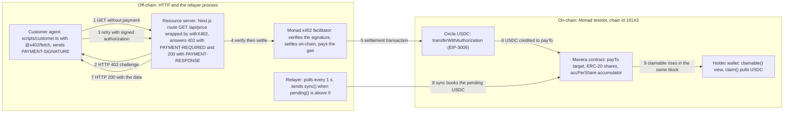
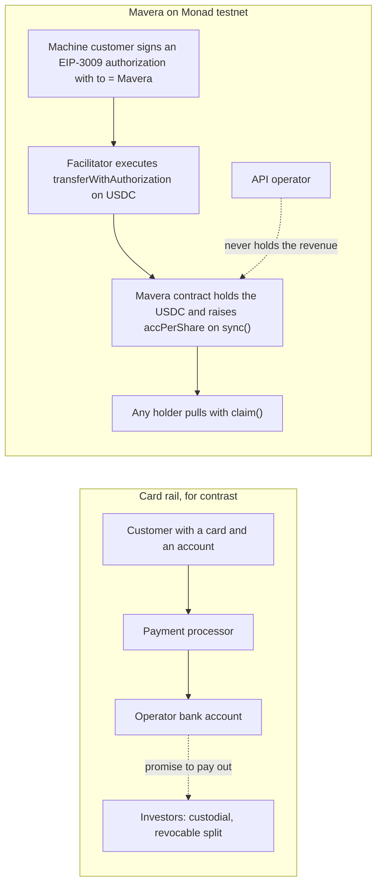

# Mavera — Overview

Mavera is a hackathon project for Monad Blitz Ankara v4 (Saturday 24 October 2026; hacking window 10:45–16:30, submission closes 16:30 Europe/Istanbul). It is one Solidity contract and one paid HTTP endpoint. The contract, `Mavera`, issues ERC-20 shares of a pay-per-call API and is the `payTo` address of every x402 payment that API receives; `sync()` books each payment pro rata to the holders of record and `claim()` lets any holder pull their USDC. This document is the entry point for two readers: the jury (what problem is solved, why a chain and why Monad, what is honestly new) and the team on event day (exact names, scope, success criteria). Everything in the repository before 10:45 on 24 October is configuration, CI and documentation; all product code is written during event hours. Testnet proof of concept with test USDC. Not an offer of securities. A production deployment would require a KYC allow-list and a licensed issuance wrapper in the relevant jurisdiction.

## 1. The problem: three failures

Pay-per-call revenue is real and already settles on Monad: the Monad API Hub lists 136 services that agents pay per call in USDC with x402 v2 on mainnet (`eip155:143`), at prices from $0.000036 to $60.00 per call (https://app.monad.xyz/agents/api-hub, accessed 2026-10-24). Three things are still impossible with that revenue.

| # | Failure | Who is hurt | What it looks like today |
| --- | --- | --- | --- |
| 1 | Developers and agents cannot raise against pay-per-call revenue | An API operator or agent with real usage | Revenue arrives one cent at a time; the only ways to fund growth are a VC round or a company that takes custody of the stream |
| 2 | Investors cannot buy cash flow at 1-cent granularity | A small investor | Revenue-share deals are bespoke, custodial, revocable and jurisdiction-gated; nobody can buy a slice of a $0.01-per-call API and receive the money as it arrives |
| 3 | "Agent tokens" whose revenue is not bound to the token | Token holders | The operator receives payments in their own wallet and can move them. x402commit states the problem on its own site: "The operator can redirect payments to any wallet at any time, so the token trades on hype, not income." (https://x402commit.com/, accessed 2026-10-24) |

Mavera's answer is structural, not contractual: the payment destination (`payTo`) is the share contract itself, so holders own the cash flow by construction, and every settled call is booked to holders within one block.

## 2. The one sentence

Three variants, each 20 words or fewer. Pick one and use it everywhere (platform description, README, pitch):

1. "Mavera turns a paid API into shares; every x402 call pays the holders within one Monad block."
2. "Sell your API's future revenue as on-chain shares; each 1-cent call is split to holders instantly on Monad."
3. "A cash-flow token for machine customers: agents pay per call, holders get the money within 600 ms."

Long form (also the root `package.json` description): "A paid API sells its future revenue as on-chain shares; every x402 call's payment is distributed to share holders within one Monad block."

The bear frame, for the organizer's test ("If a bear in a children's book can't draw your job in one frame, it isn't real."): **a bear sells honey; every time a jar sells, coins drip into his friends' cups.**

Headline claim stated precisely, because the `honest_pitch` gate checks it: every settled x402 payment for `GET /api/price` is transferred by the facilitator straight to the `Mavera` contract; `claimable()` is pending-inclusive, so every holder's claimable rises in the same block in which the settlement is included; the relayer calls `sync()` within about 1 s to book it, and holders pull with `claim()`. Nothing is pushed to wallets, and nothing is promised about yield or price.

### 2.1 The sentence as a picture

One paid call: the customer pays no gas, the operator never holds the money, and the holder's claimable moves in the block in which the settlement lands.

## 3. Who uses it and what each does in the demo

| User | In the demo | What they do | What they get |
| --- | --- | --- | --- |
| API developer or agent operator | The team's deployer keystore `DEPLOYER_ACCOUNT=mavera-deployer` | Deploys `Mavera` from the terminal (`scripts/deploy.sh`, wrapping `forge create ... --broadcast --account mavera-deployer`), sets `PAY_TO=MAVERA_ADDRESS`, runs the x402 route | Primary-sale USDC from `buy()` goes directly to the creator; the creator keeps `creatorShares` (default 60e18, TBD on event day) and earns alongside holders |
| Small investor-holder | A browser wallet (MetaMask via the wagmi injected connector) holding testnet USDC | Connects, buys shares at the fixed `sharePrice` (default 10,000 USDC atomic units per whole share = 0.01 USDC, TBD), watches the fountain, calls `claim()` | USDC in the wallet, plus a transferable ERC-20 claim on all future calls |
| Machine customer | `scripts/customer.ts` and `scripts/load-test.ts` with `CUSTOMER_PRIVATE_KEY`, funded with 20 USDC from https://faucet.circle.com (20 USDC per address every 2 hours; accessed 2026-10-24) | Calls `GET /api/price`, receives HTTP 402 with `PAYMENT-REQUIRED`, signs an EIP-3009 authorization for 10,000 USDC atomic units ($0.01) to `MAVERA_ADDRESS`, retries with `PAYMENT-SIGNATURE`, receives the data and `PAYMENT-RESPONSE` | MON/USD data for $0.01 per call, with no account, subscription or API key |
| Audience (20% of the score) | Phones in the room | Optional: one QR code fires one paid call each, only if the x402 path is stable by 15:00; otherwise the load script plays this role | Their call appears in the fountain within a second |

## 4. Why a blockchain, and why not Stripe

The organizer's warning from the 23 October workshop is explicit: "If your app uses the blockchain only as a payment rail, it will probably fail; a credit card replaces it." Mavera does not use the chain as the rail. It uses it as the cap table and the escrow. Four reasons, each visible in the demo:

1. **Trust-minimised destination.** The x402 `payTo` is the `Mavera` contract, not the operator's account. The operator never holds the revenue, so there is no payout promise to trust. With Stripe the operator receives the money and promises to pay out.
2. **Permissionless, transferable claims.** A share is a plain ERC-20 that anyone in the world can buy at 1-cent granularity and transfer; the accounting keeps every holder's entitlement correct across transfers. Stripe Connect splits are custodial, revocable and gated by jurisdiction.
3. **Machine customers.** The payers are agents and scripts. With x402, "Rather than requiring accounts, subscriptions, or API keys, any HTTP endpoint can become instantly payable using onchain payment authorization." (https://docs.monad.xyz/tooling-and-infra/agentic-payments.md, accessed 2026-10-24). Agents cannot open Stripe accounts.
4. **Payment and dividend are one flow.** The facilitator's settlement transaction moves USDC into the contract; in that same block every holder's `claimable()` already reflects it. There is no second system, batch job or bank file between revenue and distribution.

### 4.1 What is on-chain and what is off-chain

| On-chain (Monad testnet, chain id 10143) | Off-chain (HTTP, on Vercel or a laptop) |
| --- | --- |
| `Mavera` contract: ERC-20 shares, `buy()`, `sync()`, `claim()`, `claimable()`, `pending()`, `payTo()` and `endpoint()` views; events `Synced`, `Bought`, `Claimed` | The API itself: Next.js route `GET /api/price` (working name) wrapped by `withX402` from `@x402/next` 2.28.0, running on the Node runtime |
| Circle USDC `0x534b2f3A21130d7a60830c2Df862319e593943A3`: `transferWithAuthorization` executed by the facilitator (EIP-3009) | The facilitator https://x402-facilitator.molandak.org (run by Monad): verifies the signature, settles on-chain, pays the gas |
| Settlement, share purchases, claims and transfers: ordinary transactions with explorer links | The relayer: polls every 1 s, sends `sync()` when `pending()` is above 0, pays only MON gas |
| Oracle contracts read for the data product (Pyth and Stork, one Multicall3 `eth_call`) | The server-side state poller `GET /api/state` (cached about 1 s) that feeds every browser, and the single page `/` |

The honest caveat, said out loud: the chain cannot force a server's `payTo`. The route lock is the customer's refusal to sign anything whose `payTo` is not `MAVERA_ADDRESS`, backed by the contract's `payTo()` view and the server's `PAY_TO == MAVERA_ADDRESS` check in `web/src/lib/env.ts`. A redirect by the operator is therefore equivalent to switching the API off: honest clients stop paying and the `Synced` events stop within a block. Attacks and mitigations: [docs/06-THREAT-MODEL.md](06-THREAT-MODEL.md).

In the card model the investors trust the operator's payout; in Mavera the payer's signature binds the destination to the contract and the holders pull their own share.

## 5. Why Monad specifically

Only verified numbers; every docs page below was accessed 2026-10-24.

| Fact | Value | Why it matters for Mavera | Source |
| --- | --- | --- | --- |
| Block time | 300 ms nominal; 302 ms measured by the team over 10,000 testnet blocks (2026-10-24) | A paid call and its dividend are visible before a human can react | https://docs.monad.xyz/introduction/monad-for-developers |
| Visibility and finality | Visible in ~300 ms (`latest`, Proposed), safe at +300 ms (`safe`, Voted), final at ~600 ms (`finalized`, Finalized). Never say "300 ms finality" | The fountain shows "paid" at Proposed and "final" at Finalized | https://docs.monad.xyz/monad-arch/consensus/block-states |
| Fees | Minimum base fee 100 MON-gwei; the sender is charged for the gas limit, not the gas used. 21,000-gas transfer ≈ 0.0021 MON ≈ $0.00005; 200,000-gas transaction ≈ 0.02 MON ≈ $0.0005, both at the minimum base fee | One `sync()` at a 150,000-gas limit costs ≈ 0.015 MON ≈ $0.0003 at the minimum base fee: under 4% of a $0.01 call. Distributing one cent pro rata is economically impossible at Ethereum fees | https://docs.monad.xyz/developer-essentials/gas-pricing |
| Contrast | Monad's own comparison table: Ethereum 12 s blocks and 12–18 min finality, ~10 TPS vs a ~10,000 TPS target | On a 12-second chain the fountain would not move during a 90-second demo | https://docs.monad.xyz/introduction/monad-for-developers |
| Machine payments exist today | Hosted x402 facilitator for `eip155:10143` and `eip155:143`, x402 v2, schemes `exact`, `upto` and `batch-settlement`; the facilitator pays settlement gas | Nothing to run; the customer pays no gas at all | https://x402-facilitator.molandak.org/supported |
| Dollar asset | Circle USDC on Monad testnet with EIP-3009 and EIP-2612, 6 decimals; faucet gives 20 USDC per address every 2 hours | Real stablecoin settlement, not a mock token | https://developers.circle.com/stablecoins/usdc-contract-addresses and https://faucet.circle.com/ |
| Supply side | Monad API Hub: 136 pay-per-call services, x402 v2, USDC, mainnet `eip155:143` | Mavera is the capital layer for that supply; the hackathon build runs on testnet, so the Hub is the roadmap market, not the demo | https://app.monad.xyz/agents/api-hub |
| Toolchain fit | Foundry v1.8.6 with `network = "monad"` (hardfork MonadTen) applies Monad gas rules, MIP-8 storage pages and precompiles in tests | Gas limits for `sync()`, `claim()` and `buy()` are measured, not guessed, and set explicitly because the limit is what is billed | https://docs.monad.xyz/tooling-and-infra/toolkits/foundry |

Two Monad-specific operating facts shape the runbook. Every EOA has a 10 MON reserve-balance budget that consensus checks against a 3-block-lagged state, so the relayer is funded with more than 10 MON before the demo, and a freshly funded wallet can send only once its funding transaction is 3 blocks old (https://docs.monad.xyz/developer-essentials/reserve-balance, accessed 2026-10-24). Public RPCs cap `eth_getLogs` at a 100-block window and `eth_call` at 25 requests per second on https://testnet-rpc.monad.xyz, which is why browsers poll `GET /api/state` instead of the chain (https://docs.monad.xyz/developer-essentials/testnet, accessed 2026-10-24). Details: [docs/10-MONAD-NOTES.md](10-MONAD-NOTES.md).

## 6. The jury rubric and what Mavera shows for each line

Source: `GET https://blitz.devnads.com/api/events/monad-blitz-ankara-v4/judging` (accessed 2026-10-24; `enabled: true`, `published: false`; `judgeWeight` 80 / `voteWeight` 20). Gates are pass/fail; a project that fails a gate is not ranked. Labels and descriptions are quoted verbatim.

| Line | Verbatim description | What Mavera shows | Where |
| --- | --- | --- | --- |
| Gate `built_at_event` ("Built at the event") | "The repo shows the work happened during the event. Prior work must be disclosed." | README section "Built at the event — prior work disclosure": the pre-event scaffold (configuration, docs, CI, stubs; commits `fec7bfa..<LAST_PRE_EVENT_COMMIT>`) and the statement that product code starts at 10:45. No project image or video is created before event hours | [README.md](../README.md), [docs/12-SUBMISSION-CHECKLIST.md](12-SUBMISSION-CHECKLIST.md) |
| Gate `deployed` ("Deployed on Monad") | "A contract address is provided and has code on Monad testnet." | `<MAVERA_ADDRESS>` on chain 10143 with code, verified on Monadscan (Etherscan V2 API) and MonadVision (Sourcify); explorer links in the README and on the page | [docs/07-RUNBOOK.md](07-RUNBOOK.md) |
| Gate `honest_pitch` ("Honest pitch") | "The headline claim in the description and demo is actually implemented." | The headline is the precise statement in section 2; the demo shows a paid call, its settlement transaction on https://testnet.monadscan.com, the `Synced` event and the claimable increase. No APY, no price chart | [docs/08-DEMO-AND-PITCH.md](08-DEMO-AND-PITCH.md) |
| Execution (30) | "How much of it actually works." | Live, end to end, no slides: buy, paid call, fountain climbs, claim, USDC in the wallet; about 50 real paid calls from the load script. Repo bar set by the Istanbul v2 winner Kaskad (43 Foundry tests in CI, 3 invariants, 1 fuzz test, 15 Vitest `it()` blocks, CI): target at least 40 unit tests, 2 invariants with a handler, CI green, Slither output committed | [docs/05-TEST-PLAN.md](05-TEST-PLAN.md) |
| On-chain necessity / Monad fit (25) | "Whether the product needs the chain, and Monad specifically." | Section 4 (the chain is the cap table and the escrow; the payer is a machine; payment and dividend are one flow) and section 5 (sub-cent per-call distribution, 300 ms visibility) | [docs/01-ARCHITECTURE.md](01-ARCHITECTURE.md), [docs/10-MONAD-NOTES.md](10-MONAD-NOTES.md) |
| Problem & promise (20) | "Who it is for and whether it can live past the hackathon." | Supply side exists today (API Hub, 136 services; 92 of 1,759 approved Blitz projects mention x402); demand side is 1-cent-granular cash-flow investing; roadmap in section 7 | [docs/09-COMPETITIVE-LANDSCAPE.md](09-COMPETITIVE-LANDSCAPE.md) |
| Originality (15) | "How new the idea is." | Honest prior-art line, never "first": the accounting is ERC-1726 (Wu and Lam, 2019) and its successor draft ERC-2222 (Pfeffer et al., 2019); Terra used the same accumulator for rent at Monad Blitz Mumbai V3 (20 June 2026); x402commit (Base, pilot stage, no public code) and Bondrail (Monad testnet, Metropolis entry, results 3 November 2026) put a company, a vault or a bond in the loop. Of 1,759 approved projects from 59 Blitz events (plus 5 test events), none combines an x402-paid API, transferable ERC-20 shares and automatic per-call distribution | [docs/09-COMPETITIVE-LANDSCAPE.md](09-COMPETITIVE-LANDSCAPE.md) |
| Presentation (10) | "How clearly it was shown." | One sentence, the bear, then the live flow; a 90-second and a 3-minute version rehearsed; optional QR for the audience vote | [docs/08-DEMO-AND-PITCH.md](08-DEMO-AND-PITCH.md) |

Sources for the prior-art line (all accessed 2026-10-24): https://github.com/ethereum/EIPs/issues/1726, https://github.com/ethereum/EIPs/issues/2222, https://github.com/JustinaMary/tokenized-real-estate, https://x402commit.com/, https://github.com/calledAdo/bondrail, https://blitz.devnads.com/api/showcase.

## 7. Scope

### 7.1 In scope: the only five things we build

| # | Deliverable | Exact names | Specified in |
| --- | --- | --- | --- |
| 1 | One contract | `contracts/src/Mavera.sol`, contract `Mavera`: fixed-price `buy(shares)`, permissionless idempotent `sync()`, pull-based `claim()`, dividend-correct transfers, `claimable()`, `pending()`, `payTo()`, `endpoint()` views; events `Synced`, `Bought`, `Claimed`. Token name and symbol TBD on event day (suggested "Mavera Shares: <API name>" / "mAPI") | [docs/02-CONTRACT-SPEC.md](02-CONTRACT-SPEC.md), [docs/adr/ADR-0001-single-contract-vs-factory.md](adr/ADR-0001-single-contract-vs-factory.md), [docs/adr/ADR-0002-pull-vs-push-dividends.md](adr/ADR-0002-pull-vs-push-dividends.md), [docs/adr/ADR-0003-fixed-price-vs-bonding-curve.md](adr/ADR-0003-fixed-price-vs-bonding-curve.md) |
| 2 | One x402-protected endpoint serving real data | `GET /api/price` (working name, TBD): MON/USD as the median of two independent testnet oracles (Pyth Core Compatible and Stork) read in one Multicall3 `eth_call`, plus chain-heartbeat fields; `DATA_MODE=heartbeat` drops the oracle reads. Scheme `exact`, network `eip155:10143`, asset USDC, price `X402_PRICE_ATOMIC=10000` ($0.01), `payTo` = `MAVERA_ADDRESS` | [docs/03-X402-FLOW.md](03-X402-FLOW.md), [docs/adr/ADR-0004-x402-exact-vs-upto.md](adr/ADR-0004-x402-exact-vs-upto.md), [docs/adr/ADR-0005-usdc-choice.md](adr/ADR-0005-usdc-choice.md) |
| 3 | One web page | Route `/`: token header, the fountain (total distributed, calls, last call age, your claimable), Buy, Claim, Call API, explorer links; reads come from `GET /api/state` every 2 s, writes go through the user's wallet (wagmi 3.7.9, viem 2.57.10) | [docs/04-FRONTEND.md](04-FRONTEND.md) |
| 4 | A relayer loop | 1-second poller with `RELAYER_PRIVATE_KEY` that sends `sync()` whenever `pending()` is above 0; the route's `onAfterSettle` hook may trigger an extra `sync()` as an accelerator; double triggers are harmless | [docs/01-ARCHITECTURE.md](01-ARCHITECTURE.md), [docs/03-X402-FLOW.md](03-X402-FLOW.md) |
| 5 | A load script | `scripts/load-test.ts`: about 50 real paid calls in a row from the customer wallet; `scripts/customer.ts`: one call | [docs/07-RUNBOOK.md](07-RUNBOOK.md), [scripts/README.md](../scripts/README.md) |

### 7.2 Out of scope: the roadmap we mention and do not build

| Item | Why it is out | Where the decision lives |
| --- | --- | --- |
| Factory or launchpad UI | A deploy script is enough; "launch in 10 seconds" is shown from the terminal | [docs/adr/ADR-0001-single-contract-vs-factory.md](adr/ADR-0001-single-contract-vs-factory.md) |
| Bonding curve | Fixed price and fixed supply keep the sale explainable in one sentence | [docs/adr/ADR-0003-fixed-price-vs-bonding-curve.md](adr/ADR-0003-fixed-price-vs-bonding-curve.md) |
| Secondary market in the app; multiple APIs per contract; agent directory; governance | Shares are a plain ERC-20 that any venue can list later; one API is enough to prove the mechanism | — |
| Metered `upto` scheme | `exact` at a fixed $0.01 is enough for the demo; `upto` needs Permit2 | [docs/adr/ADR-0004-x402-exact-vs-upto.md](adr/ADR-0004-x402-exact-vs-upto.md) |
| ERC-8004 registration, diversion watcher, timelock on route changes | Hardening of the route lock for mainnet (x402commit uses a 48-hour timelock; Bondrail checks endpoints every 30 minutes) | [docs/06-THREAT-MODEL.md](06-THREAT-MODEL.md), [docs/09-COMPETITIVE-LANDSCAPE.md](09-COMPETITIVE-LANDSCAPE.md) |
| KYC allow-list and licensed issuance wrapper | A mainnet and jurisdiction question, stated in the disclaimer | [docs/06-THREAT-MODEL.md](06-THREAT-MODEL.md) |
| Mainnet (`eip155:143`, USDC `0x754704Bc059F8C67012fEd69BC8A327a5aafb603`) | Blitz requires testnet; mainnet gives no advantage | [docs/10-MONAD-NOTES.md](10-MONAD-NOTES.md) |
| Passkey onboarding (`@category-labs/mera` 0.3.0); Ultrafuzz | Nice to have; Ultrafuzz is cited as Monad-native tooling and not run during the event | [docs/11-TOOLCHAIN.md](11-TOOLCHAIN.md) |

## 8. Demo success criteria: what must be true at 16:00

Submission closes at 16:30 and needs admin approval, so the team submits by 16:00. Each row is true at that time, or its fallback is in place.

| # | Must be true at 16:00 | Evidence | Fallback |
| --- | --- | --- | --- |
| 1 | `Mavera` is deployed at `<MAVERA_ADDRESS>` on chain 10143 and has code | Address on Monadscan and MonadVision with Exact Match verification on both | Sourcify (no key) alone if the Etherscan V2 key fails |
| 2 | `GET /api/price` returns HTTP 402 with `PAYMENT-REQUIRED` when unpaid and HTTP 200 with data and `PAYMENT-RESPONSE` after payment; the challenge's `payTo` equals `MAVERA_ADDRESS` | `scripts/customer.ts` output and one settlement transaction hash in the README | Decision at 13:20: EIP-3009 `receiveWithAuthorization` path (gasless for the customer), then EIP-2612 `permit` plus `pay()`; same UI, same narrative |
| 3 | The data is real | Oracle reads from Pyth and Stork with per-source validity | `DATA_MODE=heartbeat` (chain stats only), rehearsed |
| 4 | About 50 paid calls have settled and been synced | `scripts/load-test.ts` run; `Synced` event hashes; the fountain's call counter | 10 manual calls |
| 5 | A holder bought shares on the page, saw claimable rise after calls, and claimed USDC into the wallet | Three transaction hashes (`Bought`, `Synced`, `Claimed`) in the README | Approve then `buy()` if the `permit` flow fails |
| 6 | The fountain updates within about 2 s of a settlement | `GET /api/state` polled by the page | Manual refresh |
| 7 | Tests and CI are green on the public repository | `forge test` (unit plus 2 invariants) and both workflows passing; Slither output committed | Run locally and paste results if the first CI run fails |
| 8 | README has the one sentence, addresses, explorer links, the prior-work disclosure and the securities disclaimer | Rendered README | — |
| 9 | Submission is in: title, category (free text, e.g. "DeFi / Agentic Payments (x402)"), description (mentions monskills if used), image (PNG, JPG or GIF, 4 MB or less, made during event hours), GitHub URL, demo URL, pitch video (landscape, clear audio, 90 s or less by default, uploaded before Submit) | Platform message "pending approval" | Demo URL falls back to the repository link, as the form allows |

## 9. Glossary

| Term | Meaning in Mavera |
| --- | --- |
| share | The `Mavera` ERC-20 (18 decimals); a whole share is 1e18 base units. `buy()` sells shares at `sharePrice` USDC atomic units per whole share (default 10,000 = 0.01 USDC, TBD); supply is capped at `maxSupply` (default 100e18, of which 60e18 go to the creator and 40e18 are for sale, so the whole sale is 0.4 USDC, TBD). A share is a transferable claim on all future revenue, pro rata |
| sync | `sync()`: permissionless and idempotent. Takes the USDC the contract holds beyond what is already booked (`accounted`), adds it to the per-share accumulator `accPerShare`, emits `Synced`; returns early when nothing is pending or there is no supply. Called by the relayer, by `buy()`, and by default inside every transfer so each payment goes to the holders of record at that instant (confirm before 11:00 after gas measurement) |
| claimable | `claimable(holder)`: the USDC the holder can pull right now. Pending-inclusive (it simulates a sync), so the number on the page equals what `claim()` pays |
| pending | `pending()`: USDC received by the contract but not yet booked by `sync()`, i.e. the contract's USDC balance minus `accounted` |
| claim | `claim()`: pull-based; pays exactly `claimable()` to the caller and reverts with `NothingToClaim()` when it is zero |
| fountain | The live-revenue panel on the single page: total distributed, number of calls, age of the last call, your claimable. Fed by the server poller `GET /api/state` (cached about 1 s, polled every 2 s), not by browsers calling the RPC |
| route lock | The rule that the x402 `payTo` must be `MAVERA_ADDRESS`, enforced wherever it can be: the customer client aborts unless `payTo == MAVERA_ADDRESS`, the asset is USDC, the network is `eip155:10143` and the scheme is `exact`; the server refuses to start unless `PAY_TO == MAVERA_ADDRESS`; the contract advertises `payTo()` and `endpoint()`. The chain cannot force a server's `payTo` |
| facilitator | The x402 service that verifies a signed payment and settles it on-chain, paying the gas: https://x402-facilitator.molandak.org, run by Monad, x402 v2 only, settlement signer `0x7f6a2850669202519f0FE8aa912451238820Db86` (accessed 2026-10-24) |
| EIP-3009 | `transferWithAuthorization` on USDC: the payer signs an EIP-712 authorization (from, to, value, validAfter, validBefore, nonce) off-chain and the facilitator submits it. `to` is inside the signature, so money can only go where the payer agreed. `receiveWithAuthorization` is the fallback variant |
| x402 | The HTTP 402 payment protocol. Headers: `PAYMENT-REQUIRED` (402, server to client), `PAYMENT-SIGNATURE` (client to server), `PAYMENT-RESPONSE` (200, server to client), all base64 JSON. Packages `@x402/core`, `@x402/evm`, `@x402/fetch`, `@x402/next`, all 2.28.0 |
| relayer | The server-side process holding `RELAYER_PRIVATE_KEY` that sends `sync()`; it pays only MON gas and holds no USDC |
| dust | Integer-division remainder that stays in the contract after a distribution; bounded by the number of holders, in USDC atomic units |

## 10. Where to read next

| Question | Document |
| --- | --- |
| How is it built: components and trust boundaries, contract storage and math, the paid-call sequence with failure and fallback paths | [docs/01-ARCHITECTURE.md](01-ARCHITECTURE.md), [docs/02-CONTRACT-SPEC.md](02-CONTRACT-SPEC.md), [docs/03-X402-FLOW.md](03-X402-FLOW.md) |
| How is it shown and checked: page spec and wallet flows, tests and invariants, attacks and mitigations | [docs/04-FRONTEND.md](04-FRONTEND.md), [docs/05-TEST-PLAN.md](05-TEST-PLAN.md), [docs/06-THREAT-MODEL.md](06-THREAT-MODEL.md) |
| What happens on the day: timeline and copy-paste commands, demo and pitch script, what the platform needs by 16:30 | [docs/07-RUNBOOK.md](07-RUNBOOK.md), [docs/08-DEMO-AND-PITCH.md](08-DEMO-AND-PITCH.md), [docs/12-SUBMISSION-CHECKLIST.md](12-SUBMISSION-CHECKLIST.md) |
| Context: prior art and differentiation, chain facts with sources, verified versions and decisions | [docs/09-COMPETITIVE-LANDSCAPE.md](09-COMPETITIVE-LANDSCAPE.md), [docs/10-MONAD-NOTES.md](10-MONAD-NOTES.md), [docs/11-TOOLCHAIN.md](11-TOOLCHAIN.md) |
| Decisions and their alternatives | [docs/adr/README.md](adr/README.md) |
| Faucets for MON and testnet USDC; environment variables; sub-project notes | [scripts/faucet-notes.md](../scripts/faucet-notes.md), [.env.example](../.env.example) (schema in `web/src/lib/env.ts`), [contracts/README.md](../contracts/README.md), [web/README.md](../web/README.md), [scripts/README.md](../scripts/README.md) |
| Index of all documents; license | [docs/README.md](README.md); [LICENSE](../LICENSE) (MIT, "Mavera contributors") |

## Open questions

- The Blitz platform entry `monad-blitz-ankara-v4` is dated 2026-10-23 with `status: ended` (accessed 2026-10-24). Check https://blitz.devnads.com/events/monad-blitz-ankara-v4 at 09:00 and tell port immediately if "Submit Project" is closed; while logged in, read whether the pitch video is enabled for this event (`configured`, `max_seconds`), which is visible only after login.
- The rubric is `published: false`; the morning announcement may change weights or add a gate (for example monskills usage). Re-read section 6 against what is announced at 10:00.
- Team size (Notion pack: maximum 3; Luma: up to 4) and pitch length (organizer: 1–2 minutes; Notion: 3 and 5 minutes) conflict. Ask at "Welcome & rules" (10:00); rehearse 90 s and 3 min.
- Working names and parameters to confirm before 11:00: the endpoint name `/api/price`, the token name and symbol (TBD on event day), and the spec defaults `sharePrice` 10,000 units, `creatorShares` 60e18, `maxSupply` 100e18, price $0.01 per call.
- Attribution default (`sync()` inside `_update`, about +40k gas per transfer) needs a gas measurement at 11:00 before it is final.
- The facilitator advertises `batch-settlement`; test early that one settlement is one transaction before the relayer assumes it.
- Pyth's MON/USD pusher on testnet may stop; if it does, Stork is the only fresh source and `DATA_MODE=heartbeat` is the rehearsed fallback.
- Vercel's handling of the pnpm 12.15.0 pin is unverified until the first deploy; read the "Detected pnpm-lock.yaml version 9 generated by pnpm@12.x" log line.
