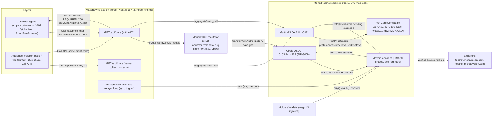
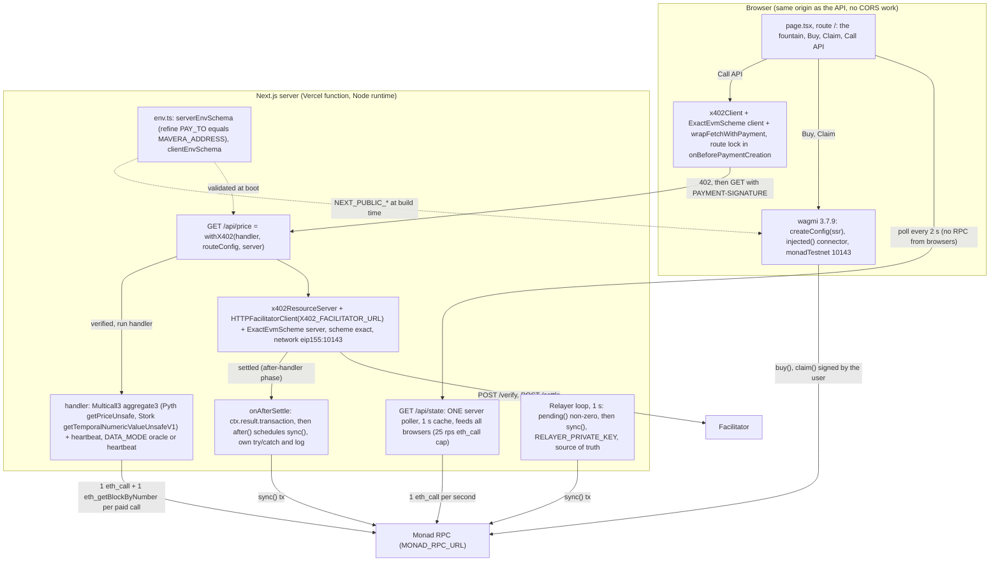
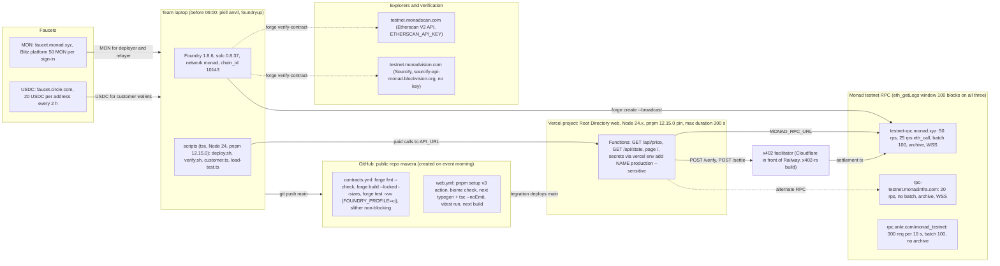

# Architecture

Mavera is one contract, one paid HTTP route and one page. A customer (a person or an agent) pays $0.01 in Circle USDC per `GET /api/price` call through x402 v2; the Monad x402 facilitator settles that payment straight into the `Mavera` contract on Monad testnet (chain id 10143), and a permissionless `sync()` splits it pro-rata across ERC-20 share holders within one 300 ms block. Everything that holds or allocates money is on-chain. Everything that moves bytes (the 402 challenge, the signature, the price data, the live "fountain" view) is off-chain, stateless and replaceable. This document gives the context, component and deployment views, the paid-call data flow, the buy/claim state flow, the trust boundaries, the on-chain versus off-chain split, the failure modes, the finality model for the UI and the RPC budget. The accounting math lives in [docs/02-CONTRACT-SPEC.md](02-CONTRACT-SPEC.md), the HTTP sequence in [docs/03-X402-FLOW.md](03-X402-FLOW.md), the attacks in [docs/06-THREAT-MODEL.md](06-THREAT-MODEL.md). All product code is written during event hours (10:45–16:30 on 2026-10-24); tonight's repository holds configuration, CI and placeholders only.

## 1. Components

| Component | Where it lives | Runs on | Responsibility | Key names |
| --- | --- | --- | --- | --- |
| `Mavera` contract | `contracts/src/Mavera.sol` (event) | Monad testnet, chain id 10143 | ERC-20 shares, fixed-price `buy()`, permissionless `sync()`, pull `claim()`, dividend-correct `_update` | `accPerShare`, `accounted`, `pending()`, `claimable()`, `payTo()`, `endpoint()`, event `Synced` |
| Circle USDC (testnet) | external | Monad testnet | the only payment asset; EIP-3009 and EIP-2612; 6 decimals | `0x534b2f3A21130d7a60830c2Df862319e593943A3`, EIP-712 domain name `USDC`, version `2` |
| Paid route | `web/src/app/api/price/route.ts` (event) | Vercel function, Node runtime | `GET /api/price` wrapped in `withX402`: verify, serve data, settle, fire the hook | `X402_FACILITATOR_URL`, `X402_NETWORK`, `PAY_TO`, `X402_PRICE_ATOMIC` (10000 = $0.01), `X402_MAX_TIMEOUT_SECONDS` (300 s) |
| State route | `web/src/app/api/state/route.ts` (event) | Vercel function, Node runtime | `GET /api/state`: one server poller with a ~1 s cache that feeds every browser | `MONAD_RPC_URL`, `MULTICALL3_ADDRESS`, `DATA_MODE` |
| Settlement hook and relayer | same server module (event) | the function (`after()`), plus any long-lived process holding `RELAYER_PRIVATE_KEY` | call `sync()` after each settlement; a 1 s polling loop is the source of truth | `RELAYER_PRIVATE_KEY` (holds MON only, never USDC) |
| Page and wallet | `web/src/app/page.tsx` (event) with wagmi 3.7.9 + viem 2.57.10 | browser, served by Vercel | route `/`: the fountain (live revenue), Buy, Claim, Call API, explorer links; injected connector on `monadTestnet` (10143) signs `buy()`, `claim()` and the x402 authorization | `NEXT_PUBLIC_MAVERA_ADDRESS`, `NEXT_PUBLIC_USDC_ADDRESS`, `NEXT_PUBLIC_EXPLORER_URL`, `NEXT_PUBLIC_MONAD_RPC_URL`, `createConfig({ ssr: true })`, `useConnection`, `useReadContracts` |
| Env schema | `web/src/lib/env.ts` (exists) | server and build | zod 3.25.76 `serverEnvSchema` (refine: `PAY_TO` equals `MAVERA_ADDRESS`) and `clientEnvSchema` | variables listed in [.env.example](../.env.example) |
| Customer and load scripts | `scripts/customer.ts`, `scripts/load-test.ts` (stubs) | team laptop, `tsx` | one paid call; about 50 sequential paid calls for the demo | `CUSTOMER_PRIVATE_KEY`, `API_URL`; see [scripts/README.md](../scripts/README.md) |
| Facilitator | external | `https://x402-facilitator.molandak.org` | `GET /supported`, `POST /verify`, `POST /settle`; pays the settlement gas | signer `0x7f6a2850669202519f0FE8aa912451238820Db86` |
| Data sources | external | Monad testnet | Pyth Core Compatible and Stork MON/USD read in one `eth_call` through Multicall3; staking precompile for heartbeat fields | `PYTH_ADDRESS`, `PYTH_MON_USD_FEED_ID`, `STORK_ADDRESS`, precompile `0x0000000000000000000000000000000000001000` |

## 2. Context diagram

Money enters the system only through the facilitator's `transferWithAuthorization` into the contract and leaves only through `claim()`; the web app never holds USDC.

## 3. Web app components

One server-side poller reads the chain for everyone, the x402 wrapper settles only after the handler succeeds, and two independent triggers (hook, relayer loop) call the same idempotent `sync()`.

- **One poller, many browsers.** The public RPC `https://testnet-rpc.monad.xyz` allows 25 rps for `eth_call` and `eth_estimateGas` (50 rps overall), per https://docs.monad.xyz/developer-essentials/testnet (accessed 2026-10-24). Fifty audience browsers each polling Multicall3 every 2 s would be exactly 25 rps before the load test starts. So browsers poll `GET /api/state` every 2 s, and the server refreshes one cached snapshot at most once per second (Mavera views, oracle ages, `latest` and `finalized` block numbers, last `Synced` events). The snapshot is recomputable and holds no money, so losing it costs nothing.
- **Settlement hook is the fast path, not the source of truth.** `withX402` settles after the handler returns a status below 400, so the handler never sees the transaction hash; `server.onAfterSettle` does (phase `after-handler`, field `ctx.result.transaction`), per https://docs.x402.org/advanced-concepts/lifecycle-hooks (accessed 2026-10-24). A hook that throws is caught and only logged with `console.warn`, so the `sync()` trigger runs in its own try/catch with a structured log and is handed to `after()` from `next/server`, which runs after the response within the function's maximum duration (Vercel Hobby: 300 s, https://vercel.com/docs/functions/configuring-functions/duration, accessed 2026-10-24). Whether `after()` can be called from inside the hook is unverified (checkpoint D in [docs/07-RUNBOOK.md](07-RUNBOOK.md)).
- **Relayer loop.** Every second: read `pending()`; if it is non-zero, send `sync()` with an explicit gas limit (measured on event day; 150,000 gas is the planning figure) using `eth_sendRawTransactionSync`. It needs only MON. A Vercel function is request-scoped and cannot host an interval, so during `next dev` the loop is a module-level timer in the long-lived process, and on Vercel the poller's once-per-second refresh doubles as the loop (same `pending()` read, `sync()` scheduled through `after()`). Any other process with MON can be the relayer, because `sync()` is permissionless; the hosting choice is confirmed in the 13:15 slot (see Open questions).

## 4. Deployment

The only two things Mavera deploys are the contract (from the laptop with Foundry) and the web app (from GitHub to Vercel); the facilitator, RPC, faucets and explorers are external services it depends on.

Deployment facts the diagram compresses (all from FACTS.md and the research reports, accessed 2026-10-24):

| Item | Value |
| --- | --- |
| Vercel project | Root Directory `web` (CLI prompt "Code directory?" when linking from the repo root; not under `--yes`); Node `24.x` from `web/package.json` `engines.node`; pnpm `12.15.0` read from the root `package.json` `packageManager` field; expected build-log line "Detected pnpm-lock.yaml version 9 generated by pnpm@12.x"; fallback env `ENABLE_EXPERIMENTAL_COREPACK=1`; no `vercel.json` |
| Next.js config | `web/next.config.ts`: Cache Components and Partial Prefetching disabled; Tailwind 4.3.3 through `@tailwindcss/turbopack`; GET route handlers are dynamic by default; no `runtime` export (Node is the default, and the x402 SDK uses `Buffer`); `NEXT_PUBLIC_*` values are inlined at build time (redeploy after changing them) |
| Contracts toolchain | Foundry v1.8.6, `network = "monad"` (hardfork MonadTen), solc 0.8.37, `evm_version = "osaka"`, OpenZeppelin v5.7.0, forge-std v1.17.0, `foundry.lock` committed; CI runs `forge build --locked`; Sourcify verification needs no key, Monadscan uses the Etherscan V2 API with `ETHERSCAN_API_KEY` (see [contracts/README.md](../contracts/README.md), [docs/11-TOOLCHAIN.md](11-TOOLCHAIN.md)) |
| Wallet funding | MON: Blitz platform 50 MON per sign-in, `https://faucet.monad.xyz`; relayer funded with more than 10 MON (consensus gas budget is min(10 MON, balance three blocks ago)); USDC: `https://faucet.circle.com`, 20 USDC per address per 2 h on "Monad Testnet" (accessed 2026-10-24); details in [scripts/faucet-notes.md](../scripts/faucet-notes.md) |

## 5. Data flow: one paid call

Header names are the x402 v2 names from https://docs.x402.org/core-concepts/http-402 (accessed 2026-10-24); all three carry base64-encoded JSON.

1. The customer sends `GET /api/price` with `Accept: application/json` and no payment header. On its first request each server instance has already fetched `GET /supported` from the facilitator (`initialize()`), so the facilitator is a hard dependency even for the challenge.
2. The server answers `402` with header `PAYMENT-REQUIRED`. Its `accepts[0]` is `scheme: "exact"`, `network: "eip155:10143"`, `asset: 0x534b2f3A21130d7a60830c2Df862319e593943A3`, `amount: "10000"` (0.01 USDC), `payTo: <MAVERA_ADDRESS>`, `maxTimeoutSeconds: 300`, `extra: { name: "USDC", version: "2" }`; `resource.url` is the request URL; body `{}`; `Cache-Control: no-store`.
3. The client decodes the header and applies the route lock in `onBeforePaymentCreation`: abort unless `payTo` equals `MAVERA_ADDRESS`, `asset` equals the USDC address, `network` is `eip155:10143` and `scheme` is `exact`. The SDK's spend control also caps one payment at $1.
4. The client signs an EIP-712 `TransferWithAuthorization` under the domain name `USDC`, version `2`, chain id 10143, verifying contract USDC: `from` = customer, `to` = `MAVERA_ADDRESS`, `value` = 10000, `validAfter` = 0, `validBefore` = now + 300 s, random 32-byte `nonce`. No transaction, no gas for the customer.
5. The client repeats `GET /api/price` with header `PAYMENT-SIGNATURE`.
6. The server posts `{ x402Version: 2, paymentPayload, paymentRequirements }` to the facilitator's `POST /verify`. The facilitator checks the signature, the payer's balance and the amount by simulating the transfer. An invalid payment comes back as HTTP 400 (`insufficient_funds`, `invalid_payment_expired`, ...), and the server re-issues a `402` whose `PAYMENT-REQUIRED` carries the reason.
7. The handler runs: one `eth_call` to Multicall3 `aggregate3` reading Pyth `getPriceUnsafe(feedId)` and Stork `getTemporalNumericValueUnsafeV1(keccak256("MONUSD"))`, plus `eth_getBlockByNumber` for `latest` and `finalized` and the staking precompile for epoch and proposer. It returns JSON with `pair`, `price_usd` (median of the sources that are within their own validity: Pyth 60 s, Stork 3600 s), `sources[]` (`name`, `contract`, `price`, `published_at`, `age_s`, `valid_for_s`), `spread_bps`, `block_number`, `block_timestamp`, `finalized_block`, `epoch`, `proposer_val_id`, `validator_count`, `rpc_latency_ms`. With `DATA_MODE=heartbeat` the oracle reads are skipped.
8. Because the handler status is below 400, the server posts the same body to `POST /settle`. The facilitator's signer `0x7f6a2850669202519f0FE8aa912451238820Db86` sends `transferWithAuthorization` on USDC and pays the gas (estimate 141,817 gas, about 0.014 MON at the minimum base fee). USDC moves from the customer to the Mavera contract.
9. The server returns `200` with header `PAYMENT-RESPONSE` (`success`, `transaction`, `network`, `payer`) and the handler JSON; `Cache-Control` includes `private`. If settlement fails, the response is `402` with `PAYMENT-RESPONSE` `success: false` and body `{}`: the data is withheld.
10. `onAfterSettle` fires with `ctx.result.transaction`; the hook schedules `sync()` through `after()` and logs the hash.
11. The relayer loop independently sees `pending()` non-zero within about 1 s and sends `sync()` if the hook has not. `sync()` adds `pending * 1e36 / totalSupply` to `accPerShare`, moves `pending` into `accounted` and `totalDistributed`, and emits `Synced(amount)`. A second trigger returns early at `pending == 0`.
12. The poller's next refresh (within 1 s) and the browsers' next `GET /api/state` (within 2 s) show `totalDistributed` and every holder's `claimable()` higher: the fountain climbs. The settlement receipt is visible at `latest` about 300 ms after submission and final at `finalized` about 600 ms after.
13. The client decodes `PAYMENT-RESPONSE` and links `https://testnet.monadscan.com/tx/<transaction>`.

## 6. State flow: buy, claim, transfer

Exact storage, formulas and edge cases are in [docs/02-CONTRACT-SPEC.md](02-CONTRACT-SPEC.md); the numbers below are the spec defaults and are confirmed on event day.

- **`buy(shares)`** (capital raise). (1) `sync()` runs first, so revenue received before the purchase stays with the holders of record. (2) Checks: `shares > 0`, `cost = mulDiv(shares, sharePrice, 1e18, Ceil) > 0`, `totalSupply + shares <= maxSupply`. (3) `_mint(buyer, shares)`; the `_update` hook adjusts the buyer's correction so past revenue is not claimable by them. (4) `safeTransferFrom(buyer, creator, cost)`: the proceeds go to the creator, never to the contract, so `pending` only ever means revenue. Guarded by `nonReentrant` (ReentrancyGuardTransient; TSTORE is live on testnet). Demo defaults: `sharePrice` 10,000 USDC units per 1e18 share (0.01 USDC), `creatorShares` 60e18, `maxSupply` 100e18.
- **`claim()`** (pull payout). (1) `sync()`. (2) `amount = claimable(holder)`, which is pending-inclusive, so the fountain shows exactly what the claim pays. (3) Revert `NothingToClaim()` when `amount == 0`. (4) `claimed[holder] += amount`, `accounted -= amount`. (5) `safeTransfer(holder, amount)` last (checks, effects, interactions). ADR: [docs/adr/ADR-0002-pull-vs-push-dividends.md](adr/ADR-0002-pull-vs-push-dividends.md).
- **Transfer** (`_update(from, to, value)`). Recommended default: `sync()` runs before `super._update`, so every payment received so far is attributed to the holders of record at that instant; then `corrections[from] += delta` and `corrections[to] -= delta` with `delta = accPerShare * value`, which keeps both parties' `claimable()` unchanged by the transfer. Cost: roughly 40,000 extra gas per transfer, about $0.0001 on Monad; measure at 11:00 and confirm before the contract is frozen ("confirm before 11:00" in FACTS.md). Transfers to the contract itself revert.
- **Identities the tests enforce** ([docs/05-TEST-PLAN.md](05-TEST-PLAN.md)): `pending = usdc.balanceOf(this) - accounted`; `usdc.balanceOf(mavera) >= sum of claimable(h)`; `totalDistributed == sum of claimed + sum of claimable + dust` with `dust <= number of holders` (in USDC units); all magnitudes stay below 1e57 (less than 2^255).

## 7. Trust boundaries

| Who | Trusts | For what | Why that is acceptable, and what limits it |
| --- | --- | --- | --- |
| Payer (agent or browser) | its own client's route lock, plus the contract's `payTo()` and `endpoint()` views | that the 402 names the real Mavera contract | the chain cannot force a server's `payTo` (the server SDK even allows a per-request `DynamicPayTo`); the client simply refuses to sign for anything else |
| Payer | the facilitator | to settle only the signed authorization | the signature binds `to`, `value`, `validBefore` and a single-use `nonce`; the facilitator cannot redirect or inflate, only decline; exposure is one 1-cent payment |
| Payer | the server | to return data after payment | settlement happens only after the handler succeeds; a failed settlement withholds the data; data provenance (oracle contracts, block number) is in the payload and checkable on-chain |
| Holders | the `Mavera` contract code | custody of revenue and pro-rata accounting | source verified on Sourcify and Monadscan, no admin keys, no upgrade path, invariants tested |
| Holders | Circle, the USDC issuer | that the token keeps transferring | FiatTokenV2_2 behind a proxy: pause, blacklist and upgrade are Circle's powers; disclosed as a known limit ([docs/adr/ADR-0005-usdc-choice.md](adr/ADR-0005-usdc-choice.md)) |
| Holders | nobody, for custody: not the server, not Vercel, not the relayer | | payments land in the contract; the server never holds USDC; the relayer key can only spend MON on gas |
| Holders | the operator's routing honesty (soft trust) | that the live endpoint keeps paying the contract | not enforceable on-chain; anyone can decode a 402 and compare `payTo` with `payTo()`; see [docs/06-THREAT-MODEL.md](06-THREAT-MODEL.md) |
| Server operator | the facilitator and the RPC | liveness only | hard dependency for every 402; fallback: `receiveWithAuthorization` helper (customer stays gasless), decided 60 min into the x402 slot ([docs/03-X402-FLOW.md](03-X402-FLOW.md)) |
| Relayer | | pays gas, nothing else | funded with more than 10 MON before the demo; never EIP-7702-delegated; anyone can replace it because `sync()` is permissionless |
| Data consumers | the Pyth and Stork pushers | fresh MON/USD | per-source validity (60 s and 3600 s), median of valid sources, `DATA_MODE=heartbeat` has zero third-party risk |
| Everyone | Monad testnet consensus | ordering and finality | 300 ms blocks (302 ms measured), final at about 600 ms; it is a testnet (reset from genesis on 2025-12-16) |

## 8. On-chain versus off-chain

| Concern | Where | Why |
| --- | --- | --- |
| Revenue custody | on-chain (the contract holds USDC) | holders never trust the operator's bank account; this is the "why not Stripe" answer |
| Dividend accounting (`accPerShare`, `corrections`, `claimed`, `accounted`) | on-chain | verifiable by anyone, O(1) per payment; affordable because one `sync()` at a 150,000 gas limit costs about 0.015 MON, about $0.0003 at the 100 MON-gwei minimum base fee (https://docs.monad.xyz/developer-essentials/gas-pricing, accessed 2026-10-24), under 4 % of a 1-cent call |
| Share issuance and transfers | on-chain ERC-20 | a permissionless, transferable claim on cash flow |
| Attribution at transfer time | on-chain (`sync()` in `_update`) | a transfer never carries already-earned revenue to the buyer |
| Payment authorization | off-chain EIP-712 signature (EIP-3009) | gasless for the customer; a machine can pay without a bank account |
| Payment verification and settlement submission | off-chain, external facilitator | the x402 standard; the facilitator pays gas; Mavera does not run it |
| The paid data (MON/USD) | off-chain HTTP response built from on-chain oracle reads | the product is an API; the payload names the oracle contracts and the block so provenance is checkable |
| `sync()` trigger | off-chain (hook, relayer) calling a permissionless on-chain function | liveness only; safety never depends on who calls |
| Live UI state | off-chain cache (`GET /api/state`, 1 s) of on-chain views | the 25 rps `eth_call` cap; the cache is recomputable and holds nothing |
| Route lock | off-chain client check plus trivial on-chain views | the chain cannot force a server's `payTo`; the honest statement is "the client refuses" |
| Factory, secondary market, agent directory | not built (roadmap) | [docs/adr/ADR-0001-single-contract-vs-factory.md](adr/ADR-0001-single-contract-vs-factory.md); scope in [docs/00-OVERVIEW.md](00-OVERVIEW.md) |

## 9. Failure modes (summary)

Full analysis with attacker models: [docs/06-THREAT-MODEL.md](06-THREAT-MODEL.md). Commands for each recovery: [docs/07-RUNBOOK.md](07-RUNBOOK.md).

| Failure | Visible effect | Why money is safe | Mitigation |
| --- | --- | --- | --- |
| Facilitator unreachable | the route returns 502; no 402 can be produced | no payment happened | smoke test `GET /supported` at the start of the slot; fallback `receiveWithAuthorization` helper |
| `POST /verify` rejects (`insufficient_funds`, `invalid_payment_expired`, ...) | 402 with the reason in `PAYMENT-REQUIRED` | nothing moved | client prints the reason; debug ladder in the runbook |
| `POST /settle` fails after the handler | 402 with `PAYMENT-RESPONSE` `success: false`, body `{}` | nothing moved; data withheld | client reconciles from the header, never re-signs in a loop |
| Hook throws or `after()` is unavailable | payment sits as `pending` for up to 1 s | USDC is already in the contract; `claimable()` is pending-inclusive | relayer loop syncs; hook failures are logged |
| Relayer out of MON or key leaked | `sync()` delayed; attacker can only burn MON | USDC untouched; anyone can call `sync()` | fund more than 10 MON before the demo; rotate the key |
| Operator changes `payTo` | customer clients refuse to pay; no new revenue | holders lose future revenue, never past revenue | detectable by decoding the 402; `payTo()` view for cross-checks |
| Oracle pusher stops (Pyth `0xFC6b...` or Stork) | source flagged invalid by its own validity window | not a money path | median of valid sources; `DATA_MODE=heartbeat` |
| RPC rate limit or outage | stale `GET /api/state`, failed paid calls | nothing on-chain changes | one poller; alternate `MONAD_RPC_URL` (`https://rpc-testnet.monadinfra.com`, 20 rps, no batch) |
| Facilitator batches settlements (`batch-settlement` is advertised) | one settlement might not equal one transaction | the relayer keys on `pending()`, not on hashes | test early that one paid call yields one USDC transfer |

## 10. Finality model for the UI

Block states and tags per https://docs.monad.xyz/reference/json-rpc/overview (accessed 2026-10-24); chain background in [docs/10-MONAD-NOTES.md](10-MONAD-NOTES.md). Say "visible in about 300 ms, final in about 600 ms", never "300 ms finality".

| Block state | RPC tag | When, relative to the block that includes the tx | What the page shows |
| --- | --- | --- | --- |
| Proposed | `latest` (and `pending`, which behaves the same) | about 300 ms after submission: receipt and logs appear | "paid", the fountain counter moves |
| Voted | `safe` | +300 ms | "safe" (speculative finality) |
| Finalized | `finalized` | +600 ms, irreversible without a hard fork | "final" badge |
| Verified | only via `monadNewHeads` `commitState` | +1.5 s | not used |

Rules: the poller reads at `latest` and publishes `finalized_block` with every snapshot; the page marks a transaction final when `finalized_block >= receipt.blockNumber`; `eth_getTransactionReceipt` results for non-finalized blocks can change on repeat, so the page keys on block numbers, not on first sight. Nothing off-chain is ever credited (USDC moves on-chain), so there is nothing that must wait for `finalized`. The 1-second poller cadence and the 2-second page cadence mean the fountain shows a payment 1 to 3 s after settlement; the chain itself needed 0.6 s.

## 11. RPC rate-limit budget

Design budget (not a measurement) against the public endpoint `https://testnet-rpc.monad.xyz`: 50 rps overall, 25 rps for `eth_call` and `eth_estimateGas`, batch size 100 (https://docs.monad.xyz/developer-essentials/testnet, accessed 2026-10-24). The load test fires about 50 paid calls sequentially; one call per second is the planning rate because the facilitator's verify and settle round trips dominate each call.

| Caller | RPC method | Steady state, 50 viewers | During the 50-call load test | Note |
| --- | --- | --- | --- | --- |
| Browsers polling the chain directly (rejected design) | `eth_call` (multicall) every 2 s per viewer | 25 rps, equal to the cap | 25 rps plus the load | the reason the server poller exists |
| Browsers polling `GET /api/state` (chosen) | none; HTTP to Vercel | 25 req/s to Vercel, 0 rps to the RPC | same | cache hits |
| Server poller | `eth_call` (`aggregate3`) and `eth_getBlockByNumber` | up to 2 rps | up to 2 rps | 1 s cache |
| Relayer loop | `eth_call` `pending()` (shared with the poller), `eth_sendRawTransactionSync` | up to 1 rps, 0 tx | up to 1 rps plus up to 1 tx/s | sends only when `pending()` is non-zero |
| Paid-call handler | `eth_call` (`aggregate3`) and `eth_getBlockByNumber` | 0 | about 2 rps at one paid call per second | sequential calls |
| Connected wallets (at most 5 during the demo) | `eth_call` (wagmi multicall) every 2 s; a handful of `buy`/`claim` writes | up to 2.5 rps | up to 2.5 rps | creator, holder, customer |
| Facilitator | its own provider | not in this budget | not in this budget | it pays its own gas and RPC |
| Total against the cap | | about 2 to 6 rps of 25 rps `eth_call` and 50 rps overall | about 5 to 9 rps | at least 3x headroom |

Also: `eth_getLogs` is limited to `toBlock - fromBlock <= 100` on all three public endpoints, so the `Synced` feed comes from the poller's view reads and small log windows, never from a scan since deployment.

## 12. Key design properties

- **Permissionless `sync()`.** Anyone can call it; the server only pays gas; liveness never depends on Mavera's operator.
- **Idempotent.** `sync()` returns early when `pending == 0` or `totalSupply == 0`, so the hook and the relayer loop can both fire. The relayer keys on the USDC balance delta, not on settlement hashes.
- **Pending-inclusive views.** `claimable()` simulates `sync()`, so the fountain shows exactly what `claim()` pays; `pending()` is public. Pull-based claims keep every call O(1) in the holder count.
- **Attribution at the instant of payment.** `sync()` inside `_update` (default, confirm before 11:00) means a transfer never moves already-earned revenue.
- **One contract, fixed price, `exact` scheme, Circle USDC.** ADR-0001, [ADR-0003](adr/ADR-0003-fixed-price-vs-bonding-curve.md), [ADR-0004](adr/ADR-0004-x402-exact-vs-upto.md), [ADR-0005](adr/ADR-0005-usdc-choice.md); index in [docs/adr/README.md](adr/README.md).
- **Explicit gas limits everywhere.** Monad charges the gas limit, not the gas used; limits come from `forge test --network monad --gas-report` plus a margin.
- **Same origin for page and API.** The x402 SDK sets no `Access-Control-Expose-Headers`, so keeping `/` and `/api/price` on the Vercel app avoids CORS work.
- **Stateless server, validated configuration.** No database; the only state is a 1 s cache; `serverEnvSchema` refuses to boot unless `PAY_TO` equals `MAVERA_ADDRESS`.

## 13. Addresses and endpoints

| Name | Value | Source (accessed 2026-10-24) |
| --- | --- | --- |
| Monad testnet chain id | 10143 (`0x279f`) | https://docs.monad.xyz/developer-essentials/testnet |
| `Mavera` contract | `<MAVERA_ADDRESS>`, TBD on event day (also `PAY_TO`) | deploy step in [docs/07-RUNBOOK.md](07-RUNBOOK.md) |
| Circle USDC (testnet) | `0x534b2f3A21130d7a60830c2Df862319e593943A3` | https://developers.circle.com/stablecoins/usdc-contract-addresses |
| Multicall3 | `0xcA11bde05977b3631167028862bE2a173976CA11` | https://docs.monad.xyz/developer-essentials/testnet |
| Pyth Core Compatible, MON/USD feed id | `0xFC6bd9F9f0c6481c6Af3A7Eb46b296A5B85ed379`, `0x31491744e2dbf6df7fcf4ac0820d18a609b49076d45066d3568424e62f686cd1` | https://docs.pyth.network/price-feeds/core/upgrade/contracts |
| Stork, asset id | `0xacC0a0cF13571d30B4b8637996F5D6D774d4fd62`, `keccak256("MONUSD")` = `0xa4f6b07ae0c89e3f3cc03c1badcc3e9adffdf7206bafcd56d142979800887385` | https://docs.stork.network/resources/contract-addresses/evm |
| Staking precompile (heartbeat) | `0x0000000000000000000000000000000000001000` | https://docs.monad.xyz/reference/staking/api |
| x402 facilitator, signer | `https://x402-facilitator.molandak.org`, `0x7f6a2850669202519f0FE8aa912451238820Db86` | `GET /supported` on that host |
| Explorers | `https://testnet.monadscan.com`, `https://testnet.monadvision.com` | https://docs.monad.xyz/tooling-and-infra/block-explorers |
| Deployer, relayer, customer EOAs; Vercel production URL | TBD on event day | [scripts/faucet-notes.md](../scripts/faucet-notes.md), [docs/12-SUBMISSION-CHECKLIST.md](12-SUBMISSION-CHECKLIST.md) |

## Open questions

- Can `after()` from `next/server` be called from inside the `onAfterSettle` hook? Unverified; if not, the relayer loop is the only trigger (checkpoint D, 12:55).
- Where does the 1-second relayer loop run during the demo: the Vercel poller's refresh, a local `next dev` process, or both? Decide in the 13:15 slot; both are safe because `sync()` is idempotent.
- Does one paid call always produce one `transferWithAuthorization` transaction, given that the facilitator also advertises `batch-settlement`? Test with the first five paid calls.
- Attribution choice: keep `sync()` inside `_update` only if the measured transfer overhead at 11:00 is acceptable; otherwise fall back to sync-time attribution with the relayer (ADR-0002 keeps both).
- Per-wallet reads (`claimable(holder)`, balances) for connected wallets: browser multicall every 2 s (budgeted above at up to 2.5 rps) or a `holder` parameter on `GET /api/state`? Owned by [docs/04-FRONTEND.md](04-FRONTEND.md).
- Does the Vercel build image contain `/pnpm12`? Read the first deploy's "Detected pnpm-lock.yaml ..." line; fallback `ENABLE_EXPERIMENTAL_COREPACK=1`.
- Latency from the Vercel region to `https://testnet-rpc.monad.xyz` was not measured (only from Istanbul, 0.11 to 0.55 s); switch to `https://rpc-testnet.monadinfra.com` if the poller misses its 1 s cadence.
- Who operates the pusher that keeps Pyth Core Compatible `0xFC6b...` fresh on testnet is undocumented; check both oracle ages in the 30-second pre-demo check and rehearse `DATA_MODE=heartbeat`.
