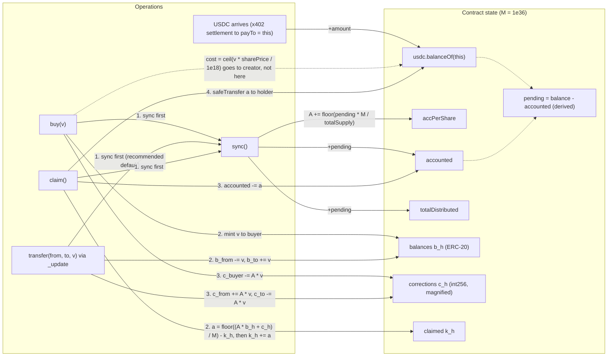

# Mavera contract specification

Mavera is one ERC-20 contract (`contracts/src/Mavera.sol`, contract `Mavera`, OpenZeppelin Contracts v5.7.0, solc 0.8.37) whose tokens are shares in the future revenue of one paid API. Customers (agents or people) pay the API 0.01 USDC per call through x402; the x402 `payTo` is the contract itself, so every payment lands in the contract and never in the operator's account. A permissionless `sync()` splits whatever arrived since the last sync across holders pro-rata; holders pull their USDC with `claim()`; a fixed-price `buy()` sells new shares and sends the proceeds to the creator. The accounting is the ERC-1726 "magnified dividend per share plus per-holder correction" pattern with magnifier M = 1e36, corrected in twelve places by the adversarial review (section 7). This document is specification only: no Solidity exists yet, and all product code is written during the hacking window (10:45–16:30 Europe/Istanbul, 24 Oct 2026). Items marked "confirm before 11:00" need a gas measurement or a team decision before the contract is written. Sibling documents: [01-ARCHITECTURE.md](01-ARCHITECTURE.md), [03-X402-FLOW.md](03-X402-FLOW.md), [05-TEST-PLAN.md](05-TEST-PLAN.md), [06-THREAT-MODEL.md](06-THREAT-MODEL.md), [10-MONAD-NOTES.md](10-MONAD-NOTES.md).

## 1. Purpose and parameters

### 1.1 On-chain versus off-chain

| Concern | Where | Why |
| --- | --- | --- |
| Share ledger (ERC-20 balances, transfers) | on-chain, `Mavera` | shares must be permissionless, global and transferable without the operator's consent |
| Revenue accounting and payout (`sync`, `claim`) | on-chain, `Mavera` | holders do not trust the operator: USDC lands in the contract and is split by code |
| Primary sale (`buy`) | on-chain, `Mavera`, proceeds to `creator` | a capital raise at a fixed price; proceeds never enter the revenue pool |
| The payment | on-chain, USDC `transferWithAuthorization` executed by the facilitator | the facilitator moves the customer's USDC to `payTo`; it never holds funds |
| The API data, the 402 handshake, the relayer timing, the page | off-chain (Next.js app, Monad facilitator) | see [01-ARCHITECTURE.md](01-ARCHITECTURE.md) and [03-X402-FLOW.md](03-X402-FLOW.md) |

Why not Stripe, in one sentence: with Stripe the operator receives the money and may or may not pass it on; here the payment and the dividend are one flow into one contract, the claim on that flow is a transferable token, and the payers can be machines that cannot open a Stripe account.

### 1.2 Constructor parameters (demo defaults)

| Parameter | Type | Demo default | Constraint (the constructor reverts otherwise) |
| --- | --- | --- | --- |
| `usdc` | `address`, immutable | `0x534b2f3A21130d7a60830c2Df862319e593943A3` (Circle USDC on Monad testnet, 6 decimals, FiatTokenV2_2 behind FiatTokenProxy) | non-zero; must be the x402 asset ([ADR-0005](adr/ADR-0005-usdc-choice.md)) |
| `creator` | `address`, immutable | `<CREATOR_ADDRESS>` TBD on event day | `!= address(0)` and `!= address(this)` |
| `sharePrice` | `uint256`, immutable | `10_000` USDC units per `1e18` share-wei (0.01 USDC per whole share) | `> 0` |
| `maxSupply` | `uint256`, immutable | `100e18` (100 whole shares) | `>= creatorShares` |
| `creatorShares` | `uint256`, minted in the constructor | `60e18` (60 % of the float) | `> 0` and `<= maxSupply`; recommended `>= 1e18` (overflow margin, section 5.7) |
| `name`, `symbol` | `string` | TBD on event day; proposed "Mavera Shares: <API name>" and "mAPI" | ERC-20 metadata; `decimals()` is 18 |
| `endpoint` | `string`, storage | TBD on event day, e.g. `<API_URL>/api/price` (working route name `GET /api/price`, TBD) | informational; pairs the contract with its URL (section 9) |

Derived demo numbers: 40e18 shares are for sale, so the whole float costs 40e18 x 10_000 / 1e18 = 400_000 units = 0.40 USDC. One paid call is `X402_PRICE_ATOMIC=10000` units = $0.01 (see [.env.example](../.env.example)). The Circle faucet gives 20 USDC per address every 2 hours (https://faucet.circle.com, accessed 2026-10-24), enough for one buyer plus about 50 paid calls. The constructor argument order, and with it the `cast abi-encode "constructor(...)"` string used for Monadscan verification in [07-RUNBOOK.md](07-RUNBOOK.md), is TBD until the file exists; the toolchain report's placeholder `constructor(address,address,uint256,uint256)` must be updated. Assign every immutable before the constructor mint: the mint runs `_update`, which runs `sync()` (section 6); `sync()` returns on `totalSupply() == 0` before it reads USDC.

### 1.3 Compiler and execution environment

Quoted from `contracts/foundry.toml` (the full file and the reasons are in [11-TOOLCHAIN.md](11-TOOLCHAIN.md)):

```toml
solc = "0.8.37"
evm_version = "osaka"
optimizer = true
optimizer_runs = 200
network = "monad"
chain_id = 10143
```

Use `pragma solidity 0.8.37;` (exact; Slither's `solc-version` detector flags floating pragmas). `network = "monad"` makes `forge test` use Monad's gas model and MIP-8 storage pages (hardfork defaults to MonadTen). Parents: OZ `ERC20`, `ReentrancyGuardTransient` (EIP-1153 transient storage is live on testnet: a TSTORE/TLOAD probe returned the stored value on 2026-10-24; fallback is the storage-based `ReentrancyGuard`), plus the libraries `SafeERC20`, `SafeCast` and `Math`.

## 2. Storage layout

Immutables live in code and cost nothing to read. OpenZeppelin v5.7.0 `ERC20` declares `_balances`, `_allowances`, `_totalSupply`, `_name`, `_symbol` in slots 0–4 and no parent of it holds storage. MIP-8 groups storage into 128-slot pages of 4,096 bytes (`page_index = slot >> 7`); the first access to a page in a transaction costs 8,100 gas and later accesses 100; each mapping key resolves to its own page (https://docs.monad.xyz/developer-essentials/opcode-pricing and https://mips.monad.xyz/MIPs/MIP-8, accessed 2026-10-24).

| Name | Kind | Type and unit | Slot (expected) | Page | Role |
| --- | --- | --- | --- | --- | --- |
| `usdc` | immutable | `IERC20` | code | – | payout asset |
| `creator` | immutable | `address` | code | – | receives `buy` proceeds |
| `sharePrice` | immutable | `uint256`, units per 1e18 share-wei | code | – | fixed primary price |
| `maxSupply` | immutable | `uint256`, share-wei | code | – | supply cap |
| `_balances`, `_allowances`, `_totalSupply`, `_name`, `_symbol` | OZ state | – | 0–4 | 0 for the scalars; own page per mapping key | ERC-20 |
| `accPerShare` | state | `uint256`, magnified by M = 1e36 | 5 | 0 | cumulative USDC units per share-wei, times M |
| `accounted` | state | `uint256`, units | 6 | 0 | distributed but unclaimed USDC held by the contract |
| `totalDistributed` | state | `uint256`, units | 7 | 0 | lifetime revenue that has been synced |
| `corrections` | state | `mapping(address => int256)`, magnified | 8 (keys at `keccak(h, 8)`) | own page per holder | keeps each entitlement constant across mints and transfers |
| `claimed` | state | `mapping(address => uint256)`, units | 9 (keys at `keccak(h, 9)`) | own page per holder | cumulative payouts |
| `endpoint` | state | `string` | 10 (length word; a URL longer than 31 bytes keeps its data at `keccak(10)`, per the Solidity storage layout) | 0 for the length word; data elsewhere | route-lock pairing; read only by the `endpoint()` view, never on a hot path |

Caveats. (1) The slot numbers hold only while `ERC20` is the sole storage-bearing parent; `ERC20Permit`/`Nonces`, `Ownable` or the storage-based `ReentrancyGuard` would shift Mavera's scalars by 1–3 slots and the mapping base slots with them. Everything stays inside page 0 (slots 0–127), so the gas pattern does not change. `ReentrancyGuardTransient` uses transient storage and occupies no slot. (2) All scalars that `sync()` touches share page 0 with `_totalSupply`, so a sync pays one cold Mavera page. (3) Optional optimisation, confirm before 11:00: one per-holder struct with the fields `corrections` (int256) and `claimed` (uint256), stored in a single mapping, would put both values on one page and save about 8,000 gas per holder side in `claim()` and in transfers. The default keeps two mappings because [05-TEST-PLAN.md](05-TEST-PLAN.md) reads `corrections(h)` and `claimed(h)` as separate getters.

## 3. Functions

| Function | Access | Preconditions | Effects | Emits | Reverts with |
| --- | --- | --- | --- | --- | --- |
| `constructor(usdc, creator, sharePrice, maxSupply, creatorShares, name, symbol, endpoint)` | deployer | constraints of section 1.2 | stores immutables and `endpoint`; mints `creatorShares` to `creator`, so `totalSupply() > 0` from block one | `Transfer(0, creator, creatorShares)` | `InvalidCreator()`, `InvalidSharePrice()`, `InvalidCreatorShares()` |
| `buy(uint256 shares)` | anyone, `nonReentrant` | `shares > 0`; `totalSupply() + shares <= maxSupply`; caller approved `cost` USDC | `sync()`; `cost = ceil(shares x sharePrice / 1e18)`; mint `shares` to caller; pull `cost` USDC from caller to `creator` | `Synced` (if pending), `Transfer`, `Bought` | `ZeroShares()`, `SupplyCap(requested, available)`, `ZeroCost()`, `SafeERC20FailedOperation`, USDC reverts |
| `sync()` | anyone (permissionless) | none | if `totalSupply() == 0` or `pending() == 0`: return with no state change and no event; else distribute `pending` (section 5.3) | `Synced(amount)` | never (defensive `pending`) |
| `claim()` | holder, `nonReentrant` | caller's pending-inclusive claimable `> 0` | `sync()`; `claimed[h] += a`; `accounted -= a`; transfer `a` USDC to caller (checks, effects, interaction) | `Synced` (if pending), `Claimed` | `NothingToClaim()`, `SafeERC20FailedOperation`, USDC reverts |
| `claimable(address h)` view | anyone | none | pending-inclusive: simulates the next sync and returns exactly what `claim()` would pay now | – | – |
| `pending()` view | anyone | none | `usdc.balanceOf(this) - accounted`, floored at 0 | – | – |
| `payTo()` view | anyone | none | returns `address(this)` (route lock, section 9) | – | – |
| `endpoint()` view | anyone | none | returns the stored route string | – | – |
| `accPerShare()`, `accounted()`, `totalDistributed()`, `corrections(address)`, `claimed(address)`, `usdc()`, `creator()`, `sharePrice()`, `maxSupply()` | anyone | none | public getters used by the tests, the fountain and the invariant suite | – | – |
| Standard ERC-20: `transfer`, `transferFrom`, `approve`, `allowance`, `balanceOf`, `totalSupply`, `name`, `symbol`, `decimals` | per ERC-20 | OZ rules | every balance move passes through the `_update` override (section 5.5) | `Transfer`, `Approval` | OZ `ERC20InsufficientBalance`, `ERC20InsufficientAllowance`, `ERC20InvalidSender`, `ERC20InvalidReceiver`; Mavera `InvalidRecipient()` |
| `_update(from, to, value)` internal override | – | `to != address(this)` | `sync()` first (recommended default, section 6); `super._update`; adjust `corrections` | `Transfer` (from OZ) | `InvalidRecipient()`, `SafeCastOverflowedUintToInt` |

Not exposed: `burn`/`burnFrom` (do not inherit `ERC20Burnable`), owner functions, pause, upgrade. `totalSupply()` therefore never falls below `creatorShares`, and no USDC can be stranded by a zero supply. The relayer calls `sync()` after every settlement, but anyone may call it; it cannot direct funds, only timing (section 6).

## 4. Events and custom errors

| Event | Signature | When |
| --- | --- | --- |
| `Synced` | `Synced(uint256 amount)` | each effective sync; never emitted with `amount == 0` |
| `Bought` | `Bought(address indexed buyer, uint256 shares, uint256 cost)` | each successful `buy`; `shares >= 1` and `cost >= 1` always |
| `Claimed` | `Claimed(address indexed holder, uint256 amount)` | each successful `claim`; `amount >= 1` always |
| OZ `Transfer`, `Approval` | ERC-20 | mints, transfers, approvals |

| Error | Raised by | Meaning |
| --- | --- | --- |
| `NothingToClaim()` | `claim` | pending-inclusive claimable is 0; it surfaces at `eth_estimateGas`, so a wallet shows it before the user pays a full Monad gas limit for a no-op |
| `ZeroShares()` | `buy` | `shares == 0` |
| `SupplyCap(uint256 requested, uint256 available)` | `buy` | `totalSupply() + shares > maxSupply` |
| `ZeroCost()` | `buy` | defence in depth; unreachable with ceil rounding and `shares > 0` |
| `InvalidRecipient()` | `_update` | shares sent to the contract itself; its entitlement could never be claimed |
| `InvalidCreator()`, `InvalidSharePrice()`, `InvalidCreatorShares()` | constructor | section 1.2 constraints |
| OZ: `ERC20InsufficientBalance`, `ERC20InsufficientAllowance`, `ERC20InvalidSender`, `ERC20InvalidReceiver`, `SafeERC20FailedOperation(address)`, `ReentrancyGuardReentrantCall()`, `SafeCastOverflowedUintToInt(uint256)`, `SafeCastOverflowedIntToUint(int256)` | inherited | standard OpenZeppelin v5.7.0 errors |
| USDC reverts | USDC | FiatTokenV2_2 `whenNotPaused` and `notBlacklisted(from)`/`notBlacklisted(to)` modifiers, insufficient balance or allowance; propagate through `SafeERC20` (section 11) |

## 5. Accounting math (M = 1e36)

### 5.1 Notation

Shares are ERC-20 units with 18 decimals (1 share = 1e18 share-wei). USDC amounts are 6-decimal integer units (1 USDC = 1_000_000 units). M = 1e36 is the magnifier.

| Symbol | Contract state | Type and unit |
| --- | --- | --- |
| A | `accPerShare` | uint256, magnified units per share-wei: A x b / M is in USDC units |
| b_h | `balanceOf(h)` | uint256 share-wei |
| TS | `totalSupply()` | uint256 share-wei |
| c_h | `corrections[h]` | int256, magnified (same scale as A x b) |
| E_h := A x b_h + c_h | magnified entitlement (not stored) | int256; E_h / M = cumulative USDC units ever allocated to h |
| k_h | `claimed[h]` | uint256 units |
| D | `totalDistributed` | uint256 units |
| acc | `accounted` | uint256 units |
| bal | `usdc.balanceOf(address(this))` | uint256 units |
| P := bal - acc | pending (derived) | uint256 units |
| r_i := (P_i x M) mod TS_i | remainder floored away at sync i; R := sum of all r_i | magnified |

### 5.2 Views

```text
view pending():
    balance = usdc.balanceOf(this)
    return balance > accounted ? balance - accounted : 0          -- never underflows (section 11, USDC trust)

view claimable(h):                                                 -- pending-inclusive: equals what claim() pays right now
    A = accPerShare
    if totalSupply() > 0 and pending() > 0: A = A + floor(pending() * M / totalSupply())
    return toUint256(toInt256(A * balanceOf(h)) + corrections[h]) / M - claimed[h]
```

The stored-only variant (same formula with A = `accPerShare`) is what `claim()` uses after its own `sync()`; the two agree whenever `pending() == 0`.

### 5.3 sync

```text
procedure sync():
    if totalSupply() == 0: return                                  -- constructor mint, pre-funded CREATE address
    balance = usdc.balanceOf(this)
    P = balance > accounted ? balance - accounted : 0
    if P == 0: return                                              -- no state change, no event
    accPerShare = accPerShare + floor(P * M / totalSupply())       -- r = (P * M) mod totalSupply() is never allocated
    accounted = accounted + P
    totalDistributed = totalDistributed + P
    emit Synced(P)
```

### 5.4 buy (checks, effects, interaction)

```text
procedure buy(v):                                                  -- nonReentrant
    sync()                                                         -- 1. revenue already in the contract goes to current holders
    if v == 0: revert ZeroShares                                   -- 2. checks
    if totalSupply() + v > maxSupply: revert SupplyCap(v, maxSupply - totalSupply())
    cost = mulDiv(v, sharePrice, 1e18, Ceil)                       --    = ceil(v * sharePrice / 1e18); never 0 for v > 0
    if cost == 0: revert ZeroCost                                  --    defence in depth
    mint(caller, v)                                                -- 3. effects: runs _update(0, caller, v), see 5.5
    emit Bought(caller, v, cost)
    usdc.safeTransferFrom(caller, creator, cost)                   -- 4. interaction: capital goes to the creator, not to this contract
```

Ceil cost: `cost = ceil(v x sharePrice / 1e18)`, computed with OZ `Math.mulDiv(v, sharePrice, 1e18, Math.Rounding.Ceil)` (no intermediate overflow: v x sharePrice <= 1e24 x 1e6 = 1e30). With floor, any `v < 1e18 / sharePrice` (at sharePrice 10_000: up to 99_999_999_999_999 share-wei) would be minted for 0 USDC; with ceil the smallest buy costs 1 unit. Rounding goes in the protocol's favour on the way in (like ERC-4626 `previewMint`) and floors on the way out (`claimable`).

### 5.5 _update, transfer and claim

```text
procedure _update(from, to, v):                                    -- overrides OZ ERC20._update: mint, burn, transfer, transferFrom
    if to == this: revert InvalidRecipient
    sync()                                                         -- recommended default (section 6): pending is split by pre-move balances
    super._update(from, to, v)                                     -- OZ moves balances and totalSupply, emits Transfer
    delta = toInt256(accPerShare * v)                              -- SafeCast: reverts instead of wrapping into the sign bit
    if from != 0: corrections[from] = corrections[from] + delta
    if to != 0:   corrections[to]   = corrections[to]   - delta

procedure claim():                                                 -- nonReentrant
    sync()
    a = toUint256(toInt256(accPerShare * balanceOf(caller)) + corrections[caller]) / M - claimed[caller]
    if a == 0: revert NothingToClaim
    claimed[caller] = claimed[caller] + a                          -- effects before the interaction
    accounted = accounted - a
    emit Claimed(caller, a)
    usdc.safeTransfer(caller, a)
```

Sign convention (identical to ERC-1726): the sender's correction gains A x v because its balance lost A x v; the receiver's loses the same; a mint subtracts, a burn would add. A self-transfer adds and subtracts the same delta. `corrections[address(0)]` is never written because OZ's `_mint` and `_transfer` reject the zero address and no burn is exposed; both guards stay for a future burn.

### 5.6 Properties (proven in the accounting review and model-checked over 1,800 random sequences)

1. Balance moves preserve every entitlement. For `_update(from, to, v)` at magnifier A with delta = A x v: E_from' = A x (b_from - v) + (c_from + delta) = E_from; E_to' = A x (b_to + v) + (c_to - delta) = E_to; a mint gives the buyer E = A x v - A x v = 0 for the new shares. Nobody else's b or c changes.
2. Entitlements are non-negative and monotone. Only `sync` changes E_h, by ΔA_i x b_h(t_i) >= 0, so E_h(t) = Σ_i ΔA_i x b_h(t_i); hence `uint256(E_h)` is safe, `floor(E_h / M) - k_h >= 0` always, and a holder who sells all shares keeps a frozen E_h: past revenue stays with past holders.
3. Conservation (corrected). Σ_h E_h changes only at syncs, each by ΔA_i x TS_i = P_i x M - r_i, so **Σ_h E_h = M x D - R** with 0 <= R < Σ_i TS_i. Because Σ_h E_h = A x TS + Σ_h c_h by definition, Σ_h c_h = M x D - R - A x TS; a mint of v at magnifier A lowers Σ c by A x v and transfers are zero-sum. So Σ_h E_h = A x TS only while no mint happened at A > 0; after any `buy` at A > 0 it is smaller by exactly the negated sum of corrections. The handoff's "Σ entitlement == accPerShare x totalSupply" is wrong as an invariant.
4. Why `buy` and `claim` sync first. If P units were pending when a buyer minted v at A, the next sync would give the buyer about P x v / (TS + v) units of revenue that arrived before they held anything, at the expense of every old holder; the buy is profitable whenever P / (TS + v) > sharePrice / 1e18. Syncing first credits already-landed revenue to the old holders. Likewise `claim` must sync first or a holder could be paid less than they are owed while the contract holds the money.
5. Dust identity. Define dust := D - Σ_h k_h - Σ_h floor(E_h / M). With ρ_h := E_h mod M, **dust x M = R + Σ_h ρ_h** exactly.
6. Dust bound (corrected). 0 <= dust <= floor((Σ_i (TS_i - 1) + H x (M - 1)) / M) <= H + floor(n x TS_max / M) for H holders and n effective syncs. For every realistic deployment n x TS_max < M (for example 1e6 syncs x 1e24 share-wei = 1e30), so **dust <= H**. Dust is not monotone: it drops when a holder's ρ_h crosses M. The handoff bound `dust < totalSupply / 1e18 + 1` is wrong: with TS = 1e18 split over 1,000 holders of 1e15 and 999 payments of 1 unit, each synced, every E_h = 9.99e35 < M, so Σ claimable = 0 and dust = 999 while the handoff bound says 2 (the 1,000th unit pays everyone 1 unit and dust returns to 0). Per-holder floor dust (< 1 unit each) is recoverable; sync remainders r_i / M (< TS / M, under 1e-12 unit per sync at TS <= 1e24) are not.
7. Cash identities. acc = D - Σ_h k_h; acc = Σ_h floor(E_h / M) - Σ_h k_h + dust = Σ claimable_stored + dust; bal = acc + P with P >= 0 as long as USDC leaves only through `claim`.

### 5.7 Overflow bounds (cumulative, corrected)

Constraints, applied from the ERC-1726 magnitude discussion: (i) P x M < 2^256; (ii) A < 2^256; (iii) A x b_h < 2^255 because it is cast to int256 and added to c_h; (iv) r_i much smaller than M. `accPerShare` accumulates: A <= lifetime revenue x M / TS_min, where TS_min = `creatorShares` (supply never shrinks). 2^255 is about 5.79e76.

| Scenario | Bound on A = Σ P_i x M / TS_i | max A x b (b <= maxSupply) | A x b < 2^255? | P x M (largest single sync) < 2^256? |
| --- | --- | --- | --- | --- |
| Handoff line (per sync only): P <= 1e12, TS >= 1e18, b <= 1e24 | 1e30 (one increment, not cumulative) | 1e54 | yes | 1e48, yes |
| Lifetime revenue 1e15 units (1 billion USDC), TS_min = 1e18, b <= 1e24 | **1e33** | **1e57** | yes (margin about 5.8e19) | 1e51, yes |
| Lifetime 1e15, TS_min = 1e21 (creator keeps 1,000 shares), b <= 1e24 | 1e30 | 1e54 | yes | yes |
| Pathological: lifetime 1e15, TS_min = 1 share-wei, b <= 1e24 | 1e51 | 1e75 | yes (margin 58x) | yes |
| Impossible: lifetime 1e17 (more USDC than exists), TS_min = 1 share-wei, b <= 1e27 | 1e53 | 1e80 | **no** | 1e53, yes |

Safety condition for (iii): lifetime revenue x (maxSupply / creatorShares) < 2^255 / M, about 5.79e40 units. With `creatorShares >= 1e18` and `maxSupply <= 1e24` the ratio is at most 1e6, so lifetime revenue would have to exceed 5.79e34 units (5.79e28 USDC). (i) needs P >= 1.16e41 units, more than all USDC that exists (the testnet token's total supply was 9,227,675,640,016,803 units on 2026-10-24). Precision sets no lower bound on TS: the per-sync loss r_i / M shrinks with smaller TS, and ΔA >= 1 for any P >= 1 unit while TS < 1e36. Demo parameters (60e18, 100e18, cent-sized payments) sit about 20 orders of magnitude inside the safe region.

## 6. Attribution decision: who gets a payment that is still unsynced?

A payment is allocated to the balances at the moment of the sync that absorbs it, not at the moment the USDC arrived. Two designs were compared; the default is the first.

| | Recommended default: `sync()` inside `_update`, before `super._update` | Alternative: relayer-only sync (sync-time attribution) |
| --- | --- | --- |
| Semantics | every payment is split among the holders of record at that instant: a transfer first distributes what is pending to the pre-transfer balances, then moves the shares | pending revenue goes to whoever holds shares when the relayer's `sync()` lands: a window of about one block (300 ms) plus relayer lag, and a transfer in the same block can capture it |
| Worked example (section 8) | main path reproduced exactly | variant: the third party receives 4_000 units of payment #2 although it held nothing when that payment arrived |
| Gas per `transfer` | about +38–40k when `pending() == 0` and +43–45k when `pending() > 0` (estimate, section 10): a plain OZ transfer on Monad is about 45–65k, so transfers roughly double; about 0.0045 MON, about $0.0001 at the 100 MON-gwei floor. `buy` and `claim` are unaffected (they sync anyway; the nested sync inside `_mint` touches only warm state, about +1k) | no extra gas on transfers |
| Test `test_Transfer_BeforeSync_Attribution` | deterministic: third gets 0, buyer keeps 12_000 | third gets 4_000 |
| Pitch sentence | "every payment is split among the holders of record at that instant" | needs the caveat "within one block" |

Confirm before 11:00: measure `transfer` gas with the hook under `network = "monad"` (commands in section 10). If the measured extra cost is far above about 45k, fall back to relayer-only and document the window in the README. `buy()` keeps its explicit `sync()` first (redundant with the hook, but the invariant stays readable). Either way the relayer keeps calling `sync()` within a second of each settlement so the fountain never depends on a user transaction, and `claimable()` is pending-inclusive so the counter moves within one block of settlement even before the relayer. Decision record: [ADR-0002](adr/ADR-0002-pull-vs-push-dividends.md).

## 7. The twelve corrections applied to the original brief

| # | Handoff section 4.2 said | This specification says | Why |
| --- | --- | --- | --- |
| 1 | Σ_h entitlement == `accPerShare x totalSupply` | Σ_h E_h = M x totalDistributed - R; equals A x TS only while Σ corrections == 0 | after any `buy` at A > 0 the sum of corrections is negative (section 5.6, item 3) |
| 2 | `dust < totalSupply / 1e18 + 1` | dust <= H (number of holders), plus a negligible floor(n x TS_max / M) | counterexample: 1,000 holders, 999 one-unit payments, dust 999 versus bound 2 (section 5.6, item 6) |
| 3 | `accPerShare <= pending x 1e36 / supply <= 1e30` | that is one increment; cumulative A <= lifetime x M / creatorShares; with creatorShares >= 1e18, maxSupply <= 1e24, lifetime <= 1e15 units: A x b <= 1e57 < 2^255 | section 5.7 |
| 4 | `cost = shares x sharePrice / 1e18` (floor) | `cost = mulDiv(shares, sharePrice, 1e18, Ceil)`; require `shares > 0` and `cost > 0` | floor mints up to 99_999_999_999_999 share-wei for 0 USDC at sharePrice 10_000 (section 5.4) |
| 5 | `int(accPerShare x value)` and `uint(...)` bare casts | `SafeCast.toInt256` and `SafeCast.toUint256` | Solidity explicit int/uint casts reinterpret bits and never revert (https://docs.soliditylang.org/en/v0.8.38/types.html, accessed 2026-10-24); forge lint also warns `unsafe-typecast` on bare casts |
| 6 | `sync()`: return on `pending == 0`; reverts when `totalSupply == 0` | early return on `pending == 0` and on `totalSupply == 0`; defensive `pending`; public `pending()` view | a pre-funded CREATE address or the constructor mint would otherwise revert; the relayer skips no-ops that would still bill a full gas limit |
| 7 | `claimable` on the stored `accPerShare` | `claimable()` pending-inclusive; `claim()` reverts `NothingToClaim()` on 0 | the UI shows exactly what `claim` pays; a no-op claim would cost a full Monad gas limit |
| 8 | constructor mints `creatorShares` | require `creatorShares > 0 && <= maxSupply`, `creator != 0 && != this`, `sharePrice > 0`; recommend `creatorShares >= 1e18` | zero supply would brick `sync`; `creator == this` would count capital as revenue; overflow margin |
| 9 | `_update`: adjust corrections after `super._update` | also `sync()` before `super._update` (recommended), revert when `to == this`, keep both `address(0)` guards | attribution (section 6), stranded revenue, safety for a future burn |
| 10 | `buy`: sync, check, pull USDC, mint | `buy`: sync, checks, mint, `safeTransferFrom(buyer, creator)`, under `nonReentrant` | checks-effects-interactions; with a reentrant token the old order could exceed `maxSupply` through nested buys |
| 11 | limits: dust, fixed price, no market, USDC trusted (no fee-on-transfer) | add Circle pause and blacklist controls, attribution semantics, dust recoverability | section 11 |
| 12 | cite `eips.ethereum.org/EIPS/eip-1726` | cite GitHub issue `ethereum/EIPs#1726` and `Roger-Wu/erc1726-dividend-paying-token`; Foundry guide at www.getfoundry.sh | the EIP page returns 404 (checked 2026-10-24) |

## 8. Accounting flow (diagram 5) and worked example



Diagram 5: how each operation moves `accPerShare`, `corrections`, `claimed`, `accounted` and `totalDistributed`; only `sync` raises entitlements, mints and transfers only re-label them, and only `claim` moves USDC out.

Worked example, exact integers. Parameters: `sharePrice = 10_000`, `creatorShares = 60e18`, buyer buys `40e18` (cost 400_000 units = 0.40 USDC, paid to the creator), payments of 10_000, 20_000 and 5_000 units, one transfer of 20e18 after sync #2, one claim, then a 7-unit payment to show dust. Balances are shown in whole shares (times 1e18 share-wei); `accPerShare` is exact; the correction 6e39 is exactly 3e20 x 20e18, that is 6 followed by 39 zeros; "Σcl" is the sum of claimables; dust = D - Σ claimed - Σcl.

| Step | Event | accPerShare | accounted | totalDistributed | contract USDC | creator b / c / claimable / claimed | buyer b / c / claimable / claimed | third b / c / claimable / claimed | Σcl | dust | In plain words |
| --- | --- | --- | --- | --- | --- | --- | --- | --- | --- | --- | --- |
| 0 | constructor mints 60 to creator | 0 | 0 | 0 | 0 | 60 / 0 / 0 / 0 | 0 / 0 / 0 / 0 | 0 / 0 / 0 / 0 | 0 | 0 | creator holds 100 % of a token with no revenue yet |
| 1 | buy 40 (sync is a no-op; 400_000 units go to creator) | 0 | 0 | 0 | 0 | 60 / 0 / 0 / 0 | 40 / 0 / 0 / 0 | 0 / 0 / 0 / 0 | 0 | 0 | buyer paid 0.40 USDC to the creator; split is now 60 / 40 |
| 2 | payment #1: 10_000 arrives | 0 | 0 | 0 | 10_000 | 60 / 0 / 0 / 0 | 40 / 0 / 0 / 0 | 0 / 0 / 0 / 0 | 0 | 0 | 0.01 USDC pending; the pending-inclusive view already shows 6_000 / 4_000 |
| 3 | sync #1: ΔA = 10_000 x 1e36 / 1e20 = 1e20 | 100_000_000_000_000_000_000 | 10_000 | 10_000 | 10_000 | 60 / 0 / 6_000 / 0 | 40 / 0 / 4_000 / 0 | 0 / 0 / 0 / 0 | 10_000 | 0 | 0.006 USDC to creator, 0.004 to buyer |
| 4 | payment #2: 20_000 arrives | 1e20 | 10_000 | 10_000 | 30_000 | 60 / 0 / 6_000 / 0 | 40 / 0 / 4_000 / 0 | 0 / 0 / 0 / 0 | 10_000 | 0 | 0.02 USDC pending |
| 5 | sync #2: ΔA = 2e20 | 300_000_000_000_000_000_000 | 30_000 | 30_000 | 30_000 | 60 / 0 / 18_000 / 0 | 40 / 0 / 12_000 / 0 | 0 / 0 / 0 / 0 | 30_000 | 0 | 0.018 / 0.012 USDC |
| 6 | buyer transfers 20 to third: delta = 3e20 x 20e18 = 6e39 | 3e20 | 30_000 | 30_000 | 30_000 | 60 / 0 / 18_000 / 0 | 20 / +6e39 / 12_000 / 0 | 20 / -6e39 / 0 / 0 | 30_000 | 0 | nobody's claimable moves; the buyer keeps what it earned |
| 7 | payment #3: 5_000 arrives | 3e20 | 30_000 | 30_000 | 35_000 | 60 / 0 / 18_000 / 0 | 20 / +6e39 / 12_000 / 0 | 20 / -6e39 / 0 / 0 | 30_000 | 0 | 0.005 USDC pending |
| 8 | sync #3: ΔA = 5e19 | 350_000_000_000_000_000_000 | 35_000 | 35_000 | 35_000 | 60 / 0 / 21_000 / 0 | 20 / +6e39 / 13_000 / 0 | 20 / -6e39 / 1_000 / 0 | 35_000 | 0 | 0.005 USDC split 60 / 20 / 20 |
| 9 | buyer claims 13_000 | 3.5e20 | 22_000 | 35_000 | 22_000 | 60 / 0 / 21_000 / 0 | 20 / +6e39 / 0 / 13_000 | 20 / -6e39 / 1_000 / 0 | 22_000 | 0 | buyer receives 0.013 USDC |
| 10 | payment #4: 7 arrives | 3.5e20 | 22_000 | 35_000 | 22_007 | 60 / 0 / 21_000 / 0 | 20 / +6e39 / 0 / 13_000 | 20 / -6e39 / 1_000 / 0 | 22_000 | 0 | 7 units pending |
| 11 | sync #4: ΔA = 7 x 1e36 / 1e20 = 7e16 | 350_070_000_000_000_000_000 | 22_007 | 35_007 | 22_007 | 60 / 0 / 21_004 / 0 | 20 / +6e39 / 1 / 13_000 | 20 / -6e39 / 1_001 / 0 | 22_006 | 1 | 7 units cannot split 60 / 20 / 20 exactly: 4.2 / 1.4 / 1.4 pays 4 / 1 / 1; one unit stays as recoverable dust |

Reconciliation at step 9: E_creator = 3.5e20 x 60e18 = 2.1e40 (21_000 units); E_buyer = 3.5e20 x 20e18 + 6e39 = 1.3e40 (13_000, all claimed); E_third = 7e39 - 6e39 = 1e39 (1_000). Σ E = 3.5e40 = M x 35_000 - 0 (R = 0 because 1e20 divides every P x 1e36). totalDistributed 35_000 = Σ claimed 13_000 + Σcl 22_000 + dust 0. accounted 22_000 = Σcl + dust = contract USDC (pending 0). Σ corrections = +6e39 - 6e39 = 0 because no mint happened at A > 0. At step 11: dust x M = R + Σρ = 0 + (0.2 + 0.4 + 0.4) x 1e36 = 1e36, so dust = 1 unit (0.000001 USDC), held inside `accounted` (22_007 = 22_006 + 1) and paid out as soon as later syncs push each ρ_h past M. Variant for section 6: if the transfer in step 6 happened before sync #2 and the hook did not sync, sync #2 would split 20_000 by the new balances (18_000 / 8_000 / 4_000), giving the third party 4_000 units of a payment made when it held nothing; with `sync()` in `_update` the transfer syncs first and the table above is reproduced exactly.

## 9. Route lock

The lock has an on-chain half and a client half. On-chain: `payTo()` returns `address(this)` and `endpoint()` returns the paid route, so anyone can pair a contract with a URL and audit afterwards that the API's settlement hashes are USDC `Transfer` logs into the contract. Client side, in `scripts/customer.ts` and `scripts/load-test.ts`: the x402 client refuses to sign unless the 402 challenge has `payTo == MAVERA_ADDRESS`, `asset == USDC_ADDRESS` (`0x534b2f3A21130d7a60830c2Df862319e593943A3`), `network == eip155:10143` and `scheme == exact`, enforced through the SDK's `paymentRequirementsSelector` or an `onBeforePaymentCreation` hook that aborts (details and quoted types in [03-X402-FLOW.md](03-X402-FLOW.md)). Server side, `web/src/lib/env.ts` refuses to start unless `PAY_TO` equals `MAVERA_ADDRESS` ("route lock: PAY_TO must equal MAVERA_ADDRESS").

Honest statement: the chain cannot force a server's `payTo`. Settlement is a direct EIP-3009 `transferWithAuthorization(from, to = payTo, ...)` on USDC executed by the facilitator (which accepts a contract address as `payTo`; verified live with Multicall3 as `payTo` on 2026-10-24), and the server SDK even allows a per-request `DynamicPayTo`. A dishonest operator can therefore run a second server that names a different `payTo`; what holders get is that honest clients refuse to pay anything else, the on-chain pairing is public, and the divergence is provable from the logs. Threats and mitigations: [06-THREAT-MODEL.md](06-THREAT-MODEL.md).

## 10. Gas notes (Monad billing and MIP-8)

Monad charges the gas limit, not the gas used: `fee = gas_limit x min(base_fee + priority_fee, max_fee)`, minimum base fee 100 MON-gwei (https://docs.monad.xyz/developer-essentials/gas-pricing, accessed 2026-10-24; receipts report `gasUsed == gas limit`). Consequences: every transaction Mavera's tooling sends (relayer `sync()`, page `buy`/`claim`) uses an explicit gas limit measured in Foundry under `network = "monad"` plus about 30 % margin; never let a wallet estimate a call that may revert, because MetaMask then sets a very high limit that is billed in full. Note that Foundry 1.8's default `isolate = true` runs each top-level call as its own transaction, which changes gas numbers against older Foundry versions.

Repricing (https://docs.monad.xyz/developer-essentials/opcode-pricing, accessed 2026-10-24): cold account access 10,100 (every first `CALL`/`STATICCALL`/`DELEGATECALL` into an address); `SLOAD` first access to a 128-slot page 8,100, then 100; `SSTORE` = base 100 + page load 8,000 (first access) + page write 2,800 (first value-changing write to the page) + state growth 17,000 (each time the page's net slot count reaches a new high); everything else as on Ethereum. The USDC token is a Circle FiatTokenProxy in front of FiatTokenV2_2, so the first USDC touch in a transaction pays the proxy account (10,100), the proxy's implementation-slot page (8,100), the implementation account (10,100) and the implementation's storage pages; the proxy's admin-slot check probably adds a second cold page (about 8,100, different page), not yet verified against the deployed bytecode.

Expected cold touches per function (estimate; measure before setting limits):

| Function | Mavera pages | Holder pages | USDC hop | Estimate and limit |
| --- | --- | --- | --- | --- |
| `sync()` | page 0 once (8,100); writes `accPerShare` 100 + 2,800 first changing write, `accounted` 100, `totalDistributed` 100 | none | proxy 10,100 + impl slot page 8,100 (+ admin slot page about 8,100) + impl 10,100 + balance page of `this` 8,100 | about 70–75k including the 21k intrinsic cost and the event; limit 150k (2x margin), 100k plausible after measurement |
| `claim()` | page 0 once (via sync) | `_balances[h]`, `corrections[h]`, `claimed[h]` (3 pages; first-ever `claimed[h]` write adds 17,000) | sync set, then `safeTransfer`: accounts already warm; balance page of `h` cold (8,100 plus write) | TBD at 11:00 |
| `buy(v)` | page 0 once (via sync) | `_balances[buyer]` and `corrections[buyer]` (each +17,000 for a first-time holder) | sync set, then `safeTransferFrom`: allowance page, balance pages of buyer and creator | TBD at 11:00; nested sync in `_mint` about +1k |
| `transfer(from, to, v)` | page 0 once if the hook syncs (it reads `accPerShare` anyway) | two balance pages and two correction pages (+17,000 each for a new holder) | only with the hook: +38–40k when pending == 0, +43–45k when pending > 0 | plain OZ transfer on Monad about 45–65k; confirm before 11:00 |

Money at the minimum base fee (MON at $0.0214, CoinGecko 2026-10-23 23:54 UTC; the Monad docs' worked examples imply about $0.025):

| Action | Gas billed (= limit) | MON at 100 MON-gwei (unless noted) | USD |
| --- | --- | --- | --- |
| `sync()` at a 150k limit | 150,000 | 0.0150 (0.0153 at the live 102 gwei: floor + 2 gwei tip) | $0.00032–0.00033, about 3 % of a 1-cent call (under 4 %) |
| `sync()` if a 100k limit holds after measurement | 100,000 | 0.0100 | $0.00021 |
| x402 settlement, paid by the facilitator (observed tx) | 86,628 | 0.0087 (0.0091 at the observed 105 gwei) | $0.00019 |
| ERC-20 transfer (docs figure) | about 65,000 | 0.0065 | $0.00014 |
| extra per transfer for `sync()` in `_update` | about 40,000–45,000 | about 0.0045 | about $0.0001 |
| 50-call demo, relayer gas only | 50 x 150,000 | 0.75 (0.77 at 102 gwei) | about $0.016 |
| deployment of `Mavera` (estimate from a probe of similar size, unverified) | about 2–3 M | 0.2–0.3 | about $0.005 |

Measure at 11:00 (also confirms the attribution decision):

```sh
cd /Users/mericcintosun/mavera/contracts
forge --version
forge test --gas-report
forge snapshot
forge test --match-test test_Gas_TransferWithSyncInUpdate -vvv
```

`forge --version` must print 1.8.6; the laptop's PATH Foundry was 1.7.1 tonight and cannot load `network = "monad"` (see the "before 09:00" section of [07-RUNBOOK.md](07-RUNBOOK.md)). Relayer rules: `eth_call pending()` before sending (a no-op `sync()` still bills its whole limit); explicit limit; keep the relayer at or above 10 MON so its in-flight gas budget is the full reserve; a freshly funded account can send only once its funding transaction is 3 blocks old (about 0.9–1.2 s). Details: [10-MONAD-NOTES.md](10-MONAD-NOTES.md).

## 11. Known limits

- Dust. Up to 1 unit (0.000001 USDC) per holder sits in `accounted` as a recoverable sub-unit remainder; sync remainders below 1e-12 unit per sync are never allocated. Both are bounded (section 5.6) and never block anything.
- Fixed price and fixed supply. No bonding curve and no price discovery ([ADR-0003](adr/ADR-0003-fixed-price-vs-bonding-curve.md)); new shares dilute future revenue only, never past revenue.
- No secondary market in the app. Shares are a plain ERC-20; listing them anywhere is out of scope. One contract per API, no factory ([ADR-0001](adr/ADR-0001-single-contract-vs-factory.md)).
- Capital is not escrowed. `buy` proceeds go straight to the creator; the holders' claim is on revenue, not on the raised capital, and they trust the creator to keep the API running. Keeping proceeds out of the contract also keeps `pending` pure: every unit ever distributed came from a payment, never from a later buyer's capital.
- USDC is trusted. Circle can pause the token or blacklist addresses (FiatTokenV2_2 `whenNotPaused`, `notBlacklisted(from)`, `notBlacklisted(to)`). If Mavera's address were blacklisted, `claim` and x402 settlement would both fail; a blacklisted holder loses only its own claim; a blacklisted creator blocks `buy`. Live on 2026-10-24: `paused() == false`, owner and pauser `0x7A154EA9156D354504ad9A401380AA548039BE8b`, blacklister `0xA5a9723c4D658a6F92701ce3A5246Fa7d4723c26`, master minter `0x87f2e95621D8f12b83bb4a3E9975c0eAd524D437`. No fee-on-transfer and no rebasing today; the defensive `pending` makes a hypothetical seizure degrade to "the last claimers are short" instead of every function reverting.
- Facilitator dependency. Revenue arrives only if `https://x402-facilitator.molandak.org` verifies and settles; it pays the settlement gas from signer `0x7f6a2850669202519f0FE8aa912451238820Db86`. If it is down there is no revenue (fallback paths in [03-X402-FLOW.md](03-X402-FLOW.md)); the contract itself has no dependency on it.
- Attribution. With the recommended hook, attribution is exact; with relayer-only sync there is a one-block window (section 6).
- Operator insider. The API operator sees payments first and could buy just before a settlement lands in the same block; the gain is bounded by the fixed share price and is a share of future flow, which is the product's premise.
- Event spam. Many 1-unit payments produce many `Synced(1)` events; no storage grows per payment and the accounting stays exact, so the only cost is UI aggregation.
- No burn, no owner, no pause, no upgrade. A bug means a redeploy; acceptable for a hackathon, not for mainnet.
- Testnet only: "Testnet proof of concept with test USDC. Not an offer of securities. A production deployment would require a KYC allow-list and a licensed issuance wrapper in the relevant jurisdiction."

## 12. Invariants summary

Checked after every handler call in the Foundry invariant suite; handler design, ghost variables and the unit tests are in [05-TEST-PLAN.md](05-TEST-PLAN.md). H is the fixed actor count, R the ghost sum of sync remainders, E(h) is computed from the public getters.

| ID | Statement |
| --- | --- |
| INV-1 Solvency | `usdc.balanceOf(mavera) >= accounted >= Σ_h claimable(h)` |
| INV-2 Cash identity | `usdc.balanceOf(mavera) == ghost_paid - ghost_claimed == accounted + pending()` |
| INV-3 Accounted identity | `accounted == totalDistributed - Σ_h claimed(h)` |
| INV-4 Conservation with dust | `dust := totalDistributed - Σ claimed - Σ claimable; 0 <= dust <= H` |
| INV-5 Exact dust | `dust x M == ghost_R + Σ_h (E(h) mod M)` |
| INV-6 Entitlement conservation | `Σ_h E(h) == M x totalDistributed - ghost_R == accPerShare x totalSupply + Σ_h corrections(h)`; `Σ corrections <= 0` |
| INV-7 Per-holder sanity | `E(h) >= 0` and `E(h) / M >= claimed(h)` for every h |
| INV-8 Supply and zero address | `creatorShares <= totalSupply <= maxSupply`; `Σ balanceOf == totalSupply`; `balanceOf(0) == 0`; `corrections(0) == 0`; `balanceOf(mavera) == 0` |
| INV-9 Monotonicity | `accPerShare`, `totalDistributed` and every `claimed(h)` never decrease |
| INV-10 Buy isolation | `buy` leaves `usdc.balanceOf(mavera)` and `pending()` unchanged and raises the creator's USDC by exactly `cost` |
| INV-11 Sync idempotence | after any `sync`, `pending() == 0`; a second `sync` changes no storage and emits nothing |
| INV-12 Transfer neutrality | a transfer changes neither `claimable(from)` nor `claimable(to)` (post-sync values) |
| INV-13 No free shares | every `Bought` event has `cost >= 1` and `shares >= 1` |

## 13. References (all accessed 2026-10-24)

| Source | Location | Used for |
| --- | --- | --- |
| OpenZeppelin Contracts v5.7.0, `token/ERC20/ERC20.sol` line 176: `function _update(address from, address to, uint256 value) internal virtual {` ("All customizations to transfers, mints, and burns should be done by overriding this function"); `_mint`, `_burn`, `_transfer` are not virtual | https://github.com/OpenZeppelin/openzeppelin-contracts/releases/tag/v5.7.0 (2026-07-29) | one hook for mint, burn, transfer, transferFrom |
| OZ v5.7.0 `utils/math/SafeCast.sol` (`toInt256` line 1146), `utils/math/Math.sol` (`mulDiv(uint256,uint256,uint256,Rounding)` line 282), `utils/ReentrancyGuardTransient.sol`, `token/ERC20/utils/SafeERC20.sol` | same release | casts, ceil cost, reentrancy guard, token calls |
| ERC-1726 Dividend-Paying Token Standard (Roger Wu and Tom Lam, 2019-01-27, Draft, issue closed 2022-02-12); magnitude discussion comment 472352728 | https://github.com/ethereum/EIPs/issues/1726 and https://github.com/Roger-Wu/erc1726-dividend-paying-token (the page eips.ethereum.org/EIPS/eip-1726 is 404) | accounting pattern, overflow constraints |
| ERC-2222 Funds Distribution Token (Johannes Pfeffer of atpar, Roger Wu, Johannes Escherich, Tom Lam; draft 2019-06-12; supersedes ERC-1726; issue closed 2021-12-04) | https://github.com/ethereum/EIPs/issues/2222 and https://github.com/atpar/funds-distribution-token (`EIP-DRAFT.md`) | prior art: "claims on future cash flow of an asset such as dividends, loan repayments, fee or revenue shares" |
| SushiSwap MasterChef (`accSushiPerShare`, `rewardDebt`, `pendingSushi`) | https://github.com/sushiswap/masterchef (contracts/MasterChef.sol) | update-before-balance-change and pending-inclusive view |
| Solidity 0.8.38 docs: explicit conversions, checked arithmetic, Panic codes 0x11 and 0x12 | https://docs.soliditylang.org/en/v0.8.38/types.html and https://docs.soliditylang.org/en/v0.8.38/control-structures.html | correction 5 |
| Monad docs: gas pricing, opcode pricing (MIP-8), reserve balance | https://docs.monad.xyz/developer-essentials/gas-pricing, https://docs.monad.xyz/developer-essentials/opcode-pricing, https://docs.monad.xyz/developer-essentials/reserve-balance, https://mips.monad.xyz/MIPs/MIP-8 | section 10 |
| x402 docs: `exact` scheme uses token-native `transferWithAuthorization`; the facilitator holds no funds | https://docs.x402.org/schemes/exact.md and https://docs.x402.org/core-concepts/facilitator.md | section 9 |
| Circle stablecoin-evm (`FiatTokenV1.sol`, `FiatTokenV2.sol`, `FiatTokenV2_2.sol`) and live reads of `0x534b2f3A21130d7a60830c2Df862319e593943A3` | https://github.com/circlefin/stablecoin-evm; https://developers.circle.com/stablecoins/usdc-contract-addresses | USDC trust assumptions |
| Foundry invariant testing guide and test configuration reference | https://www.getfoundry.sh/guides/invariant-testing and https://www.getfoundry.sh/config/reference/testing | section 12 |
| Accounting review and its verification (exact-integer model, 1,800 random sequences, all identities held) | scratchpad research `dividend-accounting-review.md` and `.verify.md` (internal) | sections 5–8 |

## Open questions

- Final attribution choice (section 6) after the 11:00 gas measurement: hook in `_update` (default) or relayer-only.
- Constructor argument order, token `name`/`symbol`, and the exact `endpoint` string (depends on the deployed `API_URL`); update the `cast abi-encode` placeholder in [07-RUNBOOK.md](07-RUNBOOK.md) once fixed.
- Per-holder struct packing (`corrections` + `claimed` on one page) versus two mappings: worth about 8,000 gas per holder side; decide before 11:00 together with the test-plan getter names.
- Does the USDC proxy's admin-slot check add a second cold page (about 8,100 gas) on the first USDC touch? Read it off the first testnet receipt and fold it into the limits.
- `claimTo(address)` for agent wallets that cannot hold the payout address: not needed for the demo, does not change the accounting.
- Should the relayer also sync on a timer (for example every 10 s when `pending() > 0`) to catch direct USDC transfers that bypass the paid route? Cheap on Monad, recommended, not costed here.
- Minimum lot for `buy` (for example multiples of 1e15 share-wei): pure UX, since ceil rounding already removes free shares.
- Does the facilitator's `batch-settlement` scheme ever merge several payments into one transaction? If so, "one settlement equals one `sync()`" is not guaranteed; test early on event day.
- The USD figures assume MON at $0.0214 (CoinGecko, 2026-10-23) or the docs' implied $0.025; the price on event day was not checked.
