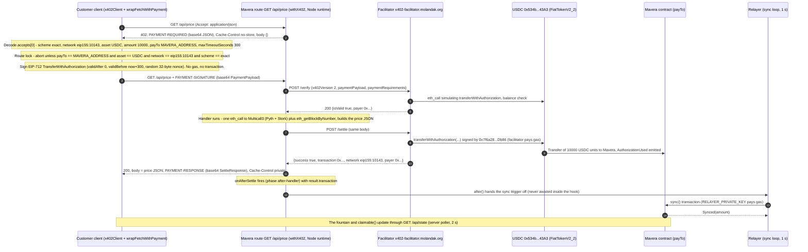
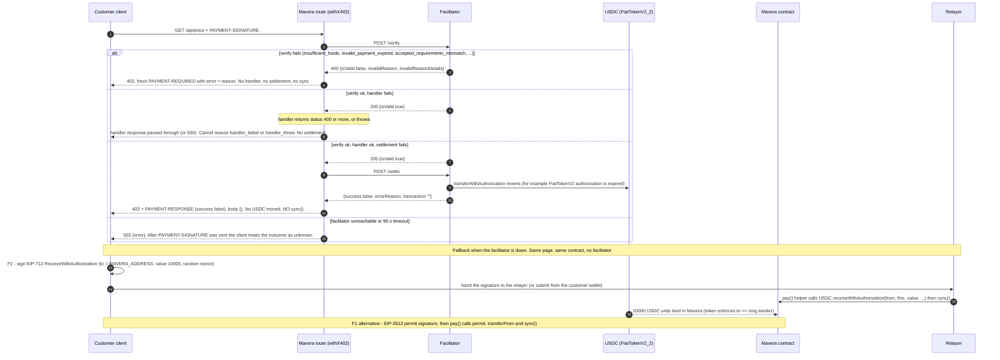

# x402 payment flow for `GET /api/price`

Mavera sells one thing: a paid HTTP endpoint, `GET /api/price`, that returns the live MON/USD price read from two independent oracles on Monad testnet. A customer (a script, an AI agent or the browser page) pays 0.01 USDC (10,000 atomic units, 6 decimals) per call over the x402 v2 protocol: the server answers `402` with a `PAYMENT-REQUIRED` header that names the `Mavera` contract as the payee, the customer signs a gasless EIP-3009 `transferWithAuthorization`, the Monad facilitator verifies and settles the USDC transfer on-chain and pays the gas, and the cent lands in the contract, never in the developer's account. A relayer then calls `sync()` so the cent is booked to share holders. This document fixes the wire format, route configuration, settlement observation, client behaviour, facilitator and USDC facts, the data payload, environment variables, error vocabulary, pitfalls, the 60-minute integration plan and the two facilitator-free fallbacks (F2 `receiveWithAuthorization`, F1 `permit`). Every fact was checked against the `@x402/*@2.28.0` tarballs, the x402 specification and live Monad testnet reads on 2026-10-24 (section 16); unknowns are marked "TBD on event day". The contract is specified in [docs/02-CONTRACT-SPEC.md](02-CONTRACT-SPEC.md), the page in [docs/04-FRONTEND.md](04-FRONTEND.md), the event-day commands in [docs/07-RUNBOOK.md](07-RUNBOOK.md).

## 1. Where x402 sits in Mavera

Finance first: x402 is the cash register, not the product. The product is the share token whose revenue is the stream of these one-cent payments ([docs/00-OVERVIEW.md](00-OVERVIEW.md)). What x402 adds over a card processor such as Stripe: the payee written into every price challenge is a smart contract, the payer can be a machine with a wallet and no bank account, and the money is on-chain the moment it settles, so the distribution to holders needs no trust in the operator. The chain cannot force a server to name the contract as payee (the server SDK even allows a per-request `DynamicPayTo`), so Mavera adds a **route lock**: the customer's client refuses to sign unless `payTo == MAVERA_ADDRESS`, `asset == USDC`, `network == eip155:10143` and `scheme == exact`, and the contract exposes trivial `payTo()` and `endpoint()` views for the client to compare against. Honest prior art (x402commit, Bondrail) is in [docs/09-COMPETITIVE-LANDSCAPE.md](09-COMPETITIVE-LANDSCAPE.md).

| Step | Where it happens | Who pays gas | Proof the jury can check |
| --- | --- | --- | --- |
| Price challenge (`402`) | off-chain, Mavera route on Vercel | nobody | `PAYMENT-REQUIRED` header |
| Payment authorization | off-chain, customer wallet (EIP-712 signature) | nobody | `PAYMENT-SIGNATURE` header |
| Verification | off-chain, facilitator simulates with `eth_call` | nobody | `/verify` response |
| Settlement | on-chain, USDC `transferWithAuthorization` sent by the facilitator signer | facilitator `0x7f6a2850669202519f0FE8aa912451238820Db86` | tx hash in `PAYMENT-RESPONSE`; `Transfer` and `AuthorizationUsed` logs on testnet.monadscan.com |
| Distribution (`sync()`) | on-chain, `Mavera` contract | relayer (`RELAYER_PRIVATE_KEY`) | `Synced(amount)` event |
| Claim (`claim()`) | on-chain, `Mavera` contract | the holder | `Claimed` event, USDC balance change |

The scheme is `exact` (one fixed amount, one signature, one real transfer per call). `upto` was rejected because it routes through Permit2 (`0x000000000022d473030f116ddee9f6b43ac78ba3`, proxy `0x4020A4f3b7b90ccA423B9fabCc0CE57C6C240002`) and needs an on-chain approval by the payer: [docs/adr/ADR-0004-x402-exact-vs-upto.md](adr/ADR-0004-x402-exact-vs-upto.md). The asset choice (Circle testnet USDC, not the devnads test token) is [docs/adr/ADR-0005-usdc-choice.md](adr/ADR-0005-usdc-choice.md).

## 2. Happy path



Diagram 3: one paid call. Settlement happens only after the handler returned a status below 400; the transaction hash reaches the server through the `onAfterSettle` hook and the client through the `PAYMENT-RESPONSE` header.

What each step means for the money:

1. Steps 1–5 cost nothing. The `402` is produced by `withX402` after it has synced with the facilitator (`GET /supported` at start-up), so the facilitator is a dependency even for the challenge. The signature is an EIP-712 message under the USDC domain `{ name: "USDC", version: "2", chainId: 10143, verifyingContract: 0x534b2f3A21130d7a60830c2Df862319e593943A3 }`; the customer needs no MON.
2. Steps 7–10: the facilitator recovers the signer, checks the USDC balance and the amount, and simulates the transfer; `isValid: false` comes back as HTTP 400 and the route answers `402` again. The handler then runs unpaid-so-far: a status of 400 or more means nothing is settled and the customer is not charged.
3. Steps 11–14: one on-chain transaction, sent and paid by the facilitator signer (estimate 141,817 gas, about 0.014 MON at the 100 MON-gwei base-fee floor, charged on gas limit). The USDC moves straight into the contract.
4. Steps 15–19: the paid response and the distribution. `claimable()` is pending-inclusive (it simulates `sync()`), so the fountain can show the new entitlement as soon as the settlement transaction is visible, before the relayer's `sync()` lands. `sync()` is permissionless and idempotent, so the hook-triggered call and the 1-second polling relayer may both fire; the second one early-returns because `pending() == 0`.

## 3. Failure paths and the facilitator-free fallback



Diagram 4: the failure classes and the fallback. In every failure class no `sync()` runs, because no USDC reached the contract.

| Condition | HTTP to the customer | Header carried | On-chain effect | `sync()` |
| --- | --- | --- | --- | --- |
| No `PAYMENT-SIGNATURE` | `402` | `PAYMENT-REQUIRED`, `Cache-Control: no-store` | none | no |
| `/verify` returns `isValid: false` (HTTP 400 from the facilitator) | `402` | `PAYMENT-REQUIRED` with `error` = `invalidReason` | none | no |
| Handler returns status 400 or more, or throws | handler's status, or `500` | none | none (`cancel` reason `handler_failed` or `handler_threw`) | no |
| `/settle` returns `success: false` | `402` | `PAYMENT-RESPONSE` with `errorReason`, `transaction: ""` | none | no |
| `settlement_pending` | `200` if the single SDK retry succeeds, otherwise `402` | `PAYMENT-RESPONSE` with a non-empty `transaction` | tx broadcast, receipt unknown | relayer poll decides |
| Facilitator unreachable, malformed, or 90,000 ms timeout | `502` `{ "error": ... }` | none | unknown (a timeout is an indeterminate outcome) | relayer poll decides |

**Fallbacks** (chosen at the gates in section 14; both need no facilitator and leave the page, the fountain, `sync()` and `claim()` unchanged):

| | F2 (primary): `receiveWithAuthorization` via a `pay()` helper | F1 (secondary): EIP-2612 `permit` + `pay()` |
| --- | --- | --- |
| Customer signs | EIP-712 `ReceiveWithAuthorization(from, to, value, validAfter, validBefore, nonce)` under the same USDC domain as x402, random `bytes32` nonce | EIP-712 `Permit(owner, spender, value, nonce, deadline)`; sequential `nonces(owner)` must be read before signing |
| Contract helper does (gas from live `cast estimate`) | `usdc.receiveWithAuthorization(from, address(this), value, validAfter, validBefore, nonce, signature)` then `sync()`; about 141,817 gas for the token call, budget about 300,000 gas for the helper | `usdc.permit(owner, address(this), value, deadline, signature)` then `usdc.transferFrom(owner, address(this), value)` then `sync()`; about 149,028 gas for `permit` alone, budget about 300,000 gas |
| Who sends the transaction | relayer (customer needs no MON) or the customer | relayer (if the helper takes `owner` as an argument) or the customer |
| Why it is safe | the token requires `to == msg.sender`: a stolen signature cannot be redirected and nobody else can consume it | funds can only move to the contract; `permit` has no `msg.sender` check so anyone may submit |

The helper's exact name and signature are TBD on event day and belong to [docs/02-CONTRACT-SPEC.md](02-CONTRACT-SPEC.md) (the research draft calls the EIP-3009 variant `payWithAuthorization`). Both token functions were exercised with real signatures by `eth_call` on 2026-10-24 (section 9). F2 keeps the demo narrative identical to x402: the customer only signs, a relayer pays gas.

## 4. Wire format

Headers (spec: https://docs.x402.org/core-concepts/http-402.md and https://github.com/x402-foundation/x402/blob/main/specs/transports-v2/http.md, accessed 2026-10-24): "All headers contain valid Base64-encoded JSON strings." v1 used `X-PAYMENT` / `X-PAYMENT-RESPONSE`; `@x402/next@2.28.0` still reads `x-payment` as a fallback.

| Header | Direction | Body (base64 JSON) | When |
| --- | --- | --- | --- |
| `PAYMENT-REQUIRED` | server to client | `PaymentRequired` `{ x402Version, error?, resource, accepts[], extensions? }` | every `402`, with `Cache-Control: no-store` and JSON body `{}` |
| `PAYMENT-SIGNATURE` | client to server | `PaymentPayload` `{ x402Version, resource?, accepted, payload, extensions? }`; for `exact` on EVM `payload` = `{ signature, authorization: { from, to, value, validAfter, validBefore, nonce } }` (spec https://github.com/x402-foundation/x402/blob/main/specs/schemes/exact/scheme_exact_evm.md) | the paid retry |
| `PAYMENT-RESPONSE` | server to client | `SettleResponse` `{ success, errorReason?, errorMessage?, payer?, transaction, network, amount? }` | the `200` and the settlement-failure `402`, with `Cache-Control` containing `private` |

The `402` body Mavera emits (shape from the spec example; values from section 5; the URL defaults to the request URL):

```json
{
  "x402Version": 2,
  "error": "PAYMENT-SIGNATURE header is required",
  "resource": { "url": "https://<APP_HOST>/api/price", "description": "MON/USD from two oracles on Monad testnet", "mimeType": "application/json" },
  "accepts": [{ "scheme": "exact", "network": "eip155:10143", "asset": "0x534b2f3A21130d7a60830c2Df862319e593943A3",
                "amount": "10000", "payTo": "<MAVERA_ADDRESS>", "maxTimeoutSeconds": 300, "extra": { "name": "USDC", "version": "2" } }]
}
```

Naming traps: the v2 amount field is `amount` (v1: `maxAmountRequired`); `resource`, `description` and `mimeType` are top-level in v2; the settlement hash field is `transaction` (not `txHash`); the wire scheme id is `exact` (the Monad guide's `v2-eip155-exact` is a table label, never a value). Spec error codes (https://github.com/x402-foundation/x402/blob/main/specs/x402-specification-v2.md, section 9): `insufficient_funds`, `invalid_exact_evm_payload_authorization_valid_after`, `invalid_exact_evm_payload_authorization_valid_before`, `invalid_exact_evm_payload_authorization_value_mismatch`, `invalid_exact_evm_payload_signature`, `invalid_exact_evm_payload_recipient_mismatch`, `invalid_network`, `invalid_payload`, `invalid_payment_requirements`, `invalid_scheme`, `unsupported_scheme`, `invalid_x402_version`, `invalid_transaction_state`, `unexpected_verify_error`, `unexpected_settle_error`, `settlement_pending`.

## 5. Route configuration

The route module exports `GET` as the result of `withX402(handler, routeConfig, server)` from `@x402/next@2.28.0`, where `server` is an `x402ResourceServer` built on `HTTPFacilitatorClient({ url: X402_FACILITATOR_URL })` with the server-side `ExactEvmScheme` from `@x402/evm/exact/server` registered for `eip155:10143`. Reference signature (quoted from `@x402/next@2.28.0 dist/esm/index.d.ts`):

```ts
declare function withX402<T = unknown>(
  routeHandler: (request: NextRequest) => Promise<NextResponse<T>>,
  routes: RoutesConfig,
  server: x402ResourceServer,
  paywallConfig?: PaywallConfig,
  paywall?: PaywallProvider,
  syncFacilitatorOnStart?: boolean
): (request: NextRequest) => Promise<NextResponse<T>>;
```

| Parameter | Mavera value | Why |
| --- | --- | --- |
| `routes` form | bare `RouteConfig` (no path key) | a keyed map whose key does not equal the served path runs the handler **unpaid** with one `console.warn`; the bare form "matches any path" |
| `accepts.scheme` | `exact` | wire id from `/supported`; fixed price, one transfer per call |
| `accepts.network` | `eip155:10143` (`X402_NETWORK`) | CAIP-2 id of Monad testnet (chain id 10143) |
| `accepts.payTo` | `PAY_TO` = `MAVERA_ADDRESS` (the env schema refuses a mismatch) | the contract is the payee: the server side of the route lock |
| `accepts.price` | `AssetAmount` `{ amount: "10000", asset: USDC_ADDRESS, extra: { name: "USDC", version: "2" } }` (`X402_PRICE_ATOMIC`) | passthrough, no float math, no table dependency; `extra` is what the signer needs for EIP-712 |
| `accepts.price` alternative | `"$0.01"` | resolves to the same requirement because `@x402/evm@2.28.0` ships Monad testnet USDC in its default asset table (`eip155:10143`, `0x534b2f3A21130d7a60830c2Df862319e593943A3`, name `USDC`, version `2`, 6 decimals); parsed as a string (`"0.01"` to `"10000"`), digits beyond 6 decimals truncated |
| `accepts.maxTimeoutSeconds` | `300` (`X402_MAX_TIMEOUT_SECONDS`; SDK default) | the client signs `validBefore = now + maxTimeoutSeconds`; keep at least 60 s for clock skew |
| `description`, `mimeType`, `extensions`, `resource`, `unpaidResponseBody` | short text, `application/json`, none, omitted, omitted | the whole `PaymentRequired` travels in one header and Node `fetch` fails above 16 KB of headers, so no Bazaar extensions; `resource` defaults to the real request URL (the Monad guide's `http://localhost:3000/...` would be advertised in production); the `402` body stays `{}` |
| `syncFacilitatorOnStart` | default `true` | `initialize()` fetches `/supported` and validates the route; a cold start pays about 0.3 s |
| Runtime, caching | Node runtime (default, no `runtime` export); GET handlers are dynamic by default in Next 16 | the SDK uses `Buffer`; it sets `no-store` on the `402` and `private` on the `200`; do not add `revalidate` or `force-static` |

Implementation note (`web/src/app/api/price/route.ts`): the `x402ResourceServer` and the route config are built lazily on the first request (`paid ??= buildPaidHandler()`), so `next build` and CI need neither real env values nor facilitator access, and the first paid request pays the `/supported` round-trip instead of a module-load cold start.

`registerMoneyParser` is **not required** on 2.28.0. The Monad guide (https://docs.monad.xyz/guides/x402.md, accessed 2026-10-24) says testnet "requires the custom money parser"; that was true for `@x402/evm@2.22.0`, whose table had only `eip155:143`, and is stale for 2.28.0. A parser is harmless; if one is kept its type is `(amount: string | number, network: Network) => Promise<AssetAmount | null>` and it receives the decimal string `"0.01"`.

## 6. Observing settlement on the server

The handler runs before settlement, so it never sees the transaction hash. The hash reaches the server through a lifecycle hook (https://docs.x402.org/advanced-concepts/lifecycle-hooks.md, accessed 2026-10-24). Reference types (quoted from `@x402/core@2.28.0`):

```ts
type AfterSettleHook = (context: SettleResultContext) => Promise<void>;
interface SettleResultContext extends SettleContext { result: DeepReadonly<SettleResponse>; }
type SettlePhase = "before-handler" | "after-handler" | "cancel";
```

| Fact | Consequence for Mavera |
| --- | --- |
| `server.onAfterSettle(hook)` fires with `phase == "after-handler"` for `exact`; `ctx.result.transaction` is the hash, `ctx.result.payer` the customer; `onSettleFailure` and `onVerifiedPaymentCanceled` cover the failure paths | the only server-side place to log the settlement and start the `sync()` trigger; log the failure hooks but never call `sync()` from them (no money moved) |
| Hooks are awaited inside `processSettlement`, before the HTTP response is written | never await the `sync()` transaction in the hook; the paid response would wait for a Monad receipt |
| A throwing hook is caught and only `console.warn`-ed (`warnResourceServerHookFailure`); nothing is retried and the paid response still succeeds | the trigger owns its own `try/catch` and a structured log line (hash, payer, amount) |
| `after()` from `next/server` runs work after the response is finished; usable in Route Handlers; stable since Next 15.1.0; on Vercel backed by `waitUntil` (https://nextjs.org/docs/app/api-reference/functions/after, accessed 2026-10-24) | hand the `sync()` send to `after()`; whether `after()` can be called from inside the hook is UNVERIFIED, test at checkpoint D (section 14) |
| Vercel function duration with Fluid compute: default and maximum 300 s on Hobby (https://vercel.com/docs/functions/configuring-functions/duration, accessed 2026-10-24); `after` runs within the route's duration | the 90 s facilitator timeout plus one `sync()` transaction fits; no `maxDuration` export needed |
| `sync()` is permissionless and idempotent (`pending() == 0` returns early) | a **1-second polling relayer that compares `usdc.balanceOf(mavera)` with the contract's accounted balance is the source of truth**; the hook is an accelerator and double triggers are harmless |
| `/supported` also advertises `batch-settlement` (escrow channels, off-chain vouchers, batched claims) | not registered by Mavera, so it cannot be selected; still **verify at the first settlement that one paid call is one on-chain transaction** (section 15) |

Attribution is decided in the contract, not here: the default is `sync()` inside `_update` so every payment is split among the holders of record at that instant ([docs/02-CONTRACT-SPEC.md](02-CONTRACT-SPEC.md), [docs/adr/ADR-0002-pull-vs-push-dividends.md](adr/ADR-0002-pull-vs-push-dividends.md)).

## 7. Client side (customer script, load test, browser button)

Reference signatures (quoted from `@x402/fetch@2.28.0` and `@x402/core@2.28.0`):

```ts
declare function wrapFetchWithPayment(fetch: typeof globalThis.fetch, client: x402Client | x402HTTPClient): (input: RequestInfo | URL, init?: RequestInit) => Promise<Response>;
declare class x402Client {
  constructor(paymentRequirementsSelector?: SelectPaymentRequirements);
  register(network: Network, client: SchemeNetworkClient): x402Client;
  setSpendControls(controls: SpendControls | false): x402Client;   // SpendControls.maxAmountPerPayment defaults to "$1"
  onBeforePaymentCreation(hook: BeforePaymentCreationHook): x402Client;   // return { abort: true, reason } to refuse
}
declare function decodePaymentResponseHeader(paymentResponseHeader: string): SettleResponse;
```

| Concern | Decision |
| --- | --- |
| Registration | one `x402Client`; `register("eip155:10143", <client ExactEvmScheme>)` with the signer. The client `ExactEvmScheme` is imported from `@x402/evm` or `@x402/evm/exact/client`; the server class with the same name lives in `@x402/evm/exact/server` |
| Signer | script: a viem `privateKeyToAccount(CUSTOMER_PRIVATE_KEY)` account is already a valid `ClientEvmSigner`; browser: an adapter `{ address, signTypedData }` over the wagmi wallet client; `toClientEvmSigner` is only needed for Permit2 extensions |
| Fetch wrapper | `wrapFetchWithPayment(fetch, client)`: first request; on `402` decode the header, create the payload, retry once with `PAYMENT-SIGNATURE`; refuses to pay twice (`Payment already attempted`) |
| Route lock | `onBeforePaymentCreation` returns `{ abort: true, reason }` unless `selectedRequirements.payTo` equals `MAVERA_ADDRESS`, `asset` equals `USDC_ADDRESS` (case-insensitive), `network` is `eip155:10143` and `scheme` is `exact`; optionally a `paymentRequirementsSelector` that only picks such a requirement. The hook runs before any signature exists |
| Spend controls | default cap `$1` per payment and only default-table assets; Monad testnet USDC qualifies, so `$0.01` passes untouched; `setSpendControls(false)` only to bisect "no matching requirements" errors |
| Signed values | `validAfter: "0"`, `validBefore: now + maxTimeoutSeconds` (300 s), `nonce` = 32 random bytes; the reference client never lets the user choose these |
| Reading the result | `decodePaymentResponseHeader(res.headers.get("PAYMENT-RESPONSE"))` or `x402HTTPClient.processResponse(res)` → `{ paymentStatus: "settled", header: SettleResponse }`; `header.transaction` becomes the link `NEXT_PUBLIC_EXPLORER_URL/tx/<hash>` |
| Headers | send `Accept: application/json`; a request whose `Accept` contains `text/html` and whose `User-Agent` contains `Mozilla` gets an HTML paywall page instead of JSON |
| Retries | after a `PAYMENT-SIGNATURE` was sent, treat the outcome as unknown: read `PAYMENT-RESPONSE`, never loop on `402`; the load test runs calls sequentially (one in flight) |
| CORS | page and `/api/price` share the Vercel origin, so nothing to do; the SDK adds no `Access-Control-Expose-Headers` (x402 issue #3722) |

`scripts/customer.ts` (one paid call) and `scripts/load-test.ts` (about 50 sequential calls) implement this table ([scripts/README.md](../scripts/README.md)); the browser "Call API" button reuses the same client with the wallet signer ([docs/04-FRONTEND.md](04-FRONTEND.md)).

## 8. Facilitator facts

`X402_FACILITATOR_URL=https://x402-facilitator.molandak.org`, operated for Monad (Monad docs: "The facilitator settles the payment onchain, covering gas fees.", https://docs.monad.xyz/tooling-and-infra/agentic-payments.md, accessed 2026-10-24). Live `GET /supported` on 2026-10-24 (HTTP 200, verbatim):

```json
{ "extensions": [],
  "kinds": [
    { "network": "eip155:10143", "scheme": "batch-settlement", "x402Version": 2 },
    { "network": "eip155:143",   "scheme": "batch-settlement", "x402Version": 2 },
    { "extra": { "facilitatorAddress": "0x7f6a2850669202519f0fe8aa912451238820db86" }, "network": "eip155:10143", "scheme": "upto", "x402Version": 2 },
    { "extra": {}, "network": "eip155:10143", "scheme": "exact", "x402Version": 2 },
    { "extra": {}, "network": "eip155:143",   "scheme": "exact", "x402Version": 2 },
    { "extra": { "facilitatorAddress": "0x7f6a2850669202519f0fe8aa912451238820db86" }, "network": "eip155:143", "scheme": "upto", "x402Version": 2 } ],
  "signers": { "eip155:10143": ["0x7f6a2850669202519f0FE8aa912451238820Db86"], "eip155:143": ["0x7f6a2850669202519f0FE8aa912451238820Db86"] } }
```

| Fact (live probes 2026-10-24, no funds moved) | Value |
| --- | --- |
| Endpoints and request body | `GET /supported`, `POST /verify`, `POST /settle`; root `GET /` answers `Hello from x402-facilitator-local!` (a Rust `x402-rs` build; exact version UNVERIFIED). Body: spec shape `{ x402Version: 2, paymentPayload, paymentRequirements }` (what `HTTPFacilitatorClient` sends); a second, bare `PaymentPayload` shape is also accepted, but only when it includes `resource`, otherwise the answer is a misleading `unsupported_scheme` |
| Responses | `/verify`: `200 { isValid: true, payer }` or `400 { isValid: false, invalidReason, invalidReasonDetails, payer: "" }` (the SDK type calls the detail `invalidMessage`); `/settle`: `{ success, transaction, network, payer, errorReason?, errorMessage? }`; an empty `{}` body answers `400 unsupported_scheme` on both |
| Auth, CORS, limits | no authentication; `access-control-allow-origin: *`, `OPTIONS` allows `GET,POST`; no `RateLimit-*` or `Retry-After` headers seen; Cloudflare bot management (`__cf_bm`) in front of a Railway deployment; rate limits undocumented |
| Gas | paid by the signer `0x7f6a2850669202519f0FE8aa912451238820Db86`: about 4,964 MON, 0 USDC, nonce 22,095 at block 73,671,505 (a moving number); one `exact` settlement estimates at 141,817 gas, about 0.014 MON at the 100 MON-gwei floor |
| Validity window | rejects already-expired authorizations (`invalid_payment_expired`, checked before the signature) but does **not** enforce `validBefore <= now + maxTimeoutSeconds` (a `maxTimeoutSeconds: 5` requirement with `validBefore = now + 300` verified as valid) |
| Contract as `payTo` | accepted: a spec-shaped `/verify` with `payTo` = Multicall3 `0xcA11bde05977b3631167028862bE2a173976CA11` returned `isValid: true`. Caveat: `payTo` = the USDC contract itself fails with HTTP 500 `unexpected_error ... Blacklistable: account is blacklisted` |
| SDK client | `HTTPFacilitatorClient` timeout 90,000 ms; `getSupported()` retries on 429; `settleWithPendingRetry` retries exactly once on `settlement_pending` |

## 9. USDC facts (the only asset the route accepts)

All reads by `cast` 1.8.6 against `https://testnet-rpc.monad.xyz` on 2026-10-24 (blocks 73,663,297 and 73,671,505). Issuer: Circle, listed as "Monad Testnet" at https://developers.circle.com/stablecoins/usdc-contract-addresses (accessed 2026-10-24).

| Property | Value |
| --- | --- |
| Address (`USDC_ADDRESS`, `NEXT_PUBLIC_USDC_ADDRESS`) | `0x534b2f3A21130d7a60830c2Df862319e593943A3` |
| Code | `FiatTokenProxy` (Circle proxy, not EIP-1967) in front of `FiatTokenV2_2` at `0x21240161521D6854BE79F7D3a0A65c6BeDDB42fb`; Sourcify full match, solc 0.6.12, verified 2026-10-10, deployer `0xD1e4098de8667a491Eb2Bf5acf09ED7F67260BCA` (https://sourcify.dev/server/v2/contract/10143/0x534b2f3A21130d7a60830c2Df862319e593943A3) |
| Metadata and EIP-712 domain | `name()` `USDC`, `symbol()` `USDC`, `version()` `2`, `decimals()` `6`; domain `{ name: "USDC", version: "2", chainId: 10143, verifyingContract: 0x534b...43A3 }`; `DOMAIN_SEPARATOR()` = `0xf1090f5a61ddee19528cecc447be0f91c7205fc2b34dd271fc0de87809a0a48d` (recomputed match; the name `USD Coin` would give `0xb75d4809...d0ed` and the signature reverts `FiatTokenV2: invalid signature`) |
| EIP-3009 | present: `TRANSFER_WITH_AUTHORIZATION_TYPEHASH` `0x7c7c6cdb67a18743f49ec6fa9b35f50d52ed05cbed4cc592e13b44501c1a2267`, `RECEIVE_WITH_AUTHORIZATION_TYPEHASH` `0xd099cc98ef71107a616c4f0f941f04c322d8e254fe26b3c6668db87aae413de8`, `cancelAuthorization`, `authorizationState(address,bytes32)`; strict bounds `now > validAfter` and `now < validBefore`; nonces are arbitrary single-use `bytes32`. A real `TransferWithAuthorization` signature passed `eth_call` (estimate 141,817 gas from the facilitator signer); `receiveWithAuthorization` from a non-payee reverts `FiatTokenV2: caller must be the payee` |
| EIP-2612 | present: `PERMIT_TYPEHASH` `0x6e71edae12b1b97f4d1f60370fef10105fa2faae0126114a169c64845d6126c9`, sequential `nonces(owner)`, `permit(...)` in `(v, r, s)` and `bytes signature` forms; `deadline >= now` or `type(uint256).max`; a real `Permit` passed `eth_call` (estimate 149,028 gas) |
| Circle controls | `paused() == false`; `owner`/`pauser` `0x7A154EA9156D354504ad9A401380AA548039BE8b`, `blacklister` `0xA5a9723c4D658a6F92701ce3A5246Fa7d4723c26`: pause and blacklist are a trust assumption ([docs/06-THREAT-MODEL.md](06-THREAT-MODEL.md)) |
| Faucet | https://faucet.circle.com (accessed 2026-10-24): "Send 20 USDC", one request per asset and network per address every 2 hours; the Monad guide's and the handoff's "1 USDC" are outdated. One request funds 2,000 calls at 0.01 USDC ([scripts/faucet-notes.md](../scripts/faucet-notes.md)) |
| Not the asset | devnads test USDC `0x56bf9CDc3C1876F3F22655a0016C2743E9e39a73` ("Test USD Coin", EIP-2612 only, **no EIP-3009**: `authorizationState` reverts); Kuru and Garden test "USDC" tokens; mainnet USDC `0x754704Bc059F8C67012fEd69BC8A327a5aafb603` is `eip155:143` only |

Boot-time assertion for the server (configuration, not code): `chainId == 10143`, `name() == "USDC"`, `version() == "2"`, `decimals() == 6` on `USDC_ADDRESS`, and `PAY_TO == MAVERA_ADDRESS` (already enforced by [web/src/lib/env.ts](../web/src/lib/env.ts)).

## 10. The data behind the cent: what `GET /api/price` returns

Framing for the pitch: "every call pays one cent for the MON/USD price that two oracle networks just posted to Monad, read in one `eth_call`". `DATA_MODE=oracle` reads Pyth and Stork through Multicall3 `0xcA11bde05977b3631167028862bE2a173976CA11` (`aggregate3`; canonical address per https://docs.monad.xyz/developer-essentials/testnet.md, accessed 2026-10-24) plus one `eth_getBlockByNumber`; `DATA_MODE=heartbeat` drops the oracle reads and serves chain data only (zero third-party risk). Warm RPC latency measured 0.11–0.20 s per call; the facilitator round trips dominate.

| Field | Meaning | Source |
| --- | --- | --- |
| `pair` | `"MON/USD"` | constant |
| `price_usd` | median of the sources that are within their own validity period | computed |
| `sources[]` `{ name, contract, price, published_at, age_s, valid_for_s }` | one entry per oracle; `published_at` is the on-chain publish time, `age_s = block_timestamp - published_at`, `valid_for_s` the oracle's own validity | Pyth, Stork |
| `spread_bps` | relative gap between the two prices in basis points | computed |
| `block_number`, `block_timestamp`, `finalized_block` | `latest` (Proposed) and `finalized` heights | `eth_getBlockByNumber` |
| `epoch`, `proposer_val_id`, `validator_count` | `getEpoch()`, `getProposerValId()`, `getConsensusValidatorSet(uint32)` (200 validators) on the staking precompile `0x0000000000000000000000000000000000001000` (https://docs.monad.xyz/reference/staking/api.md); `CALL` only, so `eth_call` works | precompile |
| `rpc_latency_ms` | wall time of the RPC round trip | server |

| Source | Contract | Read | Scaling | Validity | Live 2026-10-24 00:32:39Z |
| --- | --- | --- | --- | --- | --- |
| Pyth Core Compatible | `0xFC6bd9F9f0c6481c6Af3A7Eb46b296A5B85ed379` (`PYTH_ADDRESS`), feed `0x31491744e2dbf6df7fcf4ac0820d18a609b49076d45066d3568424e62f686cd1` (`PYTH_MON_USD_FEED_ID`) | `getPriceUnsafe(bytes32)` → `(price, conf, expo, publishTime)` | `price * 10^expo`, expo −8 | 60 s (`getValidTimePeriod()`); new publish every 6–15 s observed | 0.02131383 USD, age 5 s |
| Stork | `0xacC0a0cF13571d30B4b8637996F5D6D774d4fd62` (`STORK_ADDRESS`), id `keccak256("MONUSD")` = `0xa4f6b07ae0c89e3f3cc03c1badcc3e9adffdf7206bafcd56d142979800887385` | `getTemporalNumericValueUnsafeV1(bytes32)` → `(timestampNs, quantizedValue)` | value / 1e18, timestamp in ns | 3,600 s (`validTimePeriodSeconds()`); deviation-gated 0.02 % pushes, so multi-minute ages are normal | 0.021325689575 USD, age 72 s |

Rules that follow from the research (https://docs.pyth.network/price-feeds/core/upgrade/contracts, https://docs.stork.network/resources/stork-pushed-assets, accessed 2026-10-24):

- Use **per-source validity**, never a flat 120 s threshold; a flat threshold would wrongly flag Stork.
- Pyth `0x2880aB155794e7179c9eE2e38200202908C17B43` (the address Monad docs list) is live, but its MON/USD feed has not been pushed since 2026-09-29; the MON/USD pusher writes only to `0xFC6b...`. Do not read MON/USD from it and do not call it "legacy". No keyless Hermes pull exists (`/v2/updates/price/latest` answers 401), so if the Pyth pusher stops, Stork is the only fresh MON/USD source. Rehearse `DATA_MODE=heartbeat` once before the demo.
- Map oracle custom errors (Pyth `StalePrice` `0x19abf40e`, Stork `StaleValue` `0x24c4fe43` and `NotFound` `0xc5723b51`) to a `sources[]` entry marked invalid, not to a 500; a handler status of 400 or more means the customer is **not** charged.
- Optional DEX flavour: Uniswap v4 StateView `0xB639209539c61BaF67AC04876315786F8D0b153c`.`getSlot0(0x40ab892dad820a1b57392a8a6e7c783e108a2285e83d3a6dbf1dd44902a19972)` shows about 1.01 USDC per MON of test liquidity; label it "pool state", never "price".
- Browsers never call the RPC: the page polls `GET /api/state` (server poller, cached about 1 s) every 2 s, because the public RPC caps `eth_call` at 25 rps and `eth_getLogs` at `toBlock - fromBlock <= 100` (https://docs.monad.xyz/reference/rpc-limits.md).

## 11. Environment variables used by this flow

Exact names from [.env.example](../.env.example); schema in [web/src/lib/env.ts](../web/src/lib/env.ts). One root `.env`, linked by `pnpm env:link`.

| Variable | Value | Used by |
| --- | --- | --- |
| `X402_FACILITATOR_URL`, `X402_NETWORK` | `https://x402-facilitator.molandak.org`, `eip155:10143` | `HTTPFacilitatorClient` and smoke tests; route `accepts.network` and client registration |
| `USDC_ADDRESS`, `NEXT_PUBLIC_USDC_ADDRESS` | `0x534b2f3A21130d7a60830c2Df862319e593943A3` | `AssetAmount.asset`, client route lock, UI balances |
| `X402_PRICE_ATOMIC`, `X402_MAX_TIMEOUT_SECONDS` | `10000` (= 0.01 USDC), `300` | `AssetAmount.amount`, `accepts.maxTimeoutSeconds` |
| `MAVERA_ADDRESS`, `NEXT_PUBLIC_MAVERA_ADDRESS` | TBD on event day (deployed contract) | relayer, UI, client route lock |
| `PAY_TO` | must equal `MAVERA_ADDRESS` | `accepts.payTo` |
| `DATA_MODE` | `oracle` or `heartbeat` | handler |
| `PYTH_ADDRESS`, `PYTH_MON_USD_FEED_ID`, `STORK_ADDRESS`, `MULTICALL3_ADDRESS` | see section 10 | handler (`oracle` mode) |
| `MONAD_RPC_URL`, `MONAD_CHAIN_ID` | `https://testnet-rpc.monad.xyz`, `10143` (alternate RPC `https://rpc-testnet.monadinfra.com`, 20 rps) | handler, relayer |
| `RELAYER_PRIVATE_KEY`, `CUSTOMER_PRIVATE_KEY` | relayer funded with more than 10 MON (reserve-balance budget) plus gas; customer funded with 20 USDC from the Circle faucet, scripts only, never in the web app | `sync()` sender; `scripts/customer.ts`, `scripts/load-test.ts` |
| `API_URL`, `NEXT_PUBLIC_EXPLORER_URL` | `http://localhost:3000` locally (the Vercel URL in the demo); `https://testnet.monadscan.com` | scripts; explorer links for `transaction` |

## 12. Error vocabulary

| Where | String | Meaning / action |
| --- | --- | --- |
| Facilitator `/verify`, HTTP 400 | `insufficient_funds` | payer's USDC balance below `amount`; fund from the faucet |
| Facilitator `/verify`, HTTP 400 | `invalid_payment_amount`, `accepted_requirements_mismatch` | `authorization.value` differs from `amount`; `paymentPayload.accepted` differs from `paymentRequirements` |
| Facilitator `/verify`, HTTP 400 | `invalid_payment_expired` | `validBefore` already past (checked before the signature): clock skew or a stale retry |
| Facilitator, HTTP 400 | `unsupported_scheme`, `invalid_format` | wrong scheme or network, empty body, the bare body shape without `resource`; body did not deserialize (for example an empty `signature`) |
| Facilitator, HTTP 500 | `unexpected_error` | the simulation reverted; the revert string is in `invalidReasonDetails` (seen: `ECRecover: invalid signature 'v' value`, `Blacklistable: account is blacklisted`) |
| Facilitator or spec | `settlement_pending` | tx broadcast, receipt not established; `transaction` must be non-empty; the SDK retries once |
| USDC revert | `FiatTokenV2: authorization is expired`, `FiatTokenV2: authorization is not yet valid` | `now >= validBefore` at execution (window too short, settlement too slow); `now <= validAfter` (only hand-rolled payloads, the SDK signs `validAfter: "0"`) |
| USDC revert | `FiatTokenV2: authorization is used or canceled`, `FiatTokenV2: invalid signature` | nonce replay (harmless for Mavera because funds can only go to the contract); wrong EIP-712 domain (`USD Coin` instead of `USDC`) or wrong chain id |
| USDC revert | `FiatTokenV2: caller must be the payee`, `FiatTokenV2: permit is expired` | fallback F2 sent by anyone other than `to` (expected protection); fallback F1 `deadline` passed |
| `@x402/next` cancel reasons | `handler_failed`, `handler_threw` | handler status 400 or more, or an exception; no settlement |
| `@x402/core` and `@x402/fetch` errors | server: `VerifyError`, `SettleError`, `FacilitatorResponseError`, `FacilitatorTimeoutError`, `RouteConfigurationError` (`missing_scheme`, `missing_facilitator`, `unsupported_asset_transfer_method`, `unsupported_payment_flow`); client: `Failed to parse payment requirements`, `Failed to create payment payload`, `Payment already attempted` | `FacilitatorTimeoutError` is an indeterminate outcome; `Payment already attempted` means a retry-loop bug |

## 13. Pitfalls

1. **The facilitator is a hard dependency even for the `402`.** `initialize()` must fetch `/supported` before any challenge; a down facilitator surfaces as `502`. Smoke-test it first (section 15) and keep F2 ready. Cloudflare bot management in front of it never challenged curl or the SDK from a residential IP, but Vercel egress is UNVERIFIED: make the first paid call from the deployed app, not only from localhost.
2. **Validity window and clock skew.** The chain timestamp was 8 s ahead of the laptop clock during the probes; keep `maxTimeoutSeconds` at 300 s and never below 60 s.
3. **The hash arrives late, and hook exceptions are swallowed.** Only `onAfterSettle` (server) and `PAYMENT-RESPONSE` (client) carry the hash; a throwing hook is only `console.warn`-ed, so the trigger logs its own failures and the polling relayer keeps running.
4. **A route pattern mismatch serves the handler unpaid.** Use the bare `RouteConfig` form.
5. **Double signing on retries.** A client that loops on `402` after sending `PAYMENT-SIGNATURE` can pay twice; the fetch wrapper refuses, hand-rolled loops must too.
6. **HTTP details.** `Accept: text/html` plus a `Mozilla` user agent yields a paywall page, so scripts send `Accept: application/json`; Node runtime only (the SDK uses `Buffer`); GET handlers are dynamic by default, so do not add `revalidate`, `force-static` or a `runtime` export; the whole `PaymentRequired` is one header and Node `fetch` fails above 16 KB (x402 issue #3803).
7. **Wrong USDC or wrong domain name.** Four other "USDC" tokens live on testnet; the domain name is `USDC`, not `USD Coin` (x402 issue #3102). A blacklisted `payTo` (for example the USDC address pasted into `PAY_TO`) is a confusing 500, not a clean 400.
8. **`isValid: false` is HTTP 400, not an outage; spend controls bite silently.** Hand-rolled tooling must not treat 4xx as "down"; a `no matching requirements` error on a non-default asset points at the `$1` cap or the asset allow-list.
9. **`eth_getLogs` window of 100 blocks** (`toBlock - fromBlock <= 100`): read `totalDistributed()`, `pending()`, `claimable()` with `eth_call`; let the server poller emit the `Synced` feed.

## 14. The 60-minute integration box and the fallback decision rule

Slot 12:20–13:20 in [docs/07-RUNBOOK.md](07-RUNBOOK.md); the runbook's latest fallback decision is minute 60. Preconditions: `Mavera` deployed and `MAVERA_ADDRESS` set, the four `@x402/*` packages at `2.28.0`, relayer holding more than 10 MON, customer wallet holding 20 USDC. Checkpoints A–F come from the research report; the minute-30/45/60 gates below are the decision rule.

| Minute | Step | Checkpoint (binary) |
| --- | --- | --- |
| 0–5 | `GET /supported` smoke test and USDC `name()` check (section 15) | **A**: `exact` for `eip155:10143` present; `name()` = `USDC`. A fails → facilitator down → start F2 immediately |
| 5–20 | server singleton (`HTTPFacilitatorClient`, `x402ResourceServer` with the server `ExactEvmScheme` for `eip155:10143`, `onAfterSettle` logger) and the `GET /api/price` route with the section 5 configuration | **B**: `curl -si` returns `402` with `payment-required`; decoded `accepts[0]` matches the JSON in section 4 and `resource.url` is the request URL |
| 20–35 | `scripts/customer.ts`: `x402Client`, client `ExactEvmScheme` with `CUSTOMER_PRIVATE_KEY`, `onBeforePaymentCreation` route lock, `wrapFetchWithPayment`, print `processResponse` | **C**: `paymentStatus: "settled"`, `header.success == true`, `header.transaction` is a hash; receipt `status 1`, `to` = USDC, `from` = `0x7f6a...Db86`; `balanceOf(MAVERA_ADDRESS)` grew by 10,000 |
| 35–45 | `onAfterSettle` → `after()` → `sync()`; confirm `Synced(amount)` or `totalDistributed()` growth after one paid call | **D**: `totalDistributed()` increases within 1–2 s of the `200`; the log line shows the hash. If `after()` misbehaves, the polling relayer is the trigger (no fallback needed) |
| 45–55 | browser "Call API" button with the wallet signer, same origin | **E**: EIP-712 prompt (no gas), then `200` and the fountain moves |
| 55–60 | five paid calls back-to-back with the script; note the median latency; copy one hash into README | **F**: 5/5 settled, no `Payment already attempted`, no `settlement_pending`; each receipt is exactly one transaction with one `Transfer` to Mavera |

Decision rule (what must be true, otherwise what happens):

- **Minute 30**: B is green (the route serves the correct `402`). If A failed at minute 5, F2 is already under way. If A is green but B is not, the problem is local configuration: spend at most until minute 40 on it, then F2.
- **Minute 45**: C is green (one real settlement landed in the contract). If not, **switch to F2 now**: F2 is about 15 lines of Solidity plus one `signTypedData` call and needs the remaining 30 minutes. The x402 story stays in the pitch ("the facilitator was unavailable during the event; the same signature type is settled by our relayer").
- **Minute 60**: D and F are green. D red with C green is **not** a fallback case: keep x402 and use the polling relayer as the only trigger. F red because of `settlement_pending` or facilitator slowness: run the load test strictly sequentially and lower the demo to 20 calls; still no fallback.

## 15. Smoke tests: T+0 and the first settlement

T+0 (facilitator and token; one command per line, from the repo root with `.env` loaded):

```sh
curl -sS https://x402-facilitator.molandak.org/supported | jq '.kinds[] | select(.network == "eip155:10143")'
curl -sS -X POST https://x402-facilitator.molandak.org/verify -H 'Content-Type: application/json' -d '{}'
cast call 0x534b2f3A21130d7a60830c2Df862319e593943A3 "name()(string)" --rpc-url https://testnet-rpc.monad.xyz
cast call 0x534b2f3A21130d7a60830c2Df862319e593943A3 "version()(string)" --rpc-url https://testnet-rpc.monad.xyz
cast balance 0x7f6a2850669202519f0FE8aa912451238820Db86 --ether --rpc-url https://testnet-rpc.monad.xyz
curl -si "$API_URL/api/price" -H 'Accept: application/json' | grep -i '^payment-required:' | cut -d' ' -f2 | tr -d '\r' | base64 -d | jq .
```

Expected: one `exact`, one `upto` and one `batch-settlement` kind for `eip155:10143`; the empty `/verify` body answers HTTP 400 `unsupported_scheme` (proof the service is up); `USDC` and `2`; a signer balance in the thousands of MON. The last line is for checkpoint B: it decodes the challenge and must show the `accepts[0]` of section 4.

At the first settlement (replace `<TX_HASH>` with `header.transaction` and `<MAVERA_ADDRESS>` with the deployed contract):

```sh
cast receipt <TX_HASH> --rpc-url https://testnet-rpc.monad.xyz
cast call 0x534b2f3A21130d7a60830c2Df862319e593943A3 "balanceOf(address)(uint256)" <MAVERA_ADDRESS> --rpc-url https://testnet-rpc.monad.xyz
cast call <MAVERA_ADDRESS> "pending()(uint256)" --rpc-url https://testnet-rpc.monad.xyz
cast call <MAVERA_ADDRESS> "totalDistributed()(uint256)" --rpc-url https://testnet-rpc.monad.xyz
```

Expected: receipt `status 1`, `to` = `0x534b2f3A21130d7a60830c2Df862319e593943A3`, `from` = `0x7f6a2850669202519f0FE8aa912451238820Db86`, exactly one `Transfer` log (customer to Mavera, 10,000) and one `AuthorizationUsed` log, i.e. **one settlement = one transaction**; the contract balance up by 10,000; `pending()` back to 0 and `totalDistributed()` up by 10,000 once `sync()` has landed. Open `https://testnet.monadscan.com/tx/<TX_HASH>` for the jury.

## 16. Sources

All accessed 2026-10-24. x402 docs: https://docs.x402.org/core-concepts/http-402.md, https://docs.x402.org/core-concepts/network-and-token-support.md, https://docs.x402.org/advanced-concepts/lifecycle-hooks.md, https://docs.x402.org/schemes/batch-settlement.md. Specs: https://github.com/x402-foundation/x402/blob/main/specs/x402-specification-v2.md, https://github.com/x402-foundation/x402/blob/main/specs/transports-v2/http.md, https://github.com/x402-foundation/x402/blob/main/specs/schemes/exact/scheme_exact_evm.md. SDK: `@x402/core`, `@x402/evm`, `@x402/fetch`, `@x402/next` at `2.28.0` (published 2026-09-29) on npm. Monad: https://docs.monad.xyz/guides/x402.md, https://docs.monad.xyz/tooling-and-infra/agentic-payments.md, https://docs.monad.xyz/developer-essentials/testnet.md, https://docs.monad.xyz/reference/rpc-limits.md, https://docs.monad.xyz/reference/staking/api.md, https://x402-facilitator.molandak.org/supported. Circle: https://developers.circle.com/stablecoins/usdc-contract-addresses, https://faucet.circle.com, https://github.com/circlefin/stablecoin-evm (contracts/v2/EIP3009.sol, EIP2612.sol). Sourcify: https://sourcify.dev/server/v2/contract/10143/0x534b2f3A21130d7a60830c2Df862319e593943A3. Oracles: https://docs.pyth.network/price-feeds/core/upgrade/contracts, https://docs.stork.network/resources/stork-pushed-assets, https://docs.stork.network/resources/asset-id-registry. Platform: https://nextjs.org/docs/app/api-reference/functions/after, https://vercel.com/docs/functions/configuring-functions/duration. Live chain reads: `cast` 1.8.6 against `https://testnet-rpc.monad.xyz`, chain id 10143.

## Open questions

- Does the facilitator wait for the receipt before answering `/settle`, what is the end-to-end latency of one paid call on Monad (expect about one second; measure at checkpoint F and write the median into [docs/08-DEMO-AND-PITCH.md](08-DEMO-AND-PITCH.md)), and does it reject an authorization whose `validBefore` is only seconds away? Only the already-expired case was probed.
- Can `after()` from `next/server` be called from inside the `onAfterSettle` hook (async-context propagation through `@x402/core`)? If not, the polling relayer is the only trigger; test at checkpoint D. Related: does `next build` import the route module and run `initialize()` (a network call to `/supported`) at build time? The background init handler should swallow a failure; confirm on the first `pnpm build` with the route in place.
- Rate limits on `/verify` and `/settle` (per IP or per payer) and Cloudflare challenges of Vercel egress IPs: none documented, none observed. The 50-call load test is the heaviest traffic the testnet facilitator sees (its nonce moved by one in about 40 minutes); keep calls sequential.
- In `DATA_MODE=oracle`, what should the handler return when **no** source is within its validity period: `200` with `price_usd: null` plus raw sources and heartbeat fields (the customer pays one cent for a truthful "no fresh price"), or `503` (no charge)? Default proposal: `200` with `price_usd: null`; confirm before 11:00.
- Share-token name and symbol, and the string stored in the contract's `endpoint()` view (`/api/price` is the working name): TBD on event day.
- Should the Monad DevRel be told that the guide's parser requirement, the "1 USDC" faucet amount and the "`resource` is optional" comment are outdated? Suggested: yes, at the event.
