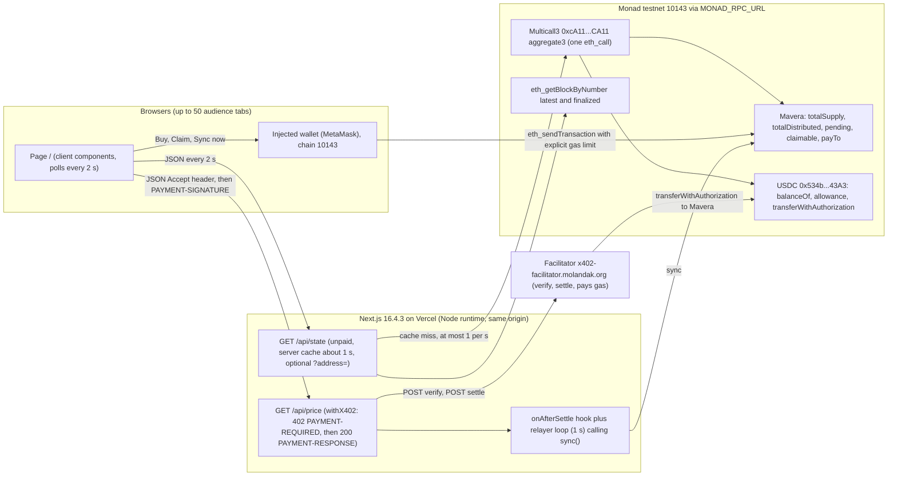
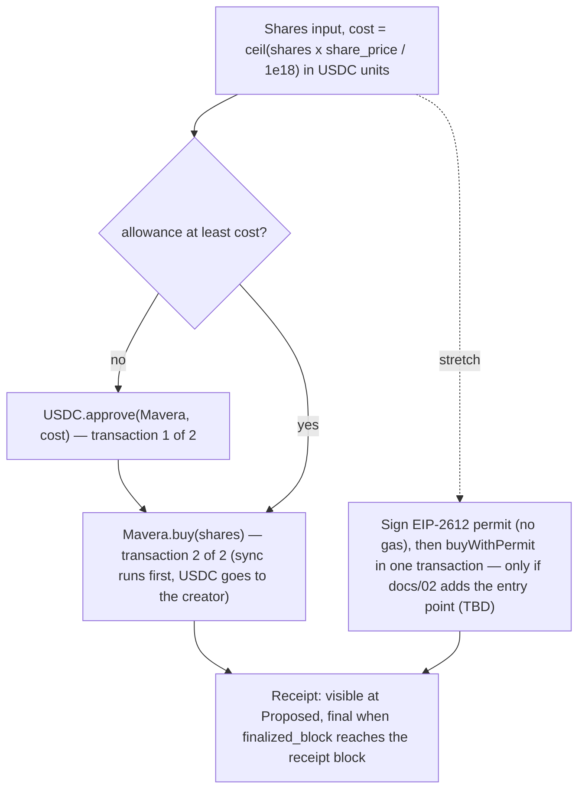
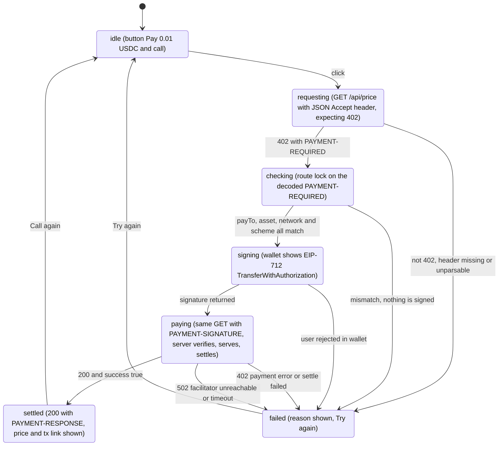

# 04 — Frontend specification

Mavera's web app is one page at `/` plus two API routes on the same origin: `GET /api/price`, the x402-paid data product, and `GET /api/state`, an unpaid, server-cached snapshot of the contract and chain state that every open browser polls every 2 s. The page shows the fountain — the live revenue panel — and three actions: Buy shares, Claim, and Call the API with a real x402 payment signed by the connected wallet. Reads never go from a browser to the public RPC; writes always go through the user's injected wallet. Nothing here is implemented yet (product code starts at 10:45 on 24 Oct 2026); this is the build spec: page map, data flow, layout and exact microcopy, wallet flows, number formatting, the fountain animation, the Call-the-API state machine, the performance budget, configuration facts, component inventory, accessibility and scope. Sibling documents: [docs/01-ARCHITECTURE.md](01-ARCHITECTURE.md) (components), [docs/02-CONTRACT-SPEC.md](02-CONTRACT-SPEC.md) (views the page reads), [docs/03-X402-FLOW.md](03-X402-FLOW.md) (the paid route in full), [docs/07-RUNBOOK.md](07-RUNBOOK.md) (deploy and env values).

## 1. Page map

| Route | Kind | Paid? | Purpose |
| --- | --- | --- | --- |
| `/` | App Router page: static shell plus client components | no | Header, the fountain, Buy card, Claim card, Call-the-API card, explorer links, footer |
| `GET /api/state` | Route handler, Node runtime, dynamic | no | One server-side read of Mavera, USDC and block heights, cached about 1 s and served to every viewer; `?address=0x…` adds that wallet's own figures (section 2.2) |
| `GET /api/price` | Route handler wrapped by `withX402` (bare `RouteConfig`) | yes, 0.01 USDC per call (`X402_PRICE_ATOMIC=10000`) | MON/USD from Pyth and Stork read in one Multicall3 `eth_call`, plus chain-heartbeat fields; `DATA_MODE=heartbeat` drops the oracle reads. Spec: [docs/03-X402-FLOW.md](03-X402-FLOW.md) |

`/api/price` is the working name (TBD confirm before 11:00). No other routes exist. Nothing is prerendered with data: Cache Components is off in `web/next.config.ts`, GET route handlers are dynamic by default in Next 16 ("Route Handlers are not cached by default", https://nextjs.org/docs/app/getting-started/route-handlers.md, accessed 2026-10-24), and the x402 SDK needs the Node runtime (it uses `Buffer`), which is the default, so no `runtime` export anywhere.

## 2. Data flow

### 2.1 Why every read goes through the server

The public RPC `https://testnet-rpc.monad.xyz` allows 50 requests/s, and only 25 requests/s for `eth_call` and `eth_estimateGas` (https://docs.monad.xyz/developer-essentials/testnet.md, accessed 2026-10-24). Audience voting is 20 % of the score, so plan for 50 phones opening the demo URL. 50 tabs each calling `eth_call` every 2 s would be 25 `eth_call`/s, the whole cap, before the 50-call load test even starts. So one server-side read feeds everyone: `GET /api/state` touches the chain at most about once per second (request-coalescing cache) and every tab polls it every 2 s. 50 tabs produce 25 cheap HTTP requests/s to our own Vercel function and no more than 1 to 2 `eth_call`/s per server instance. `eth_getLogs` is capped at `toBlock - fromBlock <= 100` on every public testnet RPC (https://docs.monad.xyz/reference/rpc-limits.md and live probe, accessed 2026-10-24), so the page relies on view functions and never on log scans.



Reads fan in through one cached server route and one Multicall3 call; writes leave the browser only through the wallet or the x402 payment header.

### 2.2 What `GET /api/state` returns

| Field | Unit / type | Source | Used by |
| --- | --- | --- | --- |
| `fetched_age_ms` | ms since the server read the chain | server cache | freshness chip |
| `block_number`, `block_timestamp` | block height; unix seconds | `eth_getBlockByNumber("latest")` (Proposed) | finality badge; never used for ages |
| `finalized_block` | block height | `eth_getBlockByNumber("finalized")` | finality badge, "final" flip of own transactions |
| `token_name`, `token_symbol`, `share_price` | string, string, USDC atomic units per 1e18 share (demo: 10000) | `name()`, `symbol()`, `sharePrice()` | header (`<TOKEN_NAME>`, `<TOKEN_SYMBOL>` TBD on event day; suggested "Mavera Shares: MON/USD Price API", "mAPI"), Buy cost |
| `total_supply`, `max_supply` | 1e18-scaled shares (demo: 60e18, 100e18) | `totalSupply()`, `maxSupply()` | header, Buy remaining |
| `creator`, `pay_to`, `endpoint` | address, address, string | `creator()`, `payTo()`, `endpoint()` | Buy helper text; route-lock cross-check |
| `holders` | integer or `null` | `holderCount()` if adopted in the contract spec, else `null` | header (shows "—" when null; Open questions) |
| `total_distributed`, `pending` | USDC atomic units (6 decimals) | `totalDistributed()`, `pending()` | fountain "Distributed to holders"; pending note and "Sync is late" warning |
| `revenue_total` | USDC atomic units = `total_distributed + pending` | derived | animation trigger, `paid_calls` |
| `paid_calls` | integer = floor(`revenue_total` / `X402_PRICE_ATOMIC`) | derived (exact while every deposit is one 0.01 USDC call) | fountain "Paid calls" |
| `last_call_age_s` | whole seconds or `null` | server wall clock at the moment the poller saw `revenue_total` grow; `null` on a cold instance | fountain "Last call" |
| `last_sync_tx` | tx hash or `null` | `onAfterSettle` on this instance, else latest `Synced` log within the last 100 blocks | explorer links |
| `me.shares`, `me.claimable`, `me.usdc_balance`, `me.usdc_allowance`, `me.usdc_nonce` | 1e18 shares; USDC atomic units (pending-inclusive, equals what `claim()` pays); USDC atomic units; USDC atomic units; integer | Mavera `balanceOf(address)`, `claimable(address)`; USDC `balanceOf`, `allowance(address, MAVERA_ADDRESS)`, `nonces(address)` | header, fountain, Claim; Buy pre-checks, approve step, permit stretch |

Server rules: the shared part is one Multicall3 (`0xcA11bde05977b3631167028862bE2a173976CA11`, `MULTICALL3_ADDRESS`) `aggregate3` call plus the two block reads; the `me` part is one more `aggregate3` per distinct `?address=` seen within the second, cached about 1 s per address (only connected wallets send it, so it stays at a handful of calls). JSON-RPC batching is fine on QuickNode (limit 100) but `https://rpc-testnet.monadinfra.com` rejects batches, so batching follows `MONAD_RPC_URL`. Ages are computed on the server at response time and extrapolated in the browser with `performance.now()`; the client never compares its own clock with the server's or with `block_timestamp` (chain time was 8 s ahead of the laptop clock in tonight's probes). The route answers with `Cache-Control: no-store`; the ~1 s cache is server-side only.

## 3. Layout and microcopy (mobile-first)

Single column, 16 px side gutters, no horizontal scroll at 360 px, sections stacked in this order: header (3.1), the fountain (3.2), Buy card (3.3), Claim card (3.4), Call-the-API card (3.5), explorer links and footer (3.6). From 768 px up, Buy and Claim sit side by side; everything else stays full width inside a centred 720 px column. Every figure is large and tabular. Reading needs no wallet; the only wallet control above the fold is the header button.

### 3.1 Header

| Element | Copy |
| --- | --- |
| Brand, tagline, network pill | "Mavera" — "A paid API that pays its share holders on every call." — "Monad Testnet · 10143" |
| Token line | "`<TOKEN_NAME>` (`<TOKEN_SYMBOL>`) · Share price 0.01 USDC · Supply 60 / 100 shares · Holders 2" (holders unknown: "Holders —") |
| Your position (connected) | "You hold 20 shares (20.0 % of supply)" |
| Wallet button states | "Connect wallet" · "Connecting…" · "Switch to Monad Testnet" · "0x1234…abcd" (menu: "Disconnect") · disabled "No browser wallet found" with helper "Install MetaMask, or use the terminal script in the Call-the-API card." |
| Not-deployed banner | "Mavera is not deployed yet. Set NEXT_PUBLIC_MAVERA_ADDRESS and redeploy." (shown while the address is the zero placeholder from `.env.example`) |

### 3.2 The fountain

| Element | Copy |
| --- | --- |
| Title and subtitle | "The fountain" — "Every paid call is split among share holders in the same block." |
| Distributed to holders | label "Distributed to holders", value "$0.47 USDC" |
| Paid calls | label "Paid calls", value "47" |
| Last call | label "Last call", value "3 s ago"; null: "Waiting for the first call" |
| Your claimable | label "Your claimable", value "$0.282000 USDC"; no wallet: "Connect a wallet to see your share"; zero: "$0.000000 USDC" |
| Pending note (pending > 0); sync late (pending > 0 for more than 5 s) | "Pending sync: $0.01 USDC"; "Sync is late (pending $0.01 USDC for 12 s). Anyone can trigger it." + button "Sync now" (connected wallet only; one `sync()` transaction) |
| Finality badge | "Block 73,672,843 · final 73,672,841" with chip "Live" (last poll ≤ 3 s), "Stale 12 s" (no successful poll for > 6 s), "Reconnecting…" (fetch error; last values stay, dimmed) |
| Loading (first poll); error (first poll failed) | skeleton bars + "Loading chain state…"; "Could not load chain state. Retrying…" |

### 3.3 Buy card

| Element | Copy |
| --- | --- |
| Title and helper | "Buy shares" — "You pay the creator; the fountain pays you from then on. Revenue from before your purchase stays with earlier holders." |
| Input | label "Shares", placeholder "5", helper "Remaining: 40 shares · Cost: 0.05 USDC" |
| Button states; success line | "Connect wallet" · "Switch to Monad Testnet" · "Approve 0.05 USDC (1 of 2)" · "Approving…" · "Buy 5 shares (2 of 2)" · "Buying…"; then "Bought 5 shares · visible" → "Bought 5 shares · final" + link "View transaction" + "Fee 0.0153 MON" |
| Disabled reasons (text under the button) | "Enter a number of shares." · "Only 40 shares remain." · "All shares sold." · "Not enough USDC: you have 0.00 USDC. Get 20 test USDC at faucet.circle.com (Monad Testnet)." |
| Errors | "Rejected in wallet." · "Transaction failed. View transaction" |
| Stretch variant (permit) | helper "Sign to approve (no gas), then buy in one transaction." · buttons "Sign approval" · "Buy 5 shares" |

### 3.4 Claim card

| Element | Copy |
| --- | --- |
| Title, helper, value | "Claim" — "Your share of every paid call so far. Unclaimed USDC stays in the contract until you claim." — "Claimable now: $0.282000 USDC" |
| Button states; success line | "Connect wallet" · "Switch to Monad Testnet" · "Claim $0.282000 USDC" · disabled "Nothing to claim yet" · "Claiming…"; then "Claimed $0.282000 USDC · visible" → "· final" + "View transaction" + "Fee 0.0153 MON" |
| Errors | "Rejected in wallet." · "Transaction failed. View transaction" |

### 3.5 Call-the-API card

| Element | Copy |
| --- | --- |
| Title and body | "Call the API" — "GET /api/price: MON/USD from two oracles on Monad testnet, read in one call. Price 0.01 USDC. You sign a USDC authorization; the facilitator pays the gas." |
| Button states | "Connect wallet" · "Switch to Monad Testnet" · "Pay 0.01 USDC and call" · "Requesting… (expecting 402)" · "Checking who gets paid…" · "Sign the payment in your wallet" · "Paying… (verify, serve, settle)" · "Call again" |
| Result (oracle mode; heartbeat mode) | "MON/USD $0.02131 · Pyth 5 s · Stork 72 s · spread 6 bps · block 73,672,843 (final 73,672,841)" — a source whose `age_s` exceeds its `valid_for_s` is tagged "stale"; heartbeat mode: "Monad heartbeat · block 73,672,843 · final 73,672,841 · epoch 1,474 · proposer #61 · 200 validators" |
| Settlement line | "Payment settled on Monad: 0x58…825d — View transaction" · "Payer: you (0x1234…abcd) → Mavera contract" |
| Errors | "Refused: this server asked to be paid at 0x…, not the Mavera contract. Nothing was signed." · "Signature rejected in wallet." · "Payment declined: insufficient_funds. Your wallet needs test USDC: get 20 USDC at faucet.circle.com (Monad Testnet)." · "Payment declined: `<errorReason>`." · "Settlement failed: `<errorReason>`. Nothing was charged." · "Payment broadcast, confirmation pending (settlement_pending). View transaction" · "Facilitator unreachable (502). Try again in a few seconds." · "Already paid for this request; refusing to sign twice." |
| Terminal alternative | "Prefer the terminal?" followed by the command `pnpm --filter @mavera/scripts customer` |

### 3.6 Explorer links and footer

Links (Etherscan-style paths on `NEXT_PUBLIC_EXPLORER_URL=https://testnet.monadscan.com`): "Mavera contract" → `/address/<MAVERA_ADDRESS>`; "Verified source" → `<VERIFICATION_URL>` (TBD on event day, Sourcify or Monadscan); "USDC (Circle, testnet)" → `/address/0x534b2f3A21130d7a60830c2Df862319e593943A3`; "Facilitator signer (pays the gas)" → `/address/0x7f6a2850669202519f0FE8aa912451238820Db86`; "Last sync transaction" → `/tx/<last_sync_tx>` or "— none yet". Footer, three lines: "Testnet proof of concept with test USDC. Not an offer of securities. A production deployment would require a KYC allow-list and a licensed issuance wrapper in the relevant jurisdiction." · "Prior art: ERC-2222 Funds Distribution Token (Johannes Pfeffer, atpar, with Roger Wu), the EIP-1726 dividend-token draft (GitHub issue ethereum/EIPs#1726), x402commit (pilot on Base), Bondrail (Monad testnet). Mavera: one permissionless contract, payTo locked to the contract, per-call distribution." with a link to [docs/09-COMPETITIVE-LANDSCAPE.md](09-COMPETITIVE-LANDSCAPE.md) · "Built at Monad Blitz Ankara v4, 24 Oct 2026. Product code from 10:45. MIT licence ([LICENSE](../LICENSE)). Source: `<GITHUB_URL>`".

## 4. Wallet flows

### 4.1 Connection and chain (wagmi 3.7.9, viem 2.57.10, @tanstack/react-query 5.104.5)

`createConfig` with `ssr: true` and no cookie storage (one "disconnected" frame before mount is acceptable, https://wagmi.sh/react/guides/ssr.md, accessed 2026-10-24), the single connector `injected()` (no extra packages; EIP-6963 discovery is on by default), and the transport `http(NEXT_PUBLIC_MONAD_RPC_URL)`. Hook names are the wagmi 3 ones: `useConnection` (the v2 `useAccount` is a deprecated alias), `useConnect` with `useConnectors` (`useConnect().connectors` is deprecated), `useDisconnect`, `useSwitchChain`, `useWriteContract`, `useWaitForTransactionReceipt`, `useSignTypedData`, `useWalletClient`; mutations are `mutate` / `mutateAsync` (https://wagmi.sh/react/guides/migrate-from-v2-to-v3.md, accessed 2026-10-24). A previously approved wallet reconnects silently on mount; otherwise no wallet interaction happens until a button is clicked. When `useConnection().chainId` is not 10143, every action button turns into "Switch to Monad Testnet" and `useSwitchChain` switches or adds the chain with the fields below.

| Field in viem `monadTestnet` (viem 2.57.10, `chains/definitions/monadTestnet.ts`) | Shipped value | Mavera uses |
| --- | --- | --- |
| `id` | 10143 (`0x279f`) | as is (`NEXT_PUBLIC_MONAD_CHAIN_ID=10143`) |
| `name` | "Monad Testnet" | as is |
| `blockTime` | 400 ms — stale; measured 302 ms, MIP-12 cut 400 → 300 ms (https://docs.monad.xyz/developer-essentials/changelog/releases.md, accessed 2026-10-24) | never read for UI timing; use 300 ms / 600 ms from the docs |
| `nativeCurrency` | "Testnet MON Token", "MON", 18 decimals | as is |
| `rpcUrls.default.http` | `https://testnet-rpc.monad.xyz` | overridden by `NEXT_PUBLIC_MONAD_RPC_URL` |
| `blockExplorers.default` | "Monad Testnet explorer", `https://testnet.monadexplorer.com` | overridden: name "Monadscan", url `NEXT_PUBLIC_EXPLORER_URL` (also what the wallet receives on add-chain) |
| `contracts.multicall3` | `0xcA11bde05977b3631167028862bE2a173976CA11`, `blockCreated` 251449 (unverifiable on public RPC) | address confirmed live; `blockCreated` irrelevant (no historical reads) |
| `testnet` | true | as is |

### 4.2 Buy: approve + buy (default), permit + buy (stretch)

Cost is `ceil(shares × share_price / 1e18)` in USDC atomic units, the same `Math.mulDiv(…, Ceil)` the contract uses ([docs/02-CONTRACT-SPEC.md](02-CONTRACT-SPEC.md)); the input is rejected unless `0 < shares ≤ max_supply − total_supply` and `cost > 0`. Pre-checks come from `me`: `usdc_balance ≥ cost`, and `usdc_allowance ≥ cost` decides whether step 1 is needed. Step 1 is `USDC.approve(MAVERA_ADDRESS, cost)` for exactly the cost, never unlimited; step 2 is `Mavera.buy(shares)`, which runs `sync()` first and moves the USDC to the creator (a capital raise, not fountain revenue). Each write passes an explicit gas limit (`<GAS_APPROVE>`, `<GAS_BUY>`, `<GAS_CLAIM>`, `<GAS_SYNC>`: TBD on event day from `forge test --network monad --gas-report` plus about 30 % margin, recorded in [docs/07-RUNBOOK.md](07-RUNBOOK.md)) and fee caps `maxPriorityFeePerGas` 2 gwei (the RPC's hardcoded suggestion) and `maxFeePerGas` 200 gwei (about 2× the 100 gwei floor). Monad charges the gas limit, not gas used (https://docs.monad.xyz/developer-essentials/gas-pricing.md, accessed 2026-10-24), and a wallet that estimates a reverting call sets a very high limit, so the UI disables any button whose transaction would revert instead of letting the wallet find out. Receipts are polled every 500 ms; the line says "visible" at the receipt (Proposed, about 300 ms) and "final" once `finalized_block ≥ receipt.blockNumber` (about 600 ms). The fee shown is `receipt.gasUsed × receipt.effectiveGasPrice` (on Monad `gasUsed` equals the limit).



The default path costs the buyer two wallet confirmations; the stretch path costs one signature plus one transaction.

Stretch facts: the testnet USDC exposes EIP-2612 `permit` (both the `v, r, s` and the `bytes` variants), sequential `nonces(owner)` (read `me.usdc_nonce` right before signing), `deadline ≥ block.timestamp`, EIP-712 domain `{ name "USDC", version "2", chainId 10143, verifyingContract 0x534b2f3A21130d7a60830c2Df862319e593943A3 }`; a live `permit` call estimated at 149,028 gas (research probe, 2026-10-24). It only helps if the contract gains a permit-aware buy entry point, which is not among the adopted spec changes; treat it as optional and decide at 13:15.

### 4.3 Claim

One transaction, `Mavera.claim()`, which pays exactly `claimable(msg.sender)` (pending-inclusive) and reverts `NothingToClaim()` on zero, so the button is disabled whenever `me.claimable` is 0. Same gas, fee, receipt and "visible → final" rules as Buy. The fountain's "Your claimable" drops to zero on the next poll; the claimed amount is shown with all six decimals because dust makes claims fractional-cent.

### 4.4 Call the API: an x402 payment signed in the browser

The page builds an `x402Client` (from `@x402/fetch`), registers the client-side `ExactEvmScheme` (from `@x402/evm`) with a signer adapter `{ address, signTypedData }` wrapped around wagmi's wallet client, and calls `wrapFetchWithPayment(fetch, client)`; the result is read with `x402HTTPClient.processResponse`, whose `paymentStatus` is `settled`, `settle_failed`, `payment_required` or `none`. Rules:

- The request sends `Accept: application/json`. The SDK treats "Accept contains text/html and User-Agent contains Mozilla" as a web browser and would answer with an HTML paywall instead of the JSON 402; `@x402/paywall` is not installed.
- Route lock before signing: `onBeforePaymentCreation` aborts unless the selected requirement has `payTo` equal to `NEXT_PUBLIC_MAVERA_ADDRESS` (case-insensitive) and to `state.pay_to` from the contract's `payTo()` view, `asset` equal to `NEXT_PUBLIC_USDC_ADDRESS`, `network` equal to `eip155:10143` and `scheme` equal to `exact`. The chain cannot force a server's `payTo` (the server SDK even allows a per-request `DynamicPayTo`); the client simply refuses to pay anyone else. Threats: [docs/06-THREAT-MODEL.md](06-THREAT-MODEL.md).
- What the wallet shows: an EIP-712 request with domain `{ name "USDC", version "2", chainId 10143, verifyingContract 0x534b2f3A21130d7a60830c2Df862319e593943A3 }`, primary type `TransferWithAuthorization`, `from` = the user, `to` = the Mavera contract, `value` 10000 (0.01 USDC), `validAfter` 0, `validBefore` now + 300 s (`X402_MAX_TIMEOUT_SECONDS`), a random 32-byte `nonce`. No gas and no MON are needed; the default spend cap is $1 per payment. Header names on the wire: `PAYMENT-REQUIRED`, `PAYMENT-SIGNATURE`, `PAYMENT-RESPONSE`, all base64 JSON (https://docs.x402.org/core-concepts/http-402.md, accessed 2026-10-24).
- Same origin: the page and `/api/price` live on the same Vercel deployment, so the SDK's missing `Access-Control-Expose-Headers` never matters.
- Settlement happens after the handler and before the 200 is sent, so a 200 means the USDC transfer is on-chain. The card decodes `PAYMENT-RESPONSE` with `decodePaymentResponseHeader` and links `transaction` as `<NEXT_PUBLIC_EXPLORER_URL>/tx/<hash>`; the body fields (`price_usd`, `sources[].age_s`, `spread_bps`, `block_number`, `finalized_block`, …) fill the result line.
- The connected wallet needs testnet USDC only (https://faucet.circle.com gives 20 USDC per address every 2 hours, accessed 2026-10-24; see [scripts/faucet-notes.md](../scripts/faucet-notes.md)). The scheme choice is justified in [docs/adr/ADR-0004-x402-exact-vs-upto.md](adr/ADR-0004-x402-exact-vs-upto.md), the asset in [docs/adr/ADR-0005-usdc-choice.md](adr/ADR-0005-usdc-choice.md).

## 5. Call-the-API card: state machine



Each transition maps to one button label from section 3.5; the card never signs twice for one request (the SDK throws "Payment already attempted"). Mapping the SDK result to copy: `paymentStatus` `settled` → the settlement line; `payment_required` (402 again, `error` in `PAYMENT-REQUIRED`: `insufficient_funds`, `invalid_payment_amount`, `invalid_payment_expired`, `accepted_requirements_mismatch`, `unsupported_scheme`, `invalid_format`, `unexpected_error`) → "Payment declined: `<errorReason>`." (insufficient_funds adds the faucet hint; an on-chain revert string such as `FiatTokenV2: authorization is expired` or `… is used or canceled` goes into a details disclosure); `settle_failed` (402 with `PAYMENT-RESPONSE`, `success:false`, or `settlement_pending` with a hash) → "Settlement failed: …" or "Payment broadcast, confirmation pending …"; HTTP 502 (facilitator down or 90 s timeout) → "Facilitator unreachable (502)…"; errors thrown before any request is retried (route-lock abort, wallet rejection) → their lines in section 3.5.

## 6. Number formatting

| Quantity | Raw unit | Display rule | Example |
| --- | --- | --- | --- |
| USDC totals (distributed, cost, pending) and share price | atomic units, 6 decimals, `bigint` | integer math only; two decimals, more only when non-zero below a cent; always suffixed "USDC", dollar sign in front; share price as "0.01 USDC per share" | `470000` → "$0.47 USDC"; `10000` → "0.01 USDC per share" |
| USDC claimable and claimed | atomic units | all six decimals (dust is sub-cent, bounded by the number of holders per sync) | `282000` → "$0.282000 USDC" |
| Shares | 1e18-scaled | whole shares, up to two decimals if fractional, suffixed "shares"; supply as "x / y shares"; position as one-decimal percent of supply | `20000000000000000000` → "20 shares", "20.0 % of supply" |
| Gas fee | wei | `gasUsed × effectiveGasPrice`, four decimals, suffixed "MON" | "0.0153 MON" |
| Ages | whole seconds | "3 s ago"; from 60 s "1 m 12 s ago"; from 3,600 s "1 h 02 m ago"; never fractional | `3` → "3 s ago" |
| Block heights, counts, epochs | integer | en-US thousands separators | "73,672,843" |
| Addresses and hashes | hex | first 6 and last 4 characters with an ellipsis; full value in `title` and copy button | "0x1234…abcd", "0x58…825d" |
| Oracle price and spread | `price_usd` decimal string, `spread_bps` integer | five decimals for MON/USD; spread as "6 bps" | "$0.02131" |

## 7. The fountain animation

- Trigger: an increase of `revenue_total` (new revenue, whether already synced or still pending) or of `me.claimable` between two consecutive successful polls. One "drop" falls per observed delta, sized by the delta, and the number counts up from the old to the new value over 600 ms, the time Monad needs to finalize a block. With `prefers-reduced-motion` the value changes instantly with a colour flash only.
- Never trigger on `block_timestamp` or on `last_call_age_s`: block timestamps have one-second granularity and 3 to 4 consecutive blocks share the same value (https://docs.monad.xyz/developer-essentials/summary.md, accessed 2026-10-24). Triggers are value deltas; the time base is the browser's monotonic clock.
- No animation on first paint, on the first poll after a fetch error, or on the first poll after the tab becomes visible again: those polls set a new baseline.
- During the 50-call load test the counter climbs in steps every 2 s; 600 ms per step means steps never overlap. That climb is the demo moment ([docs/08-DEMO-AND-PITCH.md](08-DEMO-AND-PITCH.md)).

## 8. UI principles and accessibility

- Distinctive but simple: one accent colour (`<ACCENT_HEX>`, TBD on event day) used only for the fountain and primary buttons; neutral greys elsewhere; large tabular numerals (`font-variant-numeric: tabular-nums`); system font stack, no web-font dependency. No wallet popup for reading: everything above the cards renders from `/api/state` for anonymous viewers.
- Dark and light follow the OS `prefers-color-scheme`; no toggle. Both schemes meet a 4.5:1 text contrast target.
- Touch and keyboard: controls at least 44 × 44 px, visible focus ring, logical tab order header → fountain → cards, `Enter` triggers the focused action.
- Semantics: one `h1`, one `h2` per card, inputs with labels, disabled reasons as visible text (never only a tooltip), state conveyed by text plus icon, never colour alone.
- Live regions: transaction and payment status lines use `aria-live="polite"`; the polling counters do not (they would announce every 2 s); counters carry full-precision `aria-label`s.

## 9. Performance budget and polling

| What | Interval | Caller → callee | Upstream cost |
| --- | --- | --- | --- |
| Shared state | 2,000 ms per visible tab (`refetchInterval` 2000, paused in background tabs) | browser → `GET /api/state` | ≤ 1 Multicall3 `eth_call` + 2 block reads per second per instance |
| Own figures | same poll, `?address=` only while a wallet is connected | browser → `GET /api/state` | ≤ 1 extra `eth_call` per second per address |
| Receipt of an own transaction | 500 ms while in flight (about 1 to 2 s) | wagmi → `NEXT_PUBLIC_MONAD_RPC_URL` | 2 to 4 `eth_getTransactionReceipt` per transaction (the only direct browser-to-RPC reads) |
| Paid call | on click; about 1 s expected, unverified | browser → `/api/price` → facilitator | 2 facilitator calls and one settlement tx (about 141,817 gas, paid by the facilitator) |
| Relayer | 1,000 ms | server → RPC | 1 `eth_call` per second, one `sync()` tx when `pending > 0` |
| Fountain animation | 600 ms per delta | browser | none |

Derived latencies: a payment settled in block T is reflected in `claimable` (pending-inclusive) within ≤ 1 s cache + ≤ 2 s poll, so about 3 s worst case; `total_distributed` additionally waits for the relayer's `sync()` (≤ 1 s poll + about 1 block). RPC budget: 50 audience tabs cost ≤ 2 `eth_call`/s against the 25 `eth_call`/s cap. Page-weight targets (JS, LCP on venue Wi-Fi) are TBD on event day: record the `next build` route sizes in [docs/11-TOOLCHAIN.md](11-TOOLCHAIN.md) and keep the page free of charts, fonts and images.

## 10. Configuration facts for `web/`

| Item | Value (verified 2026-10-24, [docs/11-TOOLCHAIN.md](11-TOOLCHAIN.md)) |
| --- | --- |
| Framework | Next.js 16.4.3, React 19.3.1, TypeScript 5.9.3, App Router, `src/` layout, Turbopack (default); `web/next.config.ts` has no `cacheComponents` / `partialPrefetching` and only the Tailwind loader rule; type check is `next typegen && tsc --noEmit` (generates `LayoutProps<"/">` and friends) |
| Styling | Tailwind CSS 4.3.3 through `@tailwindcss/turbopack` 4.3.3 (`turbopack.rules["*.css"]` → loader `@tailwindcss/turbopack`, `as: "*.css"`); `globals.css` is `@import "tailwindcss";`; no PostCSS config. Caveat: the loader predates the fix in https://github.com/tailwindlabs/tailwindcss/pull/20582 (merged 2026-10-16, accessed 2026-10-24), so editing `globals.css` under `next dev` may serve the previous CSS; save again or restart `next dev`. Class changes in TSX are unaffected. Never build with `--webpack` (the rule is ignored and no Tailwind CSS is emitted) |
| Lint and format | Biome 2.6.2 (`biome check`, `biome format --write`), `rules.preset: recommended`, domains `next` and `react`; also formats `*.md` and `*.yaml` under `web/` |
| Unit tests | Vitest 5.0.5 + Vite 8.3.5, `environment: node`, `include: src/**/*.test.ts`, `passWithNoTests`; tests cover the pure helpers only: USDC/shares/age/address formatting, ceil cost, the route-lock predicate, the Call-the-API reducer ([docs/05-TEST-PLAN.md](05-TEST-PLAN.md)). `next build` type-checks test files too |
| Env | client: `NEXT_PUBLIC_MONAD_CHAIN_ID=10143`, `NEXT_PUBLIC_MONAD_RPC_URL`, `NEXT_PUBLIC_MAVERA_ADDRESS`, `NEXT_PUBLIC_USDC_ADDRESS`, `NEXT_PUBLIC_EXPLORER_URL` — validated by `clientEnvSchema` in `web/src/lib/env.ts`, documented in [.env.example](../.env.example), inlined at build time (redeploy after changing them); server (`/api/state`): `MONAD_RPC_URL`, `MAVERA_ADDRESS`, `USDC_ADDRESS`, `MULTICALL3_ADDRESS`, `X402_PRICE_ATOMIC`, never imported from client components |
| Wallet stack | wagmi 3.7.9, viem 2.57.10, @tanstack/react-query 5.104.5; x402 client packages `@x402/fetch`, `@x402/evm`, `@x402/core` 2.28.0 |

Commands (repo root; see [web/README.md](../web/README.md)):

```sh
pnpm install --frozen-lockfile
cp .env.example .env
pnpm env:link
pnpm --filter @mavera/web dev
pnpm --filter @mavera/web lint
pnpm --filter @mavera/web typecheck
pnpm --filter @mavera/web test
pnpm --filter @mavera/web build
curl -si http://localhost:3000/api/state
curl -si http://localhost:3000/api/price -H 'Accept: application/json'
```

The last command must return HTTP 402 with a `payment-required` header once the route exists; the one before it must return the JSON of section 2.2.

## 11. Component inventory

| Component | Responsibility | Data in | Data out |
| --- | --- | --- | --- |
| `Providers` | wagmi config (`ssr: true`, `injected()`, `http(NEXT_PUBLIC_MONAD_RPC_URL)`, Monadscan explorer override) inside `WagmiProvider` and `QueryClientProvider`; client component | client env | React context |
| `WalletButton` | connect, silent reconnect, switch to 10143, disconnect, "no wallet" state | `useConnection`, `useConnectors`, `useSwitchChain` | — |
| `TokenHeader` | brand, network pill, token line, your position, not-deployed banner | state, `me` | — |
| `Fountain` | four counters, pending note, sync-late warning with "Sync now", drop animation | state, previous state, `me` | optional `sync()` write |
| `FinalityBadge` | latest vs finalized heights, Live / Stale / Reconnecting chip | `block_number`, `finalized_block`, `fetched_age_ms`, poll error | — |
| `BuyCard` | shares input, ceil cost, pre-checks, approve then buy, status line | `share_price`, supply, `me.usdc_*` | `approve`, `buy` writes |
| `ClaimCard` | claimable amount, claim, status line | `me.claimable` | `claim` write |
| `CallApiCard` | section 5 state machine, x402 client with route lock, result and tx link, terminal hint | client env, `state.pay_to` | `GET /api/price` |
| `TxStatus` | shared "pending → visible → final → failed" line with fee and explorer link | tx hash, receipt, `finalized_block` | — |
| `ExplorerLinks` | contract, verified source, USDC, facilitator signer, last sync tx | client env, `last_sync_tx` | — |
| `Footer` | disclaimer, prior art, event and licence line | — | — |
| `useStatePoll` (hook) | polls `/api/state` every 2 s with `?address=`, keeps the last good value, exposes deltas and error | — | state, previous state, error |
| `format` and `lock` helpers (lib) | the pure functions of sections 4.4 and 6 (Vitest) | `bigint`, strings | strings, booleans |

## 12. Explicitly out of scope

Factory or launchpad UI (deploy from the terminal), bonding curve, secondary market or transfer UI, multiple APIs, agent directory, governance, ERC-8004, mainnet; wallet connectors beyond `injected()` (no WalletConnect, no mera passkeys — cite as roadmap), cookie-based wagmi SSR, a dark-mode toggle, i18n, charts or history views, indexers or log scanning, notifications, the x402 HTML paywall (`@x402/paywall`), the `upto` / Permit2 scheme, and any direct browser read of the RPC beyond receipt polling. Scope rationale: [docs/00-OVERVIEW.md](00-OVERVIEW.md).

## Open questions

- Holders: add a `holderCount()` view to the contract (one more storage write per transfer) or show "Holders —"? Confirm before 11:00 with the author of [docs/02-CONTRACT-SPEC.md](02-CONTRACT-SPEC.md); scanning `Transfer` logs in 100-block windows is rejected for cold-start cost.
- `last_call_age_s` is per server instance and `null` after a cold start; is "Waiting for the first call" acceptable right after a redeploy, or should the relayer publish the last settlement time?
- Vercel may run more than one instance; each keeps its own ~1 s cache, so the RPC cost is instances × 1 to 2 `eth_call`/s. Verify the instance count in the first production logs.
- Permit + buy needs a permit-aware entry point in the contract; decide at 13:15 whether it is worth the extra Solidity.
- Monadscan `/address/` and `/tx/` paths are assumed Etherscan-style; confirm with the deployed contract link at 11:40.
- Facilitator end-to-end latency is unverified (about 1 s expected); if it exceeds 3 s, the "Paying…" label needs a progress hint.
- Should background audience tabs keep polling (`refetchIntervalInBackground`) so the room sees the climb the moment they look up? Default here is paused.
