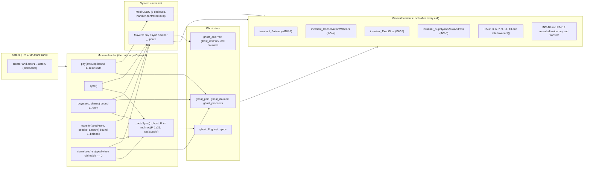

# 05 — Test plan

Mavera's headline claim is arithmetic: every x402 payment that lands in the `Mavera` contract is split pro-rata among the holders of record, nobody can claim more than their share, and the contract can always pay what it shows. This plan turns that claim into evidence a juror can check in the repository: Foundry unit tests that encode the worked example and the twelve spec corrections from [docs/02-CONTRACT-SPEC.md](02-CONTRACT-SPEC.md), bounded fuzz tests, a handler-based invariant suite with formal statements and ghost variables, Slither output committed to the repo, explorer verification on both Monad testnet explorers, and Vitest checks for the off-chain helpers (environment schema, `GET /api/price` payload formatting, route-lock predicate). On-chain accounting is tested in `contracts/`; off-chain glue is tested in `web/`. Everything here is written during event hours (hacking window 10:45–16:30); tonight only the configuration in [.env.example](../.env.example), `contracts/foundry.toml` and the CI workflows exists. Commands assume Foundry 1.8.6 and the repo layout in [contracts/README.md](../contracts/README.md).

## Goals and the bar

The bar is the İstanbul v2 winner Kaskad, audited at its last event-day commit (https://github.com/mryavascann/kaskad, accessed 2026-10-24): 43 Foundry tests run in CI, 3 invariant functions, 1 parametrised fuzz test, 15 Vitest `it()` blocks, a CI workflow, and README claims of Slither review and Sourcify/MonadVision verification (the Sourcify API shows no match for its three addresses today; Monadscan shows "Similar Match"). The rubric weights execution at 30 of 100 and has a pass/fail gate `deployed` ("A contract address is provided and has code on Monad testnet", https://blitz.devnads.com/api/events/monad-blitz-ankara-v4/judging, accessed 2026-10-24). Tests are how we make "Execution" and "Honest pitch" verifiable rather than asserted.

| Item | Kaskad (event day) | Mavera target | Deadline |
| --- | --- | --- | --- |
| Foundry test functions run in CI | 43 | 48 planned (31 unit + 4 fuzz + 13 invariants); at least 28 green by 12:20 (20 P0 unit + 4 fuzz + 4 invariants) | 12:20 / 15:00 |
| Invariants | 3, no handler details | INV-1, INV-4, INV-5, INV-8 first; handler with 5 bounded actions, ghost sums, `fail_on_revert = true` | 12:20 |
| Fuzz tests | 1 | 4, all input-bounded (see Fuzz tests) | 12:20 |
| Vitest `it()` blocks | 15 | ≥ 15 across env schema, payload helpers, route lock | 14:30 |
| Slither | claimed in README only | run with Slither 0.11.6, output and triage committed as `docs/slither.md` (file created on event day) | 15:00 |
| Verification | claimed; Sourcify match not visible | Monadscan "Exact Match" via Etherscan V2 and BlockVision Sourcify match; links in [README.md](../README.md) | 11:40 (throwaway), 15:00 (final) |
| CI | one workflow | `contracts.yml` (fmt, build --locked, test under `FOUNDRY_PROFILE=ci`, non-blocking Slither) and `web.yml` on every push | first push |
| Gas evidence | — | `.gas-snapshot` committed; transfer cost with sync-in-`_update` measured at 11:00 | 11:00 |

Minimum acceptable by 12:20 (the runbook slot "11:40–12:20 tests", [docs/07-RUNBOOK.md](07-RUNBOOK.md)): all P0 unit tests, the 4 fuzz tests, and INV-1/INV-4/INV-5/INV-8 green under the default profile.

## Fixture and conventions

- Proposed layout (final names are the implementer's call): `contracts/test/Mavera.t.sol` (unit + fuzz), `contracts/test/MaveraInvariants.t.sol` (invariants), `contracts/test/handlers/MaveraHandler.sol`, `contracts/test/mocks/MockUSDC.sol` (6 decimals, test-controlled `mint`), `contracts/test/mocks/ReentrantUSDC.sol` (re-enters on `transfer`/`transferFrom`), optional `PausableMockUSDC.sol`.
- Default fixture F: `Mavera(usdc = MockUSDC, creator, sharePrice = 10_000 units per 1e18 share-wei, maxSupply = 1_000e18 share-wei, creatorShares = 60e18, endpoint = "<API_URL>/api/price")`; buyer funded with 1_000_000 units (1 USDC) and approved. The 60/40 state means creator 60e18, buyer 40e18 (cost 400_000 units), as in the worked example of [docs/02-CONTRACT-SPEC.md](02-CONTRACT-SPEC.md). Demo parameters (`maxSupply` 100e18) are TBD on event day and independent of this fixture.
- Units: USDC amounts in atomic units (6 decimals), shares in share-wei (1e18 per share), magnifier M = 1e36, gas in gas units.
- Names are what `forge` discovers: `test_*` unit, `testFuzz_*` fuzz (any `test*` with parameters), `invariant_*` invariants. Priorities: P0 must be green by 12:20, P1 by 15:00, P2 if time remains.
- Decisions the tests encode (fixed in [docs/02-CONTRACT-SPEC.md](02-CONTRACT-SPEC.md)): `sync()` runs inside `_update` before `super._update` (default; confirm before 11:00 with the gas test), `claim()` reverts `NothingToClaim()` on zero, `claimable()` is pending-inclusive, `buy` cost rounds up.

## Unit tests

| Test | Setup | Action | Expected | P | Covers |
| --- | --- | --- | --- | --- | --- |
| `test_Constructor_MintsCreatorShares` | F | – | `balanceOf(creator) == 60e18`, `totalSupply() == 60e18`, `accPerShare == 0`, `corrections(creator) == 0`, `accounted == 0`, `pending() == 0` | P0 | constructor |
| `test_Constructor_RevertsOnBadParams` | – | deploy with `creatorShares == 0`; `creatorShares > maxSupply`; `creator == address(0)`; `creator ==` the predicted CREATE address (`vm.computeCreateAddress`); `sharePrice == 0` | each deployment reverts | P0 | correction 8 |
| `test_Constructor_SucceedsWithPrefundedAddress` | 10_000 units sent to the predicted CREATE address before deployment | deploy, then `sync()` | deployment does not revert (sync early-returns while `totalSupply() == 0` during the constructor mint); after `sync()` `claimable(creator) == 10_000` | P1 | correction 6, A14 |
| `test_RouteLock_Views` | F | `payTo()`, `endpoint()` | `payTo() == address(mavera)`; `endpoint()` equals the constructor string | P0 | route lock |
| `test_Buy_PullsCostToCreatorAndMints` | F | `buy(40e18)` | creator USDC +400_000; buyer shares 40e18; contract USDC and `pending()` unchanged; event `Bought(buyer, 40e18, 400_000)` | P0 | A12, INV-10 |
| `test_Buy_CostRoundsUp` | F | `buy(99_999_999_999_999)`, `buy(1e14)`, `buy(2e14 - 1)` | costs 1, 1, 2 units (ceil); never 0 | P0 | correction 4 |
| `test_Buy_ZeroSharesReverts` | F | `buy(0)` | revert | P0 | correction 4 |
| `test_Buy_ExactlyMaxSupply` | F (`totalSupply` 60e18) | `buy(940e18)` | succeeds; `totalSupply() == maxSupply` | P0 | A5 |
| `test_Buy_OverMaxSupplyReverts` | after the row above | `buy(1)` | revert | P0 | A5 |
| `test_Buy_SyncsFirst_NoPastRevenueForNewBuyer` | 10_000 units sent, not synced | `buy(40e18)` | `claimable(buyer) == 0`, `claimable(creator) == 10_000`, `pending() == 0` | P0 | sync-first |
| `test_Buy_ReentrantTokenCannotExceedMaxSupply` | `ReentrantUSDC` whose `transferFrom` re-enters `buy()` | `buy(room)` | inner call reverts `ReentrancyGuardReentrantCall`; `totalSupply() <= maxSupply` | P1 | correction 10 |
| `test_Sync_DistributesProRata` | 60/40 | send 10_000; `sync()` | claimables 6_000 / 4_000; event `Synced(10_000)`; `accounted == totalDistributed == 10_000` | P0 | sync |
| `test_Sync_NoopWhenNothingPending` | after the row above | `sync()` | no storage change (`vm.snapshotState` before/after), no event (`vm.recordLogs`) | P0 | correction 6 |
| `test_Sync_AccumulatesAcrossSyncs` | 60/40 | 10_000 then 20_000, synced each | `accPerShare` 1e20 then 3e20 (cumulative, not reset); claimables 18_000 / 12_000 | P1 | correction 3 |
| `test_Sync_RemainderStaysInContract` | creator only, `creatorShares` 3e18 | send 10 units; `sync()` | `accPerShare == 3_333_333_333_333_333_333`; `claimable(creator) == 9`; dust == 1 | P1 | rounding |
| `test_Sync_DustBoundedByHoldersAndRecoverable` | `creatorShares` 1e18; creator transfers 0.25e18 to three actors (4 holders of 0.25e18, H = 4) | three 1-unit payments, synced each; then a fourth | after three: each `E(h) = 7.5e35 < M`, Σ claimable 0, `totalDistributed` 3, dust 3 ≤ H (the handoff bound "< 2" would fail); after the fourth: each `claimable == 1`, dust 0 | P1 | corrections 2, 11 |
| `test_Overflow_LifetimeRevenueBoundHolds` | `creatorShares` 1e18, `maxSupply` 1e24 | one payment of 1e15 units synced (`accPerShare == 1e33`); buyer buys `1e24 - 1e18`; transfers all of it | no revert; `SafeCast.toInt256(accPerShare * value)` = 1e57 < 2^255 fits | P1 | correction 3 |
| `test_Update_RevertsOnSafeCastOverflow` | `vm.store` the `accPerShare` slot to 2^255 | `transfer(third, 1)` | reverts `SafeCastOverflowedUintToInt` (a bare `int256(...)` cast would silently flip sign) | P2 | correction 5 |
| `test_Claimable_IncludesPending` | 60/40; 10_000 sent, not synced | read `claimable()` | 6_000 / 4_000 before any sync; a following `claim()` pays exactly the shown number | P0 | correction 7 |
| `test_Claim_PaysExactlyClaimable` | 60/40, 10_000 synced | creator `claim()` | creator USDC +6_000; `claimable(creator) == 0`; `accounted == 4_000`; event `Claimed(creator, 6_000)`; `pending() == 0` | P0 | claim |
| `test_Claim_SyncsFirst` | 10_000 sent, not synced | buyer `claim()` | receives 4_000 | P0 | sync-first |
| `test_Claim_NothingReverts` | fresh holder, or right after a claim | `claim()` | revert `NothingToClaim()` | P0 | correction 7 |
| `test_Claim_AfterSellingAllShares_KeepsPastRevenue` | buyer with 12_000 claimable (after sync #2 of the worked example) | buyer transfers all 40e18 to third; 5_000 synced | `claimable(buyer) == 12_000`; `claim()` pays 12_000; buyer gets 0 of the 5_000 | P0 | Lemma 2 |
| `test_Transfer_PreservesClaimables` | after sync #2 (`accPerShare` 3e20) | buyer → third 20e18 | `claimable(buyer) == 12_000`, `claimable(third) == 0`, `corrections(buyer) == +6e39`, `corrections(third) == -6e39` | P0 | Lemma 1 |
| `test_Transfer_ToSelf_NoChange` | any | `transfer(self, x)` | corrections and claimables unchanged | P1 | A3 |
| `test_TransferFrom_ByApprovedSpender` | buyer approves spender | `transferFrom(buyer, third, 20e18)` | same corrections as a direct transfer | P1 | A4 |
| `test_Transfer_ToContractReverts` | F | `transfer(address(mavera), 1)` | revert | P0 | correction 9, A13 |
| `test_Transfer_BeforeSync_Attribution` | 20_000 pending after sync #1 | buyer → third 20e18, then `sync()` | sync-in-`_update` (default): creator 18_000, buyer 12_000, third 0 of the 20_000; relayer-only alternative: buyer 8_000, third 4_000 — encode the decision taken before 11:00 | P0 | correction 9, A9 |
| `test_Reentrancy_ClaimWithCallbackToken` | `ReentrantUSDC` whose `transfer` re-enters `claim()` | `claim()` | inner call reverts; no double payment; state written before the transfer (CEI) | P1 | A1 |
| `test_Claim_RevertsWhenUsdcPaused` | `PausableMockUSDC` paused | `claim()` | reverts; documents the USDC pause/blacklist trust assumption | P2 | correction 11, A2 |
| `test_Gas_TransferWithSyncInUpdate` | pending 0 and pending > 0 | `transfer` | gas recorded via `forge snapshot`; compare with the spec estimate of ≈ 38–45k extra gas; run at 11:00, it feeds the attribution decision | P0 | gas |

Correction 12 (reference URLs) has no test; it is checked by the link list in [docs/02-CONTRACT-SPEC.md](02-CONTRACT-SPEC.md). Worked-example numbers (6_000/4_000, 18_000/12_000, ±6e39, 21_000/13_000/1_000, dust 1 after a 7-unit payment) come from the exact-integer model behind the spec; the 4-holder dust case above is derived from the same identity `dust * M == R + Σ (E(h) mod M)` with `ΔA = 1e36 / 1e18 = 1e18` per 1-unit payment.

## Fuzz tests

`[fuzz] fail_on_revert = true` is the forge 1.8.6 default (confirmed with `forge config --json`; reference https://www.getfoundry.sh/config/reference/testing, accessed 2026-10-24). Any revert inside a `testFuzz_*` fails the test, so every input is clamped with forge-std `bound(x, min, max)` — never `vm.assume` over wide ranges (`max_test_rejects = 65536`) — actors are pre-funded, and zero paths are pre-checked.

| Test | Input bounds | Action | Expected |
| --- | --- | --- | --- |
| `testFuzz_SingleHolderGetsEverything(uint96 amount)` | `creatorShares = 1e18` (divides M); `amount = bound(amount, 1, 1e15)` units | send `amount`; `sync()` | `claimable(creator) == amount` exactly (remainder R == 0) |
| `testFuzz_TwoHoldersSplit(uint96 amount, uint64 a, uint64 b)` | `a = bound(a, 1, 1e19)`, `b = bound(b, 1, 1e19)` share-wei (creator a, buyer buys b, buyer pre-funded with the ceil cost); `amount = bound(amount, 1, 1e12)` units | send `amount`; `sync()` | `cl_a + cl_b <= amount`; `amount - (cl_a + cl_b) <= 2`; each `cl_h` within 1 unit of `floor(amount * b_h / (a + b))` |
| `testFuzz_CostCeil(uint128 shares)` | `shares = bound(shares, 1, maxSupply - totalSupply())`; buyer pre-funded with `(shares * 10_000 + 1e18 - 1) / 1e18` units | `buy(shares)` | `cost == ceil(shares * sharePrice / 1e18)` and `cost >= 1`; `Bought` event matches |
| `testFuzz_RandomSequence(bytes32 seed)` | 4 actors; 50 steps derived from `keccak256(seed, i)`; pay ∈ [1, 1e12] units, buy ∈ [1, room] share-wei (skip if room 0), transfer ∈ [1, balance] (skip if 0), claim only if `claimable > 0`, sync | run the sequence | INV-1 … INV-9 hold at the end (stateless complement of the invariant suite) |

Runs: 512 locally (`[fuzz] runs = 512` in `contracts/foundry.toml`), 2048 under `FOUNDRY_PROFILE=ci`.

## Invariants

Ghost variables are maintained by the handler; `E(h) = accPerShare * balanceOf(h) + corrections(h)` and `cl_stored(h) = floor(E(h) / M) - claimed(h)` are computed in the test from public getters (the public `claimable(h)` is pending-inclusive, so stored-basis sums are used wherever `pending()` may be non-zero). H = 6 fixed actors (creator + 5). INV-1, INV-4, INV-5 and INV-8 are written first.

| Ghost | Update rule |
| --- | --- |
| `ghost_paid` | += every amount the handler mints into the Mavera address (settlements, donations) |
| `ghost_R` | before every call that can sync with `P > 0` (`sync`, `buy`, `claim`, `transfer` under sync-in-`_update`): `P = usdc.balanceOf(mavera) - accounted(); if P > 0 and totalSupply() > 0: ghost_R += mulmod(P, M, totalSupply())` |
| `ghost_syncs` | += 1 under the same condition |
| `ghost_claimed` | += amount paid by each `claim` |
| `ghost_proceeds` | += `cost` of each `buy` (USDC moved to creator) |
| `ghost_accPrev`, `ghost_distPrev` | previous `accPerShare`, `totalDistributed` (monotonicity) |
| `calls[selector]` | per-action counters printed by `callSummary()`; with `show_metrics = true` they prove every action actually ran |

| ID | `invariant_*` name | Formal statement | Where checked |
| --- | --- | --- | --- |
| INV-1 | `invariant_Solvency` | `usdc.balanceOf(mavera) >= accounted >= Σ_h cl_stored(h)` and `usdc.balanceOf(mavera) >= Σ_h claimable(h)` | after every call |
| INV-4 | `invariant_ConservationWithDust` | `dust := totalDistributed - Σ_h claimed(h) - Σ_h cl_stored(h)`; `0 <= dust <= H` (valid while `ghost_syncs * maxSupply < M`; 32,768 × 1e21 ≪ 1e36) | after every call |
| INV-5 | `invariant_ExactDust` | `dust * M == ghost_R + Σ_h (E(h) mod M)` | after every call, re-checked in `afterInvariant()` |
| INV-8 | `invariant_SupplyAndZeroAddress` | `creatorShares <= totalSupply() <= maxSupply`; `Σ_h balanceOf(h) == totalSupply()`; `balanceOf(address(0)) == 0`; `corrections(address(0)) == 0`; `balanceOf(address(mavera)) == 0` | after every call |
| INV-2 | `invariant_CashIdentity` | `usdc.balanceOf(mavera) == ghost_paid - ghost_claimed == accounted + pending()` | after every call |
| INV-3 | `invariant_AccountedIdentity` | `accounted == totalDistributed - Σ_h claimed(h)`; `Σ_h claimed(h) == ghost_claimed` | after every call |
| INV-6 | `invariant_EntitlementConservation` | `Σ_h E(h) == M * totalDistributed - ghost_R`; also `== accPerShare * totalSupply() + Σ_h corrections(h)`; `Σ_h corrections(h) <= 0` | after every call, re-checked in `afterInvariant()` |
| INV-7 | `invariant_PerHolderSanity` | for all h: `E(h) >= 0` and `floor(E(h) / M) >= claimed(h)` | after every call |
| INV-9 | `invariant_Monotonicity` | `accPerShare >= ghost_accPrev`; `totalDistributed >= ghost_distPrev`; each `claimed(h)` non-decreasing | after every call |
| INV-10 | handler assertion in `buy` | `usdc.balanceOf(mavera)` and `pending()` unchanged; `usdc.balanceOf(creator)` += `cost`; `ghost_proceeds` matches | inside the action |
| INV-11 | `invariant_SyncIdempotent` | after any `sync`: `pending() == 0`; a second `sync` changes no storage and emits nothing (`vm.recordLogs`) | after every call |
| INV-12 | handler assertion in `transfer` | post-sync `claimable(from)` and `claimable(to)` unchanged by the transfer | inside the action |
| INV-13 | `invariant_NoZeroCostMint` | every `Bought` event has `cost >= 1` and `shares >= 1` | log scan |

### Handler design

- Targets: `targetContract(address(handler))` only ("Only target the handler", https://www.getfoundry.sh/guides/invariant-testing, accessed 2026-10-24), restricted with `targetSelector` to the five selectors `pay(uint256)`, `sync()`, `buy(uint256,uint256)`, `transfer(uint256,uint256,uint256)`, `claim(uint256)`. forge-std v1.17.0's `FuzzSelector` carries the handler address and a `bytes4[]` selector list (https://github.com/foundry-rs/forge-std/blob/v1.17.0/src/StdInvariant.sol, accessed 2026-10-24).
- Actors: `creator` plus 5 `makeAddr` actors; `useActor(seed)` picks `actors[bound(seed, 0, 5)]` and runs the action under `vm.startPrank`.
- Bounds: `pay`: `amount = bound(amount, 1, 1e12)` units. `buy`: `room = maxSupply - totalSupply(); return if room == 0; shares = bound(shares, 1, min(room, 1e24))`; mint and approve the ceil cost for the actor. `transfer`: `bal = balanceOf(from); return if bal == 0; amount = bound(amount, 1, bal)`; `from == to` is allowed and occurs naturally; a `transferFrom` variant via `approve`. `claim`: `return if claimable(actor) == 0` after `_noteSync()`.
- What must never revert: with `[invariant] fail_on_revert = true` (repo setting) every Mavera revert path is pre-empted by the handler — `buy` over `maxSupply`, `buy(0)`, `claim` with nothing, `transfer` to `address(mavera)`, missing USDC allowance or balance. Any revert that still happens is a real finding, not noise.
- `afterInvariant()` (exact signature, one per contract) re-checks INV-5 and INV-6 on the final state; with 6 actors the per-call sums are cheap enough to keep `check_interval = 1`.



Forge calls only the handler; the handler bounds inputs, records ghost sums before each effective sync, and drives `Mavera` and the mock USDC; the invariant contract sums over the six actors and compares against the ghosts after every call.

## Configuration

`contracts/foundry.toml` as committed (compiler `solc = "0.8.37"`, `evm_version = "osaka"`, `network = "monad"`, `gas_reports = ["Mavera"]`):

```toml
[fuzz]
runs = 512
max_test_rejects = 65536

[invariant]
runs = 128
depth = 64
fail_on_revert = true
shrink_run_limit = 5000
show_metrics = true

[profile.ci]
fuzz = { runs = 2048 }
invariant = { runs = 256, depth = 128 }
```

| Profile | Fuzz runs per test | Handler calls per invariant campaign (runs × depth) | Expected wall-clock |
| --- | --- | --- | --- |
| default (laptop loop) | 512 | 128 × 64 = 8,192 | TBD on event day — measure once with `time forge test --match-test invariant`; the toolchain research expects seconds (unverified) |
| `ci` (`FOUNDRY_PROFILE=ci`) | 2048 | 256 × 128 = 32,768 | TBD; `contracts.yml` caps the job at `timeout-minutes: 20` (forge defaults would be 256 runs and 256 × 500 = 128,000 calls) |

Forge 1.8.6 defaults differ from the repo in two places that matter: `[invariant] fail_on_revert = false` (we set `true` because the handler bounds inputs) and `[fuzz] fail_on_revert = true` (kept; it is why fuzz inputs are bounded). `isolate = true` is the 1.8 default, so gas numbers are per-transaction and differ from pre-1.8 snapshots. Since Foundry 1.8.0, compatible boolean invariant functions in one contract share a single campaign and corpus, with failures reported per predicate. Failing sequences persist under `cache/invariant` (`failure_persist_dir`); do not commit them.

## Commands

The laptop's `PATH` Foundry is 1.7.1 (`/Users/mericcintosun/.foundry/bin/forge`), which cannot parse `network = "monad"` ("unknown variant: found `monad`"). Four orphaned `anvil` processes block `foundryup`. Before 09:00, in every shell:

```sh
pkill anvil
foundryup --install 1.8.6
forge --version
```

`forge --version` must print `1.8.6`; if it does not, nothing below (including Slither, which shells out to `forge`) is valid. Versions and the full toolchain rationale are in [docs/11-TOOLCHAIN.md](11-TOOLCHAIN.md). Then:

```sh
cd /Users/mericcintosun/mavera/contracts
forge fmt --check
forge build --locked --sizes
forge test -vvv
forge test --match-test invariant -vvv
forge test --match-test invariant_Solvency -vvvv
FOUNDRY_PROFILE=ci forge test -vvv
forge coverage --report lcov --report-file lcov.info
forge snapshot
forge snapshot --check --tolerance 2
forge test --gas-report
```

Notes: `-vvvv` on a failing invariant prints the shrunk call sequence; `forge coverage --ir-minimum` if the coverage build hits stack-too-deep; `forge snapshot` writes `.gas-snapshot` (commit it once a baseline exists; `--check` is the CI candidate for later); `--gas-report` is filtered to `Mavera` by `gas_reports` and reflects MIP-8 pricing because `network = "monad"` is set. From the repo root, `pnpm contracts:test` runs `forge test --root contracts`.

## Static analysis

Slither 0.11.6 (installed with `uv tool install --python 3.12 slither-analyzer`) compiles the project through crytic-compile (`forge build --build-info --deny never --skip ./test/** ./script/** --force` after `forge clean`), so it honours `solc = "0.8.37"` and `network = "monad"` — and it needs forge 1.8.6 first on `PATH`. The committed `contracts/slither.config.json` is `{ "filter_paths": "lib/", "exclude_dependencies": true, "detectors_to_exclude": "solc-version,naming-convention", "fail_on": "none" }`.

```sh
cd /Users/mericcintosun/mavera/contracts
forge --version
slither . --filter-paths "lib/" --exclude-dependencies
slither . --filter-paths "lib/" --exclude-dependencies --fail-none --checklist --markdown-root https://github.com/<GITHUB_OWNER>/mavera/blob/<COMMIT_SHA>/contracts/ > ../docs/slither.md
slither . --filter-paths "lib/" --exclude-dependencies --fail-none --sarif slither.sarif
```

Detectors to expect for a pull-based dividend ERC-20 (names and impact/confidence from `slither --list-detectors`; descriptions at https://github.com/crytic/slither/wiki/Detector-Documentation, accessed 2026-10-24):

| Detector | Impact / confidence | Expected outcome for `Mavera` |
| --- | --- | --- |
| `reentrancy-eth`, `reentrancy-no-eth` | High / Medium, Medium / Medium | none if `claim()` and `buy()` write state before the USDC call and carry `nonReentrant` |
| `reentrancy-benign`, `reentrancy-events` | Low / Medium | fire if `Claimed`/`Bought` are emitted after the transfer — emit before the external call |
| `unchecked-transfer` | High / Medium | none if every USDC move uses `SafeERC20` |
| `arbitrary-send-erc20` | High / High | `buy()` must pull from `msg.sender` only |
| `divide-before-multiply` | Medium / Medium | none: `accPerShare * balance` multiplies before dividing by M; `Math.mulDiv` in `buy` is exact |
| `incorrect-equality` | Medium / High | avoid strict `balanceOf(this) == accounted` checks; `pending` uses a difference |
| `uninitialized-state`, `missing-zero-check` | High / High, Low / Medium | immutables set in the constructor; `usdc`/`creator` zero checks (correction 8) |
| `unused-return`, `events-maths`, `dead-code`, `too-many-digits` | Medium to Informational | hygiene; write `1e36`, not the 37-digit literal |

Recording and triage (`docs/slither.md`, created on event day): header with Slither version, `forge --version`, commit hash and the exact command; the `--checklist` output verbatim; then a triage table with columns Detector, Location, Verdict (fixed / false positive / accepted), Reason. Rules: fix every High or Medium true positive before 15:00; a false positive gets `// slither-disable-next-line <detector>` on the offending line with the reason in the same comment; no detector is excluded globally beyond the two already in the config; the CI job is non-blocking (`fail-on: none`, `continue-on-error`), so the gate is this human triage, not the exit code. The CI job also uploads SARIF to code scanning and prints the checklist in the job summary.

Forge lint runs on every build (`lint_on_build = true` default) and warns `unsafe-typecast` on a bare `int256(accPerShare * value)`. The spec uses `SafeCast.toInt256`, which removes the cast; if a bare cast remains for a documented reason, silence that one line with `// forge-lint: disable-next-line(unsafe-typecast)` plus the justification. Do not add `forge lint --deny warnings` to CI on event day.

Ultrafuzz (https://github.com/monad-developers/ultrafuzz, v0.1.4 of 2026-10-06, accessed 2026-10-24) is Monad's agentic fuzzing orchestrator: Linux-only, built from source, needs an agent CLI with credentials, hour-scale campaigns, and its own docs say to run it only on ephemeral isolated VMs. It is cited in the README roadmap as the next step after the event and is not run during the hackathon.

## Verification

Both explorers, right after the first successful compile (about 11:05, with a throwaway deployment of the same bytecode), so that any API-key or metadata surprise shows up before the real deployment and again at 15:00 for the demo contract. Metadata settings that make an exact match possible are already in `contracts/foundry.toml` (`bytecode_hash` default `ipfs`, `use_literal_content = true`, pinned `solc = "0.8.37"`). The deployer keystore is `mavera-deployer` (`DEPLOYER_ACCOUNT` in [.env.example](../.env.example)); fund it with more than 10 MON plus gas as that file advises (the 10 MON reserve balance is a consensus-time gas budget, and Monad charges the gas limit, see [docs/10-MONAD-NOTES.md](10-MONAD-NOTES.md)). `forge create` sends the raw `eth_estimateGas` value as the limit and needs no `--legacy` flag. The constructor signature and argument order are TBD on event day — take them from [docs/02-CONTRACT-SPEC.md](02-CONTRACT-SPEC.md) once `Mavera.sol` compiles.

```sh
cd /Users/mericcintosun/mavera/contracts
forge create src/Mavera.sol:Mavera --rpc-url https://testnet-rpc.monad.xyz --account mavera-deployer --broadcast --constructor-args <CTOR_ARGS_HUMAN_READABLE> --verify --verifier sourcify --verifier-url https://sourcify-api-monad.blockvision.org/
```

MonadVision (BlockVision Sourcify, no key; chain 10143 listed at https://sourcify-api-monad.blockvision.org/chains, accessed 2026-10-24):

```sh
forge verify-contract <MAVERA_ADDRESS> src/Mavera.sol:Mavera --chain 10143 --verifier sourcify --verifier-url https://sourcify-api-monad.blockvision.org/
curl -s https://sourcify-api-monad.blockvision.org/v2/contract/10143/<MAVERA_ADDRESS>
```

Monadscan (Etherscan V2 API; `https://api.etherscan.io/v2/api?chainid=10143` is listed at https://api.etherscan.io/v2/chainlist, accessed 2026-10-24; Foundry 1.8.6 resolves `--chain 10143` to `monad-testnet` and reaches V2 without `--verifier-url`; a free key from https://etherscan.io/myapikey works for all chains, 3 calls/s and 100,000 calls/day; the `api-testnet.monadscan.com` URL in the Monad block-explorers table is a deprecated V1 endpoint). The Etherscan path needs ABI-encoded constructor args and, since Foundry 1.8.0, also submits to sourcify.dev:

```sh
export ETHERSCAN_API_KEY=<ETHERSCAN_API_KEY>
CTOR_ARGS=$(cast abi-encode "<CONSTRUCTOR_SIGNATURE>" <CTOR_ARGS_HUMAN_READABLE>)
forge verify-contract <MAVERA_ADDRESS> src/Mavera.sol:Mavera --chain 10143 --verifier etherscan --etherscan-api-key $ETHERSCAN_API_KEY --constructor-args $CTOR_ARGS --watch
curl -s https://sourcify.dev/server/v2/contract/10143/<MAVERA_ADDRESS>
```

Acceptance: `https://testnet.monadscan.com/address/<MAVERA_ADDRESS>#code` shows "Exact Match" (Kaskad only reached "Similar Match"); the BlockVision `v2/contract` response has a non-null `match` (record whether it is `exact_match`); `https://testnet.monadvision.com/address/<MAVERA_ADDRESS>` shows the source in a browser (the host answers 403 to `curl`). Record the address, both explorer links and the deployment tx hash in [README.md](../README.md) and [docs/12-SUBMISSION-CHECKLIST.md](12-SUBMISSION-CHECKLIST.md). A verification failure never undoes a deployment; re-run `forge verify-contract`.

## Web tests

Vitest 5.0.5 with Vite 8.3.5, configured in `web/vitest.config.mts` (`environment: "node"`, `include: ["src/**/*.test.ts"]`, `passWithNoTests: true`, alias `@` → `src`). Plain TypeScript helpers only: no React rendering, no network, no `next/server` imports. Because `passWithNoTests` keeps CI green with zero tests, the ≥ 15 `it()` target is a self-imposed bar. Run with `pnpm --filter @mavera/web test` (CI: `pnpm -r --if-present test`). Proposed files: `web/src/lib/env.test.ts`, `web/src/lib/payload.test.ts`, `web/src/lib/route-lock.test.ts` (helper module names are the implementer's call; environment variable names are fixed by [.env.example](../.env.example)).

| Area (module) | Cases (one `it()` each) |
| --- | --- |
| Env schema (`web/src/lib/env.ts`, `serverEnvSchema`) | parses a complete `.env.example`-shaped object; rejects `PAY_TO != MAVERA_ADDRESS` with message "route lock: PAY_TO must equal MAVERA_ADDRESS"; accepts the same address in different letter case; applies defaults `MONAD_CHAIN_ID` 10143, `X402_NETWORK` `eip155:10143`, `X402_PRICE_ATOMIC` 10000, `X402_MAX_TIMEOUT_SECONDS` 300, `DATA_MODE` `oracle`; rejects a 39-hex-char `USDC_ADDRESS`; rejects `X402_NETWORK` without the `eip155:` prefix; accepts `RELAYER_PRIVATE_KEY` empty or absent; rejects `DATA_MODE` outside `oracle`/`heartbeat` |
| Env schema (`clientEnvSchema`) | parses the five `NEXT_PUBLIC_*` variables; rejects a non-URL `NEXT_PUBLIC_EXPLORER_URL` |
| Payload helpers for `GET /api/price` | Pyth price with `expo -8` formats to a decimal string; Stork 1e18 value and nanosecond timestamp convert to `price` and `published_at` seconds; `age_s` compared against per-source `valid_for_s` (Pyth 60 s, Stork 3600 s) marks stale sources invalid; `price_usd` is the median of valid sources only; `spread_bps` of two sources is computed in basis points; `DATA_MODE=heartbeat` payload has no `sources` or `price_usd`; `X402_PRICE_ATOMIC` 10000 renders as `$0.01` |
| Route-lock predicate (client, `paymentRequirementsSelector` / `onBeforePaymentCreation`) | accepts the exact tuple `payTo == MAVERA_ADDRESS`, `asset == USDC_ADDRESS`, `network == eip155:10143`, `scheme == exact`, `amount <= X402_PRICE_ATOMIC`; rejects a different `payTo`; rejects a different `asset`; rejects `network` `eip155:143`; rejects `scheme` `upto`; rejects `amount` above the cap; address comparison is case-insensitive; an empty requirements list is rejected |

That is 25 cases; the 18 env-schema and route-lock cases are P0 for the x402 slot, the 7 payload cases follow the `GET /api/price` implementation. The route lock is client-side by design: the chain cannot force a server's `payTo` (the server SDK allows a per-request `DynamicPayTo`), so these tests are the evidence that the customer refuses to pay anything but the contract ([docs/03-X402-FLOW.md](03-X402-FLOW.md), [docs/06-THREAT-MODEL.md](06-THREAT-MODEL.md)).

## CI mapping

| Workflow / job | Triggers | Steps, in order | Blocking |
| --- | --- | --- | --- |
| `.github/workflows/contracts.yml` / `forge` | push to `main` and PRs touching `contracts/**`, `.gitmodules`, the workflow; `workflow_dispatch` | `actions/checkout@v7` (`submodules: recursive`); `foundry-rs/foundry-toolchain@v1` with `version: v1.8.6`; `forge --version` and `forge config --json` piped to `jq`; `forge fmt --check`; `forge build --locked --sizes`; `forge test -vvv` — all with `FOUNDRY_PROFILE: ci` (fuzz 2048, invariant 256 × 128) | yes |
| `contracts.yml` / `slither` | same | toolchain v1.8.6; `forge build --build-info --skip test script --force`; `crytic/slither-action@v0.4.2` (`target: contracts`, `ignore-compile: true`, `fail-on: none`, `sarif: results.sarif`, `slither-config: contracts/slither.config.json`, `--checklist --markdown-root <repo blob URL>`); `github/codeql-action/upload-sarif@v4`; checklist to the job summary | no (`continue-on-error: true`) |
| `.github/workflows/web.yml` / `web` | push to `main` and PRs touching `web/**`, `scripts/**`, root `package.json`, `pnpm-lock.yaml`, `pnpm-workspace.yaml`, `.nvmrc`, `.env.example`, the workflow | `pnpm/setup@v3` (`node-version-file: .nvmrc`, cache, `install: true`, `require-lockfile: true`); `cp .env.example web/.env.local`; `pnpm -r --if-present lint` (Biome 2.6.2 `biome check`); `pnpm -r --if-present typecheck` (`next typegen && tsc --noEmit`); `pnpm -r --if-present test` (`vitest run`); `pnpm --filter @mavera/web build` | yes |

Not in CI by design: `forge coverage` (local artifact), `forge snapshot --check` (add after a baseline commit), explorer verification (manual, recorded in the README), the Slither gate (human triage). Neither workflow has run on `ubuntu-latest` yet; the first push after `gh repo create mavera --public --source=. --push` is the test, so push the contract scaffold early in the 11:00 slot.

## Event-day acceptance checklist: tests done by 12:20

- [ ] `forge --version` prints `1.8.6` in every open shell (also the one Slither will use).
- [ ] `forge build --locked --sizes` passes; `Mavera` runtime size is well under 131,072 bytes.
- [ ] 11:00: `test_Gas_TransferWithSyncInUpdate` measured; attribution decision (sync-in-`_update` vs relayer-only) recorded in [docs/02-CONTRACT-SPEC.md](02-CONTRACT-SPEC.md) and the ADR index [docs/adr/README.md](adr/README.md); `test_Transfer_BeforeSync_Attribution` encodes it.
- [ ] Throwaway deployment verified on Monadscan (Etherscan V2) and BlockVision Sourcify; addresses kept in the runbook notes.
- [ ] All 20 P0 unit tests green under `forge test -vvv`.
- [ ] 4 fuzz tests green at 512 runs with no revert-caused failures.
- [ ] `invariant_Solvency`, `invariant_ConservationWithDust`, `invariant_ExactDust`, `invariant_SupplyAndZeroAddress` green at 128 × 64; `show_metrics` output shows all five handler actions with non-zero call counts.
- [ ] `forge fmt --check` clean; `.gas-snapshot` written by `forge snapshot` and committed.
- [ ] `FOUNDRY_PROFILE=ci forge test -vvv` started in a background shell; result checked before 13:15.
- [ ] First push: `contracts.yml` `forge` job green (Slither job may be yellow).
- [ ] By 15:00: remaining P1 tests, all 13 invariants, Slither run with `docs/slither.md` committed, `lcov.info` generated, Vitest ≥ 15 `it()` green, final contract verified on both explorers with links in the README.

## Open questions

- Attribution: the ≈ 38–45k-gas estimate for `sync()` inside `_update` is unmeasured; the 11:00 snapshot decides the default and the expected values of `test_Transfer_BeforeSync_Attribution`.
- Wall-clock time of the invariant campaigns on the laptop and on `ubuntu-latest` (8,192 and 32,768 handler calls) is unmeasured; adjust `depth` if the dev loop exceeds a minute.
- Whether `forge coverage` behaves identically under `network = "monad"` was not exercised in research.
- Sourcify match level (`match` vs `exact_match`) with `bytecode_hash = "ipfs"`, and whether MonadVision displays verifications that exist only on sourcify.dev — hence verifying on both instances.
- Final constructor signature and argument order (needed for `cast abi-encode` on the Etherscan path) are fixed only when `Mavera.sol` compiles.
- Whether the mock USDC should model Circle's `pause`/`blacklist` (P2 test) or stay minimal; the trust assumption is documented either way.
- The 4-holder dust example is derived from the spec identity, not from the research model; re-run the exact-integer model with those parameters before relying on the numbers in a test.
