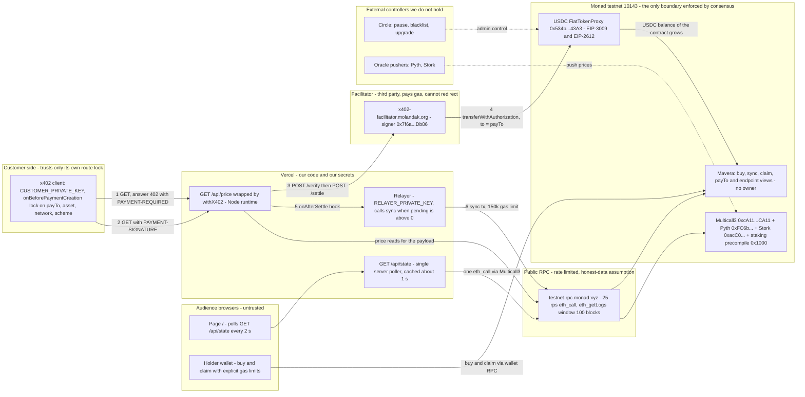

# Mavera threat model

This document lists what Mavera must protect, who can touch it, what we trust, and how every known attack or failure is handled. Mavera is one Solidity contract (`Mavera`: ERC-20 shares plus a per-share USDC revenue accumulator) on Monad testnet (chain id 10143), a Next.js app with one x402-paid route (`GET /api/price`) and one server poller (`GET /api/state`), a relayer that calls `sync()`, and a ring of third parties: the Monad x402 facilitator, Circle as USDC issuer, public RPC providers, oracle pushers, Vercel and GitHub. The honest headline for the jury: the chain enforces the accounting (who receives which share of every dollar that lands in the contract, with no owner and no admin key), but the chain cannot force the API server to point payments at the contract. That "route lock" is enforced on the customer side and is disclosed as such. Everything here is testnet with test USDC. Status values used below: **mitigated** (a design or spec decision already taken), **accepted** (documented, not worth fixing for a one-day build), **TBD on event day** (needs a measurement or a check during hacking hours, 10:45-16:30).

Related documents: [docs/01-ARCHITECTURE.md](01-ARCHITECTURE.md) (components), [docs/02-CONTRACT-SPEC.md](02-CONTRACT-SPEC.md) (the accounting the mitigations refer to), [docs/03-X402-FLOW.md](03-X402-FLOW.md) (payment path, fallbacks F1/F2), [docs/04-FRONTEND.md](04-FRONTEND.md) (the fountain, polling), [docs/05-TEST-PLAN.md](05-TEST-PLAN.md) (tests named here), [docs/07-RUNBOOK.md](07-RUNBOOK.md) (commands), [docs/10-MONAD-NOTES.md](10-MONAD-NOTES.md) (chain facts), [docs/11-TOOLCHAIN.md](11-TOOLCHAIN.md) (versions, CI, Vercel), [docs/adr/ADR-0002-pull-vs-push-dividends.md](adr/ADR-0002-pull-vs-push-dividends.md), [docs/adr/ADR-0004-x402-exact-vs-upto.md](adr/ADR-0004-x402-exact-vs-upto.md), [docs/adr/ADR-0005-usdc-choice.md](adr/ADR-0005-usdc-choice.md), [.env.example](../.env.example).

## Scope and method

- In scope: the contract, the paid route and its x402 settlement, the relayer, the fountain and `/api/state`, keys and environment, deployment (Vercel, GitHub Actions), and the demo itself as an asset.
- Out of scope: Monad consensus security, Circle's internal controls, the facilitator's own infrastructure, legal classification of the shares (see residual risks).
- Method: assets, then actors, then trust boundaries and assumptions, then an attack-and-failure register (one row per threat, IDs `C` contract, `P` payment path, `I` infrastructure and data, `O` operations and demo), then residual risks and a symptom-driven playbook.
- Likelihood is judged for the event day only: **Very low**, **Low**, **Medium**, **High**. Impact names the asset class hit: funds, fairness (who gets what), availability, confidentiality, data quality, demo.
- Every fact comes from FACTS.md, the handoff, or the research reports; external facts carry a link in the Sources section (all accessed 2026-10-24). Addresses not yet known are written as `<MAVERA_ADDRESS>`, `<RELAYER_ADDRESS>`, `<TX_HASH>`.

## Assets

| # | Asset | Where it lives | Why it matters | Loss scenario |
|---|---|---|---|---|
| A1 | USDC revenue held by the contract: `accounted` (distributed, unclaimed) plus `pending` (landed, not yet synced) | `usdc.balanceOf(<MAVERA_ADDRESS>)` on Circle testnet USDC `0x534b2f3A21130d7a60830c2Df862319e593943A3` (6 decimals) | This is the money the pitch is about: every 1-cent call (10,000 units) lands here | Theft (reentrancy, misattribution), stranding (blacklist, shares sent to the contract), brick (`pending` underflow) |
| A2 | Shares (`Mavera` ERC-20, 18 decimals) | Holder balances; demo float `creatorShares` 60e18 plus up to 40e18 sold at `sharePrice` 10,000 units per 1e18 share (0.01 USDC) | A share is a claim on all future revenue; transferable | Free minting, cap bypass, wrong attribution on transfer |
| A3 | Buy proceeds | Paid buyer to creator directly in `buy()`; never enters the contract | Keeps "every unit distributed came from an API call" literally true | `creator == address(this)` would count capital as revenue |
| A4 | Relayer MON | `<RELAYER_ADDRESS>` funded with at least 10 MON plus headroom; one `sync()` at a 150,000-gas limit costs 0.0153 MON at 102 MON-gwei | Gas for `sync()`; without it the fountain lags (but anyone can call `sync()`) | Drained after a key leak; starved during the demo |
| A5 | Keys and secrets | Foundry keystore `mavera-deployer` (`DEPLOYER_ACCOUNT`) or `DEPLOYER_PRIVATE_KEY`; `RELAYER_PRIVATE_KEY`; `CUSTOMER_PRIVATE_KEY` (holds 20 test USDC); `ETHERSCAN_API_KEY`; Vercel project env | The contract has no owner, so no key controls funds after deployment; keys only hold gas and test USDC | Leak via `NEXT_PUBLIC_` prefix, committed `.env`, or a laptop |
| A6 | The demo | `GET /api/price` 402-to-200 cycle, the fountain, `claim()`, explorer proof on `https://testnet.monadscan.com`, rubric gates `built_at_event`, `deployed`, `honest_pitch`; scoring 80 % jury, 20 % audience | A one-day hackathon is judged on what works at 18:00 | Facilitator, RPC, oracle or Vercel outage; failing a gate; late submission (closes 16:30) |
| A7 | Repository integrity and public history | Public GitHub repo; pre-event commits are configuration only; CI in `.github/workflows/contracts.yml` and `web.yml` | `built_at_event` gate; supply chain | Committed secret; poisoned dependency |

## Actors

| Actor | Role | What they can do | Trusted for |
|---|---|---|---|
| Customer or agent | Pays $0.01 (10,000 units) per call by signing an EIP-712 `TransferWithAuthorization`; pays no gas; uses `CUSTOMER_PRIVATE_KEY` (script) or a browser wallet | Refuse to pay; send unpaid 402 probes; run or skip the route lock | Nothing (untrusted input) |
| Holder | `buy(shares)` with USDC approval, `transfer`, `claim()` | Time buys and transfers around syncs; send dust; send shares to odd addresses | Nothing |
| Creator / API operator (the team) | Deploys `Mavera`, runs the Next.js app, receives buy proceeds, sets `PAY_TO` | Change the advertised `payTo` (the SDK allows a per-request `DynamicPayTo`); stop the API; buy before a settlement lands | Pointing `payTo` at the contract (disclosed; clients verify) |
| Relayer | `RELAYER_PRIVATE_KEY` on Vercel; calls `sync()` from `onAfterSettle` and from a 1-second polling loop | Only pay gas; cannot direct funds (`sync()` has no parameters) | Liveness only |
| Facilitator | `https://x402-facilitator.molandak.org`; signer `0x7f6a2850669202519f0FE8aa912451238820Db86` (about 4,964 MON, about 22,000 txs, 0 USDC); verifies by `eth_call` simulation, settles `transferWithAuthorization`, pays gas; Cloudflare in front of Railway; x402-rs based; no auth, CORS `*` | Refuse or delay settlement; cannot alter `to`, `value` or `nonce` (signed by the customer); holds no funds | Availability only |
| RPC providers | QuickNode `https://testnet-rpc.monad.xyz` (50 rps, 25 rps for `eth_call` and `eth_estimateGas`, batch 100, archive); Ankr `https://rpc.ankr.com/monad_testnet` (300 requests per 10 s, no archive); Monad Foundation `https://rpc-testnet.monadinfra.com` (20 rps, no batch) | Rate-limit, lag, serve speculative `latest` | Honest data |
| Oracle pushers | Whoever pushes MON/USD to Pyth Core Compatible `0xFC6bd9F9f0c6481c6Af3A7Eb46b296A5B85ed379` (identity undocumented; publishes every 7-15 s observed) and Stork `0xacC0a0cF13571d30B4b8637996F5D6D774d4fd62` (deviation-gated 0.02 %, 3,600 s heartbeat) | Stop pushing (the MON/USD feed on Pyth Core `0x2880aB155794e7179c9eE2e38200202908C17B43` has been frozen since 2026-09-29) | Price correctness of the paid payload only; never funds |
| Circle (USDC issuer) | Owner and pauser `0x7A154EA9156D354504ad9A401380AA548039BE8b`, blacklister `0xA5a9723c4D658a6F92701ce3A5246Fa7d4723c26`, master minter `0x87f2e95621D8f12b83bb4a3E9975c0eAd524D437`, proxy admin `0x667b894bcc6899f5df1eba73c006b94c661a2d95`; implementation `FiatTokenV2_2` at `0x21240161521D6854BE79F7D3a0A65c6BeDDB42fb` | Pause, blacklist, upgrade the token | Not doing so during the event; exact-value transfers |
| Vercel and GitHub | Host the app and its env (`RELAYER_PRIVATE_KEY` as a sensitive variable); run CI | Leak env; fail builds; pick the wrong pnpm | Secret confidentiality, build integrity |
| Audience | About 50 browsers on `/`; 20 % of the score; anyone may call `sync()`, pay for `/api/price`, or probe | Load the RPC if the page polled it directly; vote | Nothing |
| Monad testnet validators | 200 consensus validators, 300 ms blocks (measured 302 ms), finality after 2 blocks (about 600 ms) | Reset the testnet (precedent 2025-12-16) | Consensus |

## Trust boundaries



Solid arrows are the paid-call path (numbered 1-6) and the read paths; dotted arrows are external control the team does not hold. Each subgraph is a trust zone; only the chain zone is enforced by consensus, and the step the chain cannot see (which `payTo` the server advertises) is caught at step 2 by the client's lock.

### Where each guarantee is enforced

| Guarantee | Enforced by | Notes |
|---|---|---|
| Every USDC unit that lands in the contract is split pro-rata among holders of record; `claim()` pays exactly `claimable()`; no owner, no admin, no upgrade | The chain (`Mavera.sol`) | Invariants INV-1 to INV-13 in [docs/05-TEST-PLAN.md](05-TEST-PLAN.md) |
| Shares are transferable and entitlements survive transfers | The chain | Lemma: `_update` corrections keep every holder's entitlement constant |
| The payment really goes to the contract (`payTo == <MAVERA_ADDRESS>`, asset is the x402 USDC, network `eip155:10143`, scheme `exact`) | The customer's client (route lock) plus the server env refine `PAY_TO == MAVERA_ADDRESS` in `web/src/lib/env.ts` | The chain cannot force a server's `payTo`; disclosed to the jury |
| The customer is charged only if the handler answered with status below 400 | `withX402` (settlement runs after the handler) | A failing oracle must degrade, not 500, or the fountain stops |
| The token moves exactly `value`, once, inside the signed window | Circle `FiatTokenV2_2` (EIP-3009 semantics) | Circle keeps pause and blacklist powers |
| Facilitator liveness, oracle freshness, RPC availability | Nobody (trust plus fallbacks) | Fallbacks F2/F1, `DATA_MODE=heartbeat`, alternate RPC URLs |

## Trust assumptions

| # | We assume | Evidence (accessed 2026-10-24) | If it fails |
|---|---|---|---|
| T1 | USDC transfers move exactly `value`, with no callbacks, no fee, no rebase | Circle `FiatTokenV1` `_transfer` is two `_setBalance` calls plus an event; `FiatTokenV2_2` selectors confirmed in the live bytecode; Sourcify full match for proxy and implementation | Balance-delta accounting still measures what arrived; a negative change would underflow `pending`, hence the defensive `pending` computation (C3) |
| T2 | Circle does not pause or blacklist during the event | `paused()` was `false` live; every transfer path is `whenNotPaused notBlacklisted(from) notBlacklisted(to)` | Settlement and `claim()` both fail (C4) |
| T3 | The facilitator cannot redirect or keep funds | x402 docs: "The facilitator does not hold funds or act as a custodian"; settlement is the customer-signed `transferWithAuthorization` with `to = payTo`; the signer holds 0 USDC | Only availability is at stake (P5) |
| T4 | The server advertises `payTo == <MAVERA_ADDRESS>` | `serverEnvSchema` refine in `web/src/lib/env.ts`; but `@x402/core@2.28.0` lets `PaymentOption.payTo` be a per-request `DynamicPayTo` function, and the SDK comment that a non-vacant `payTo` is "immutable" protects only against server-side extensions | Locking clients abort before signing; non-locking clients would pay the wrong address (C1) |
| T5 | EIP-1153 transient storage is live on Monad testnet | `eth_call --create` TSTORE/TLOAD probe returned `0x2a`; docs: "All opcodes as of the Fusaka fork are supported" | `ReentrancyGuardTransient` would revert; fall back to plain `ReentrancyGuard` |
| T6 | State read at `latest` is speculative but almost always final | Docs: `latest` = Proposed, `safe` = Voted (+300 ms), `finalized` after 2 blocks (+600 ms); "Nearly 100% of proposals ... do eventually become finalized" | A shown payment is superseded (I5); the UI marks "final" only at `finalized` |
| T7 | RPC providers return honest data | Three independent public providers documented by Monad | UI numbers wrong; contract state unaffected |
| T8 | Oracle pushers keep posting | Pyth Compatible ages 0-7 s and Stork 0-90 s observed; counter-evidence: MON/USD on `0x2880aB...` frozen since 2026-09-29 | `DATA_MODE=heartbeat` (I3) |
| T9 | Vercel keeps server env confidential and Next exposes only `NEXT_PUBLIC_*` | Vercel env CLI marks Production variables secret by default; `clientEnvSchema` lists only public values | Relayer MON drained (O1) |
| T10 | The x402 USDC is `0x534b2f3A21130d7a60830c2Df862319e593943A3` and nothing else | Circle address page; `@x402/evm@2.28.0` default asset table; four other "USDC" tokens live on testnet | Facilitator rejects the payment; `buy` in the wrong token (P10) |

## Attack and failure register

Columns: ID, scenario, impact, likelihood (event day), mitigation, status.

### Contract (`Mavera.sol`)

| ID | Scenario | Impact | Likelihood | Mitigation | Status |
|---|---|---|---|---|---|
| C1 | Route redirect: the server (or a drifted deploy) advertises a `payTo` other than the contract. The server SDK itself allows a per-request `DynamicPayTo`; the chain cannot force a server's `payTo` | Funds: every payment flows elsewhere; holders get nothing | Low (we run the server; config drift is the realistic case) | Client-side lock is the only enforcement: `paymentRequirementsSelector` or `onBeforePaymentCreation` aborts unless `payTo == MAVERA_ADDRESS`, `asset == USDC_ADDRESS`, `network == eip155:10143`, `scheme == exact`; `SpendControls.allowedAssets` caps asset and amount at 10,000 units; server env refine `PAY_TO == MAVERA_ADDRESS`; on-chain `payTo()` and `endpoint()` views let anyone pair URL and contract; holders audit USDC `Transfer` logs into the contract against settlement hashes. The facilitator accepts a contract address as `payTo` (verified live with Multicall3) | Mitigated for locking clients; accepted and disclosed for others |
| C2 | Reentrancy through the USDC calls in `buy()` and `claim()` | Funds: double claim; cap bypass | Low (Circle `_transfer` has no hooks, no ERC-777 or ERC-1363) | CEI: update `claimed` and `accounted`, emit, then `safeTransfer`; `nonReentrant` via OZ 5.7.0 `ReentrancyGuardTransient` (TSTORE live, T5); `SafeERC20`; test `test_Reentrancy_ClaimWithCallbackToken` | Mitigated |
| C3 | Fee-on-transfer, rebasing or seizure in the payout token | Accounting: `pending` underflow (Panic 0x11) would brick `sync`, `buy` and `claim` | Very low (FiatTokenV2_2 is exact-value, no rebase, no clawback) | Balance-delta accounting measures what actually arrived (fee-on-transfer safe by construction; a positive rebase is revenue); defensive `pending` (balance minus `accounted` when the balance is larger, otherwise 0) degrades to "last claimers short" instead of a brick | Accepted (documented trust) |
| C4 | Circle pauses USDC or blacklists an address | Availability: blacklisted contract stops settlement and `claim()`; blacklisted holder stops only their claim; blacklisted creator stops `buy()`; pause stops everything | Very low on testnet | Nothing possible in-contract. Known signature: a blacklisted `payTo` makes the facilitator answer HTTP 500 `unexpected_error ... Blacklistable: account is blacklisted` (observed with the USDC address itself as `payTo`), not a clean 400; redeploy to a new address if it ever happens | Accepted (trust in Circle) |
| C5 | Free shares via floor rounding: `floor(shares * sharePrice / 1e18)` is 0 for `shares < 1e14` at `sharePrice` 10,000 | Funds: shares minted for 0 USDC; `Bought(buyer, shares, 0)` events | Medium if left as in the handoff (about 10,000 buys of dust shares cost about USD 2.5 in gas for one whole share) | `cost = Math.mulDiv(shares, sharePrice, 1e18, Ceil)`; `require(shares > 0 && cost > 0)`; INV-13 (every `Bought` has `cost >= 1`); `test_Buy_CostRoundsUp` | Mitigated (spec) |
| C6 | Supply cap bypass by nested buys with a hooked token (handoff order: pull USDC, then mint) | Fairness: `totalSupply > maxSupply` | Very low (needs a callback token) | `buy()` order: `sync` then checks then `_mint` then `safeTransferFrom(buyer -> creator)`, under `nonReentrant`; boundary tests at `maxSupply` plus or minus 1 share-wei | Mitigated (spec) |
| C7 | Dividend theft: buy right before unsynced revenue is distributed and share in it | Fairness: a new buyer takes about `P * v / (TS + v)` of revenue that landed before they held anything; profitable whenever unsynced pending per share exceeds the fixed price | High if `buy()` did not sync first | `buy()` and `claim()` call `sync()` first, so already-landed revenue goes to the old holders. Residual: the operator sees payments first and could buy before a settlement lands in the same block; bounded by the share price, and Monad has no global mempool (txs go to the next 3 leaders), so third-party visibility is low | Mitigated; insider residual accepted |
| C8 | Transfer before sync: pending revenue is attributed to balances at sync time, so a recipient who receives shares before the sync takes part of a payment made when they held nothing (worked example: 4,000 of a 20,000-unit payment) | Fairness: sub-sync misattribution; contradicts "past revenue stays with past holders" at 1-block granularity | Medium with a relayer-only design (about 300 ms window) | Default: `_update` calls `sync()` before `super._update`, making attribution exact at about +38k to +45k gas per transfer (about 0.004 MON, about USD 0.0001) - must be measured with `forge test --gas-report`; the relayer-only alternative is kept in [docs/adr/ADR-0002-pull-vs-push-dividends.md](adr/ADR-0002-pull-vs-push-dividends.md); `test_Transfer_BeforeSync_Attribution` encodes the choice | TBD on event day (confirm before 11:00) |
| C9 | Shares transferred to the Mavera contract itself | Funds: the contract becomes a holder and its share of every payment is stranded forever | Low (mistake, not profit) | `_update` reverts `InvalidReceiver()` when `to == address(this)`; INV-8 `balanceOf(address(mavera)) == 0`; `test_Transfer_ToContractReverts` | Mitigated (spec) |
| C10 | Dust griefing: thousands of 1-unit (0.000001 USDC) payments | UX: `Synced(1)` event spam; no per-payment storage growth; dust is bounded by the number of holders (`dust <= H`), not by payment count | Low (the griefer pays about 40k-60k gas per payment, about USD 0.0001-0.00015) | No contract change; relayer checks `pending()` before sending; UI aggregates events; sync remainders below 1e-12 unit per sync are unrecoverable, per-holder sub-unit dust (at most 1 unit per holder) is recoverable | Accepted (harmless) |
| C11 | Permissionless `sync()` called by anyone at any time | Fairness and gas: nobody can direct funds (no parameters); the only lever is timing (removed by C8's default); the relayer's own tx can become a no-op that still pays its full gas limit | Low | Keep it permissionless; the relayer does `eth_call pending()` first and skips at 0; explicit tight gas limit; `sync()` early-returns without an event when `pending == 0` | Accepted (harmless) |
| C12 | USDC sent to the predicted CREATE address before deployment, or `totalSupply() == 0` | Availability: division by zero (Panic 0x12) in `sync()` could brick `buy()` forever, or revert the deployment if `_update` syncs | Low | `sync()` early-returns when `totalSupply() == 0`; constructor requires `creatorShares > 0 && creatorShares <= maxSupply`, `creator != 0 && creator != address(this)`, `sharePrice > 0`; no `burn` exposed (do not inherit `ERC20Burnable`) | Mitigated (spec) |
| C13 | Integer overflow or sign reinterpretation in `accPerShare * balance` and the `int256` casts | Accounting: a bare `int256(uint256)` cast never reverts and would silently create a negative correction in the band [2^255, 2^256) | Very low: cumulative bound `accPerShare <= lifetimeRevenue * 1e36 / creatorShares`; with `creatorShares >= 1e18`, `maxSupply <= 1e24` and lifetime revenue at most 1e15 units the product is at most 1e57, below 2^255 (about 5.79e76) | `SafeCast.toInt256` and `SafeCast.toUint256` (OZ 5.7.0); constructor floor on `creatorShares`; forge lint `unsafe-typecast` | Mitigated (spec) |
| C14 | `permit`-based `buy` front-run: a third party submits the user's EIP-2612 permit first, so the user's call reverts on the nonce | UX only | Low | If a permit path is built: try/catch the permit and continue when `allowance` already suffices (OZ guidance); plain approve plus `buy` for the demo | Accepted ([docs/04-FRONTEND.md](04-FRONTEND.md) topic) |

### Payment path (x402, USDC, facilitator)

| ID | Scenario | Impact | Likelihood | Mitigation | Status |
|---|---|---|---|---|---|
| P1 | Replay, nonce reuse or expired EIP-3009 authorization | Funds: a reused authorization would double-charge the customer | Very low | Token semantics: random 32-byte `nonce`, single-use per authorizer (`FiatTokenV2: authorization is used or canceled`); strict window `now > validAfter`, `now < validBefore`; the domain separator includes chain id 10143, so a testnet signature cannot replay on mainnet 143; `to`, `value` and `nonce` are inside the signed message | Mitigated (by USDC) |
| P2 | Clock skew and `validBefore`: the client signs `validBefore = now + maxTimeoutSeconds` (300 s); the chain clock was 8 s ahead of the laptop at probe time | Availability: `invalid_payment_expired` from the facilitator or `FiatTokenV2: authorization is expired` on-chain | Low at 300 s; High if someone shortens it to a few seconds | Keep `X402_MAX_TIMEOUT_SECONDS=300`; the facilitator does not enforce `validBefore <= now + maxTimeoutSeconds`, it only rejects already-expired authorizations; sync the demo laptop clock | Mitigated |
| P3 | A captured `PAYMENT-SIGNATURE` is settled by a third party: x402 does not bind the authorization to the resource (x402 issues #3873 and #803) | Funds: the money still moves into the contract; the customer may get a settle-failure 402 because the nonce is used | Very low (same-origin HTTPS; the attacker gains nothing) | Nothing needed: `to` is the contract; worst case the customer repeats the call | Accepted |
| P4 | Double signing on retries, and unknown outcome after a facilitator timeout (`FacilitatorTimeoutError` after 90 s, surfaced as HTTP 502) | Funds: a customer pays twice; the operator thinks a paid call failed | Low | `wrapFetchWithPayment` refuses to pay twice ("Payment already attempted") and signs a fresh authorization only on a new 402 (issue #3438); the customer script never loops on 402 after sending a signature; the load test keeps one call in flight; on 502 check the contract balance and `cast receipt` before retrying | Mitigated |
| P5 | Facilitator outage, 5xx, Cloudflare bot challenge or undocumented rate limit (`__cf_bm` cookie seen; no `RateLimit-*` headers; none hit in 6-12 rapid calls) | Availability: `withX402` cannot even emit a 402 until `GET /supported` succeeds; failures surface as 502 `{"error": ...}` | Medium (single third party; testnet saw about one settlement per 40 minutes, so our 50 calls are its heaviest load) | Smoke test `GET /supported` at the start of the x402 slot and before the demo; 60-minute time box with a hard decision at T+40; fallback F2 `receiveWithAuthorization` (customer stays gasless; `to == msg.sender` prevents redirection) first, F1 EIP-2612 `permit` plus `pay()` second; both primitives verified live on the testnet USDC | Mitigated by fallback; TBD on event day |
| P6 | Batch-settlement assumption: `/supported` lists `batch-settlement`; the relayer must not assume one settlement = one tx = one `sync()` | UX: a missed or doubled trigger | Low (we request `exact`; `batch-settlement` is an escrow-channel scheme) | At checkpoint C verify that one paid call produces exactly one `transferWithAuthorization` receipt from `0x7f6a...Db86`; `sync()` is idempotent, so the 1-second polling relayer is the source of truth and double triggers are harmless | TBD on event day (5-minute test) |
| P7 | Handler served unpaid: a keyed `RoutesConfig` whose key does not match the served path runs the handler without payment and logs one warning; a hard-coded `resource` URL (for example localhost) is advertised in the 402 | Funds: free data; broken clients | Medium (easy misconfiguration) | Use the bare `RouteConfig` form for the single route; omit `resource` (defaults to the request URL); checkpoint B decodes the 402 and compares `accepts[0]` with env; grep logs for "did not match any configured route pattern" | Mitigated (spec) |
| P8 | The `onAfterSettle` hook throws, or `after()` cannot be called from inside it (unverified) | UX: no `sync()` trigger after a settlement; `@x402/core` swallows hook exceptions with `console.warn` | Medium | Own try/catch and structured log in the hook; the polling relayer (`pending() > 0`, every 1 s) is the source of truth; Vercel Hobby function duration 300 s covers `after()` plus one tx | Mitigated |
| P9 | zod advisory GHSA-mrhx-c7xc-m3w5 (High, CVSS 7.5, memory exhaustion via oversized arrays, fixed in zod 4.6.6, no 3.x fix): `@x402/*` bundle their own `zod@3.25.76` as a regular dependency, so the app's pin cannot patch it | Availability: a crafted `PAYMENT-SIGNATURE` could exhaust the function's memory | Very low | The payload travels in an HTTP header; Node's `--max-http-header-size` default is 16 KiB and Vercel enforces request limits, so a multi-megabyte array cannot reach the schema; app-side zod parses only `process.env`; Node `fetch` itself fails above 16 KB of headers (issue #3803) | Accepted (not fuzz-tested) |
| P10 | Wrong USDC: five "USDC" tokens live on testnet (devnads `0x56bf9CDc3C1876F3F22655a0016C2743E9e39a73` is permit-only with no EIP-3009; Kuru, Garden, and two dead pre-reset addresses) | Availability and funds: payments or `buy` in a token the contract does not distribute | Low | One source of truth `USDC_ADDRESS=0x534b2f3A21130d7a60830c2Df862319e593943A3`; boot-time assertions `name() == "USDC"`, `version() == "2"`, `decimals() == 6`, chain id 10143; client lock on `asset`; the UI shows the token address next to balances | Mitigated |

### Infrastructure and data

| ID | Scenario | Impact | Likelihood | Mitigation | Status |
|---|---|---|---|---|---|
| I1 | RPC rate limits: QuickNode allows 50 rps but only 25 rps for `eth_call` and `eth_estimateGas`; 50 audience browsers polling every 2 s would be 25 rps | Availability: the fountain freezes; wallet reads fail with 429 | High if browsers polled the RPC directly | One server-side poller behind `GET /api/state` (cached about 1 s) feeds all browsers, which poll `/api/state` every 2 s; one Multicall3 `eth_call` per poll; alternates for `MONAD_RPC_URL`: `https://rpc-testnet.monadinfra.com` (20 rps, no batch), `https://rpc.ankr.com/monad_testnet` (300 requests per 10 s, no archive) | Mitigated (design) |
| I2 | `eth_getLogs` window: `toBlock - fromBlock <= 100` on all three public RPCs (QuickNode `-32614 eth_getLogs is limited to a 100 range`, Ankr `-32062`, Monad Foundation `-32602`), about 30 s of blocks | Availability: any "scan since deployment" loop fails | Medium (easy to write wrongly) | Prefer view calls (`totalDistributed`, `claimable`, `pending`); the `Synced` event feed comes from the server poller in windows of at most 100 blocks from the last seen block | Mitigated (design) |
| I3 | Oracle staleness: the pusher behind Pyth Core Compatible `0xFC6b...` is undocumented and the MON/USD feed on Pyth Core `0x2880aB...` has been frozen since 2026-09-29; Hermes `/v2/updates/price/latest` answers 401 without a key, so no keyless self-refresh exists; Stork is deviation-gated (0.02 %) with a 3,600 s heartbeat, so multi-minute ages are normal | Data quality: stale or missing MON/USD in the paid payload | Medium | Per-source validity instead of a flat 120 s: Pyth `getValidTimePeriod()` = 60 s, Stork `validTimePeriodSeconds()` = 3,600 s; serve both sources with `age_s` and `valid_for_s`; `price_usd` is the median of valid sources; if Pyth stops, Stork alone; `DATA_MODE=heartbeat` drops the oracle reads entirely (zero third-party risk); 30-second freshness check before the demo | Mitigated; TBD on event day (rehearse heartbeat) |
| I4 | Oracle contract reverts turned into HTTP 500 (Pyth `StalePrice` `0x19abf40e`, Stork `StaleValue` `0x24c4fe43` and `NotFound` `0xc5723b51`) | Demo: a handler status of 400 or above means no settlement - correct for the customer (no pay, no data) but the fountain stops | Medium | Map source errors to "source unavailable" fields, never to 500; the heartbeat fields are always present so the response is never empty | Mitigated (spec) |
| I5 | Speculative state: `latest` is Proposed (no vote yet); receipts "can change" until `finalized` (+600 ms) | UX: a shown payment could be superseded | Very low | Show "paid" at the receipt and "final" when `finalized` is at or past the receipt's block; never say "300 ms finality" - say visible in about 300 ms, final at about 600 ms | Accepted |
| I6 | Testnet reset or client upgrade during the event (reset precedent 2025-12-16; testnet client v0.16.5 since 2026-10-15) | Availability: contract and balances gone | Very low | Addresses live only in env vars; redeploy with [docs/07-RUNBOOK.md](07-RUNBOOK.md); Monad's "100 % uptime" is a self-reported mainnet claim and does not cover testnet | Accepted |
| I7 | Explorer availability: `https://testnet.monadvision.com` returns 403 to curl (bot protection; fine in a browser); Monadscan verification needs an Etherscan V2 key | Demo: broken proof links | Low | Link to `https://testnet.monadscan.com` through `NEXT_PUBLIC_EXPLORER_URL`; verify on Sourcify (`https://sourcify-api-monad.blockvision.org/`, no key) first and Monadscan second | Mitigated |

### Operations, keys, deployment, demo

| ID | Scenario | Impact | Likelihood | Mitigation | Status |
|---|---|---|---|---|---|
| O1 | Relayer key leakage (`RELAYER_PRIVATE_KEY` in Vercel env or a laptop `.env`) | Funds: only the relayer's MON can be drained; `sync()` is permissionless, so the key has no privilege over USDC or shares | Low | Minimal funding (at least 10 MON plus headroom; 50 syncs cost about 0.77 MON); never EIP-7702-delegate it; store as a sensitive Vercel variable; rotate with the procedure in the playbook | Mitigated (blast radius) |
| O2 | Deployer key compromise | Funds: the deployer's MON only; the contract has no owner, no upgrade and no admin functions (immutables plus permissionless `sync`), so post-deployment compromise has no power over it | Low | Foundry keystore (`cast wallet import mavera-deployer --interactive`, `DEPLOYER_ACCOUNT=mavera-deployer`), `DEPLOYER_PRIVATE_KEY` left empty; deploy once with `forge create ... --broadcast --account mavera-deployer` | Mitigated |
| O3 | Secret leakage through `NEXT_PUBLIC_*` or a committed `.env`: Next inlines `NEXT_PUBLIC_*` into the browser bundle at build time; the repo must be public for submission | Confidentiality: private keys in a public bundle or in git history | Medium (classic hackathon mistake) | `web/src/lib/env.ts` splits `serverEnvSchema` (keys, facilitator, `PAY_TO`) from `clientEnvSchema` (`NEXT_PUBLIC_MONAD_CHAIN_ID`, `NEXT_PUBLIC_MONAD_RPC_URL`, `NEXT_PUBLIC_MAVERA_ADDRESS`, `NEXT_PUBLIC_USDC_ADDRESS`, `NEXT_PUBLIC_EXPLORER_URL`) with the rule "Server-only variables must never be imported from client components"; only `.env.example` is tracked; the root `.gitignore` patterns `.env` and `.env.*` cover the `pnpm env:link` symlinks `web/.env.local` and `contracts/.env`; Vercel secrets via `vercel env add ... --sensitive` | Mitigated |
| O4 | Reserve balance and the 3-block funding delay: consensus budgets an EOA's in-flight gas at `min(10 MON, balance at block n-3)`; a freshly funded account cannot send until its funding tx is 3 blocks old (about 0.9 s at 302 ms blocks; the docs say 1.2 s) | Availability: the first `sync()` after a top-up is rejected; a sub-10 MON relayer has a smaller in-flight budget | Medium if wallets are funded during the demo | Fund relayer, customer and holder wallets before the demo; keep the relayer at or above 10 MON (about 653 in-flight `sync()` txs per 3-block window at 150k gas and 102 MON-gwei); after any top-up wait for the receipt plus 1.2 s | Mitigated (ops) |
| O5 | Gas-limit billing: Monad charges the gas limit, not gas used; MetaMask sets a very high limit when estimation reverts; a no-op `sync()` or a `claim()` with nothing to claim still costs the full limit | Funds (small): users or the relayer overpay; UX confusion (explorer "gas used" equals the limit) | Medium | Explicit gas limits everywhere (relayer `sync()` about 150k after measuring about 70k-75k execution gas; `maxFeePerGas` about 200 MON-gwei); `claim()` reverts `NothingToClaim()` so the wallet shows an error before paying; the UI disables Claim at 0; the relayer checks `pending()` first; show `receipt.gasUsed * effectiveGasPrice` as the fee | Mitigated (ops); limits TBD after measurement |
| O6 | Relayer nonce gaps and silent waits: `eth_sendRawTransaction` accepts nonce-gap or underfunded txs and lets them wait; `eth_getTransactionByHash` is `null` until inclusion; there is no global mempool to inspect | Availability: stuck relayer, fountain lags | Medium under bursts | Sequential sends with local nonce tracking; `eth_sendRawTransactionSync` for the receipt; `txpool_statusByHash` for debugging; anyone can unstick the fountain by calling `sync()` | Mitigated (ops) |
| O7 | Vercel picks pnpm 10 instead of the pinned 12.15.0: pnpm 12 is pin-only and is selected only if `/pnpm12` exists in the build image (unverified) | Availability: the first deploy fails, or pnpm 10 reads a pnpm-12 lockfile (untested) | Medium | Read the first build log for "Detected pnpm-lock.yaml version 9 generated by pnpm@12.x"; fallback `ENABLE_EXPERIMENTAL_COREPACK=1` and redeploy; Root Directory `web`; `engines.node` `24.x` | TBD on event day (first deploy) |
| O8 | CI never executed: neither workflow has run on `ubuntu-latest`; the `pnpm/setup@v3` path is unverified; `minimumReleaseAge: 180` is strict, so a package published less than 3 h before install fails resolution | Demo: red badge on the public repo; a blocked install of a brand-new package | Medium | The first push is the test; fallback `pnpm/action-setup@v6` plus `actions/setup-node@v7` is documented in [docs/11-TOOLCHAIN.md](11-TOOLCHAIN.md); `minimumReleaseAgeExclude` is the escape hatch; CI is not a submission gate (the deployed address and the public repo are) | TBD on event day (first push) |
| O9 | Supply-chain compromise of a dependency during the event | Integrity: malicious postinstall or poisoned release | Low | pnpm 12 `minimumReleaseAge: 180` (strict), `pnpm install --frozen-lockfile`, `allowBuilds` limited to `esbuild` (`sharp` and `unrs-resolver` false); `foundry.lock` plus `forge build --locked`; OZ v5.7.0 and forge-std v1.17.0 pinned submodules; never pin Next below 16.4.1 (RCE fixes); do not upgrade packages on event day | Mitigated |
| O10 | Demo and rubric: gates `built_at_event` ("Prior work must be disclosed"), `deployed` ("has code on Monad testnet"), `honest_pitch` ("The headline claim ... is actually implemented"); the platform entry is dated 2026-10-23 with `status: ended`; submissions need admin approval | Demo: disqualification or a late submission | Medium | README section "Built at the event - prior work disclosure" (scaffold commit range; product code from 10:45); claim only what runs (testnet, test USDC, no API Hub integration); check the platform at 09:00 and tell port if Submit is closed; submit by 16:00 (closes 16:30); rehearse 90 s and 3 min pitches; `cast code <MAVERA_ADDRESS>` non-empty before submitting ([docs/12-SUBMISSION-CHECKLIST.md](12-SUBMISSION-CHECKLIST.md)) | TBD on event day |
| O11 | Public callers and the audience: anyone can call `/api/price` (they pay), `sync()`, or hammer `/api/state` and `/` | Availability: Vercel function load; RPC budget | Low | `/api/state` is cached about 1 s and is the only RPC reader for browsers; paid calls cost the caller $0.01 each; Vercel Hobby limits are the ceiling (not measured) | Accepted |

## Residual risks

- The route lock is client-side. A customer who does not run the lock can be redirected by a dishonest or compromised server; the chain only guarantees what happens to money that reaches the contract. Say this plainly in the pitch and in [docs/08-DEMO-AND-PITCH.md](08-DEMO-AND-PITCH.md).
- Circle keeps pause, blacklist and upgrade powers over the payout token (owner `0x7A15...BE8b`, blacklister `0xA5a9...3c26`, proxy admin `0x667b...2d95`). Mavera inherits whatever Circle decides.
- The facilitator is a single third party with no SLA, no documented rate limit, and a Cloudflare bot shield; fallback F2 keeps the product alive but the "x402" word in the pitch then describes the signing path, not the facilitator.
- Oracle freshness depends on undocumented pushers; `DATA_MODE=heartbeat` keeps the paid route truthful but changes what the customer buys.
- Operator insider timing (C7 residual) and sync-time attribution (C8, if the relayer-only variant is chosen) are fairness gaps measured in one block.
- Sync remainders (below 1e-12 unit per sync) are unrecoverable by design; per-holder dust of at most 1 unit is recoverable.
- Vercel pnpm detection, the CI workflows, `after()` inside `onAfterSettle`, and one-settlement-one-tx are all unverified until event day; each has a documented fallback.
- Legal: shares that pay revenue are securities-shaped. Footer and README text: "Testnet proof of concept with test USDC. Not an offer of securities. A production deployment would require a KYC allow-list and a licensed issuance wrapper in the relevant jurisdiction."
- Testnet reset or outage cannot be mitigated beyond env-var addresses and a 10-minute redeploy.

## Demo-day incident playbook

| Symptom | Check | Action |
|---|---|---|
| `GET /api/price` answers 502 `{"error": ...}` instead of 402 | `curl -sS https://x402-facilitator.molandak.org/supported` | If down or not JSON: facilitator outage; at T+40 of the x402 slot switch to fallback F2 ([docs/03-X402-FLOW.md](03-X402-FLOW.md)) |
| 402 returned but the client aborts ("payTo mismatch", "no matching requirements") | Decode the `PAYMENT-REQUIRED` header (`base64 -d`, then read `accepts[0]`) and compare `payTo`, `asset`, `network`, `scheme` with `.env` | Fix `PAY_TO` / `MAVERA_ADDRESS` (must be equal) and redeploy; if amount is above $1, check spend controls |
| Facilitator says `insufficient_funds` | `cast call 0x534b2f3A21130d7a60830c2Df862319e593943A3 "balanceOf(address)(uint256)" <CUSTOMER_ADDRESS> --rpc-url https://testnet-rpc.monad.xyz` | Request 20 USDC at `https://faucet.circle.com` (one request per address per 2 h) or switch to a prefunded customer wallet ([scripts/faucet-notes.md](../scripts/faucet-notes.md)) |
| `invalid_payment_expired` or on-chain `FiatTokenV2: authorization is expired` | `cast block latest --field timestamp --rpc-url https://testnet-rpc.monad.xyz` versus `date -u +%s` | Fix the laptop clock; keep `X402_MAX_TIMEOUT_SECONDS=300` |
| `unsupported_scheme` or `accepted_requirements_mismatch` | Route config must say scheme `exact`, network `eip155:10143`, asset `0x534b...43A3`; `/supported` must list that pair | Correct the config; never use the docs label `v2-eip155-exact` as a value |
| `invalid_format` ("did not match any variant of untagged enum FacilitatorVerifyRequest") | Empty signature or malformed payload from the client | Check the customer signer (`CUSTOMER_PRIVATE_KEY` is 0x plus 64 hex) and the EIP-712 domain `USDC` / `2` |
| HTTP 500 `unexpected_error ... Blacklistable: account is blacklisted` | `cast call 0x534b2f3A21130d7a60830c2Df862319e593943A3 "isBlacklisted(address)(bool)" <MAVERA_ADDRESS> --rpc-url https://testnet-rpc.monad.xyz` | Redeploy to a new address and update `MAVERA_ADDRESS`, `NEXT_PUBLIC_MAVERA_ADDRESS`, `PAY_TO` |
| Paid 200 received (`PAYMENT-RESPONSE` `success: true`) but the fountain does not move | `cast call <MAVERA_ADDRESS> "pending()(uint256)" --rpc-url https://testnet-rpc.monad.xyz`; `cast balance <RELAYER_ADDRESS> --ether --rpc-url https://testnet-rpc.monad.xyz` | If `pending` is above 0: `cast send <MAVERA_ADDRESS> "sync()" --private-key $RELAYER_PRIVATE_KEY --gas-limit 150000 --rpc-url https://testnet-rpc.monad.xyz`; then fix the relayer (balance, nonce) |
| Relayer tx never included; `eth_getTransactionByHash` returns null | `cast rpc txpool_statusByHash <TX_HASH> --rpc-url https://testnet-rpc.monad.xyz`; `cast receipt <TX_HASH> --rpc-url https://testnet-rpc.monad.xyz` | Nonce gap or underfunded: resend with the correct nonce; top up at `https://faucet.monad.xyz` or the Blitz faucet (50 MON) and wait for the receipt plus 1.2 s |
| 502 on a paid call after about 90 s (facilitator timeout) | `cast call 0x534b2f3A21130d7a60830c2Df862319e593943A3 "balanceOf(address)(uint256)" <MAVERA_ADDRESS> --rpc-url https://testnet-rpc.monad.xyz` | If the balance grew, the payment settled: do not retry the same call; otherwise retry once |
| Wallet shows `NothingToClaim()` on Claim | Expected when `claimable()` is 0 | The UI must disable Claim at 0; no action |
| MetaMask proposes a huge gas limit for `buy` or `claim` | The call would revert (allowance, `maxSupply`, zero claim) | Do not confirm (Monad bills the full limit); fix the cause; the UI passes explicit gas limits |
| Oracle age exceeds its validity (Pyth above 60 s, Stork above 3,600 s) or the price fields are missing | `cast call 0xFC6bd9F9f0c6481c6Af3A7Eb46b296A5B85ed379 "getPriceUnsafe(bytes32)((int64,uint64,int32,uint256))" 0x31491744e2dbf6df7fcf4ac0820d18a609b49076d45066d3568424e62f686cd1 --rpc-url https://testnet-rpc.monad.xyz` | If Pyth is frozen, Stork alone is still served; if both are stale: `pnpm dlx vercel@65.2.0 env add DATA_MODE production --value heartbeat --no-sensitive --yes` then `pnpm dlx vercel@65.2.0 --prod --logs` |
| Route answers 500 | `pnpm dlx vercel@65.2.0 logs --environment production --level error --since 5m` | Oracle revert leaking as 500: the handler must return "source unavailable" fields; no settlement happened, so no customer was charged |
| `/api/state` slow, or RPC answers 429 | Confirm the browsers hit `/api/state`, not the RPC; count callers | Switch `MONAD_RPC_URL` to `https://rpc-testnet.monadinfra.com` (20 rps, no batch) or Ankr; redeploy |
| `eth_getLogs is limited to a 100 range` (`-32614`) | A log scan asked for more than 100 blocks | Shrink the window to `toBlock - fromBlock <= 100` or use view calls |
| Log line "did not match any configured route pattern ... the handler ran without payment" | Keyed `RoutesConfig` with the wrong path | Switch to the bare `RouteConfig` form and redeploy immediately (data is being served for free) |
| Vercel build log says `pnpm@10.x` or the install fails | Look for "Detected pnpm-lock.yaml version 9 generated by pnpm@12.x" | `pnpm dlx vercel@65.2.0 env add ENABLE_EXPERIMENTAL_COREPACK production --value 1 --no-sensitive --yes` then redeploy |
| Install fails with a release-age error for a package added during the event | The package is less than 180 minutes old | Add it to `minimumReleaseAgeExclude` in `pnpm-workspace.yaml` or pick an older version |
| Monadscan verification fails | Etherscan V2 key missing or wrong | `forge verify-contract <MAVERA_ADDRESS> src/Mavera.sol:Mavera --chain 10143 --verifier sourcify --verifier-url https://sourcify-api-monad.blockvision.org/` (no key) and retry Monadscan later |
| Explorer link shows 403 | MonadVision bot protection (browser works, curl does not) | Use `https://testnet.monadscan.com` links (`NEXT_PUBLIC_EXPLORER_URL`) |
| Blitz platform shows `status: ended` or Submit is closed | Open blitz.devnads.com at 09:00 | Tell port at the 10:00 welcome; keep the repo URL and demo URL ready for a manual submission |

Relayer key rotation (if `RELAYER_PRIVATE_KEY` leaks; the contract is unaffected):

```sh
cast wallet new --json
cast send <NEW_RELAYER_ADDRESS> --value 15ether --account mavera-deployer --rpc-url https://testnet-rpc.monad.xyz
printf '%s' "<NEW_RELAYER_PRIVATE_KEY>" | pnpm dlx vercel@65.2.0 env add RELAYER_PRIVATE_KEY production --sensitive --yes
pnpm dlx vercel@65.2.0 --prod --logs
```

Read the new address and key from `.data[0].address` and `.data[0].private_key` of the first command's output (cast 1.8 envelope format). The second command assumes the deployer keystore holds spare MON; otherwise fund the new address from `https://faucet.monad.xyz` or the Blitz faucet (50 MON). If the variable already exists, remove the old one in the Vercel project settings before adding. Wait for the funding receipt plus 1.2 s before the new relayer sends its first `sync()`. Drain the old relayer's MON to the deployer; the old key has no other power.

## Sources

All accessed 2026-10-24.

- Monad gas model and gas-limit billing: https://docs.monad.xyz/developer-essentials/gas-pricing.md ; opcode and storage repricing (MIP-8): https://docs.monad.xyz/developer-essentials/opcode-pricing.md
- Reserve balance and emptying exception: https://docs.monad.xyz/developer-essentials/reserve-balance.md ; 3-block funding delay: https://docs.monad.xyz/monad-arch/consensus/asynchronous-execution.md
- Block tags, speculative `latest`, `eth_getLogs` limits: https://docs.monad.xyz/reference/json-rpc/overview.md and https://docs.monad.xyz/reference/rpc-limits.md ; public testnet RPC table: https://docs.monad.xyz/developer-essentials/testnet.md
- Fusaka opcode support (EIP-1153): https://docs.monad.xyz/introduction/monad-for-developers.md ; Monad x402 guide: https://docs.monad.xyz/guides/x402.md
- x402 facilitator role: https://docs.x402.org/core-concepts/facilitator.md ; exact scheme: https://docs.x402.org/schemes/exact.md ; lifecycle hooks: https://docs.x402.org/advanced-concepts/lifecycle-hooks.md ; live `GET /supported`: https://x402-facilitator.molandak.org/supported
- x402 issues cited: https://github.com/x402-foundation/x402/issues/3873 , https://github.com/x402-foundation/x402/issues/803 , https://github.com/x402-foundation/x402/issues/3438 , https://github.com/x402-foundation/x402/issues/3803
- Circle USDC addresses: https://developers.circle.com/stablecoins/usdc-contract-addresses ; EIP-3009 semantics: https://raw.githubusercontent.com/circlefin/stablecoin-evm/master/contracts/v2/EIP3009.sol ; FiatTokenV2 modifiers: https://raw.githubusercontent.com/circlefin/stablecoin-evm/master/contracts/v2/FiatTokenV2.sol ; faucet: https://faucet.circle.com
- Pyth contract table: https://docs.pyth.network/price-feeds/core/upgrade/contracts ; Stork pushed assets: https://docs.stork.network/resources/stork-pushed-assets.md ; Monad oracle page: https://docs.monad.xyz/tooling-and-infra/oracles.md
- zod advisory: https://github.com/advisories/GHSA-mrhx-c7xc-m3w5 ; Node header size limit: https://nodejs.org/docs/latest-v24.x/api/cli.html#--max-http-header-sizesize
- Vercel function duration: https://vercel.com/docs/functions/configuring-functions/duration ; Corepack flag: https://vercel.com/docs/builds/configure-a-build#corepack ; env CLI: https://vercel.com/docs/cli/env ; Next.js `after()`: https://nextjs.org/docs/app/api-reference/functions/after
- OpenZeppelin Contracts 5.7.0 (`ReentrancyGuardTransient`, `SafeCast`, `Math.mulDiv`): https://github.com/OpenZeppelin/openzeppelin-contracts/releases/tag/v5.7.0
- Blitz platform rubric and schedule: https://blitz.devnads.com ; event rules: https://monad-foundation.notion.site/blitz-ankara

## Open questions

- C8: measured gas of `sync()` inside `_update` on Monad (`forge test --gas-report`, `forge snapshot`) and the final attribution choice; confirm before 11:00.
- P6: does one `exact` settlement always produce exactly one `transferWithAuthorization` tx, and does the facilitator wait for the receipt before answering `/settle`? Test at checkpoint C with `cast receipt`.
- P8: can `after()` from `next/server` be called from inside the `onAfterSettle` hook? If not, the polling relayer is the only trigger.
- P5: are there per-IP or per-payer limits on `/verify` and `/settle`, and will Cloudflare ever challenge Vercel's egress IPs? The 50-call load test is the first real measurement.
- I3: who operates the Pyth Core Compatible pusher on testnet, and will it run through the event? Decide `DATA_MODE` after a 1-minute freshness check at 10:45.
- O7 and O8: does Vercel's build image contain `/pnpm12`, and does `pnpm/setup@v3` work on `ubuntu-latest`? Known only after the first deploy and the first push.
- O5: exact gas limits for `sync()`, `buy()` and `claim()` (set after measurement with about 30 % margin).
- P9: is the zod memory-exhaustion path reachable through a 16 KiB header at all? Assessed as not reachable, not fuzz-tested.
- O6: behaviour of `eth_sendRawTransactionSync` when `timeout_ms` elapses (error or hash) is not described in the API docs; test once before relying on it.
