# Event-day runbook

This is the operating manual for the Mavera team on Saturday 24 October 2026 at Monad Blitz Ankara v4 (platform schedule: hacking window 10:45–16:30, submission closes 16:30 Europe/Istanbul; the product is written during that window only). It gives the before-09:00 laptop checklist, the morning platform checks, the slot plan as a timeline, copy-paste commands for deploy, verification, x402 checkpoints, relayer, web, Vercel and the 50-call load test, a debug ladder, role splits for 1–3 people, the complete environment-variable table and the links. Every command is one line, runs in the directory named above it, and uses the exact names from [.env.example](../.env.example). Unknown values are written as `<PLACEHOLDER>` or "TBD on event day". Product design is in [00-OVERVIEW.md](../docs/00-OVERVIEW.md) and [01-ARCHITECTURE.md](../docs/01-ARCHITECTURE.md); the pitch is in [08-DEMO-AND-PITCH.md](../docs/08-DEMO-AND-PITCH.md); the submission form is in [12-SUBMISSION-CHECKLIST.md](../docs/12-SUBMISSION-CHECKLIST.md).

## A. Before 09:00 — laptop checklist

Nothing in this section is product code. It is tooling, keys, funding, configuration and the empty skeleton deploy.

### A.1 Toolchain (any directory)

Four orphaned `anvil` processes (started 19–20 Oct) block `foundryup`, and the Foundry on PATH is 1.7.1, which cannot parse `network = "monad"` in `contracts/foundry.toml`.

```sh
pkill anvil
foundryup
foundryup --update
forge --version
cast --version
forge config --root contracts --json | jq '{solc, evm_version, network, chain_id}'
slither --version
node --version
pnpm --version
npx vercel@latest --version
```

| Check | Expected | If not |
| --- | --- | --- |
| `forge --version` | `1.8.6` (commit 6bad0a66, 2026-10-21) | `foundryup --install 1.8.6`, then re-check; `which forge` must be `~/.foundry/bin/forge` |
| `forge config` | `solc "0.8.37"`, `evm_version "osaka"`, `network "monad"`, `chain_id "monad-testnet"` | error `unknown variant: found 'monad'` means PATH still has 1.7.1 |
| `slither --version` | `0.11.6` | installed via `uv tool install --python 3.12 slither-analyzer`; Slither shells out to the PATH `forge`, so 1.8.6 must come first |
| `node --version` | `v24.x` (local 24.21.0, `.nvmrc` = 24) | `nvm use 24` |
| `pnpm --version` (inside the repo) | `12.15.0` (corepack shim downloads the pinned version) | run it from the repo root, not elsewhere |
| `npx vercel@latest --version` | `65.2.0` (npm `latest` on 2026-10-24; local global is 54.3.0) | always call `npx vercel@latest`, never the global binary |

### A.2 Keys and wallets (any directory)

`cast wallet new --json` in cast 1.8 returns an envelope; read `.data[0].address` and `.data[0].private_key`. Run the first command once per wallet and store the output outside the repo.

```sh
cast wallet new --json | jq -r '.data[0] | .address, .private_key'
cast wallet import mavera-deployer --interactive
cast wallet address --account mavera-deployer
```

`--interactive` asks for the deployer private key and a password; `forge create --account mavera-deployer` prompts for that password later. The keystore lives in `~/.foundry/keystores/`.

| Wallet | Where the key lives | Role on the day |
| --- | --- | --- |
| deployer | Foundry keystore `mavera-deployer` (`DEPLOYER_ACCOUNT`) | sends the one `forge create` transaction |
| relayer | `.env` `RELAYER_PRIVATE_KEY` (laptop) and Vercel (sensitive) | calls `sync()` after each settlement; pays gas in MON only |
| customer | `.env` `CUSTOMER_PRIVATE_KEY` (laptop only) | signs x402 payments in `scripts/customer.ts` and `scripts/load-test.ts`; holds USDC |
| holder A ("creator") | MetaMask account 1 (import the private key) | receives `creatorShares` and all `buy()` proceeds; clicks Claim in the demo |
| holder B ("buyer") | MetaMask account 2 (import the private key) | buys the free float in the UI; shows that a new holder earns from the next call |

### A.3 Funding

Each EOA has a 10 MON reserve-balance budget: consensus admits in-flight transactions against `min(10 MON, balance three blocks ago)`, so wallets that send transactions should hold more than 10 MON, and a freshly funded wallet can send only once the funding transaction is 3 blocks old (about 0.9–1.2 s). Fund before the demo, never during it.

| Wallet | MON | USDC | Source |
| --- | --- | --- | --- |
| deployer | > 10 MON plus the deploy (estimate 0.2–0.3 MON at a 100 MON-gwei base fee; unverified until measured) | 0 | https://faucet.monad.xyz, the Blitz platform (50 MON per sign-in) |
| relayer | >= 15 MON (one `sync()` at a 150,000 gas limit and 102 gwei costs 0.0153 MON; 50 calls = 0.77 MON) | 0 | Blitz platform 50 MON; event Telegram group on request (1,000–2,000 MON per the organizer's pre-event notes) |
| customer | 0 needed (x402 is gasless for the payer); 1–2 MON only for the F1 fallback | 20 USDC | https://faucet.circle.com -> USDC -> Monad Testnet -> "Send 20 USDC" |
| holder A | > 10 MON (claim gas; below 10 MON still works once per 3 blocks via the emptying exception) | 0 | https://faucet.monad.xyz |
| holder B | > 10 MON (approve, buy, claim gas) | 20 USDC (the whole float costs 0.4 USDC) | Circle faucet |

Circle faucet rule (accessed 2026-10-24): 20 USDC per request, one request per (asset, test network) per address every 2 hours, reCAPTCHA, no account. The devnads test USDC `0x56bf9CDc3C1876F3F22655a0016C2743E9e39a73` is a different token without EIP-3009 and will fail facilitator verification; only `0x534b2f3A21130d7a60830c2Df862319e593943A3` counts. Details and limits: [scripts/faucet-notes.md](../scripts/faucet-notes.md).

```sh
cast balance <ADDRESS> --ether --rpc-url https://testnet-rpc.monad.xyz
cast call 0x534b2f3A21130d7a60830c2Df862319e593943A3 "balanceOf(address)(uint256)" <ADDRESS> --rpc-url https://testnet-rpc.monad.xyz
```

USDC has 6 decimals: `20000000` = 20 USDC.

### A.4 MetaMask

Add the network manually with these fields: Network name `Monad Testnet`, RPC URL `https://testnet-rpc.monad.xyz`, Chain ID `10143`, Currency symbol `MON`, Block explorer URL `https://testnet.monadscan.com`. Import the token `0x534b2f3A21130d7a60830c2Df862319e593943A3` (USDC, 6 decimals) in both demo accounts. Monad charges the gas limit, not the gas used; when a MetaMask popup shows a very large fee it means estimation reverted and the wallet inflated the limit — cancel and fix the revert.

### A.5 Environment file and clean install (repo root)

```sh
cd ~/mavera
cp .env.example .env
pnpm env:link
ls -la web/.env.local contracts/.env
pnpm install --frozen-lockfile
pnpm lint
pnpm typecheck
pnpm test
pnpm build
pnpm contracts:build
```

Fill `.env` now: `RELAYER_PRIVATE_KEY`, `CUSTOMER_PRIVATE_KEY`, `ETHERSCAN_API_KEY` (create a free key at https://etherscan.io/register, read it at https://etherscan.io/myapikey; one key serves all Etherscan V2 chains; free tier 3 calls/s, 100,000 calls/day). `DEPLOYER_ACCOUNT=mavera-deployer` is already set; leave `DEPLOYER_PRIVATE_KEY` empty. `MAVERA_ADDRESS`, `NEXT_PUBLIC_MAVERA_ADDRESS` and `PAY_TO` stay at the zero address until S1. `pnpm env:link` symlinks `web/.env.local` and `contracts/.env` to the root `.env`. A clean `pnpm install --frozen-lockfile` passed at 03:40 on 2026-10-24. In every new terminal load the variables once:

```sh
set -a; source .env; set +a
```

### A.6 Public GitHub repository and the first CI run (repo root)

```sh
gh auth status
git status
git log --oneline
gh repo create mavera --public --source=. --push
gh run list --limit 4
gh run watch
```

`gh` must be the `mericcintosun` account (if another account is active: `gh auth switch --user mericcintosun`). The repository becomes `https://github.com/mericcintosun/mavera`. The first push is the first real execution of both workflows (`contracts.yml`: forge-toolchain v1.8.6, `forge fmt --check`, `forge build --locked --sizes`, `forge test -vvv` under `FOUNDRY_PROFILE=ci`, non-blocking Slither; `web.yml`: `pnpm/setup@v3`, lint, typecheck, test, build). The fallback for `web.yml` (`pnpm/action-setup@v6` plus `actions/setup-node@v7` with `cache: pnpm`) is documented in [11-TOOLCHAIN.md](../docs/11-TOOLCHAIN.md).

### A.7 Link and deploy the empty skeleton to Vercel (recommended, repo root)

The only way to learn whether Vercel's build image honours the pnpm 12 pin is the first build log. Do it tonight with the placeholder page, not at 15:30.

```sh
npx vercel@latest whoami
npx vercel@latest link
npx vercel@latest --prod --logs
```

Prompts for `link`: set up the directory (yes) -> scope -> "Link to existing project?" no -> name `mavera` -> **"Code directory?" answer `web`** (this prompt appears because the repo is a pnpm workspace; `--yes` skips it and leaves Root Directory empty) -> "Detected Next.js" -> customize settings no. In the build log find `Detected pnpm-lock.yaml version 9 generated by pnpm@12.x from package.json#packageManager pnpm@12.15.0` and a Node 24 banner. If it says `pnpm@10.x`, run `npx vercel@latest env add ENABLE_EXPERIMENTAL_COREPACK production --value 1 --no-sensitive --yes` and redeploy. In the dashboard confirm Settings -> Build and Deployment -> Root Directory = `web` and "Include source files outside of the Root Directory in the Build Step" is on. `.vercel/` is git-ignored. Record the production URL as `<VERCEL_URL>`. No environment variables are needed for the placeholder; they are added in S4.

## B. 09:00–10:45 — platform and organizer checks

The platform entry for this event is dated 2026-10-23 with `status: ended` and `submission_closed: true` (observed 03:23 on 2026-10-24). Check it first.

```sh
curl -s https://blitz.devnads.com/api/events/monad-blitz-ankara-v4 | jq '{start_time, submission_start_time, submission_end_time, status, submissions_open, submission_closed}'
curl -s https://blitz.devnads.com/api/events/monad-blitz-ankara-v4/judging | jq .
```

| Time | Action | Done when |
| --- | --- | --- |
| 09:00 | Open https://blitz.devnads.com/events/monad-blitz-ankara-v4, sign in (email OTP), look at the "Submit Project" tab. If it is closed or still dated 23 Oct, tell port (@port_dev) before 10:00 | the tab shows an opening time on 24 Oct |
| 09:00–10:00 | Every teammate signs in and claims the Token Faucet grant (50 MON per sign-in; the form asks for a `0x...` address, so point it at the relayer or deployer) | relayer and deployer balances confirmed with `cast balance` |
| 09:30 | Team owner uses "Form a Team"; the invite search only finds attendees who have signed in; the roster names are submitted as `team_members` later | all members accepted |
| 09:30 | Open the submission form once and note whether a "Pitch Video" block says "Required. Up to N seconds" (platform default 90 s, 500 MB) | N written into [12-SUBMISSION-CHECKLIST.md](../docs/12-SUBMISSION-CHECKLIST.md) |
| 10:00 Welcome and rules | Ask two questions: team size (Notion pack: max 3; Luma: up to 4) and pitch length (organizer: 1–2 min; Notion: 3 min heading, 5 min body). Confirm the rubric: judge 80 / audience 20; gates `built_at_event`, `deployed`, `honest_pitch`; criteria Execution 30, On-chain necessity / Monad fit 25, Problem and promise 20, Originality 15, Presentation 10 (platform rubric is `published: false`) | answers written into [08-DEMO-AND-PITCH.md](../docs/08-DEMO-AND-PITCH.md) |
| 10:15–10:45 workshop | One person attends. Others pre-stage read-only: three terminals (`contracts/`, `web/`, `scripts/`) with `.env` loaded, `pnpm dev` on the placeholder, MetaMask unlocked on chain 10143, explorer tabs open, the facilitator and oracle checks from S3 and S6. No product code before 10:45 | all checks green |

## C. Timeline

```mermaid
gantt
    title Mavera event day, Saturday 24 Oct 2026, Europe/Istanbul
    dateFormat HH:mm
    axisFormat %H:%M
    todayMarker off
    section Platform schedule
    Registration                              :reg, 09:00, 10:00
    Welcome and rules                         :wel, 10:00, 10:15
    Monad 101 workshop                        :ws, 10:15, 10:45
    Hacking window                            :hack, 10:45, 16:30
    Lunch                                     :lunch, 12:30, 13:00
    Submission closes                         :milestone, close, 16:30, 0m
    Dinner and demo setup                     :din, 17:00, 18:00
    Pitches and demos                         :pit, 18:00, 20:00
    Results and awards                        :res, 20:00, 20:30
    section Mavera slots
    S1 contract deploy verify smoke test      :s1, 10:45, 11:25
    S2 unit fuzz and invariant tests          :s2, 11:25, 12:05
    S3 x402 route and customer script 60 min  :crit, s3, 12:05, 13:05
    S3 fallback decision                      :milestone, fb, 12:50, 0m
    S4 page relayer fountain animation        :s4, 13:05, 14:20
    S5 README diagrams Slither CI green       :s5, 14:20, 14:50
    S6 rehearsal and 50 call load test        :s6, 14:50, 15:20
    S7 image video tweet submission           :s7, 15:20, 16:00
    Submit by                                 :milestone, sub, 16:00, 0m
```



Platform times are from blitz.devnads.com (accessed 2026-10-24); the Mavera slots are the handoff plan shifted to the 10:45 start, with the x402 slot as the critical 60-minute box (it overlaps lunch — eat at the desk; a one-person team eats at 13:05 after the decision point) and submission targeted at 16:00 because approval is manual.

## D. Per-slot procedures

Conventions: `$MONAD_RPC_URL`, `$USDC_ADDRESS`, `$MAVERA_ADDRESS`, `$RELAYER_PRIVATE_KEY`, `$CUSTOMER_PRIVATE_KEY`, `$ETHERSCAN_API_KEY` come from `.env` via `set -a; source .env; set +a`. Always pass `--rpc-url` explicitly (`cast chain` prints `unknown` for 10143). Commit and push at the end of every slot.

### S1 10:45–11:25 — contract, deploy, verify, smoke test (`contracts/`)

Write `src/Mavera.sol` to [02-CONTRACT-SPEC.md](../docs/02-CONTRACT-SPEC.md) (`pragma solidity 0.8.37;`, OpenZeppelin v5.7.0, exact parameter order of the constructor from that document). Decision gate "confirm before 11:00": the default attribution is `sync()` inside `_update`; keep it if the first transfer test shows roughly +40,000 gas per transfer (about $0.0001 at the 100 MON-gwei floor); the alternative is recorded in [adr/README.md](../docs/adr/README.md). Also decide now whether the F2 fallback helper (`receiveWithAuthorization` pull, see S3) ships in the contract from the start; adding it at 12:50 means a redeploy and a re-verification.

| Constructor argument | Meaning | Demo value |
| --- | --- | --- |
| `usdc` | asset the shares earn; must be the x402 USDC | `0x534b2f3A21130d7a60830c2Df862319e593943A3` |
| `creator` | receives `creatorShares` and every `buy()` payment; not zero, not the contract | holder A address (`<HOLDER_A>`) |
| `sharePrice` | USDC atomic units per 1e18 shares; > 0 | `10000` (0.01 USDC per share) |
| `maxSupply` | hard cap on shares | `100000000000000000000` (100e18) |
| `creatorShares` | minted to `creator` at deploy; > 0 and <= `maxSupply`; >= 1e18 recommended | `60000000000000000000` (60e18; free float 40e18 = 0.4 USDC) |
| name, symbol, endpoint strings | ERC-20 metadata and the route-lock string, only if the final spec has them | TBD on event day (suggested `Mavera Shares: <API name>`, `mAPI`, `/api/price`) |

```sh
cd ~/mavera/contracts
forge fmt
forge build --sizes
export CREATOR=<HOLDER_A>
forge create src/Mavera.sol:Mavera --rpc-url $MONAD_RPC_URL --account mavera-deployer --broadcast --constructor-args $USDC_ADDRESS $CREATOR 10000 100000000000000000000 60000000000000000000 "Mavera Shares: MON/USD Price API" mPRICE /api/price
```

The final constructor has eight arguments, `(address usdc, address creator, uint256 sharePrice, uint256 maxSupply, uint256 creatorShares, string name, string symbol, string endpoint)`; the non-interactive equivalent that also rewrites the three `.env` lines below is `./scripts/deploy.sh --update-env` from the repo root (uses `DEPLOYER_PRIVATE_KEY`). `--constructor-args` lists every argument in declaration order. Without `--broadcast` it is a dry run. `forge create` uses the raw `eth_estimateGas` result as the gas limit (Monad bills the limit, so no multiplier is wanted); never add `--legacy`. If `forge script` is used instead, add `--slow --gas-estimate-multiplier 110`. The output prints `Deployer:`, `Deployed to:` and `Transaction hash:`. Then, from the repo root:

```sh
cd ~/mavera
export MAVERA_ADDRESS=<DEPLOYED_TO>
sed -i '' "s|^MAVERA_ADDRESS=.*|MAVERA_ADDRESS=$MAVERA_ADDRESS|" .env
sed -i '' "s|^NEXT_PUBLIC_MAVERA_ADDRESS=.*|NEXT_PUBLIC_MAVERA_ADDRESS=$MAVERA_ADDRESS|" .env
sed -i '' "s|^PAY_TO=.*|PAY_TO=$MAVERA_ADDRESS|" .env
grep -nE "MAVERA_ADDRESS|PAY_TO" .env
```

Verify on both explorers (`contracts/`). Encode the constructor arguments once; Etherscan needs them, Sourcify does not. Adjust the signature to the final constructor.

```sh
cd ~/mavera/contracts
CTOR_ARGS=$(cast abi-encode "constructor(address,address,uint256,uint256,uint256,string,string,string)" $USDC_ADDRESS $CREATOR 10000 100000000000000000000 60000000000000000000 "Mavera Shares: MON/USD Price API" mPRICE /api/price)   # or: ./scripts/verify.sh $MAVERA_ADDRESS (repo root)
forge verify-contract $MAVERA_ADDRESS src/Mavera.sol:Mavera --chain 10143 --verifier sourcify --verifier-url https://sourcify-api-monad.blockvision.org/
forge verify-contract $MAVERA_ADDRESS src/Mavera.sol:Mavera --chain 10143 --verifier etherscan --etherscan-api-key $ETHERSCAN_API_KEY --constructor-args $CTOR_ARGS --watch
```

Check `https://testnet.monadvision.com/address/<MAVERA_ADDRESS>` (BlockVision Sourcify, no key) and `https://testnet.monadscan.com/address/<MAVERA_ADDRESS>#code` (Etherscan V2 with the free etherscan.io key; Foundry resolves chain 10143 to the V2 URL itself). Expect "Exact Match" on Monadscan — the compiler settings (`solc 0.8.37`, `evm_version osaka`, optimizer 200 runs, `use_literal_content`) are pinned for that. The Etherscan run also submits to sourcify.dev. Never pass `https://api-testnet.monadscan.com/api` (deprecated V1 endpoint). A failed verification does not undo the deployment; re-run the command. Smoke test the fountain mechanics with one manual USDC transfer (this is also the last-resort demo path if x402 and both fallbacks fail):

```sh
cast call $MAVERA_ADDRESS "totalSupply()(uint256)" --rpc-url $MONAD_RPC_URL
cast call $MAVERA_ADDRESS "balanceOf(address)(uint256)" $CREATOR --rpc-url $MONAD_RPC_URL
cast call $MAVERA_ADDRESS "payTo()(address)" --rpc-url $MONAD_RPC_URL
cast call $MAVERA_ADDRESS "pending()(uint256)" --rpc-url $MONAD_RPC_URL
cast send $USDC_ADDRESS "transfer(address,uint256)" $MAVERA_ADDRESS 10000 --private-key $CUSTOMER_PRIVATE_KEY --rpc-url $MONAD_RPC_URL
cast call $MAVERA_ADDRESS "pending()(uint256)" --rpc-url $MONAD_RPC_URL
cast send $MAVERA_ADDRESS "sync()" --private-key $RELAYER_PRIVATE_KEY --gas-limit 150000 --rpc-url $MONAD_RPC_URL
cast call $MAVERA_ADDRESS "claimable(address)(uint256)" $CREATOR --rpc-url $MONAD_RPC_URL
cast call $MAVERA_ADDRESS "totalDistributed()(uint256)" --rpc-url $MONAD_RPC_URL
```

Expected: `totalSupply` 60e18 and the creator holds all of it; `payTo()` equals `MAVERA_ADDRESS`; `pending()` 0, then 10000 after the transfer, then 0 after `sync()`; `claimable(creator)` 10000; `totalDistributed()` 10000. If a wallet was funded seconds ago, wait for 3 blocks before it sends. `--gas-limit 150000` is the spec default; replace it with the S2 measurement plus 30 %. Measured 2026-10-24 (`forge test --gas-report`, Monad model): an effective cold `sync()` costs at most 104,558 gas, so the scripts and the web relayer send `sync()` with a 200,000 gas limit.

### S2 11:25–12:05 — tests (`contracts/`)

```sh
forge test -vvv
forge test --match-test invariant -vvv
forge test --gas-report
FOUNDRY_PROFILE=ci forge test
forge fmt --check
forge snapshot
```

Bar to beat (İstanbul v2 winner): 40+ unit tests, two real invariants driven by a handler (`targetContract(address(handler))`, bounded inputs with `bound()`), one fuzz sequence test, CI green. `[fuzz] fail_on_revert = true` is the 1.8.6 default, so every fuzz input must be bounded. Record `sync()`, `claim()`, `buy()` and transfer gas from the report in [05-TEST-PLAN.md](../docs/05-TEST-PLAN.md); these numbers set the explicit gas limits for the relayer and the UI.

### S3 12:05–13:05 — x402 route and customer script (the 60-minute box)

Spec: [03-X402-FLOW.md](../docs/03-X402-FLOW.md) and [adr/ADR-0004-x402-exact-vs-upto.md](../docs/adr/ADR-0004-x402-exact-vs-upto.md). Route file `web/src/app/api/price/route.ts`, `GET /api/price`, scheme `exact`, network `eip155:10143`, price as an explicit asset amount (`10000` units of USDC, `extra` name `USDC` version `2`), `payTo` = `MAVERA_ADDRESS`, bare route config (no path key), no `resource` override, no `runtime` export (Node is the default and the SDK needs it). `pnpm dev` must be running from the repo root.

| Minute | Checkpoint | Binary check |
| --- | --- | --- |
| 0–5 | A facilitator and token | `/supported` lists `exact`, `upto` (facilitatorAddress `0x7f6a2850669202519f0fe8aa912451238820db86`) and `batch-settlement` for `eip155:10143`; signer `0x7f6a2850669202519f0FE8aa912451238820Db86`; USDC `name()` = `USDC`, `version()` = `2`. A failure here means the facilitator is down: go straight to the fallback |
| 5–20 | B first 402 | `HTTP/1.1 402`, header `payment-required` present, `cache-control: no-store`, body `{}`; decoded `accepts[0]` = scheme `exact`, network `eip155:10143`, amount `10000`, asset `0x534b…43A3`, payTo = `MAVERA_ADDRESS`, maxTimeoutSeconds `300`, extra `{name: USDC, version: 2}`; `resource.url` is the request URL |
| 20–35 | C first paid call | `pnpm --filter @mavera/scripts customer` prints payment status `settled` and a transaction hash; the receipt has `status 1`, `to` = USDC, `from` = `0x7f6a…Db86`, input starting `0xe3ee160e` (`transferWithAuthorization`); USDC `balanceOf(MAVERA_ADDRESS)` grew by 10000; the hash is visible at `https://testnet.monadscan.com/tx/<HASH>`. One settlement = one transaction confirmed (the facilitator also advertises `batch-settlement`) |
| 35–45 | D sync observed | `totalDistributed()` grows within 1–2 s of the HTTP 200: the `onAfterSettle` hook hands the `sync()` to `after()` and the 1-second polling relayer is the source of truth (double triggers are harmless, `sync()` is idempotent). If `after()` cannot be called from inside the hook, the poller alone is the trigger |
| 45–60 | F five calls | 5 of 5 settled, no `Payment already attempted`, no `settlement_pending`; write the median latency and one hash into [README.md](../README.md) |

```sh
curl -s https://x402-facilitator.molandak.org/supported | jq '.kinds[] | select(.network=="eip155:10143")'
cast call $USDC_ADDRESS "name()(string)" --rpc-url $MONAD_RPC_URL
cast call $USDC_ADDRESS "version()(string)" --rpc-url $MONAD_RPC_URL
curl -si -H 'Accept: application/json' http://localhost:3000/api/price
curl -s -D - -o /dev/null -H 'Accept: application/json' http://localhost:3000/api/price | tr -d '\r' | awk 'tolower($1)=="payment-required:" {print $2}' | base64 -d | jq .
pnpm --filter @mavera/scripts customer
cast receipt <HASH> --rpc-url $MONAD_RPC_URL
cast call $USDC_ADDRESS "balanceOf(address)(uint256)" $MAVERA_ADDRESS --rpc-url $MONAD_RPC_URL
cast call $MAVERA_ADDRESS "totalDistributed()(uint256)" --rpc-url $MONAD_RPC_URL
for i in 1 2 3 4 5; do pnpm --filter @mavera/scripts customer; done
```

`scripts/customer.ts` sends `Accept: application/json` (a browser-like `Accept: text/html` plus a `Mozilla` user agent turns the 402 into an HTML paywall) and refuses to sign unless `payTo` = `MAVERA_ADDRESS`, `asset` = USDC, `network` = `eip155:10143`, `scheme` = `exact` (the route lock). The browser "Call API" button is checkpoint E and belongs to S4.

Fallback rule. Minute 45 (12:50): if checkpoint C is not green, start F2 — the customer signs an EIP-3009 `ReceiveWithAuthorization` message under the same USDC domain, the relayer submits it to the Mavera helper, which pulls the USDC (`to == msg.sender` makes a stolen signature useless) and syncs; the customer stays gasless and the demo narrative is unchanged. F1 (EIP-2612 `permit` plus a `pay()` helper) is the secondary option. Minute 60 (13:05): hard stop — whichever path is green is the demo path; update [08-DEMO-AND-PITCH.md](../docs/08-DEMO-AND-PITCH.md). A fallback helper that is not already in the contract requires the S1 deploy and verify commands again (about 10 minutes).

### S4 13:05–14:20 — page, relayer, fountain animation (`web/`)

Relayer. What it does: once per second it reads `pending()` with one `eth_call`; when it is above zero it sends `sync()` with an explicit gas limit (the S2 measurement plus 30 %; 150,000 until measured), `maxPriorityFeePerGas` 2 gwei (the RPC's hardcoded suggestion) and `maxFeePerGas` about 200 gwei, with a locally managed nonce, and submits through `eth_sendRawTransactionSync(hex_tx, timeout_ms)`, which returns the receipt (the behaviour at timeout is undocumented — try it once). It also runs per request from the `onAfterSettle` hook via `after()`, inside its own try/catch, because the SDK swallows hook exceptions with a `console.warn`. Where it runs: on the laptop during the demo, inside the server poller that also feeds `GET /api/state` (placement per [01-ARCHITECTURE.md](../docs/01-ARCHITECTURE.md)); on Vercel only the per-request trigger exists because serverless functions do not run loops. Funding: more than 10 MON gives the full in-flight budget; top up before the demo (consensus sees balances with a 3-block lag).

```sh
cast wallet address --private-key $RELAYER_PRIVATE_KEY
cast balance <RELAYER_ADDRESS> --ether --rpc-url $MONAD_RPC_URL
cast nonce <RELAYER_ADDRESS> --rpc-url $MONAD_RPC_URL
cast rpc txpool_statusByHash <HASH> --rpc-url $MONAD_RPC_URL
cast receipt <HASH> --rpc-url $MONAD_RPC_URL
```

Web. Spec: [04-FRONTEND.md](../docs/04-FRONTEND.md). One page `/`: token header, the fountain (total distributed, calls, last call age, your claimable), Buy, Claim, Call API, explorer links built from `NEXT_PUBLIC_EXPLORER_URL` plus `/tx/<hash>`. Browsers poll `GET /api/state` every 2 s; the server poller caches it for about 1 s; browsers never call the RPC for reads (the public `eth_call` cap is 25 rps and 50 audience viewers would saturate it). Wallet writes (buy, claim) go through MetaMask as usual, with explicit gas limits. Client code reads only `NEXT_PUBLIC_*`; server code reads the rest through `web/src/lib/env.ts`, which refuses to start when `PAY_TO` differs from `MAVERA_ADDRESS`.

```sh
cd ~/mavera
pnpm dev
curl -s http://localhost:3000/api/state | jq .
pnpm lint
pnpm typecheck
pnpm test
pnpm build
```

Checkpoint E: the Call API button opens one MetaMask EIP-712 signature (no gas), the response is 200, and the fountain moves within two polls. Editing `globals.css` under `next dev` can serve the previous CSS (Tailwind loader 4.3.3 caveat): save again or restart. `pnpm typecheck` runs `next typegen && tsc --noEmit`; `next build` type-checks test files too.

### S5 14:20–14:50 — README, diagrams, Slither, CI green (repo root and `contracts/`)

[README.md](../README.md) must carry, for the three gates: the one sentence; a "Built at the event — prior work disclosure" section (pre-event scaffold = configuration, docs, CI and stubs in commits `fec7bfa..<last pre-event commit>`; product code starts at 10:45); the address table (Mavera, USDC, facilitator) with two or three settlement transaction links; verification links (Monadscan Exact Match, MonadVision/Sourcify); how to run; the prior-art line (ERC-1726, Terra, x402commit, Bondrail) from [09-COMPETITIVE-LANDSCAPE.md](../docs/09-COMPETITIVE-LANDSCAPE.md); the on-chain versus off-chain split and "why not Stripe" from [00-OVERVIEW.md](../docs/00-OVERVIEW.md); the securities disclaimer: "Testnet proof of concept with test USDC. Not an offer of securities. A production deployment would require a KYC allow-list and a licensed issuance wrapper in the relevant jurisdiction."

```sh
cd ~/mavera/contracts
forge --version
slither .
slither . --checklist --markdown-root https://github.com/mericcintosun/mavera/blob/main/contracts/ > ../docs/slither-report.md
cd ~/mavera
npx -y @mermaid-js/mermaid-cli@12.0.0 -i docs/img/<diagram>.mmd -o docs/img/<diagram>.svg
gh run list --limit 4
gh run watch
```

`contracts/slither.config.json` already filters `lib/`, excludes dependencies and sets `fail_on: none`; commit the checklist output and link it from the README (the İstanbul v2 winner only claimed Slither). GitHub renders Mermaid natively; the SVG export into `docs/img/` is optional. Both CI workflows must be green before S6.

### S6 14:50–15:20 — rehearsal and the 50-call load test (repo root)

```sh
pnpm --filter @mavera/scripts load-test
API_URL=<VERCEL_URL> pnpm --filter @mavera/scripts load-test
```

The script fires 50 sequential paid calls (one in flight) and prints hashes and timing. Expected: 50 of 50 settled; about one second per call (facilitator verify, settle, receipt) so one to two minutes in total — unverified until measured; customer spends 0.50 USDC; relayer gas about 50 × 0.0153 MON = 0.77 MON at a 150,000 limit; `totalDistributed()` grows by 500000; no 429 from the RPC or the facilitator (none observed in research; sequential calls keep it conservative). Thirty-second pre-demo check (repeat at 17:50):

```sh
cast call $PYTH_ADDRESS "getPriceUnsafe(bytes32)((int64,uint64,int32,uint256))" $PYTH_MON_USD_FEED_ID --rpc-url $MONAD_RPC_URL
cast call $STORK_ADDRESS "getTemporalNumericValueUnsafeV1(bytes32)((uint64,int192))" $(cast keccak MONUSD) --rpc-url $MONAD_RPC_URL
cast call 0x0000000000000000000000000000000000001000 "getEpoch()(uint64,bool)" --rpc-url $MONAD_RPC_URL
date +%s
curl -si -H 'Accept: application/json' <VERCEL_URL>/api/price
curl -s <VERCEL_URL>/api/state | jq .
```

Pyth is fresh when `now - publishTime <= 60 s` (price × 10^-8 USD); Stork when `now - timestampNs / 1e9 <= 3600 s` (value / 1e18 USD); updates are deviation-gated, so a Stork age of several minutes is normal. If Pyth stops (the only MON/USD pusher writes to `0xFC6b…`; there is no keyless way to refresh it), Stork is the only fresh source; `DATA_MODE=heartbeat` drops the oracle reads entirely — rehearse it once. Rehearsal checklist:

- Balances: relayer > 10 MON, customer >= 1 USDC, holder B has USDC and MON, holder A has MON; nothing funded in the last minute.
- Browser: MetaMask on chain 10143, both demo accounts imported, zoom 125 %, other tabs closed, explorer tabs preloaded (contract page, last settlement), phone hotspot ready as the Wi-Fi fallback.
- Script: the 90-second version and the 3-minute version of [08-DEMO-AND-PITCH.md](../docs/08-DEMO-AND-PITCH.md); demo order buy -> paid call -> fountain -> claim -> USDC in the wallet; one slide of honest prior art; no price chart, no yield promises.
- Jury lens: gates `built_at_event`, `deployed`, `honest_pitch`; then Execution 30, On-chain necessity / Monad fit 25, Problem and promise 20, Originality 15, Presentation 10. Say "visible in about 300 ms, final at about 600 ms", never "300 ms finality".
- Fallbacks rehearsed: `DATA_MODE=heartbeat`; the F2 path if it was built; a screen recording of one full green run saved as the demo-gremlin backup.

### S7 15:20–16:00 — image, video, tweet, submission

Image: a 1200×630 PNG under 4 MB, created now (the rules put asset creation inside event hours); the form rejects anything larger. Video: landscape, clear audio, MP4 (MOV and WebM also accepted), at most the platform's `max_seconds` (default 90 s) and 500 MB; when the event has video enabled it is uploaded inside the submission form and the Submit button stays disabled until the upload finishes (about one minute of processing); it can be replaced until the show starts and plays on the big screen. Tweet: post the image, `<VERCEL_URL>` and the repo link, then copy the `https://x.com/<handle>/status/<id>` URL.

```sh
sips -g pixelWidth -g pixelHeight <IMAGE.png>
du -h <IMAGE.png>
mdls -name kMDItemDurationSeconds <VIDEO.mp4>
curl -si -H 'Accept: application/json' <VERCEL_URL>/api/price
```

| Field | Value |
| --- | --- |
| Project Title | `Mavera` |
| Category (free text) | `DeFi / Agentic Payments (x402)` |
| Description | the one sentence; what is on-chain; addresses and one settlement hash; prior-art line; "monskills used" mention (the badge is set by admins) |
| Project image | the 1200×630 PNG |
| GitHub URL | `https://github.com/mericcintosun/mavera` |
| Demo URL | `<VERCEL_URL>` (the form's own fallback: enter the repository link again) |
| Tweet URL | `https://x.com/<handle>/status/<id>` |
| Team | via "Form a Team"; names must match the roster |
| Pitch Video | uploaded before pressing Submit when the block is shown |

Press Submit by 16:00; the message "pending approval" is expected. 16:30 is the hard close.

### Vercel production deploy and environment (repo root, during S4 and again in S7)

Production variables on Vercel default to sensitive; keys use `--sensitive`, `NEXT_PUBLIC_*` must be plain. `NEXT_PUBLIC_*` values are inlined at build time, so a change needs a redeploy. The variables with defaults in `web/src/lib/env.ts` (`MONAD_CHAIN_ID`, `X402_NETWORK`, `X402_PRICE_ATOMIC`, `X402_MAX_TIMEOUT_SECONDS`, `DATA_MODE`, `PYTH_ADDRESS`, `PYTH_MON_USD_FEED_ID`, `STORK_ADDRESS`, `MULTICALL3_ADDRESS`, `NEXT_PUBLIC_MONAD_CHAIN_ID`) are set only to override them, for example `DATA_MODE=heartbeat`.

```sh
npx vercel@latest env add MONAD_RPC_URL production --value https://testnet-rpc.monad.xyz --no-sensitive --yes
npx vercel@latest env add X402_FACILITATOR_URL production --value https://x402-facilitator.molandak.org --no-sensitive --yes
npx vercel@latest env add USDC_ADDRESS production --value 0x534b2f3A21130d7a60830c2Df862319e593943A3 --no-sensitive --yes
npx vercel@latest env add MAVERA_ADDRESS production --value $MAVERA_ADDRESS --no-sensitive --yes
npx vercel@latest env add PAY_TO production --value $MAVERA_ADDRESS --no-sensitive --yes
printf '%s' "$RELAYER_PRIVATE_KEY" | npx vercel@latest env add RELAYER_PRIVATE_KEY production --sensitive --yes
npx vercel@latest env add NEXT_PUBLIC_MONAD_RPC_URL production --value https://testnet-rpc.monad.xyz --no-sensitive --yes
npx vercel@latest env add NEXT_PUBLIC_MAVERA_ADDRESS production --value $MAVERA_ADDRESS --no-sensitive --yes
npx vercel@latest env add NEXT_PUBLIC_USDC_ADDRESS production --value 0x534b2f3A21130d7a60830c2Df862319e593943A3 --no-sensitive --yes
npx vercel@latest env add NEXT_PUBLIC_EXPLORER_URL production --value https://testnet.monadscan.com --no-sensitive --yes
npx vercel@latest env ls
npx vercel@latest --prod --logs
npx vercel@latest logs --environment production --level error --since 5m
```

Function duration on the Hobby plan defaults to 300 s, so `after()` plus one `sync()` transaction (facilitator timeout 90 s) fits without a `maxDuration` export; no `vercel.json` is needed. If the project is connected to the GitHub repository in the dashboard, every push to `main` redeploys production; otherwise run `npx vercel@latest --prod` after each change.

## E. Debug ladder

| Symptom | Likely cause | Check | Fix |
| --- | --- | --- | --- |
| `forge config` fails with `unknown variant: found 'monad'`; Slither crashes in `forge config --json` | PATH Foundry is 1.7.1 | `which forge`, `forge --version` | `pkill anvil`, `foundryup --install 1.8.6` |
| `--hardfork MonadTen` rejected | unqualified hardfork name | help text: network hardforks are namespaced | use `monad:MonadTen`, or omit (default) |
| verification `Invalid API Key (#err2)` | `ETHERSCAN_API_KEY` empty or wrong | `echo $ETHERSCAN_API_KEY` | create the key at https://etherscan.io/myapikey; `source .env` |
| verification `deprecated V1 endpoint` | `--verifier-url https://api-testnet.monadscan.com/api` was passed | command line | drop `--verifier-url` for the Etherscan run |
| Monadscan shows "Similar Match" | compiler settings differ from `foundry.toml` | `forge config --json` solc, optimizer, metadata | rebuild with the pinned settings and re-run `forge verify-contract` |
| fresh wallet transaction rejected right after funding | funding transaction younger than 3 blocks | `cast receipt <FUNDING_HASH>`, wait 1.2 s | retry; fund wallets before the demo |
| relayer transaction included but reverted, gas paid | balance below the gas budget or `pending()` already 0 | `cast receipt`, `cast balance` | top up above 10 MON; the relayer sends only when `pending() > 0` |
| fees higher than expected; MetaMask shows a huge gas limit | Monad bills the gas limit; estimation reverted | `cast estimate` the call | fix the revert; set explicit limits (S2 numbers plus 30 %) |
| HTTP 429 or `eth_call` throttling | browsers polling the RPC directly (25 rps `eth_call` cap) or a tight loop | network tab; relayer log | read through `GET /api/state`; set `MONAD_RPC_URL` to `https://rpc-testnet.monadinfra.com` (20 rps, no batch) or `https://rpc.ankr.com/monad_testnet` |
| `eth_getLogs is limited to a 100 range` (-32614) | window wider than `toBlock - fromBlock <= 100` | request range | step in 100-block windows; prefer view calls (`totalDistributed()`, `claimable()`) |
| 402 `payment-required` missing on localhost | facilitator unreachable (`initialize()` failed) or route pattern mismatch | `/supported`; server log `the handler ran without payment` | restore connectivity; use the bare route config |
| `insufficient_funds` | customer holds no Circle USDC (devnads USDC does not count) | `balanceOf(customer)` on `0x534b…43A3` | Circle faucet 20 USDC (2-hour rule: use the second prepared address) |
| `invalid_payment_amount` | authorization value differs from `amount` 10000 | decode `PAYMENT-REQUIRED` | align `X402_PRICE_ATOMIC` and the route price |
| `unsupported_scheme` | scheme or network string wrong; hand-rolled body without `resource` | decode the 402; `/supported` | `scheme: exact`, `network: eip155:10143`; use the SDK client |
| `invalid_format` | malformed payload, empty signature | decode `PAYMENT-SIGNATURE` | use the SDK client, not a hand-rolled header |
| `unexpected_error` (HTTP 500 from the facilitator) | on-chain revert surfaced (bad `v`, blacklisted `payTo`) | `invalidReasonDetails` in the server log | fix the signer; `payTo` must be `MAVERA_ADDRESS` |
| `invalid_payment_expired` | `validBefore` already passed (laptop clock behind the chain by seconds) | `date +%s` vs `cast block latest` timestamp | keep `X402_MAX_TIMEOUT_SECONDS=300`; sync the clock |
| `accepted_requirements_mismatch` | client re-used a stale 402 | compare `accepted` with the fresh 402 | request a fresh 402 per payment |
| `settlement_pending` | transaction broadcast, receipt not yet seen | `cast receipt <HASH>`, `txpool_statusByHash` | do not re-sign; the relayer poller syncs the USDC once it lands |
| on-chain `FiatTokenV2: authorization is expired` / `is not yet valid` | window closed / `validAfter` in the future | authorization fields | fresh authorization; SDK signs `validAfter` 0 |
| on-chain `FiatTokenV2: authorization is used or canceled` | nonce reuse (replayed payload) | `authorizationState(from, nonce)` | new random nonce per payment |
| on-chain `FiatTokenV2: invalid signature` | wrong EIP-712 domain (`USD Coin` instead of `USDC`, version not `2`) | `extra` in the 402 | `extra` = `{name: USDC, version: 2}` |
| on-chain `FiatTokenV2: caller must be the payee` | `receiveWithAuthorization` sent by an address other than `to` | transaction `from` | the F2 helper on the Mavera contract must be the caller |
| boot error `route lock: PAY_TO must equal MAVERA_ADDRESS` | `.env` updated partially | `grep -nE "MAVERA_ADDRESS|PAY_TO" .env` | set all three addresses (S1 `sed` lines) |
| Vercel log `pnpm@10.x` or `ERR_PNPM_IGNORED_BUILDS` | `/pnpm12` missing in the build image; build scripts not approved | build log; `pnpm-workspace.yaml` | `ENABLE_EXPERIMENTAL_COREPACK=1`; `allowBuilds` already lists `esbuild: true` |
| install blocked for a package added today | `minimumReleaseAge: 180` (strict) | package publish time | `minimumReleaseAgeExclude` for that `name@version` |
| Biome or TypeScript failure in CI | formatting; missing generated types | `pnpm lint`, `pnpm typecheck` locally | `pnpm format` then `pnpm lint`; `next typegen` runs inside `pnpm typecheck` |
| `/api/price` returns a stale or missing MON/USD | Pyth pusher stopped (`0x2880aB…` MON/USD frozen since 2026-09-29) | S6 freshness commands | serve Stork alone; `DATA_MODE=heartbeat` |

## F. Who does what

| Team size | Split | Scope cuts |
| --- | --- | --- |
| 1 person | Follow S1–S7 in order; Call API via `scripts/customer.ts` instead of the browser button; relayer as the server poller only | drop the fountain animation and the browser Call API; keep buy, claim, paid call, load test, README, video |
| 2 people | A: contract, tests, deploy, verify, relayer, Slither, gas numbers. B: x402 route, customer script, page, Vercel, load test. Both: README at 14:20, rehearsal, submission | drop the animation if S4 runs late; B owns the fallback decision at 12:50 |
| 3 people | A: contract, tests, deploy, verify, Slither. B: x402 route, customer and load scripts, relayer, Vercel. C: page, fountain, wallet flows, image, video, tweet, README, platform form | none planned; C also keeps the platform tabs and the 16:00 submission |
| 4th person (only if the organizer allows 4) | pitch, rehearsal timing, README prose, diagrams, screenshots, backup recording | — |

## G. Environment variables (every name in `.env.example`)

Schema: `web/src/lib/env.ts` (server schema with the `PAY_TO == MAVERA_ADDRESS` check; client schema for `NEXT_PUBLIC_*`). Scripts read the root `.env` through `tsx --env-file=../.env`.

| Variable | Purpose | Where set | Value or example |
| --- | --- | --- | --- |
| `MONAD_CHAIN_ID` | server chain id | laptop; Vercel optional (default 10143) | `10143` |
| `MONAD_RPC_URL` | server RPC (relayer, poller, scripts) | laptop; Vercel | `https://testnet-rpc.monad.xyz` |
| `NEXT_PUBLIC_MONAD_CHAIN_ID` | browser chain id | laptop; Vercel optional (default 10143) | `10143` |
| `NEXT_PUBLIC_MONAD_RPC_URL` | browser RPC for wallet writes | laptop; Vercel | `https://testnet-rpc.monad.xyz` |
| `NEXT_PUBLIC_EXPLORER_URL` | explorer links (`/tx/<hash>`) | laptop; Vercel | `https://testnet.monadscan.com` |
| `X402_FACILITATOR_URL` | facilitator for verify and settle | laptop; Vercel | `https://x402-facilitator.molandak.org` |
| `X402_NETWORK` | CAIP-2 network in the route config | laptop; Vercel optional (default) | `eip155:10143` |
| `USDC_ADDRESS` | asset in the 402 and the constructor | laptop; Vercel | `0x534b2f3A21130d7a60830c2Df862319e593943A3` |
| `NEXT_PUBLIC_USDC_ADDRESS` | browser token address | laptop; Vercel | same |
| `X402_PRICE_ATOMIC` | price per call in USDC atomic units | laptop; Vercel optional (default 10000) | `10000` (= $0.01) |
| `X402_MAX_TIMEOUT_SECONDS` | validity window the client signs | laptop; Vercel optional (default 300) | `300` |
| `MAVERA_ADDRESS` | deployed contract (server) | laptop; Vercel — after S1 | `<MAVERA_ADDRESS>` |
| `NEXT_PUBLIC_MAVERA_ADDRESS` | deployed contract (browser) | laptop; Vercel — after S1 | `<MAVERA_ADDRESS>` |
| `PAY_TO` | x402 `payTo`; must equal `MAVERA_ADDRESS` | laptop; Vercel — after S1 | `<MAVERA_ADDRESS>` |
| `DATA_MODE` | `oracle` (Pyth + Stork via Multicall3) or `heartbeat` (chain stats only) | laptop; Vercel optional (default oracle) | `oracle` |
| `PYTH_ADDRESS` | Pyth Core Compatible contract | laptop; Vercel optional (default) | `0xFC6bd9F9f0c6481c6Af3A7Eb46b296A5B85ed379` |
| `PYTH_MON_USD_FEED_ID` | MON/USD feed id (expo -8, 60 s validity) | laptop; Vercel optional (default) | `0x31491744e2dbf6df7fcf4ac0820d18a609b49076d45066d3568424e62f686cd1` |
| `STORK_ADDRESS` | Stork pull oracle (`keccak256("MONUSD")`, 1e18, ns, 3600 s validity) | laptop; Vercel optional (default) | `0xacC0a0cF13571d30B4b8637996F5D6D774d4fd62` |
| `MULTICALL3_ADDRESS` | one `eth_call` for both oracles | laptop; Vercel optional (default) | `0xcA11bde05977b3631167028862bE2a173976CA11` |
| `DEPLOYER_ACCOUNT` | Foundry keystore name for `--account` | laptop only | `mavera-deployer` |
| `DEPLOYER_PRIVATE_KEY` | alternative to the keystore; leave empty | laptop only | empty |
| `RELAYER_PRIVATE_KEY` | signs `sync()`; MON only | laptop; Vercel (`--sensitive`) | `0x<64 hex>` |
| `CUSTOMER_PRIVATE_KEY` | demo payer for the scripts; holds USDC | laptop only, never Vercel | `0x<64 hex>` |
| `API_URL` | base URL the scripts call | laptop only (override inline for Vercel runs) | `http://localhost:3000` or `<VERCEL_URL>` |
| `ETHERSCAN_API_KEY` | Monadscan verification via Etherscan V2 | laptop only | free key from https://etherscan.io/myapikey |

## H. Links

All accessed 2026-10-24.

- Platform: https://blitz.devnads.com/events/monad-blitz-ankara-v4 (event JSON `https://blitz.devnads.com/api/events/monad-blitz-ankara-v4`, rubric `.../judging`); Luma https://luma.com/blitz-ankara-24-Oct; info pack https://monad-foundation.notion.site/blitz-ankara.
- Monad docs: testnet and RPC table https://docs.monad.xyz/developer-essentials/testnet; gas pricing https://docs.monad.xyz/developer-essentials/gas-pricing; reserve balance https://docs.monad.xyz/developer-essentials/reserve-balance; Foundry https://docs.monad.xyz/tooling-and-infra/toolkits/foundry; verification guide https://docs.monad.xyz/guides/verify-smart-contract/foundry; x402 guide https://docs.monad.xyz/guides/x402; JSON-RPC https://docs.monad.xyz/reference/json-rpc/overview. Chain facts: [10-MONAD-NOTES.md](../docs/10-MONAD-NOTES.md).
- Explorers and verifiers: Monadscan https://testnet.monadscan.com; MonadVision https://testnet.monadvision.com; BlockVision Sourcify API https://sourcify-api-monad.blockvision.org; sourcify.dev https://sourcify.dev/server/chains; Etherscan V2 chain list https://api.etherscan.io/v2/chainlist; API key https://etherscan.io/myapikey.
- Faucets: MON https://faucet.monad.xyz; Blitz platform Token Faucet (50 MON per sign-in); Circle USDC https://faucet.circle.com (20 USDC per address per 2 hours); devnads tokens https://devnads.com/tokens (not the x402 USDC).
- x402: facilitator https://x402-facilitator.molandak.org/supported; docs https://docs.x402.org; packages `@x402/core`, `@x402/evm`, `@x402/fetch`, `@x402/next` 2.28.0; Circle USDC addresses https://developers.circle.com/stablecoins/usdc-contract-addresses.
- Data sources: Pyth contracts https://docs.pyth.network/price-feeds/core/upgrade/contracts; Stork https://docs.stork.network/resources/contract-addresses/evm; Monad oracles page https://docs.monad.xyz/tooling-and-infra/oracles.
- Tooling: Foundry https://www.getfoundry.sh/guides/invariant-testing and https://www.getfoundry.sh/config/reference/testing; Vercel CLI env https://vercel.com/docs/cli/env, deploy https://vercel.com/docs/cli/deploy, package managers https://vercel.com/docs/package-managers; versions in [11-TOOLCHAIN.md](../docs/11-TOOLCHAIN.md); contracts quick reference [contracts/README.md](../contracts/README.md); web [web/README.md](../web/README.md); scripts [scripts/README.md](../scripts/README.md); threat model [06-THREAT-MODEL.md](../docs/06-THREAT-MODEL.md); license [LICENSE](../LICENSE).

## Open questions

- Platform entry: will `monad-blitz-ankara-v4` be re-dated from 2026-10-23 and reopened before 10:15, or does the organizer create a new event slug? Blocks the submission path; checked at 09:00.
- Team size (3 vs 4) and pitch length (1–2 vs 3 vs 5 minutes) — conflicting official sources; asked at 10:00.
- Is the pitch video enabled for this event (`configured`, `max_seconds`)? Visible only after login.
- Does Vercel's build image contain `/pnpm12`? Answered by the first build log in A.7; fallback `ENABLE_EXPERIMENTAL_COREPACK=1`.
- Final constructor signature (name, symbol, endpoint strings) and token name/symbol — fixed by [02-CONTRACT-SPEC.md](../docs/02-CONTRACT-SPEC.md) on the day; the `forge create` and `cast abi-encode` lines above must be adjusted to it.
- Measured gas of `sync()`, `claim()`, `buy()`, a transfer with `sync()` inside `_update`, and the deployment itself (estimate 0.2–0.3 MON) — measured at S1/S2; sets the explicit gas limits.
- Whether the F2 helper ships in the contract from the start (recommended to avoid a redeploy at 12:50).
- Can `after()` be called from inside the `onAfterSettle` hook? Tested at checkpoint D; the poller is the fallback trigger.
- Facilitator end-to-end settlement latency and the one-settlement-one-transaction property — measured at checkpoints C and F.
- Behaviour of `eth_sendRawTransactionSync` when `timeout_ms` elapses — undocumented; tried once in S4.
- Who operates the Pyth MON/USD pusher for `0xFC6b…` and will it keep running during the event? Morning freshness check decides between `oracle` and `heartbeat`.
- Where the 1-second relayer loop runs during the pitch (laptop poller vs Vercel per-request trigger only) — settled in [01-ARCHITECTURE.md](../docs/01-ARCHITECTURE.md).
- `monskills_used` badge: set by admins; whether it carries weight is unknown.
