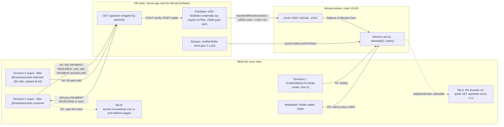
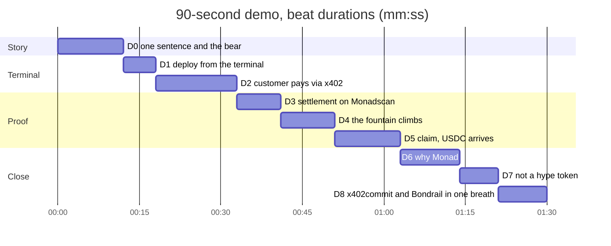
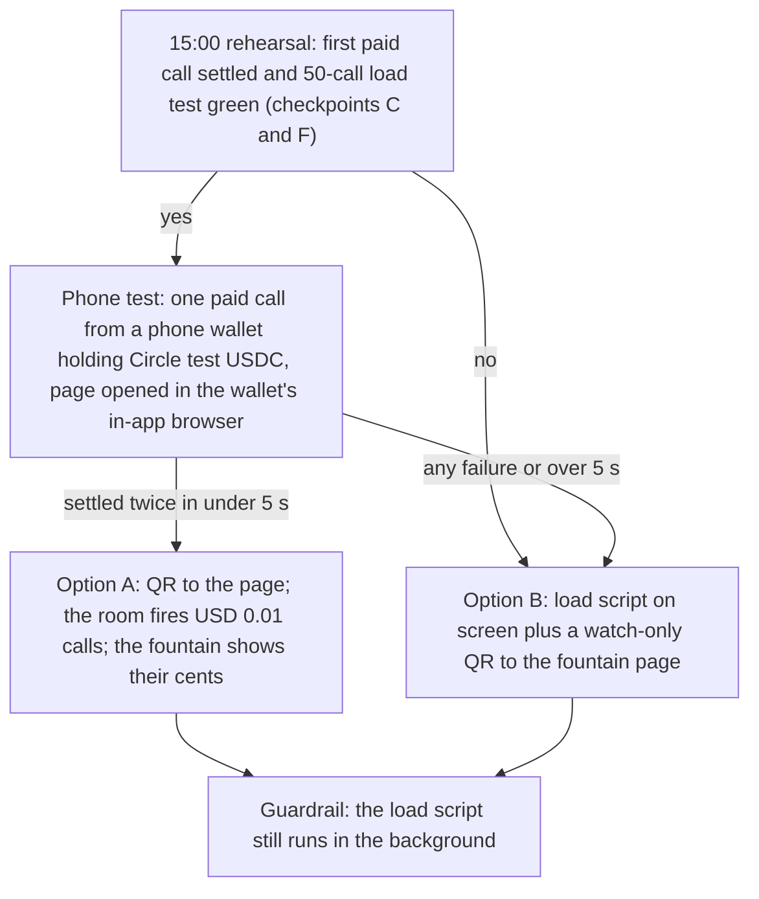

# 08 — Demo and pitch

This is the evening script for Mavera at Monad Blitz Ankara v4 (pitches and demos 18:00–20:00 on 24 Oct 2026, platform schedule): the 90-second live demo as beats with what is on screen, what is said and how each beat recovers; a 2-minute pitch and a 3-minute variant with timing marks; the three one-sentence variants; a six-slide outline; the mapping to the Blitz platform rubric (80% jury / 20% audience; gates `built_at_event`, `deployed`, `honest_pitch`; criteria Execution 30, On-chain necessity 25, Problem & promise 20, Originality 15, Presentation 10); the Q&A sheet; the three ways a juror could dismiss us and the pre-emptions; the audience-vote tactic; the numbers we may cite with sources; the claims we refuse to make; and the rehearsal checklist. Nothing in the demo is slideware: it is the product running on Monad testnet (chain 10143) with Circle test USDC, driven from two terminals and one browser. Addresses and hashes are `TBD on event day` until deployment; the commands behind every beat are in [07-RUNBOOK.md](07-RUNBOOK.md).

## Ground rules

- "Nobody knows what is in your head; they only see what you show." Every claim in the pitch is something the room watches happen (organizer workshop, 23 Oct 2026, quoted in the handoff).
- "Show a working MVP end to end: I open it, I do something, it happens on Monad, I get feedback." Beats D2–D5 below are exactly that loop.
- "If your app uses the blockchain only as a payment rail, it will probably fail; a credit card replaces it." The share comes first; the x402 payment is shown as the input, never as the product.
- Notion info pack, "Preparing for Your Project Demo": "Get to the Demo Fast", "Your Audience: Fellow Developers!", "Prepare for Demo Gremlins: screenshots, a short video fallback, stable testnet deployment." (https://monad-foundation.notion.site/blitz-ankara, accessed 2026-10-24.)
- Pitch length is unresolved (organizer: 1–2 minutes, max 2; Notion heading: 3 minutes; Notion body: 5). Ask at "Welcome & rules" 10:00–10:15; rehearse the 90-second and the 3-minute versions.

## The 90-second demo

### What is on the screen

Two terminals and one browser carry the whole story: the terminal pays, Monadscan proves it, the fountain shows the split, MetaMask collects it.

### Beats

| Beat, seconds | On screen | Said (verbatim) | What could go wrong, and the recovery |
| --- | --- | --- | --- |
| D0, 0–12 | Slide 1: the one sentence and the bear | "Mavera turns a paid API into shares; every x402 call pays the holders within one Monad block. Picture a bear selling honey: every jar sold drips coins into his friends' cups." | Projector handshake fails: slide 1 is also the first browser tab; the speaker keeps talking without it. |
| D1, 12–18 (optional) | Terminal 1: `./scripts/deploy.sh` prints the new address and its `https://testnet.monadscan.com/address/<ADDRESS>` link within about 1 s (wraps `forge create ... --broadcast --account mavera-deployer`; full command in [07-RUNBOOK.md](07-RUNBOOK.md)) | "One command, one block, and an API's share contract is live on Monad testnet. The fountain you will see is this morning's instance." | No output within 5 s (RPC, nonce, keystore prompt): say "deployed this morning", switch to Tab B on `<DEPLOY_TX_HASH>`. This creates a second instance that the page does not use; decide at the 15:00 rehearsal whether the beat stays. |
| D2, 18–33 | Terminal 2: `pnpm --filter @mavera/scripts customer` prints the 402 (`payTo` = the Mavera contract, amount `10000`), the signed authorization, then `200` with the MON/USD JSON and the `PAYMENT-RESPONSE` tx hash. Terminal 3 starts `pnpm --filter @mavera/scripts load-test` in the background | "A customer, a script, an agent, anything that speaks HTTP, asks for MON/USD. It gets a 402: one cent in USDC, payable to the contract. It signs a USDC authorization, no gas, no account, no API key, and gets the data and the settlement hash." | Facilitator `502`, `insufficient_funds`, `invalid_payment_expired`, or `Payment already attempted`: rerun with the second funded customer key (`CUSTOMER_PRIVATE_KEY` swap, 10 s). Facilitator down: play the 20-second recorded clip of this beat, or the `receiveWithAuthorization` fallback if it was built ([03-X402-FLOW.md](03-X402-FLOW.md)). |
| D3, 33–41 | Tab B: Monadscan page of that hash: from the facilitator signer `0x7f6a2850669202519f0FE8aa912451238820Db86`, `transferWithAuthorization` on USDC `0x534b2f3A21130d7a60830c2Df862319e593943A3`, 0.01 USDC to `<MAVERA_ADDRESS>` | "That cent is on-chain, in the contract, not in my account. The facilitator paid the gas." | Explorer not indexed yet: `cast receipt <SETTLEMENT_TX_HASH> --rpc-url https://testnet-rpc.monad.xyz` in Terminal 2, or the pinned rehearsal settlement tx. |
| D4, 41–51 | Tab A: the fountain: total distributed, calls, last call age, "your claimable" for the holder wallet; the load script keeps the counter climbing | "The fountain: total distributed, calls, and this holder's claimable, up within a second. Fifty more customers are paying right now." | Counter frozen (poller or relayer stuck): `claimable()` is pending-inclusive, so the holder's number still rises; trigger `sync()` from the relayer terminal (runbook command) and say "the view already includes it". |
| D5, 51–63 | MetaMask: Claim, confirm; Tab A shows claimable back to 0 and the holder's USDC balance up, with the `<CLAIM_TX_HASH>` link | "The holder pulls their USDC. One signature. It is final before I finish this sentence." | Popup slower than 5 s or a wrong gas estimate (the app sets an explicit gas limit): show the pinned rehearsal claim tx on Monadscan and move on. |
| D6, 63–74 | Slide 4: why Monad numbers | "Why only Monad: a split costs about three hundredths of a cent here, under 4 percent of the call, visible in 300 milliseconds and final in 600. On a 12-second chain with dollar fees this fountain would not move." | Running late: skip to D8. |
| D7, 74–81 | Tab A footer (disclaimer visible) | "Not a hype token: no chart, no yield promise, no company in the middle. The only thing that moves it is customers paying." | None. |
| D8, 81–90 | Slide 6: prior-art line | "x402commit and Bondrail tokenize x402 revenue with a company, a vault or a bond in the loop. Mavera is one open-source permissionless contract, paying holders per call, on Monad testnet. Thank you." | None. |

### Timing

Budget per beat for the rehearsal stopwatch; a beat that runs 5 s over its budget jumps straight to its recovery column.

## Pitch scripts

### 2-minute version (organizer: 1–2 minutes, max 2)

| Time | Beat | Said (verbatim) | Show |
| --- | --- | --- | --- |
| 0:00–0:12 | D0 | as in the beats table | Slide 1 |
| 0:12–0:30 | Problem | "Three problems. Developers and agents with real pay-per-call revenue cannot raise money without VCs. Small investors cannot buy cash flow at one-cent granularity. And in today's agent tokens the operator can redirect the payments anywhere; as x402commit puts it, the token 'trades on hype, not income'." | Slide 2 |
| 0:30–0:36 | D1 | as in the beats table | Terminal 1 |
| 0:36–0:51 | D2 | as in the beats table | Terminal 2 |
| 0:51–0:59 | D3 | as in the beats table | Tab B |
| 0:59–1:09 | D4 | as in the beats table | Tab A |
| 1:09–1:21 | D5 | as in the beats table | MetaMask, Tab A |
| 1:21–1:32 | D6 | as in the beats table | Slide 4 |
| 1:32–1:46 | Why a chain, not Stripe | "Why a chain and not Stripe: the payer is a machine with no bank account; the payee is the contract, so payment and dividend are one atomic flow; and the share is a bearer token anyone can hold. The chain is the cap table and the escrow, not the payment rail." | Slide 5 |
| 1:46–1:53 | D7 | as in the beats table | Tab A footer |
| 1:53–2:00 | D8, short | "x402commit and Bondrail add a company, a vault or a bond; Mavera is one permissionless contract, per call. Thank you." | Slide 6 |

### 3-minute variant (Notion heading: 3 minutes)

| Time | Beat | Said (verbatim) | Show |
| --- | --- | --- | --- |
| 0:00–0:30 | D0, Problem | as in the 2-minute version | Slides 1–2 |
| 0:30–0:50 | Promise (new) | "Who is this for? The supply side exists today: Monad API Hub lists 136 services paid per call in USDC on mainnet, and this event's own info pack asked for agent payment rails and indie financing; Mavera is the two combined. The demand side is anyone who wants to own cash flow at one-cent granularity." | Slide 3 |
| 0:50–1:41 | D1–D5 | as in the beats table | Terminals, tabs, MetaMask |
| 1:41–2:01 | On-chain vs off-chain (new) | "What is on-chain: the cap table, the custody, the split, the payout. What is off-chain: the customer's signature, the facilitator that settles it, the data itself, and a server poller so fifty browsers do not hit the public RPC. Every row has a reason." | Slide 5 |
| 2:01–2:12 | D6 | as in the beats table | Slide 4 |
| 2:12–2:26 | Why a chain, not Stripe | as in the 2-minute version | Slide 5 |
| 2:26–2:46 | Prior art (new) | "The accounting is ERC-1726 from 2019; Terra used it for rent at Blitz Mumbai; x402commit and Bondrail tokenize x402 revenue with a company, a vault or a bond. Of 1,759 Blitz projects we scanned, none combines a paid API, ERC-20 shares and per-call distribution. We are the minimal permissionless version, not the first idea." | Slide 6 |
| 2:46–2:53 | D7 | as in the beats table | Tab A footer |
| 2:53–3:00 | Close (extended) | "Built today from a config-only scaffold, on testnet with test USDC; a mainnet version would need a KYC allow-list and a licensed wrapper. Thank you." | Slide 6 footer |

## One-sentence variants (each 20 words or fewer)

1. "Mavera turns a paid API into shares; every x402 call pays the holders within one Monad block." (16 words; the headline used in the README and the submission description.)
2. "Sell your API's future revenue as on-chain shares; each 1-cent call is split to holders instantly on Monad." (18 words; finance-first opener for a juror who asks "what is it?")
3. "A cash-flow token for machine customers: agents pay per call, holders get the money within 600 ms." (17 words; for the agent-payments angle; "600 ms" is finality, see the numbers table.)

Children's-book frame, kept: "A bear sells honey; every time a jar sells, coins drip into his friends' cups."

## Slide outline (six slides, no slide during D1–D5)

| # | Title | The one number or diagram on it | Used in |
| --- | --- | --- | --- |
| 1 | Mavera: a paid API, as shares | The one sentence and the bear; number: USD 0.01 per call | 90 s, 2 min, 3 min |
| 2 | The problem | x402commit's line "the token trades on hype, not income" (https://x402commit.com/, accessed 2026-10-24); number: 1-cent granularity | 2 min, 3 min |
| 3 | The loop | The README hero flowchart (customer, 402, facilitator, USDC, Mavera, holders), exported to `docs/img/` on event day (TBD) | 3 min; backup if the live demo dies |
| 4 | Why only Monad | 300 ms visible, 600 ms final; USD 0.0003 per distribution, under 4% of a 1-cent call, at the 100 MON-gwei floor | all |
| 5 | On-chain vs off-chain, and not Stripe | The on-chain/off-chain table from [../README.md](../README.md); number: `payTo` = the contract | 2 min, 3 min |
| 6 | Prior art and the difference | ERC-1726 (2019) to Terra (Jun 2026) to x402commit / Bondrail to Mavera; number: 1,759 Blitz projects scanned, 0 combine the three; footer: securities disclaimer, "testnet", `<MAVERA_ADDRESS>` | all |

## Mapping to the platform rubric

Source: `GET https://blitz.devnads.com/api/events/monad-blitz-ankara-v4/judging` (accessed 2026-10-24; `enabled: true`, `published: false`, `judgeWeight` 80 / `voteWeight` 20). Descriptions are quoted verbatim. A project that fails a gate "was not ranked".

| Gate | Description (verbatim) | How Mavera passes it |
| --- | --- | --- |
| `built_at_event` | "The repo shows the work happened during the event. Prior work must be disclosed." | README section "Built at the event — prior-work disclosure" ([../README.md](../README.md)): the pre-event scaffold (configuration, CI, docs, TODO stubs, commit range `fec7bfa..PRE_EVENT_LAST_COMMIT`) is listed; product code starts at 10:45; the first product commit is timestamped after the workshop. One clause in the 3-minute close says it out loud. |
| `deployed` | "A contract address is provided and has code on Monad testnet." | `<MAVERA_ADDRESS>` with its Monadscan link in the README, the submission description and the page footer; source verified on Sourcify and Monadscan ([12-SUBMISSION-CHECKLIST.md](12-SUBMISSION-CHECKLIST.md)); beat D3 opens the explorer live. |
| `honest_pitch` | "The headline claim in the description and demo is actually implemented." | The headline is the demo: a paid call (D2), the settlement into the contract (D3), the holder's claimable rising (D4), the claim (D5). The precise form of the claim is in "Claims we make" below. |

| Criterion | Weight | Description (verbatim) | What the jury sees |
| --- | --- | --- | --- |
| Execution | 30 | "How much of it actually works." | Live end to end, no slides during the demo: buy (done before the pitch), paid call, settlement, fountain, claim; 50 settled calls with hashes; test and CI badges in the README. |
| On-chain necessity / Monad fit | 25 | "Whether the product needs the chain, and Monad specifically." | Slide 5: the payee is the contract, the payer is a machine, the claim is a bearer token; slide 4: per-call sub-cent distribution works at Monad fees and block times and not at 12-second blocks with dollar fees. |
| Problem & promise | 20 | "Who it is for and whether it can live past the hackathon." | API and agent developers with pay-per-call revenue, and buyers of cash flow at 1-cent granularity; the supply side exists (API Hub, 136 services, mainnet); the mainnet path is named (KYC allow-list, licensed wrapper). |
| Originality | 15 | "How new the idea is." | Slide 6 says what is old (the accumulator) and what is new (the combination, and no intermediary), with the 1,759-project scan. |
| Presentation | 10 | "How clearly it was shown." | One sentence, the bear, one diagram, a live loop, numbers with units; the only jargon is x402 and USDC. |

Claims we make, in the exact form we can defend:

- Every paid call's USDC lands in the contract, not with the operator: D3 shows the settlement's recipient is `<MAVERA_ADDRESS>`.
- In the block that contains the settlement, every holder's `claimable()` already includes their share, because the view is pending-inclusive (it simulates `sync()`); the relayer's `sync()` writes the accumulator about a second later. Two transactions, one block apart, both on screen. We say "within one Monad block" about the holder's claimable, not about a single transaction.
- Holders pull USDC with one transaction (D5); anyone can call `sync()`, and calling it twice is harmless.
- The customer client refuses to pay anything but `payTo == MAVERA_ADDRESS`, asset USDC, network `eip155:10143`, scheme `exact`; the chain cannot enforce a server's `payTo`.
- Testnet only, Circle test USDC, pre-event work disclosed.

## Q&A sheet

| Question | Answer (what to say) | Grounding |
| --- | --- | --- |
| "Pump.fun?" | "Pump.fun routes money to creators and to whoever sells first; the token is the product. Here the token is a claim on an external cash flow: every call pays holders in USDC, the primary sale is fixed-price and tiny (0.4 USDC for the whole float), no curve, no chart." | [adr/ADR-0003-fixed-price-vs-bonding-curve.md](adr/ADR-0003-fixed-price-vs-bonding-curve.md); MonProtocol contrast in [09-COMPETITIVE-LANDSCAPE.md](09-COMPETITIVE-LANDSCAPE.md) |
| "Isn't this a security?" | "On testnet with test USDC it is a proof of concept of a mechanism; nothing is offered. The instrument class is old: the ERC-2222 draft described 'claims on future cash flow' in 2019. x402commit says 'Not offered to US persons'; AdaVest wrote the same caveat at İstanbul v2. Our footer and README carry the disclaimer; a mainnet version would add a KYC allow-list, as Terra did with an ERC-3643-style registry, and a licensed wrapper." | Disclaimer text in [../README.md](../README.md); https://github.com/ethereum/EIPs/issues/2222 and https://x402commit.com/ (accessed 2026-10-24) |
| "Why now?" | "Three things happened in 2026: x402 v2 with a public Monad facilitator (`exact` on `eip155:10143`, checked live today), Monad API Hub (136 pay-per-call services on mainnet since September), and the SDK carrying Monad testnet USDC out of the box. Machine customers with per-call bills exist now; the capital layer for them does not." | Numbers table; [03-X402-FLOW.md](03-X402-FLOW.md) |
| "So it is just payments?" | "The payment is the input. The product is capital formation (`buy`), distribution (`sync`) and a transferable claim (the ERC-20). The chain is the cap table and the escrow, not the payment rail." | [00-OVERVIEW.md](00-OVERVIEW.md) |
| "Why not Stripe, or Stripe Connect splits?" | "One: the customers are machines; on Monad 'any HTTP endpoint can become instantly payable' with no accounts or API keys, and agents cannot open Stripe accounts. Two: trust; with Stripe the operator holds the money and promises to pay, here `payTo` is the contract, so payment and dividend are one atomic flow. Three: the claim is a bearer ERC-20 anyone can buy at 1-cent granularity; Connect splits are custodial, revocable and jurisdiction-gated." | https://docs.monad.xyz/tooling-and-infra/agentic-payments (accessed 2026-10-24) |
| "Why Monad?" | "Blocks every 300 ms, final at 600 ms; a 100 MON-gwei base-fee floor, so a distribution at a 150,000-gas limit costs about USD 0.0003, under 4% of a 1-cent call. Monad also runs the public x402 facilitator and hosts a pay-per-call USDC API catalog. On a 12-second chain with dollar fees the fountain would not move. All figures at the minimum base fee." | Numbers table; [10-MONAD-NOTES.md](10-MONAD-NOTES.md) |
| "How is this not x402commit?" | "Same diagnosis, opposite design. x402commit (Base, pilot stage, no public code) deploys a splitbox, a vault and an ERC-8004 identity per client, takes a share of each payment, and gates changes behind a 2-of-3 multisig and a 48-hour timelock. Bondrail (Monad testnet, Metropolis entry, results 3 Nov) issues capped revenue bonds with staged capital, its own facilitator and a Chainlink CRE watcher. Mavera is one open-source permissionless contract: `payTo` is the share token itself, anyone can call `sync()`, no fee, no multisig, no company." | https://x402commit.com/ and https://github.com/calledAdo/bondrail (accessed 2026-10-24); [09-COMPETITIVE-LANDSCAPE.md](09-COMPETITIVE-LANDSCAPE.md) |
| "What if the operator redirects `payTo` to their own wallet?" | "Honest clients stop paying and holders see it at once. The payer signs an EIP-3009 authorization whose `to` is inside the signature; the x402 spec tells clients to 're-run payment policy checks ... when terms such as scheme, network, amount, asset, or payTo change'; our client aborts unless `payTo == MAVERA_ADDRESS`. A redirect equals shutting the API down: `Synced` events stop within a block. The chain cannot force a server's `payTo`; hardening (ERC-8004 `agentWallet` binding, a watcher, a timelock) is deliberately left for mainnet." | https://docs.x402.org/core-concepts/client-server.md (accessed 2026-10-24); [06-THREAT-MODEL.md](06-THREAT-MODEL.md) |
| "Same as Terra or ClearTune?" | "Same accumulator, different product. Terra (Blitz Mumbai V3) used `accRentPerShare` for rent the issuer deposits by hand, ERC-1155 behind a KYC registry. ClearTune (Blitz Jakarta) splits per play among a fixed payee list; plays are reported by its backend in batches and paid in a mock token; no transferable share, no raise. In Mavera the customer pays per call through x402, the money enters the contract directly, and whoever holds the ERC-20 at that instant gets it." | https://github.com/JustinaMary/tokenized-real-estate and https://github.com/LBRT87/ClearTune (accessed 2026-10-24) |
| "Monad Private Settlement?" | The five bullets below, then: "It is a published design, not live; Mavera needs none of it, our flows are public by design." | https://monad.xyz/blog/monad-private-settlement (accessed 2026-10-24) |
| "What if the facilitator is down?" | "The x402 path needs it even to emit a 402. Same contract, same UI, two fallbacks: `receiveWithAuthorization` (the customer stays gasless, the relayer submits) and `permit` plus `pay()`." | [03-X402-FLOW.md](03-X402-FLOW.md) |
| "Who pays gas?" | "Customer: none, a signature only. Facilitator: the settlement, about 0.014 MON at the floor, from signer `0x7f6a2850669202519f0FE8aa912451238820Db86`. Relayer: `sync()`, about 0.015 MON at a 150,000-gas limit. Holder: `claim()`." | Numbers table |
| "Why pull-based claims? What about rounding?" | "Pull is gas-safe at any holder count. Integer division leaves dust in the contract, at most one atomic unit (0.000001 USDC) per holder." | [adr/ADR-0002-pull-vs-push-dividends.md](adr/ADR-0002-pull-vs-push-dividends.md); [02-CONTRACT-SPEC.md](02-CONTRACT-SPEC.md) |
| "Why `exact`, and why Circle USDC rather than the devnads test USDC?" | "`exact` is one signature and one real transfer per call; `upto` needs a Permit2 approval first. The devnads token has `permit` but no EIP-3009, so the facilitator cannot settle it; the x402 asset on testnet is Circle's USDC `0x534b2f3A21130d7a60830c2Df862319e593943A3`." | [adr/ADR-0004-x402-exact-vs-upto.md](adr/ADR-0004-x402-exact-vs-upto.md); [adr/ADR-0005-usdc-choice.md](adr/ADR-0005-usdc-choice.md) |
| "What data do you actually sell?" | "MON/USD as the median of two on-chain oracles, Pyth and Stork, read in one Multicall3 call, plus chain-heartbeat fields; `DATA_MODE=heartbeat` drops the oracles if one is stale. The data is deliberately boring; the product is the share." | [03-X402-FLOW.md](03-X402-FLOW.md); [../.env.example](../.env.example) |
| "Wallet popups? Passkeys?" | "Reading needs no wallet. A paying customer signs once per call and sends no transaction. Holders transact only to buy and to claim. mera, Monad's passkey library (regular EOAs, nothing on-chain), is the obvious onboarding upgrade and is roadmap, not built." | https://docs.monad.xyz/guides/mera (accessed 2026-10-24) |
| "Does the cent reach holders in the same transaction?" | "No. The settlement is one transaction into the contract; in that block every holder's `claimable()` already includes it, because the view simulates `sync()`; the relayer's `sync()` writes it about a second later. Two transactions, one block apart, both on the screen." | [02-CONTRACT-SPEC.md](02-CONTRACT-SPEC.md) |

Monad Private Settlement, five bullets (Monad Foundation blog, 2026-10-06; announced by Category Labs at the OPEN conference, Singapore; https://monad.xyz/blog/monad-private-settlement, accessed 2026-10-24):

- Sovereign domains on the public L1: each institution configures a private execution environment, "enabled by a standard EVM smart contract on the Monad L1"; no fork, protocol change or off-chain components required.
- Everything inside a domain is encrypted: transactions, state and contract code, "hidden from the L1 itself"; users encrypt a transaction, address it to a domain and submit it to the L1 for sequencing by Monad's public validators.
- Institution-controlled trust and access: the institution chooses the validators running its domain (it can bring its own), the trust model, jurisdiction and access policies; access is denied by default, per data type.
- Atomic settlement: two-way transactions settle atomically; "Delivery-versus-payment is built in".
- Shared liquidity: domains draw on the pooled liquidity of the Monad network; target users are banks, corporate treasuries, asset managers and trading firms.
- Status, verbatim: "Monad Private Settlement is a published design and is not yet live." Do not repeat press claims about TEE, zkVM or MPC options; the blog says only "trust model".

## Three dismissal risks and pre-emptions

| Dismissal | Why it is likely | Pre-emption in the demo | Pre-emption in the README |
| --- | --- | --- | --- |
| "It is a payment link." The organizer said crypto payment links were about 40% of an online Blitz and were rejected; On-chain necessity carries 25 points. | The 402 flow is the most visible part of the demo. | Open with the share (slide 1), show the payment as the input (D2), spend the screen time on the split and the claim (D4–D5). | Hero diagram is the cash-flow token; the on-chain/off-chain table has a "why there" column; the x402 sequence comes second. |
| "Not new: ERC-1726, Terra, x402commit did this." Originality carries 15 points; jurors who know DeFi will recognise the accumulator. | True for the accounting; harmful only if hidden. | Slide 6, 10 seconds: "Pattern from 2019; Terra used it for rent; x402commit and Bondrail add companies and bonds; we make it one permissionless contract, per call, on Monad." | "Prior art and honesty" section with links; the word "first" never appears. |
| "Hype token, securities vibes, or the headline is not really implemented." Gate `honest_pitch`; the organizer is "personally cool" on gambling-like products. | A token sale plus "yield" language reads as Pump.fun. | No price chart, no APY, no "to the moon"; a real paid call becomes USDC in a holder's wallet with the Monadscan tx open; the disclaimer footer is on screen in D7. | Headline stated precisely with tx hashes; securities disclaimer; "Built at the event" disclosure. |

## Audience vote (20%)

Voters are developers on blitz.devnads.com; the platform's voting window is 18:00–20:00 TRT (`voting_start_time` 15:00Z to `voting_end_time` 17:00Z, accessed 2026-10-24). inscribi director took 3rd at İstanbul v2 with QR wallets for a live audience; the same move here is to let the room pay the API.

The decision is made once, at 15:00, on evidence from the rehearsal; the load script runs in every branch so the counter never depends on the audience.

- Option A preconditions: checkpoints C and F from the x402 integration plan are green ([07-RUNBOOK.md](07-RUNBOOK.md)); a phone test passes twice. An audience phone needs a wallet with Monad testnet (chain 10143) added and Circle test USDC (https://faucet.circle.com, 20 USDC per address every 2 hours, accessed 2026-10-24); it needs no MON, because the x402 signature is gasless. The page must be opened in the wallet's in-app browser, since only the injected connector is configured ([04-FRONTEND.md](04-FRONTEND.md)). The "Call API" button signs the EIP-712 authorization; each cent shows up on the fountain.
- Option B: `pnpm --filter @mavera/scripts load-test` on screen (50 calls, 0.50 USDC, hashes and latencies printed) plus a watch-only QR to the page. Fifty phones are fine: the page polls `GET /api/state` (server-cached about 1 s), not the public RPC.
- In both options, end with the project name exactly as listed on the platform ("Mavera") and one sentence asking for the vote. Never wait for the audience; the pitch clock keeps running.

## Numbers to cite

| Number | Value | Say it as | Source (accessed 2026-10-24) |
| --- | --- | --- | --- |
| Block time | 300 ms; measured 302 ms average over 10,000 testnet blocks on 2026-10-24 | "visible in about 300 ms (Proposed, `latest`), `safe` about 300 ms later (Voted), final at about 600 ms (`finalized`)"; never "300 ms finality" | https://docs.monad.xyz/introduction/monad-for-developers; https://docs.monad.xyz/reference/json-rpc/overview |
| Minimum base fee | 100 MON-gwei; Monad charges the gas limit, not the gas used | "at the minimum base fee" (it can rise under load) | https://docs.monad.xyz/developer-essentials/gas-pricing |
| Cost of one distribution | `sync()` at a 150,000-gas limit = 0.015 MON, about USD 0.0003 (USD 0.000375 at the docs' implied USD 0.025/MON; USD 0.00032 at USD 0.0214/MON, CoinGecko 2026-10-23 23:54 UTC) | "about three hundredths of a cent, under 4% of a 1-cent call" | gas-pricing page plus arithmetic; https://api.coingecko.com/api/v3/simple/price?ids=monad&vs_currencies=usd |
| Reference transactions | 21,000-gas MON transfer 0.0021 MON, about USD 0.00005; 200,000-gas transaction 0.02 MON, about USD 0.0005 | contrast only; not "the dividend costs USD 0.00005" | https://docs.monad.xyz/developer-essentials/gas-pricing |
| Settlement gas | `transferWithAuthorization` estimated at 141,817 gas, about 0.014 MON at the floor, paid by the facilitator signer `0x7f6a2850669202519f0FE8aa912451238820Db86` (about 4,964 MON on 2026-10-24) | "the facilitator pays the settlement gas" | `cast estimate` on USDC `0x534b2f3A21130d7a60830c2Df862319e593943A3`; https://x402-facilitator.molandak.org/supported |
| Demo cost | 50 calls = 0.50 USDC from the customer; relayer gas about 50 x 0.0153 MON = 0.77 MON, about USD 0.016 | "fifty customers cost the relayer under two cents of gas" | arithmetic from the rows above |
| Faucets | Circle: 20 USDC per request, one request per (asset, testnet) per address every 2 hours; Blitz platform: 50 MON per sign-in | — | https://faucet.circle.com; https://blitz.devnads.com |
| Monad API Hub | 136 services, mainnet `eip155:143`, x402 v2, USDC; per-call prices from USD 0.000036 to USD 60.00 | "136 pay-per-call services on mainnet today; Mavera is the capital layer for that supply, built on testnet as the rules require"; not "66 services" | https://app.monad.xyz/agents/api-hub and its `feed.json` |
| Throughput and validators | 10,000 TPS design target; about 200 validators (testnet consensus set 200 live); mainnet since 2025-11-24; Monad reports 100% uptime (self-reported) | "Monad reports", not "has" | https://docs.monad.xyz/introduction/monad-for-developers; https://www.monad.xyz/blog/monad-network-uptime |
| Ethereum contrast | 12 s blocks, 12–18 min finality, about 10 TPS (docs comparison table) | "on a 12-second chain the fountain would not move" | https://docs.monad.xyz/introduction/monad-for-developers |
| Blitz corpus | 1,759 approved projects from 59 events (plus 5 test events); 92 mention x402; 0 combine a paid API, ERC-20 shares and per-call distribution | "none of 1,759 Blitz projects"; never "first" | https://blitz.devnads.com/api/showcase |
| Rubric | 80 / 20; Execution 30, On-chain necessity 25, Problem & promise 20, Originality 15, Presentation 10 | — | https://blitz.devnads.com/api/events/monad-blitz-ankara-v4/judging |
| Demo parameters | price 10,000 USDC atomic units = USD 0.01 (`X402_PRICE_ATOMIC`); `sharePrice` 10,000 units per 1e18 shares; `creatorShares` 60e18; `maxSupply` 100e18 (whole float 0.4 USDC) | TBD, confirm at 11:00 | [02-CONTRACT-SPEC.md](02-CONTRACT-SPEC.md); [../.env.example](../.env.example) |

## Things not to claim

| Do not say | Why | Say instead |
| --- | --- | --- |
| "World-first", "nobody has done this" | Terra, x402commit and Bondrail exist; the accumulator is ERC-1726 (2019) | "none of 1,759 Blitz projects combines the three"; "the minimal permissionless version" |
| "Mainnet", "live product", "customers" | Chain 10143 and Circle test USDC only; `deployed` gate requires testnet | "testnet proof of concept; mainnet would need a KYC allow-list and a licensed wrapper" |
| "Finality in 300 ms" | 300 ms is the Proposed block; finality is at about 600 ms | "visible in 300 ms, final in 600 ms" |
| "Endorsed by Monad", "API Hub partner", "built with the Monad team" | No such relationship; API Hub is mainnet and its catalog disclaims endorsement of listed services | "Monad runs a public facilitator; API Hub proves pay-per-call demand; we build on testnet" |
| "The chain enforces `payTo`" | It cannot; the server SDK even allows a per-request `payTo` | "the client refuses to pay anything but the contract" |
| "Audited", "secure", "extensively fuzzed" | Unit tests, one fuzz sequence test and two invariants are the plan; Slither output is committed, not an audit | "tested, invariant-checked, Slither-reviewed, source-verified" |
| "Yield", "APY", "the price goes up" | Reads as Pump.fun; conflicts with the securities disclaimer | "a cash-flow token; the only thing that moves it is customers paying" |
| "Gas is USD 0.00005 per dividend" | That figure is a 21,000-gas native transfer | "about USD 0.0003 per distribution at a 150,000-gas limit" |
| "Testnet needs a custom money parser", "the faucet gives 1 USDC", "scheme `v2-eip155-exact`" | Stale guide statements; `@x402/evm@2.28.0` has Monad testnet USDC built in, the faucet gives 20 USDC, the wire scheme is `exact` | the corrected values |
| "Monad has 100% uptime", "Private Settlement is live" | Uptime is Monad's own claim; Private Settlement is a published design | "Monad reports 100% uptime"; "published design, not live" |
| "x402commit is a startup" | No named company; a pilot-stage service on Base | "pilot-stage service on Base, no public code" |

## Rehearsal checklist and timing

Event-day slots (platform schedule and [07-RUNBOOK.md](07-RUNBOOK.md)): rehearsal and 50-call load 15:00–15:30; video and submission 15:30–16:00 (submission closes 16:30, submit by 16:00 for admin approval); dinner and demo setup 17:00–18:00; pitches and demos 18:00–20:00; results 20:00–20:30. Roles: Speaker talks, Driver types, Backup runs the stopwatch and holds the video and screenshots.

| When | Item | Pass criterion |
| --- | --- | --- |
| 15:00 | `curl -s https://x402-facilitator.molandak.org/supported` | `exact` listed for `eip155:10143` |
| 15:00 | Wallets funded at least 3 blocks before use: relayer `cast balance <RELAYER_ADDRESS> --rpc-url https://testnet-rpc.monad.xyz` at or above 10 MON; customer at or above 1 USDC (50 calls x 0.01 = 0.50 USDC); a second customer key funded; holder wallet A holds shares bought before the pitch | all four true |
| 15:05 | `pnpm --filter @mavera/scripts load-test` | 50 of 50 settled; no `Payment already attempted`, no `settlement_pending`; median latency noted for the pitch |
| 15:10 | The 90-second script, twice, with a stopwatch | at or under 85 s; every recovery column tried once |
| 15:20 | The 3-minute variant, once | at or under 2:55 |
| 15:25 | Decisions: keep or cut D1 (live deploy), audience Option A or B, `DATA_MODE=oracle` or `heartbeat` | written in the runbook log |
| 15:30 | Record the pitch video: landscape, clear audio, 90 s or shorter, MP4; export screenshots of D3, D4, D5 | the same file is the submission video (required before Submit when the platform has video enabled, default cap 90 s) and the "Demo Gremlins" fallback; created during event hours, as the rules require |
| 17:00–18:00 | Demo setup: re-fund, restart the relayer, one fresh paid call, pin tabs (A: the page; B: `https://testnet.monadscan.com/address/<MAVERA_ADDRESS>`, a rehearsal settlement tx, a rehearsal claim tx), terminal font 18 pt or larger, notifications off, phone hotspot and charger ready | one full dry run on the venue screen if allowed |
| 18:00 | Speaker, Driver, Backup in position; stopwatch started at D0 | — |

## Open questions

- Pitch length: 1–2 minutes (organizer) versus 3 minutes (Notion heading) versus 5 (Notion body). Ask at 10:00; the answer picks the 2-minute or the 3-minute script.
- Is the pitch video enabled for this event? Visible only after login (`GET https://blitz.devnads.com/api/events/monad-blitz-ankara-v4/my-project/video`, fields `configured`, `locked`, `max_seconds`). If yes, Submit is blocked until the video is uploaded.
- Presentation hardware: own laptop over HDMI, or the organizer's machine? Affects the three-terminal setup; the Notion pack does not say. Ask at 10:00.
- D1 (live deploy): keep or cut. It costs 6 s, deploys a second instance the page does not use, and adds one failure mode; decide at the 15:00 rehearsal.
- Audience Option A depends on checkpoints C and F plus a phone test; the injected-only wallet connector means the QR works only inside a wallet's in-app browser. WalletConnect is not planned.
- The facilitator advertises `batch-settlement`; the first paid call must confirm that one settlement is one transaction before anyone says "one call, one transaction" on stage.
- Attribution choice (`sync()` inside `_update` versus relayer-only) is confirmed before 11:00; the demo does not transfer shares, so it does not change what the room sees, but the Q&A answer on gas per transfer does.
- Platform entry is dated 2026-10-23 with `status: ended` (checked 2026-10-24); if Submit is closed at 09:00, tell port before hacking starts ([12-SUBMISSION-CHECKLIST.md](12-SUBMISSION-CHECKLIST.md)).
- Token name and symbol, and the demo parameters, are TBD until 11:00; slide 6 and the fountain header carry them.
- Does voting on the platform happen during the pitches or after? Determines whether the closing ask is "vote now" or "vote at 20:00".
