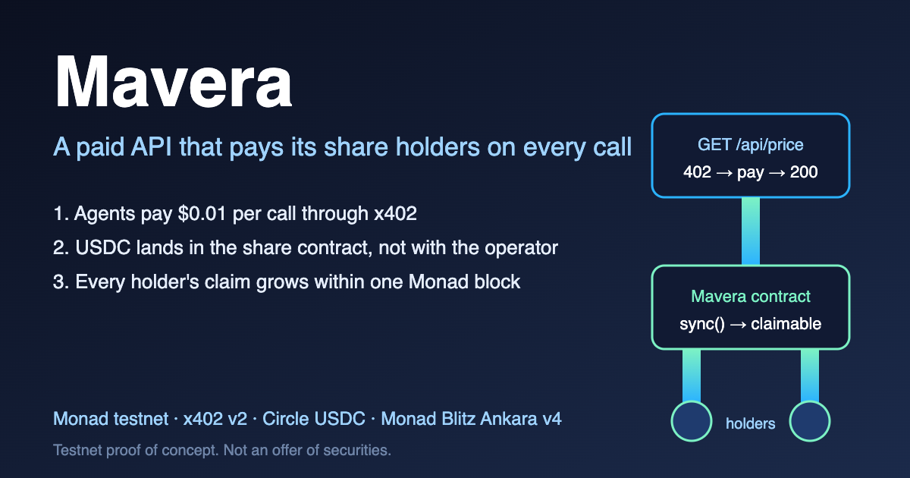

<!-- _paginate: false -->
<!-- _footer: "Mavera · Monad Blitz Ankara v4 · 24 Oct 2026 · Monad testnet (chain 10143), Circle test USDC" -->

# Mavera

Mavera turns a paid API into shares; every x402 call pays the holders within one Monad block.

A bear sells honey; every time a jar sells, coins drip into his friends' cups.

USD 0.01<small>per API call, in USDC, split to the share holders</small>

<!--
D0, 0:00-0:12. Said: "Mavera turns a paid API into shares; every x402 call pays the holders within one Monad block. A bear sells honey; every time a jar sells, coins drip into his friends' cups. Each call costs one cent."
Then switch to the terminals: D1 deploy, D2 customer pays via x402, D3 settlement on Monadscan, D4 the fountain climbs, D5 claim.
-->

---

<!-- _class: flow -->

## How it works: one call, one block

<b>1. Call, 402</b> GET /api/price answers 402 with payTo = the contract.

<b>2. Signed payment</b> The client signs an EIP-3009 authorization; no gas, no account.

<b>3. Settle</b> The Monad facilitator moves 0.01 USDC into Mavera and pays the gas.

<b>4. sync, claim</b> sync() splits it per share; holders pull with claim().

<!--
Backup slide if the live demo dies, or the 3-minute "on-chain vs off-chain" beat.
Said: "What is on-chain: the cap table, the custody, the split, the payout. What is off-chain: the customer's signature, the facilitator that settles it, the data itself, and a server poller so fifty browsers do not hit the public RPC. Every row has a reason."
The payment is the input; the product is the share that gets paid.
-->

---

## Why Monad, and why a chain at all

- **The payer is a machine.** x402: an agent with no bank account signs a USDC authorization; the server answers 402, then 200.
- **The payee is the contract.** payTo is Mavera itself, so payment and dividend are one atomic flow; the operator never holds the revenue.
- **Sub-cent split per call is only sane here.** One distribution, sync() at a 200,000-gas limit, costs about **USD 0.0004** at the 100 MON-gwei minimum base fee: under 5% of a 1-cent call.
- **Visible in about 300 ms, final at about 600 ms.** On a 12-second chain the fountain would not move.
- **Monad runs a public x402 facilitator**, which pays the settlement gas; API Hub lists 136 pay-per-call services on mainnet today.

Sources: docs.monad.xyz (block time, gas pricing), x402-facilitator.molandak.org, app.monad.xyz/agents/api-hub, accessed 24 Oct 2026. Testnet build; mainnet would need a KYC allow-list and a licensed wrapper.

<!--
D6 and "Why a chain, not Stripe", 1:21-1:46.
Said: "Why a chain and not Stripe: the payer is a machine with no bank account; the payee is the contract, so payment and dividend are one atomic flow; and the share is a bearer token anyone can hold. The chain is the cap table and the escrow, not the payment rail."
Numbers: "visible in about 300 ms, final at about 600 ms"; "about four hundredths of a cent per distribution, under 5% of a 1-cent call, at the minimum base fee". Never say "300 ms finality".
-->

---

## Our difference: one permissionless contract, per call

<b>vs Stripe Connect splits:</b> a custodial, revocable promise from the operator's bank account. In Mavera the operator never touches the money; the client refuses to pay anything but the contract.

<b>vs revenue-share tokens that pay monthly:</b> a company, a vault or a bond in the loop (x402commit, Bondrail). Mavera distributes every call within one Monad block, and anyone can call sync().

<b>vs plain x402 endpoints:</b> the operator keeps all the revenue; no shared upside. Mavera's shares are a transferable ERC-20 cash-flow claim: the only thing that moves it is customers paying.

Accounting is the ERC-1726 dividend-token pattern (2019). Of 1,759 approved Blitz projects scanned on 24 Oct 2026, none combines an x402-paid API, ERC-20 shares and per-call distribution. Testnet proof of concept with test USDC. Not an offer of securities.

<!--
D7 and D8, 1:46-2:00.
Said: "This is not a hype token: the only thing that moves it is customers paying. x402commit and Bondrail add a company, a vault or a bond; Mavera is one permissionless contract, per call. Thank you."
3-minute variant: "The accounting is ERC-1726 from 2019; Terra used it for rent at Blitz Mumbai; of 1,759 Blitz projects we scanned, none combines a paid API, ERC-20 shares and per-call distribution. We are the minimal permissionless version, not the first idea."
-->

<!--
Recording the 60-second demo video on macOS:
1. Cmd+Shift+5 and pick "Record Selected Portion", or QuickTime Player > File > New Screen Recording; set the browser window to 1920x1080.
2. Options: microphone on; turn on a Focus mode so notifications stay hidden; hide the Dock (Cmd+Option+D).
3. Record 60 seconds: terminal pays via x402, Monadscan shows the settlement, the fountain climbs, Claim lands USDC in MetaMask.
4. Stop with the menu-bar button; the .mov lands on the Desktop.
5. If an .mp4 is required: ffmpeg -i in.mov -vcodec h264 -acodec aac out.mp4
-->
