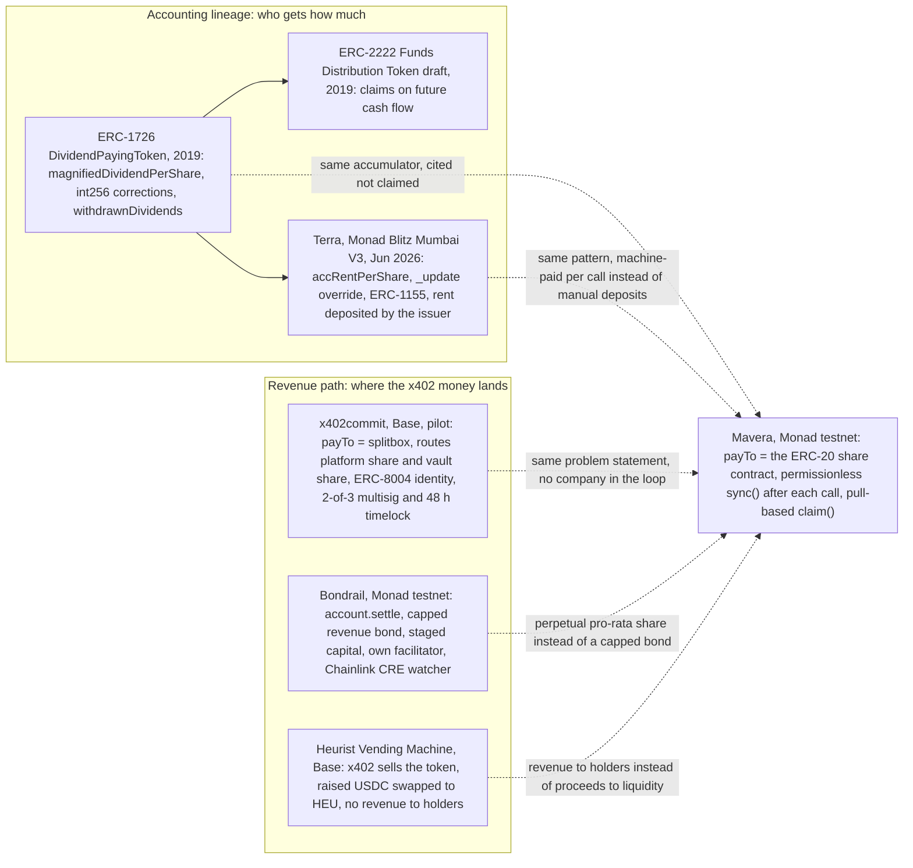

# Mavera competitive landscape and prior art

This document maps every project and standard we found that is close to Mavera, states exactly how Mavera differs from each, and fixes the wording the team may use in front of the jury. The short version: the share accounting is not new (ERC-1726, 2019; Terra used the same accumulator on Monad testnet in June 2026), the problem statement is shared with x402commit (Base, pilot stage) and Bondrail (Monad testnet, Metropolis entry), and the combination is new within the Blitz corpus: of 1,759 approved Blitz projects from 59 events (plus 5 test events) scanned on 2026-10-24, none combines an x402-paid API, transferable ERC-20 shares and automatic per-call distribution to holders. Mavera's position is the minimal permissionless version of that idea: one open-source contract that is itself the x402 `payTo`, a permissionless `sync()` after every call, a pull-based `claim()`, and no company, fee, bond or vault in the money path. The Blitz rubric weights Originality at 15 of 100 and has a pass/fail gate on an honest pitch, so citing prior art openly costs little and hiding it could cost everything. Every external fact below comes from the research report behind this document, re-checked against primary sources by a second reviewer on 2026-10-24; where the two disagreed, the reviewer's correction is used. Product framing is in [docs/00-OVERVIEW.md](00-OVERVIEW.md); the pitch that uses this material is [docs/08-DEMO-AND-PITCH.md](08-DEMO-AND-PITCH.md).

## Landscape table

Status as of 2026-10-24. Text in quotation marks is verbatim from the source in the last column; everything else is paraphrase. Personal e-mail addresses that the Blitz platform exposes for some teams are left out on purpose. "No placement" means the platform record has no `winner_placement`.

| # | Project | What it does | Chain / network | Status | Who / when | How Mavera differs | Source (accessed 2026-10-24) |
| --- | --- | --- | --- | --- | --- | --- | --- |
| 1 | x402commit | "Tokenize the cashflow from your paid API or agent." The API is registered as an ERC-8004 identity "with a canonical endpoint and payTo route"; "A revenue vault owns the service NFT"; "x402 payments land at the splitbox, which routes your share and the vault share atomically"; changes "require 2-of-3 multisig approval and a 48-hour timelock". Pricing: "x402commit takes a configured share of each settled payment through the splitbox." | Base (site footer: "x402 · ERC-8004 · ERC-20 · EIP-3009 · USDC · Base") | Pilot-stage marketing site ("Start a pilot"). No contract addresses, no token, no public code: the GitHub org holds one repository (`agents-trust-feedback`) and the SDK repository linked from PyPI returns 404. Disclaimer: "Not offered to US persons." | No named company. GitHub org created 2026-04-10 (location "Switzerland", blog agents-trust.com); PyPI package `x402commit` 0.0.1 uploaded 2026-04-23 with an Intentra Labs contact | Same diagnosis, opposite design. Mavera's `payTo` is the share contract itself (no splitbox hop, no platform share), `sync()` can be called by anyone, the shares are the ERC-20 itself, and there is no multisig, timelock or company in the loop. Cite its thesis: "The operator can redirect payments to any wallet at any time, so the token trades on hype, not income." | https://x402commit.com/ · https://github.com/x402commit · https://pypi.org/pypi/x402commit/json |
| 2 | Bondrail | "Revenue bonds for onchain businesses. Issue bonds, raise capital, and repay investors from connected revenue. Businesses receive capital in stages; investors receive transferable claims on an agreed revenue share up to a cap." "x402 EIP-3009 payments pass through `account.settle`, with payer attribution and repayment in one transaction." App: "Chainlink CRE checks every paid endpoint every 30 minutes; a confirmed diversion defaults the bond and slashes your stake"; capital "25% or 50% is released, the rest at a milestone". | Monad testnet (chain 10143). Current README deployment (`main`, 2026-10-15): Factory `0x94c86517a520e56f104c6c82b96632643b3f5d81`, Bond implementation `0x95427c18841dc8a5b6240a5337a9a4382f380c69`, Credit vault `0x57fd6a271a6a4e96b151e5d0732c7f61e3059f07`; same Circle test USDC as Mavera (`0x534b2f3A21130d7a60830c2Df862319e593943A3`). The Metropolis-judged deployment (git tag `metropolis-submission`, 2026-10-11) used other addresses (factory `0xef7916dc8c95338cd060d498528484e97aa3c597`). | "prototype … not audited"; open source (MIT). Monad Metropolis entry: judging 14–27 Oct, winners announced 3 Nov 2026 (result pending). Runs its own x402 facilitator (`https://bondrail-next.64-227-40-35.sslip.io`). | GitHub user `calledAdo`; repository created 2026-10-09 | The closest Monad-native prior art for "x402 revenue to investor claims". Mavera: a perpetual pro-rata share with no cap, no maturity, no staged capital, no stake or slash and no watcher; the official Monad facilitator; one contract instead of factory, account, bond, vault, registry and covenant. | https://github.com/calledAdo/bondrail · https://bondrail.vercel.app |
| 3 | Terra (Tokenized Real Estate on Monad) | "Each property is tokenized as on-chain shares (ERC-1155): investors buy fractions with a stablecoin, earn a proportional cut of rental income". "Rent is distributed via an `accRentPerShare` accumulator; `_update` is overridden to checkpoint rent on every transfer (so trading never strands or double-pays rent)". "33 Foundry tests"; ERC-3643-style KYC registry. | Monad testnet; PropertyShares `0x61d3eFc64FBC0070418A925d5cfFC318B3B8983a` (Monadscan "Exact Match") | Hackathon project, no placement; category "RWA / Real-World Assets" | Monad Blitz Mumbai V3 ("The Agent Economy"), 2026-06-20; repository `JustinaMary/tokenized-real-estate` | Same accumulator as Mavera; say so. Mavera's revenue is paid by machines per call through x402 and distributed on every call, Terra's rent is deposited by the issuer; Mavera is a plain ERC-20 (fungible, transferable anywhere), Terra is ERC-1155 behind a KYC registry. | https://github.com/JustinaMary/tokenized-real-estate · https://blitz.devnads.com/api/events/monad-blitz-mumbai-v3/projects |
| 4 | ClearTune | "pay-as-you-go music streaming and royalty platform… each play instantly splits that payment between the song's payees (artist, producer, label, etc.) according to royalty shares fixed at registration". Plays reported in batches (`reportPlays`), fixed `ratePerPlay`, pull withdrawals, mock mUSD token. | Monad testnet; ClearTune `0x110510745346A154f8Bc55c6825A34D0c29d49e8`, MockUSD `0x3F520E08A7227f8672b593B42A3B25f1806C2f41` | Hackathon project, no placement; category "PayFi" | Monad Blitz Jakarta, 2026-08-08; repository `LBRT87/ClearTune` | Splits to a fixed payee list: no transferable token, no primary sale, no capital raise; plays are reported by the backend, not paid by the customer through x402. | https://github.com/LBRT87/ClearTune · https://blitz.devnads.com/api/events/monad-blitz-jakarta/projects |
| 5 | Intelligence Cubed (i³) | "'AI model Nasdaq' where every model becomes a tokenized, tradable on-chain asset. Creators can tokenize their models through Initial Model Offerings (IMOs), earn perpetual royalties… pay-per-use pricing". Also claims "500+ original niche models" and "more than 1 million users" (unverified; reads as a pre-existing company, not a one-day build). | Monad (San Francisco x402 Edition submission); repository `FJDeFi/Monad_i3_app` returns 404 | Hackathon submission, no placement; repository gone; category "AI, Infrastructure, DeSci" | Monad Blitz San Francisco (x402 Edition), 2025-12-06 | Closest in narrative ("investable AI asset class") but a launchpad and marketplace paying royalties to creators. Mavera has no marketplace, one contract, and the call revenue goes to the share holders. | platform record via `GET https://blitz.devnads.com/api/showcase?search=Intelligence` |
| 6 | MonProtocol | "A high-performance, real-yield token launchpad on Monad featuring an ERC-4626 staking vault and automated fee distribution." Trading fee 1%, split 50% stakers / 30% treasury / 20% creator. | Monad (no addresses in the README) | Hackathon project, no placement; category "DeFi, Launchpad"; demo URL is the placeholder `https://vercel.app` | Monad Blitz Kayseri, 2026-04-23; repository `0xriperino/monprotocol` | Pump.fun-style fee sharing: the "revenue" is trading fees of launched tokens, not an external service's income. Mavera tokenizes a cash flow outside the token (API calls). | https://github.com/0xriperino/monprotocol · https://blitz.devnads.com/api/events/blitz-apr-2026-kayseri/projects |
| 7 | Inferra | "turns AI agents into ownable and tradable digital assets — users can mint AI agents, buy and sell them on-chain, and pay per use". README: "x402-inspired pay-per-request flow… not full x402 compliance"; `AgentNFT` plus `AgentMarketplace` with one-shot usage entitlements. | Monad testnet / local (no addresses) | Hackathon MVP, no placement; category "Agentic Commerce" | Monad Blitz İzmir, 2026-03-28; repository `ramazan-karatas/Inferra` | One owner per agent (an NFT) receives the usage fees: no fractional holders, no distribution math, no real x402. Mavera: many fungible holders, real x402 v2 settlement. | https://github.com/ramazan-karatas/Inferra |
| 8 | AdaVest | "Founders split their equity into slices (e.g. 10 x 1%) and sell them through a live on-chain Dutch auction… the investor receives an ERC-1155 token… the platform takes a 2.5% fee". Disclaimer: "This is a prototype on testnet, not a securities offering. A production version would allow only KYC-verified investors, partner with an SPK-licensed equity crowdfunding platform…" | Monad testnet; `0xb5c11cE1F2Dd31145aE9374b515305c5a5573dAC` | Hackathon project, no placement; category "DeFi" | Monad Blitz İstanbul v2, 2026-09-26; repository `azrakarakaya1/AdaVest` | Capital raise only: no revenue flows to the slice holders. In Mavera the share is a cash-flow claim and the primary sale is secondary. Its disclaimer is the model for ours. | https://github.com/azrakarakaya1/AdaVest |
| 9 | Heurist X402 Vending Machine | "If you run an AI agent or service that generates revenue through x402 payments, you can launch a token that allows others to invest in your success." Fixed-size sales ("Small 4,000 USDC", "Large 40,000 USDC"), a "14-day window to sell 800M tokens", 1B supply: "80% (800M) → Public sale via x402", "10% (100M) → Liquidity pool (LP tokens burned at graduation)", "8% (80M) → Creator allocation", "2% (20M) → Platform fee". At graduation it "Swaps 100% of raised USDC → HEU on Uniswap V3" and "Burns LP tokens permanently". | Base mainnet; VendingMachine `0xca85edab3ede15059fdabf27d861a942196ccccf`, TreasuryVault `0x7d9d1821d15B9e0b8Ab98A058361233E255E405D` | Addresses published; launch date not stated | Heurist; date unknown | A token launch for x402 services with no mechanism that routes the service's revenue to holders: the sale proceeds become HEU liquidity. Mavera is the inverse: a tiny primary sale and revenue to holders on every call. | https://docs.heurist.ai/x402-products/vending-machine |
| 10 | x402-Call (HackQuest) | "agent-native AI tool marketplace where agents can discover capabilities, pay per call, and compose tools". Roadmap: "issue the corresponding earnings right as a token" for tools with stable income; "Revenue-sharing tokens… Stablecoin + Smart Contract automatic clearing". | Not stated ("Web3") | Proof of concept; revenue-share tokens are future work | Team lead Sherry Luo; github.com/x402Call; date unknown | The same idea written as a roadmap. Mavera ships the minimal version end to end. | https://www.hackquest.io/projects/x402-Call |
| 11 | Anvil | "Agents charge per call using $ANVL through an x402-style M402 payment layer… Users can also stake $ANVL behind agents and earn a share of their revenue, while each agent has an on-chain identity." | Monad | Hackathon project, no placement; category "x402" | Monad Blitz Bangalore V5, 2026-08-16; repository `MayurK-cmd/ANVL` | Stake-to-earn with a platform token. Mavera pays USDC revenue to transferable per-API shares. | platform record via `GET https://blitz.devnads.com/api/showcase` |
| 12 | Hardware Creation & Revenue Share | "Every time a cloned design is produced, the original creator automatically receives on-chain royalty payments." | Monad | Hackathon project, no placement | Monad Blitz San Francisco (x402 Edition), 2025-12-06; repository `wu1wu/hardware` | Creator royalties, not investor shares. | platform record via `GET https://blitz.devnads.com/api/showcase` |
| 13 | Sahih (UMKM Sukuk) | Verified SME revenue (open banking, QRIS, tax invoices) hashed on-chain; "Verified performance triggers profit-sharing distribution automatically each cycle". | Monad | Hackathon project, no placement | Monad Blitz Jakarta, 2026-08-08 | Off-chain revenue attested per cycle; Mavera's revenue is on-chain per call with no attestation step. | platform record via `GET https://blitz.devnads.com/api/showcase` |
| 14 | sovereign-intelligence-bonds | "Agent Wall Street — AI agents that IPO, earn revenue, and pay dividends. ERC-3475 bonds + zkML credit + x402 micropayments + TEE autonomy on BSC." | BSC | GitHub repository, last push 2026-02-18; status unknown | `saiboyizhan`; February 2026 | A bond instrument with a heavy stack; Mavera is a plain share on Monad. | https://github.com/saiboyizhan/sovereign-intelligence-bonds |
| 15 | Pay-per-call projects without tokenization (context) | Meterrail (Blitz Abuja, 1st: x402 metering with per-second streaming), PayPerCall (Blitz Bhopal, 3rd), SATSET (Jakarta: agents buy API access per call for $0.001), Plugix (Bangalore V4), Myference (Online SFF, 3rd: EIP-712 usage receipts settled on-chain) | Monad | Hackathon projects | 2025–2026 | None sells shares of an API's revenue. They are the supply side Mavera plugs into. | platform records via `GET https://blitz.devnads.com/api/showcase` |
| 16 | Monad API Hub (context, supply side) | "Every API your agent can pay for. A public catalog of off-chain APIs, settled per call with x402 on Monad. Agents pay in stablecoin, no signups, no API keys." 136 services; 3,269 priced endpoints, 49 free, non-zero prices from $0.000036 to $60.00 per call; Nansen alone $0.01–$7.50. Disclaimer: "Services are operated by independent providers and are not endorsed, audited, or verified by the Monad Foundation." | Monad mainnet only (`eip155:143`), x402 v2, USDC | Live (services listed 2026-08-12 to 2026-10-23; Monad blog, 1 Oct 2026: "The Monad API Hub is now live") | Monad Foundation catalog of independent providers | Not a competitor: it is the supply. Mavera is the capital layer for such APIs, but the hackathon build runs on testnet (`eip155:10143`), so the honest line is "targets the same supply on mainnet later". The press figure "66 services, $0.01–$7.50" (8 Sep 2026) is stale; do not use it. | https://app.monad.xyz/agents/api-hub · https://app.monad.xyz/agents/api-hub/feed.json · https://monad.xyz/blog/monad-ecosystem-highlights-september-2026 |

## Classic patterns Mavera reuses (cite, do not claim)

The accounting in [docs/02-CONTRACT-SPEC.md](02-CONTRACT-SPEC.md) is public prior art from 2018–2019 and is implemented fresh during event hours. The table gives the exact identifiers so the pitch, the README and the contract comments can credit the right people.

| Pattern | Primary source (accessed 2026-10-24) | Exact identifiers and wording | Status | What Mavera takes from it |
| --- | --- | --- | --- | --- |
| ERC-1726 Dividend-Paying Token Standard | GitHub issue ethereum/EIPs#1726: https://github.com/ethereum/EIPs/issues/1726 ("author: Roger Wu (@Roger-Wu)… Tom Lam (@erinata)", "status: Draft", "created: 2019-01-27"; issue closed 2022-02-12). The page eips.ethereum.org/EIPS/eip-1726 is 404, so link the issue, never the EIP page. | `dividendOf(address)`, `distributeDividends()`, `withdrawDividend()`, events `DividendsDistributed`, `DividendWithdrawn` | Draft, never finalised | Mavera's `claimable()`, `sync()`, `claim()`, `Synced` and `Claimed` are this interface with USDC instead of ether. |
| ERC-1726 reference implementation | https://github.com/Roger-Wu/erc1726-dividend-paying-token (repository created 2018-11-04), `contracts/DividendPayingToken.sol` | `uint256 constant internal magnitude = 2**128`, `magnifiedDividendPerShare`, `mapping(address => int256) magnifiedDividendCorrections`, `withdrawnDividends`; on transfer `corrections[from] += magnifiedDividendPerShare * value` and `corrections[to] -= …`; `_mint` subtracts, `_burn` adds | Public code since 2018 | The same structure as Mavera's `accPerShare` (magnitude 1e36), `corrections` (int256), `claimed` and the `_update` override. Credit it in the contract header and in the pitch's prior-art line. |
| ERC-2222 Funds Distribution Standard (FDT) | GitHub issue ethereum/EIPs#2222: https://github.com/ethereum/EIPs/issues/2222 and `EIP-DRAFT.md` in https://github.com/atpar/funds-distribution-token | Authors "Johannes Pfeffer (@jo-tud), Roger Wu (@Roger-Wu), Johannes Escherich (@jo-es), Tom Lam (@erinata)"; draft "created: 2019-06-12"; "superseeds: ERC-1726 (#1726), ERC-1843 (#1843)"; scope "claims on future cash flow of an asset such as dividends, loan repayments, fee or revenue shares"; repository banner "DRAFT IMPLEMENTATION. NOT AUDITED."; issue closed 2021-12-04 | Draft, never finalised | The instrument class Mavera belongs to, described in 2019. Attribution: led by Johannes Pfeffer (atpar) with Roger Wu as co-author. Not "FDT by Roger Wu" (the handoff's wording was wrong). |
| MasterChef `rewardDebt` | https://github.com/sushiswap/masterchef, `contracts/MasterChef.sol` | `accSushiPerShare` ("Accumulated SUSHIs per share, times 1e12"), `rewardDebt`, "pending reward = (user.amount * pool.accSushiPerShare) - user.rewardDebt" | Production code, widely forked | Same family. MasterChef settles pending rewards on every user interaction; Mavera keeps ERC-1726's signed corrections so a plain ERC-20 transfer stays cheap and needs no claim. |
| ERC-4626 tokenized vault | Interface shipped in this repository: `contracts/lib/forge-std/src/interfaces/IERC4626.sol` (forge-std v1.17.0); used by MonProtocol for its staking vault (row 6 above) | `IERC4626 is IERC20`: `asset()`, `totalAssets()`, `convertToShares(uint256)`, `convertToAssets(uint256)`, `deposit`, `mint`, `withdraw`, `redeem` | Final standard (interface vendored by forge-std) | What Mavera is not. A vault's shares are redeemed for the underlying and their value grows with `totalAssets()`; Mavera's shares are never redeemed, the revenue is a separate USDC stream pulled with `claim()`, and the share stays outstanding. Chosen in [docs/adr/ADR-0002-pull-vs-push-dividends.md](adr/ADR-0002-pull-vs-push-dividends.md). |
| ERC-8004 Trustless Agents | https://github.com/ethereum/ERCs/blob/master/ERCS/erc-8004.md | "status: Draft", "created: 2025-08-13"; Identity registry (ERC-721 plus URIStorage) with `function register(string agentURI) external returns (uint256 agentId)`; reserved metadata key `agentWallet` "represents the address where the agent receives payments and is initially set to the owner's address", changeable only with an EIP-712 (EOA) or ERC-1271 (contract) signature from the new wallet; Reputation and Validation registries | Draft | x402commit binds the `payTo` route to an ERC-8004 identity owned by a vault. Mavera's route lock (`payTo == MAVERA_ADDRESS` checked by the client, plus `payTo()` and `endpoint()` views) is the minimal subset; registration is a roadmap item in [docs/00-OVERVIEW.md](00-OVERVIEW.md). |
| x402 `payTo` semantics | https://docs.x402.org/core-concepts/client-server.md | "Re-run payment policy checks or request user approval when terms such as `scheme`, `network`, `amount`, `asset`, or `payTo` change." | Protocol documentation | The basis of the client-side route lock: the payer signs an EIP-3009 authorization whose `to` is part of the signature, so money can only go where the payer agreed. Details in [docs/03-X402-FLOW.md](03-X402-FLOW.md) and [docs/06-THREAT-MODEL.md](06-THREAT-MODEL.md). |

## Blitz corpus scan

### Method

The Blitz platform (https://blitz.devnads.com) exposes every approved submission through a public JSON API. The scan on 2026-10-24 paginated the showcase endpoint with `offset` 0, 100, …, 1800 (19 pages), collected 1,759 unique projects, and ran a case-insensitive regular expression over title, description and category. The showcase lists approved projects only; `GET /api/stats` reported 72 events hosted, 1,840 projects submitted, 1,258 unique participants and 51,395 test tokens distributed. The 64 distinct `event_name` values include 5 QA or test events ("QA — Sharpest Voters / Oracle Demo", "Test Brazil - Bernardo", "QA — Capital Voting Test", "QA — Quadratic Voting Test", "Dakathon 2026"); `GET /api/events` lists 59 real events. Say "1,759 approved projects from 59 Blitz events (plus 5 test events)". Commands to repeat the scan (one per line; add `&offset=100` and so on for the next pages):

```sh
curl -s "https://blitz.devnads.com/api/stats"
curl -s "https://blitz.devnads.com/api/events"
curl -s "https://blitz.devnads.com/api/showcase?limit=100&offset=0"
curl -s "https://blitz.devnads.com/api/showcase?winners=true&limit=100"
curl -s "https://blitz.devnads.com/api/events/monad-blitz-ankara-v4/projects"
```

### Numbers

| Keyword (case-insensitive, title + description + category) | Hits | Notable projects |
| --- | --- | --- |
| `x402` | 92 | 24 of the 44 Jakarta projects; the whole San Francisco "x402 Edition" (6 Dec 2025) |
| per-call / pay-per-use | 27 (a broader regex by the second reviewer gives 32; the count is regex-dependent) | Meterrail (1st, Abuja), Inferra, SATSET, Plugix, Anvil |
| `ERC-8004` / `8004` | 29 | MallRat 8004 (2nd, San Francisco), AgentMarket (2nd, NYC), Meterrail |
| `dividend` | 3 | Terra (Mumbai V3), monstardium (Seoul), Blizkperse (Denver) |
| `revenue share` | 1 | Hardware Creation & Revenue Share (San Francisco) |
| `royalt*` | 12 | ClearTune, i³, MonadBeat (Ankara v2) |
| `profit shar*` / `cash flow` | 1 | Sahih (Jakarta) |
| tokenize … API | 0 | none |
| `x402` AND (`dividend` or `revenue share` or `share holders` or `token holders` or `cash flow`) | 0 | none |

### Conclusion and caveats

No approved Blitz project, and no Blitz winner, combines (a) an x402-paid API, (b) transferable ERC-20 shares and (c) automatic per-call distribution to holders. Terra is the nearest Blitz relative (same accumulator, rental income, deposits by the issuer); x402commit and Bondrail are the nearest outside Blitz. Three caveats keep this claim honest: the scan is a regular expression over free text, so counts are approximate; it covers approved projects only (1,759 of 1,840 submitted); and the Ankara v4 submissions are not in the corpus until the organizers approve them. Re-run the last command of the method block after 16:30 and before the pitch, and update the comparison line in [docs/08-DEMO-AND-PITCH.md](08-DEMO-AND-PITCH.md) if a same-day neighbour appears.

## Blitz winners and the technical bar

| Edition (platform slug) | Date | Projects | 1st | 2nd | 3rd |
| --- | --- | --- | --- | --- | --- |
| Monad Blitz İstanbul v2 (`blitz-istanbul-Sep-2026`) | 2026-09-26 | 38 | Kaskad ("DeFi / Risk Infrastructure", on-chain liquidation-cascade simulator) | flynads (DeFi) | inscribi director ("Consumer, Entertainment, AI") |
| Monad Blitz Ankara v3 (`blitz-ankara-27-Jun`) | 2026-06-27 | 32 | WICK ("DeFi-Ai", AI market maker against LVR) | DegenSlide (DeFi) | BillBoard dApp (DePIN / AdTech) and Kuantum qrng (privacy), both recorded as 3rd |
| Blitz Çanakkale (`blitz-anakkale`) | 2026-05-16 | 28 | Troia ("DeFi/Payment", Troy card to crypto in TL) | RUNAD ("Consumer Apps, SocialFi") | ReFaktor (DeFi, tokenized SME export invoices) |
| Monad Blitz İzmir (`monad-blitz-izmir`) | 2026-03-28 | 38 | Optimon (DeFi, AI yield agent) | DAMEON ("Agent Marketplace") | DeLeak (Cyber Security) |
| Monad Blitz San Francisco, x402 Edition (`monad-blitz-san-francisco-x402-edition`) | 2025-12-06 | — | Monacle | MallRat 8004 | FALLBACK AI |

Source: `GET https://blitz.devnads.com/api/events/<slug>/projects` and `GET https://blitz.devnads.com/api/showcase?winners=true&limit=100` (accessed 2026-10-24). Two things matter for Mavera. First, the pattern among winners is finance first plus one visible mechanic, often an agent, which is the register Mavera is written in. Second, those four Turkish editions were decided by audience vote only (the platform shows judging `enabled: false` for them), while Ankara v4 already has the platform rubric configured: judge weight 80, vote weight 20, three pass/fail gates (`built_at_event`, `deployed`, `honest_pitch`) and five criteria (Execution 30, On-chain necessity / Monad fit 25, Problem & promise 20, Originality 15, Presentation 10). Source: `GET https://blitz.devnads.com/api/events/monad-blitz-ankara-v4/judging` (accessed 2026-10-24; `published: false`, so weights may still change). Under that rubric honesty about prior art is cheap (Originality is 15) and a hidden claim is expensive (a failed gate means "not ranked"). How the demo maps to each line is in [docs/08-DEMO-AND-PITCH.md](08-DEMO-AND-PITCH.md); the form fields are in [docs/12-SUBMISSION-CHECKLIST.md](12-SUBMISSION-CHECKLIST.md).

The technical bar is Kaskad (repository `mryavascann/kaskad`, created 2026-09-26, 26 commits on event day, last event-day commit at 14:30:57 UTC). At that commit the repository had 43 Foundry tests run in CI (46 test functions in 7 files; the GasBench and Profile contracts were excluded), 3 invariant functions, 1 parametrised fuzz test, 15 Vitest `it()` blocks, a CI workflow, and README claims of a Slither review and Sourcify / MonadVision verification. On 2026-10-24 the Sourcify v2 API returned `match: null` for its three addresses and Monadscan showed a "Similar Match" badge (Terra's PropertyShares shows "Exact Match"). Describe it as "unit and invariant tests, CI, Slither review and explorer verification", not "extensive fuzzing". Mavera's planned bar, from [docs/05-TEST-PLAN.md](05-TEST-PLAN.md) and the configuration already in the repository (`contracts/foundry.toml`: `[fuzz] runs = 512`, `[invariant] runs = 128`, `depth = 64`, `fail_on_revert = true`; `[profile.ci]` 2,048 fuzz runs and 256 x 128 invariant runs; `.github/workflows/contracts.yml`: `forge fmt --check`, `forge build --locked --sizes`, `forge test -vvv`, a non-blocking Slither job with `crytic/slither-action@v0.4.2` uploading SARIF): unit tests, two handler-based invariants, one bounded fuzz sequence, Slither output in the repository rather than a README claim, and Exact Match verification on both Sourcify and Monadscan with the links in [README.md](../README.md). The tests themselves are written during event hours.

## Honest novelty matrix

### Feature by project

Legend: Yes / No / Partial / Unknown / n.a. Mavera's column is the specification in [docs/02-CONTRACT-SPEC.md](02-CONTRACT-SPEC.md); the code is written during event hours, so until the deployment lands every Mavera "Yes" reads "Yes (spec)".

| Feature | Mavera | x402commit | Bondrail | Terra | ClearTune | Heurist Vending Machine | MonProtocol | i³ | AdaVest |
| --- | --- | --- | --- | --- | --- | --- | --- | --- | --- |
| Revenue enters through real x402 v2 settlement, paid per call by the customer | Yes (spec) | Yes (Base) | Yes (own facilitator) | No (issuer deposits rent) | No (backend `reportPlays`) | Partial (x402 sells the token, not the service's revenue) | No (DEX trading fees) | Unknown ("pay-per-use" claimed) | No |
| Holders own a transferable fungible token | Yes, plain ERC-20 | Partial (ERC-20 named in the footer; no token found) | Yes (bond claims, capped) | Partial (ERC-1155, KYC-gated) | No (fixed payee list) | Yes (1B-supply ERC-20) | Yes (launchpad token and vault shares) | Unknown | Partial (ERC-1155 slices, no revenue right) |
| Each payment is split pro rata to the holders of record | Yes (spec; `sync()` after every call) | Partial (splitbox routes to a vault; vault-to-holder mechanics not public) | Yes, up to a cap | Yes, per issuer deposit | Per play, but to fixed payees | No (proceeds become HEU liquidity) | Fees to stakers, not service revenue | Unknown | No |
| The x402 `payTo` is the share contract itself | Yes (spec) | No (splitbox) | No (`account.settle`) | n.a. | n.a. | No | n.a. | Unknown | n.a. |
| Nobody but the holders in the money path (no platform share, fee, multisig or operator role) | Yes (spec; the creator receives only primary-sale proceeds) | No (platform share, 2-of-3 multisig, 48 h timelock) | No (operator stake, own facilitator, watcher) | No (issuer deposits) | No (backend reports) | No (2% platform fee) | No (30% treasury) | No | No (2.5% fee) |
| Distribution can be triggered by anyone | Yes (spec) | Unknown | Unknown | Unknown | Unknown | n.a. | Unknown | Unknown | n.a. |
| Public source code | Yes (MIT, written at the event) | No | Yes (MIT) | Yes | Yes | Unknown (docs and addresses only) | Yes | No (repository 404) | Yes |
| Live on Monad testnet (chain 10143) | TBD on event day (`<MAVERA_ADDRESS>`) | No (Base) | Yes | Yes | Yes | No (Base mainnet) | Not stated | Not stated | Yes |

Inferra is omitted from the matrix because it has one owner per agent (an NFT) and no distribution; Anvil because its claim is a platform-token stake, not a per-API share.

### Claim by claim

| Claim we might make | Verdict | Evidence |
| --- | --- | --- |
| "a single permissionless contract" | Novel against x402commit and Bondrail | x402commit: "We deploy the splitbox, the vault, and the ERC-8004 registration"; the Bondrail README lists Factory, Account, Bond, Credit vault, Credit registry and Covenant |
| "per-call instant distribution" | Novel in combination; the mechanism is ERC-1726 and was used by Terra | Classic patterns table; Terra README (`accRentPerShare`, `_update` override) |
| "no company in the middle" | True against x402commit (platform share, multisig, timelock) and Bondrail (own facilitator, stake and slash) | Landscape rows 1 and 2 |
| "open source" | True, but not unique: Bondrail is MIT too; x402commit has no public code | GitHub (`calledAdo/bondrail`; org `x402commit`) |
| "route lock" | Not novel: locking the `payTo` route is x402commit's whole product and Bondrail watches and slashes diversions. Ours is the cheapest version (client check plus views), not the strongest | Landscape rows 1 and 2; [docs/06-THREAT-MODEL.md](06-THREAT-MODEL.md) |
| "first", "world-first", "nobody has done this" | Never. Only the corpus-bounded statement: 1,759 approved projects, 59 events plus 5 test events, scanned 2026-10-24 | Corpus scan above |
| "x402commit is a startup" | Unverified: no named company; a Swiss GitHub org and an Intentra Labs contact on PyPI. Say "pilot-stage service on Base" | GitHub org; PyPI |
| "Terra did this at Blitz Mumbai" | True only with the edition: Monad Blitz Mumbai V3, 20 June 2026 | Platform event list |

## Where Mavera sits



Mavera inherits its accounting from the 2019 dividend-token lineage and its problem statement from the x402 revenue-tokenization projects, and differs from all of them by making the share contract itself the `payTo` with nothing between the paying machine and the holders.

## Differentiation statement (ready to paste)

The paragraph below is consistent with the "Prior art and honesty" section of [README.md](../README.md) and with [docs/00-OVERVIEW.md](00-OVERVIEW.md); change it in all three places or in none.

> The share accounting is the ERC-1726 dividend-token pattern (Wu and Lam, 2019; successor draft ERC-2222 Funds Distribution Token by Pfeffer et al., 2019), the same accumulator Terra used for rental income at Monad Blitz Mumbai V3 (20 June 2026). x402commit (Base, pilot stage, no public code) and Bondrail (Monad testnet, Metropolis entry, open source) tokenize x402 revenue with a company, a vault or a bond in the loop; Mavera is the single permissionless contract version: the x402 `payTo` is the share contract itself, anyone can call `sync()`, every call's payment is distributed to the holders of record within one Monad block, and holders pull their USDC with `claim()`. Of 1,759 approved Blitz projects from 59 events (plus 5 test events) scanned on 2026-10-24, none combines an x402-paid API, transferable ERC-20 shares and automatic per-call distribution to holders. We do not claim to be first, and our route lock is the cheapest version of an idea x402commit and Bondrail enforce more heavily.

One-sentence versions for the pitch (each 20 words or fewer): "Mavera turns a paid API into shares; every x402 call pays the holders within one Monad block." / "Sell your API's future revenue as on-chain shares; each 1-cent call is split to holders instantly on Monad." / "A cash-flow token for machine customers: agents pay per call, holders get the money within 600 ms."

## Jury-safe wording

| Topic | Say | Do not say |
| --- | --- | --- |
| Accounting origin | "the ERC-1726 dividend-token pattern (Wu and Lam, 2019) and its successor draft ERC-2222 FDT (Pfeffer et al., 2019)" | "our novel accounting"; "FDT by Roger Wu" |
| ERC-1726 link | GitHub issue ethereum/EIPs#1726 plus the Roger-Wu reference repository | the eips.ethereum.org/EIPS/eip-1726 page (it is 404) |
| Terra | "Terra used the same accumulator for rental income at Monad Blitz Mumbai V3 (20 June 2026)" | "no Blitz project used this accounting"; "Blitz Mumbai" without the edition |
| x402commit | "a pilot-stage service on Base with no public code; same problem statement, opposite design" | "a startup"; "a failed competitor"; anything about its team |
| Bondrail | "open source on Monad testnet; a Metropolis entry, results on 3 November 2026" | "the only open-source one is ours"; "Bondrail won" or "lost" (unknown until 3 Nov) |
| Novelty | "of 1,759 approved Blitz projects from 59 events (plus 5 test events), none combines an x402-paid API, transferable ERC-20 shares and automatic per-call distribution" | "first"; "world-first"; "nobody has done this" |
| Route lock | "the cheapest version: the client refuses to sign unless `payTo == MAVERA_ADDRESS`, asset is USDC, network is `eip155:10143` and scheme is `exact`; the contract exposes `payTo()` and `endpoint()`" | "the chain enforces `payTo`"; "trustless route lock" |
| Monad API Hub | "136 pay-per-call services, x402 v2, USDC, mainnet `eip155:143` (official catalog, 24 Oct 2026); Mavera targets that supply on mainnet later; the hackathon build is on testnet" | "66 services"; "$0.01–$7.50 per call" (that range is Nansen only); "integrated with API Hub" |
| Heurist | "launches tokens for x402 services; its docs say it 'Swaps 100% of raised USDC → HEU on Uniswap V3'; no revenue flows to holders" | the paraphrase "the USDC raised is swapped to HEU at graduation" presented as a quotation |
| Speed | "visible in about 300 ms at `latest`, safe about 300 ms later, final at about 600 ms" | "300 ms finality" |
| Cost | "about USD 0.0003 for a 150,000-gas `sync()` at the minimum base fee of 100 MON-gwei; Monad charges the gas limit" (figures in [docs/10-MONAD-NOTES.md](10-MONAD-NOTES.md)) | "gas is always USD 0.00005"; any figure without "at the minimum base fee" |
| Securities | "Testnet proof of concept with test USDC. Not an offer of securities. A production deployment would require a KYC allow-list and a licensed issuance wrapper in the relevant jurisdiction." | "yield", "APY", "guaranteed returns", "investment product" |
| Kaskad | "43 Foundry tests in CI, 3 invariants, 1 fuzz test, CI, Slither review and explorer verification claimed in the README" | "extensive fuzzing" |
| Pre-event work | "configuration, CI, documentation and TODO-only stubs before 10:45; all product code written in the hacking window" (gate `built_at_event`, see [README.md](../README.md)) | silence about the pre-event scaffold |
| Payment framing | "the payment is the input; the product is capital formation, distribution and a transferable claim" | anything that makes Mavera sound like a payment link or payment rail |

## Sources

All accessed 2026-10-24 unless stated. Raw evidence from the research pass (HTML, JSON, READMEs, JS chunks) is kept outside the repository.

- Blitz platform: https://blitz.devnads.com/ ; `GET /api/events` ; `GET /api/events/monad-blitz-ankara-v4/judging` ; `GET /api/events/<slug>/projects` ; `GET /api/showcase?winners=true&limit=100` ; `GET /api/showcase?limit=100&offset=N` ; `GET /api/stats`
- x402commit: https://x402commit.com/ ; https://github.com/x402commit ; https://pypi.org/pypi/x402commit/json ; https://agents-trust.com/
- Bondrail: https://github.com/calledAdo/bondrail (README, `docs/deployments/10143.json`, `docs/deployments/archive/10143-slice-metropolis.json`, tags) ; https://bondrail.vercel.app ; Metropolis dates https://monad.xyz/metropolis
- Terra: https://github.com/JustinaMary/tokenized-real-estate ; ClearTune: https://github.com/LBRT87/ClearTune ; AdaVest: https://github.com/azrakarakaya1/AdaVest ; MonProtocol: https://github.com/0xriperino/monprotocol ; Inferra: https://github.com/ramazan-karatas/Inferra ; i³: https://github.com/FJDeFi/Monad_i3_app (404)
- Heurist: https://docs.heurist.ai/x402-products/vending-machine ; x402-Call: https://www.hackquest.io/projects/x402-Call ; sovereign-intelligence-bonds: https://github.com/saiboyizhan/sovereign-intelligence-bonds
- Standards: https://github.com/ethereum/EIPs/issues/1726 ; https://github.com/Roger-Wu/erc1726-dividend-paying-token ; https://github.com/ethereum/EIPs/issues/2222 ; https://github.com/atpar/funds-distribution-token ; https://github.com/sushiswap/masterchef ; https://github.com/ethereum/ERCs/blob/master/ERCS/erc-8004.md ; https://docs.x402.org/core-concepts/client-server.md ; ERC-4626 interface vendored at `contracts/lib/forge-std/src/interfaces/IERC4626.sol` (forge-std v1.17.0)
- Monad API Hub: https://app.monad.xyz/agents/api-hub ; https://app.monad.xyz/agents/api-hub/feed.json ; https://app.monad.xyz/agents/api-hub/llms.txt ; https://monad.xyz/blog/monad-ecosystem-highlights-september-2026 (1 Oct 2026) ; stale press snapshot https://cryptobriefing.com/monad-api-hub-usdc-pay-per-request/ (8 Sep 2026)
- Kaskad: https://github.com/mryavascann/kaskad ; Sourcify `GET https://sourcify.dev/server/v2/contract/10143/<address>` ; Monadscan https://testnet.monadscan.com/address/<address>
- Monad facts used in the wording table: https://docs.monad.xyz/developer-essentials/gas-pricing ; https://docs.monad.xyz/tooling-and-infra/agentic-payments ; details and figures in [docs/10-MONAD-NOTES.md](10-MONAD-NOTES.md)

## Open questions

- Bondrail's Metropolis result is announced on 3 November 2026, after the event. If it places, jurors may know it; the comparison line stays factual either way ("Metropolis entry, results pending").
- x402commit: is any pilot live (addresses, token, customers), and who operates it? Nothing beyond the site, the GitHub org and the PyPI record was found; keep calling it a pilot-stage service.
- Intelligence Cubed (i³): its repository is gone and its user numbers suggest an outside company that submitted existing work. This does not affect Mavera's claims but explains why it is not a fair "Blitz prior art" comparison.
- Heurist X402 Vending Machine: launch date and whether the contracts are live are not stated in the docs; the row records addresses only.
- The corpus scan cannot see Ankara v4's own submissions until they are approved. Re-run `curl -s "https://blitz.devnads.com/api/events/monad-blitz-ankara-v4/projects"` after 16:30 and adjust the pitch's comparison line if a same-day neighbour exists.
- The Blitz rubric for Ankara v4 is configured but `published: false`; if the morning announcement changes the Originality weight or adds a gate, the "honesty is cheap" argument above should be re-read, not the facts.
- ERC-4626 is cited through the interface vendored in forge-std because no external ERC-4626 source was in the verified research corpus; add the canonical EIP link on event day if someone confirms it.
- Whether to mention Kaskad's missing Sourcify match in the pitch: probably not. It is recorded here only so that Mavera verifies on both Sourcify and Monadscan and links both.
