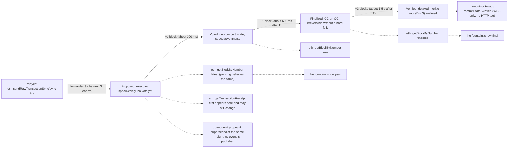
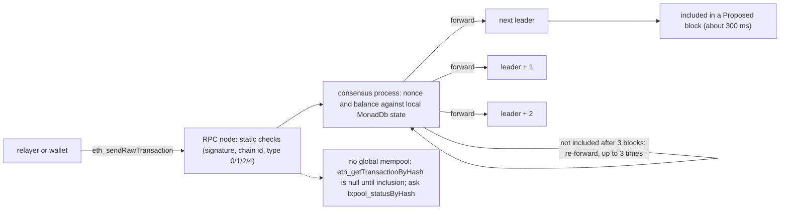

# Mavera — Monad notes

This document lists, claim by claim, the Monad facts that shaped Mavera's design: each with its value, its primary source and the date it was checked. Every URL below was accessed on 2026-10-24; live measurements were taken with `cast` 1.8.6 and `curl` against Monad testnet (chain id 10143) between 23:45 UTC on 23 Oct and 00:58 UTC on 24 Oct 2026, at blocks 73.65–73.68 million. The design rests on five of these facts: a sender is billed for its gas limit, not its gas used, at a floor of 100 MON-gwei (so one `sync()` that splits a 1-cent payment costs about $0.0003); a block arrives every 300 ms and is irreversible two blocks later (so a dividend is visible in about 300 ms and final in about 600 ms); every EOA lives under a 10 MON reserve-balance budget that consensus checks against a 3-block-lagged state (so the relayer is funded before the demo); storage is priced in 128-slot pages (so Mavera's scalars are packed into one page); and the public RPCs cap `eth_getLogs` at a 100-block window and `eth_call` at 25 requests per second (so browsers poll `GET /api/state`, not the chain). The jury should read sections 3, 5 and 11; the team should treat sections 2, 6, 9 and 12 as the operating manual. Where the docs and the live chain disagreed, the live value is given and the disagreement is noted. Three statements from the handoff were refuted by the skeptical verification and are corrected here: the `foundry-monad` template does not enable the Monad network, the Monadscan "verifier URL" in the docs is a deprecated Etherscan V1 endpoint, and the facilitator's scheme identifiers are `exact`, `upto` and `batch-settlement`. Sibling documents: [docs/01-ARCHITECTURE.md](01-ARCHITECTURE.md), [docs/02-CONTRACT-SPEC.md](02-CONTRACT-SPEC.md), [docs/03-X402-FLOW.md](03-X402-FLOW.md), [docs/04-FRONTEND.md](04-FRONTEND.md), [docs/07-RUNBOOK.md](07-RUNBOOK.md), [docs/11-TOOLCHAIN.md](11-TOOLCHAIN.md).

## 1. How to read the tables

- "Source" columns name the primary page; every one of them was accessed on 2026-10-24. Monad docs pages were fetched as raw Markdown (append `.md` to the URL).
- "Measured" means read live from the public RPC or the chain tonight; the exact command is given where it matters so the team can repeat it on event day.
- Values that depend on the contract being written are marked "TBD on event day". `<MAVERA_ADDRESS>` is the deployed contract address (also `MAVERA_ADDRESS` in [.env.example](../.env.example)).
- Prices in USD use MON = $0.0214 (CoinGecko, 2026-10-23 23:54 UTC, https://api.coingecko.com/api/v3/simple/price?ids=monad&vs_currencies=usd); the Monad docs' own worked examples imply about $0.025 per MON. Both are shown where they differ.

## 2. Networks

### 2.1 Chain identities, client versions, resets

| Fact | Value | Source (accessed 2026-10-24) |
| --- | --- | --- |
| Testnet chain id | `10143` (`eth_chainId` = `0x279f`, measured); network name "Monad Testnet"; token `MON` | https://docs.monad.xyz/developer-essentials/testnet |
| Mainnet chain id | `143`; network name "Monad Mainnet" | https://docs.monad.xyz/developer-essentials/network-information |
| Client version | `v0.16.5` (testnet 2026-10-15, mainnet 2026-10-22); `web3_clientVersion` = `Monad/0.16.5` on all three public testnet endpoints (measured); hardfork revision `MONAD_TEN` | https://docs.monad.xyz/developer-essentials/changelog/releases |
| Docs lag | The network-information page still shows `v0.16.4` for mainnet | same pages |
| Testnet reset | Reset from genesis on 2025-12-16 (release `v0.12.5`, starting from `MONAD_EIGHT`); every address published before that date must be re-verified; several old DEX and token addresses have no code today | testnet page; releases page |
| `MONAD_TEN` activation (MIP-8, MIP-12 era) | testnet timestamp `1786545000` (2026-08-12 14:30 UTC); mainnet `1788359400` (2026-09-02 14:30 UTC) | releases page |
| Mainnet launch and uptime | Public launch 2025-11-24; "100% uptime with no network outages or halts", more than 60 million uninterrupted blocks as of 2026-08-31. Self-reported by Monad; say "Monad reports 100% uptime" | https://www.monad.xyz/blog/monad-network-uptime |
| Block height tonight | 73,590,000 at 02:20 TRT rising to 73,677,800 at 03:58 TRT (measured) | live RPC |

### 2.2 Public RPC endpoints — testnet

The table is the docs table verbatim plus what was measured tonight (https://docs.monad.xyz/developer-essentials/testnet, accessed 2026-10-24).

| RPC URL | Provider | Rate limit (docs) | Batch | Archive | Docs note | Measured 2026-10-24 |
| --- | --- | --- | --- | --- | --- | --- |
| `https://testnet-rpc.monad.xyz` and `wss://testnet-rpc.monad.xyz` | QuickNode | 50 rps | 100 | yes | 25 rps for `eth_call` and `eth_estimateGas` | WSS works; `eth_getLogs` rejects `toBlock - fromBlock > 100` (error `-32614 "eth_getLogs is limited to a 100 range"`); served state 5,000,000 blocks back; cold HTTPS round trip 0.43–0.54 s from Istanbul, 0.11 s on a kept-alive connection |
| `https://rpc.ankr.com/monad_testnet` | Ankr | 300 requests per 10 s; 12,000 per 10 min | 100 | no | `debug_*` methods are not allowed | No WSS; same 100-block log window (error `-32062 "Block range is too large"`); served state 1,000,000 blocks back but not 5,000,000; 0.47–0.66 s cold |
| `https://rpc-testnet.monadinfra.com` and `wss://rpc-testnet.monadinfra.com` | Monad Foundation | 20 rps | not allowed | yes | — | WSS works; a 2-call batch returns `Restricted JSON RPC method`; same 100-block log window (error `-32602 "block range too large"`); state 1,000,000 back served, 5,000,000 not; fastest from Istanbul (0.20–0.31 s cold) |

Mainnet, for contrast (https://docs.monad.xyz/developer-essentials/network-information, accessed 2026-10-24): `https://rpc.monad.xyz` (QuickNode, 25 rps, batch 100), `https://rpc1.monad.xyz` (Alchemy, 15 rps), `https://rpc2.monad.xyz` (Goldsky Edge, 300 per 10 s, batch 10, historical state), `https://rpc3.monad.xyz` (Ankr, 300 per 10 s, batch 10), `https://rpc-mainnet.monadinfra.com` (Monad Foundation, 20 rps, batch 1, historical state).

Mavera's configuration (quoted from the repository): `MONAD_RPC_URL=https://testnet-rpc.monad.xyz` and `NEXT_PUBLIC_MONAD_RPC_URL=https://testnet-rpc.monad.xyz` in [.env.example](../.env.example); `contracts/foundry.toml` sets `eth_rpc_url = "https://testnet-rpc.monad.xyz"`, `chain_id = 10143` and `[rpc_endpoints] monad_testnet = "https://testnet-rpc.monad.xyz"`, `monad_testnet_ankr = "https://rpc.ankr.com/monad_testnet"`. If the QuickNode endpoint rate-limits during the demo, switch the server to `https://rpc-testnet.monadinfra.com` and disable JSON-RPC batching for that endpoint.

### 2.3 Explorers, verification endpoints, faucets

| Item | Value | Source (accessed 2026-10-24) |
| --- | --- | --- |
| Monadscan (testnet) | https://testnet.monadscan.com (HTTP 200 tonight); Etherscan-type explorer | https://docs.monad.xyz/tooling-and-infra/block-explorers |
| MonadVision (testnet) | https://testnet.monadvision.com (HTTP 403 to `curl`, bot protection; fine in a browser); BlockVision explorer | same page |
| Monadscan verification | Etherscan **V2** API: `https://api.etherscan.io/v2/api?chainid=10143` (mainnet `chainid=143`), "Free-tier available", key required (`ETHERSCAN_API_KEY`, create at https://etherscan.io/myapikey). Foundry 1.8.6 resolves `--chain 10143` to `monad-testnet` and targets V2 by default | https://api.etherscan.io/v2/chainlist ; verifier re-check |
| Deprecated V1 URL | `https://api-testnet.monadscan.com/api` (still listed in the Monad docs) returns HTTP 200 with body `{"status":"0","message":"NOTOK","result":"You are using a deprecated V1 endpoint, switch to Etherscan API V2 ..."}`. Never pass it as `--verifier-url` | block-explorers page; verifier re-check |
| MonadVision verification | Sourcify API at `https://sourcify-api-monad.blockvision.org` (no key; serves Sourcify v2 routes; lists chains 143 and 10143). sourcify.dev also supports both chains | https://docs.monad.xyz/guides/verify-smart-contract/foundry ; https://sourcify.dev/server/chains |
| Explorer URL in the app | viem's `monadTestnet` default explorer is `testnet.monadexplorer.com`; Mavera links to Monadscan via `NEXT_PUBLIC_EXPLORER_URL=https://testnet.monadscan.com` | [.env.example](../.env.example) |
| MON faucet | https://faucet.monad.xyz (official). The Blitz platform grants 50 MON per sign-in (event information, see [scripts/faucet-notes.md](../scripts/faucet-notes.md)) | testnet page; https://docs.monad.xyz/official-links |
| Testnet USDC faucet (Circle) | https://faucet.circle.com — select USDC and "Monad Testnet"; **20 USDC per request, one request per (asset, testnet) per address every 2 hours**; no account, reCAPTCHA. Monad's x402 guide still says "Send 1 USDC" (stale) | https://faucet.circle.com/ ; https://docs.monad.xyz/guides/x402 |
| Devnads test tokens | https://devnads.com/tokens — permissionless `mint`, verified contracts; its "USDC" is **not** the x402 USDC (section 10.6) | https://devnads.com/tokens |
| Visualiser, app hub | https://www.gmonads.com/?network=testnet ; https://testnet.monad.xyz | testnet page |

Copy-paste verification commands (both forms are also in the comments of `contracts/foundry.toml`; add `--constructor-args` as the runbook specifies):

```sh
forge verify-contract <MAVERA_ADDRESS> src/Mavera.sol:Mavera --chain 10143 --verifier sourcify --verifier-url https://sourcify-api-monad.blockvision.org/
forge verify-contract <MAVERA_ADDRESS> src/Mavera.sol:Mavera --chain 10143 --verifier etherscan --etherscan-api-key $ETHERSCAN_API_KEY --watch
```

### 2.4 Canonical testnet contracts Mavera touches or cites

| Contract | Address (testnet 10143) | Role for Mavera | Source (accessed 2026-10-24) |
| --- | --- | --- | --- |
| Circle USDC (x402 asset) | `0x534b2f3A21130d7a60830c2Df862319e593943A3` | The asset Mavera receives and distributes; `USDC_ADDRESS` | https://developers.circle.com/stablecoins/usdc-contract-addresses |
| Multicall3 | `0xcA11bde05977b3631167028862bE2a173976CA11` | One `eth_call` for oracle reads and contract views; `MULTICALL3_ADDRESS` | testnet page "Canonical Contracts" |
| Permit2 | `0x000000000022d473030f116ddee9f6b43ac78ba3` | Only relevant to the `upto` scheme (not used) | testnet page |
| x402 ExactPermit2Proxy / UptoPermit2Proxy | `0x402085c248EeA27D92E8b30b2C58ed07f9E20001` / `0x4020A4f3b7b90ccA423B9fabCc0CE57C6C240002` | Permit2 fallbacks of the facilitator (not used) | testnet page |
| WMON | `0xFb8bf4c1CC7a94c73D209a149eA2AbEa852BC541` | Reference only ("Wrapped MON") | testnet page |
| CreateX | `0xba5Ed099633D3B313e4D5F7bdc1305d3c28ba5Ed` | Not used (plain `forge create`) | testnet page |
| Mainnet USDC (contrast) | `0x754704Bc059F8C67012fEd69BC8A327a5aafb603` | `eip155:143` only; the hackathon build is testnet | Circle page |

## 3. Performance and block states

| Fact | Value | Source (accessed 2026-10-24) |
| --- | --- | --- |
| Block time | 300 ms (MIP-12 in release `v0.15.0` cut 400 to 300 ms). **Measured 302 ms** average over 10,000 blocks (73,654,423 to 73,664,423; timestamps 1792796396 to 1792799416, 3,020 s). viem's `monadTestnet` still says `blockTime` 400 (stale) | https://docs.monad.xyz/introduction/monad-for-developers ; releases page; live |
| Finality | "Speculative finality at 300 ms; full finality at 600 ms"; "Blocks are finalized after two blocks (600 ms)". Measured at one instant: `latest` = `pending` = 73,665,285, `safe` = 73,665,284, `finalized` = 73,665,283 | monad-for-developers; https://docs.monad.xyz/developer-essentials/summary ; live |
| Throughput target | 10,000 TPS design target (docs comparison table: Ethereum about 10); 500M gas per second; up to 3,750 transactions per block | monad-for-developers; https://docs.monad.xyz/reference/json-rpc/overview |
| Validators | `ACTIVE_VALSET_SIZE = 200`; live staking precompile: 200 in the testnet consensus set (208 in the execution set, epoch 1474), 196 on mainnet (epoch 2321). MIP-9 raises the cap to 300 "consensus side only" | https://docs.monad.xyz/monad-arch/consensus/staking ; live `getConsensusValidatorSet` |
| Block reward | Every block starts with a type-0, zero-gas system transaction from `0x6f49a8f621353f12378d0046e7d7e4b9b249dc9e` to the staking precompile calling `syscallReward(address)` (`0x791bdcf3`) with 18 MON; exclude it when counting user transactions | live block data; staking page constants |
| Timestamps | `block.timestamp` has 1-second granularity; 3–4 consecutive blocks share one timestamp (observed 4) | summary page "Timing considerations"; live |

| State | Docs meaning | HTTP tag | When, for a block proposed at T |
| --- | --- | --- | --- |
| `Proposed` | "proposed by a leader but has not been voted upon"; nodes "may speculatively execute the proposed block" | `latest` (`pending` behaves the same) | T (about one 300 ms slot after submission); receipts and `newHeads`/`logs` events appear here |
| `Voted` | a quorum certificate exists: "voted affirmatively for by a supermajority of validators"; "can be speculatively finalized" | `safe` | T + 1 block (about +300 ms) |
| `Finalized` | QC-on-QC: "not revertible without a hard fork"; docs: use for "value settlement: bridges, deposits, payment crediting" | `finalized` | T + 2 blocks (about +600 ms) |
| `Verified` | the delayed merkle root (`D = 3`) is finalized; "execution outputs of the block has been agreed upon by a supermajority" | none (WSS `monadNewHeads` `commitState`) | T + 5 blocks (about +1.5 s) |

Sources: https://docs.monad.xyz/monad-arch/consensus/block-states and https://docs.monad.xyz/reference/json-rpc/overview (both accessed 2026-10-24).



Block commitment states of one `sync()` transaction, the RPC tag that returns each state, and the two badges the fountain derives from them.

Wording rule for every document and the pitch: say "visible in about 300 ms (Proposed, `latest`), safe at +300 ms (Voted), final at about 600 ms (Finalized)". Never say "300 ms finality". Two layers of "speculative" exist: speculative *execution* (a `Proposed` block can still be abandoned; "Nearly 100% of proposals that are received do eventually become finalized", https://docs.monad.xyz/monad-arch/realtime-data/spec-realtime) and speculative *finality* (a `Voted` block fails to finalize only in the equivocation loophole, https://docs.monad.xyz/monad-arch/consensus/monad-bft). Any response that includes non-finalized data, including `eth_getTransactionReceipt`, can change on an identical repeat request (`blockNumber`, log indices, or the result becoming `null`): compare the receipt's `blockNumber` with the `finalized` height before treating a payment as settled. The docs' UI guidance (summary page): update at `Proposed` for most applications, wait for `Finalized` for anything irreversible; waiting for `Verified` is for exchanges, bridges and stablecoin issuers.

## 4. EVM level

| Fact | Value | Source (accessed 2026-10-24) |
| --- | --- | --- |
| Fork level | "complies with the Fusaka fork"; all opcodes as of Fusaka; precompiles `0x01`–`0x11`; `MONAD_NINE` activated the Osaka EIPs 7823, 7883 and 7939 (CLZ) via MIP-5 | https://docs.monad.xyz/introduction/monad-for-developers ; https://docs.monad.xyz/developer-essentials/changelog |
| Compiler target in the repo | `solc = "0.8.37"`, `evm_version = "osaka"`, `network = "monad"` (default hardfork `MonadTen`) in `contracts/foundry.toml`; Foundry 1.8 or later required | https://docs.monad.xyz/tooling-and-infra/toolkits/foundry ; [docs/11-TOOLCHAIN.md](11-TOOLCHAIN.md) |
| Template caveat (corrected) | `monad-developers/foundry-monad` sets only `eth-rpc-url` and `chain_id = 10143`; it does **not** set `network` or `hardfork`. Without `network = "monad"`, `forge test` runs under Ethereum pricing and misses MIP-8; the repo adds it explicitly | https://raw.githubusercontent.com/monad-developers/foundry-monad/main/foundry.toml ; verifier re-check |
| Transaction types | 0 (legacy), 1 (EIP-2930), 2 (EIP-1559), 4 (EIP-7702) supported; type 3 (EIP-4844 blobs) rejected; access lists optional | https://docs.monad.xyz/developer-essentials/transactions |
| Contract size limits | Max contract code 128 KB (Ethereum 24 KB); max initcode 256 KB (Ethereum 48 KB) | https://docs.monad.xyz/developer-essentials/differences |
| Memory | Expansion cost linear (`w/2` versus Ethereum's `3w + w^2/512`); cap 8 MB = 8,388,608 bytes per transaction, cumulative across call frames; reaching the cap costs 131,072 gas, exceeding it is out-of-gas for that frame | https://docs.monad.xyz/developer-essentials/opcode-pricing |
| Transient storage | `TSTORE`/`TLOAD` live on testnet, so OpenZeppelin `ReentrancyGuardTransient` is usable in `Mavera` | FACTS.md (lead's verification); Fusaka compliance above |
| EIP-7702 | Delegated EOAs cannot dip below 10 MON (section 6); delegated code cannot `CREATE`/`CREATE2`; undelegate first to empty an account | https://docs.monad.xyz/developer-essentials/eip-7702 |

## 5. Gas model

| Fact | Value | Source (accessed 2026-10-24) |
| --- | --- | --- |
| Billing rule | "The gas charged for a transaction is the **gas limit**": `gas_paid = gas_limit * price_per_gas`; total deducted = `value + gas_price * gas_limit` | https://docs.monad.xyz/developer-essentials/gas-pricing |
| Price formula | `price_per_gas = min(base_fee + priority_fee, max_fee)`; base fee controller `max_step_size = 1/28`, `beta = 0.96`, "increases more slowly and decreases more quickly" than Ethereum; default ordering is a priority gas auction | gas-pricing page |
| Minimum base fee | 100 MON-gwei (`100 * 10^-9 MON`); live `baseFeePerGas` = `0x174876e800` = 100 gwei in every sampled block | gas-pricing page; live |
| Limits | Block gas limit 150M; transaction gas limit 30M; up to 3,750 transactions per block (block limit divided by 40k, release `v0.15.0`); live header `gasLimit` = `0x8f0d180` = 150,000,000 | gas-pricing page; json-rpc overview; releases; live |
| Priority fee | `eth_maxPriorityFeePerGas` "currently returns a hardcoded suggested fee of 2 gwei" (live `0x77359400`); live `eth_gasPrice` 102 gwei; observed effective prices 103–105 gwei; `eth_feeHistory` with `latest` repeats the latest base fee | json-rpc overview; live |
| Docs inconsistency | gas-pricing page: controller `target = 160M (80% full)`; summary page: `80% (120M gas)` of the 150M block | both pages |

**Empirical proof of gas-limit billing (measured).** Transaction `0x58343a253eb1f958aa4134859f48b9141f30c4d06bef613d34602a7252535a2a` (block 73,666,009; the sender's only transaction in that block; `value` 0) had gas limit 1,591,201 and `effectiveGasPrice` 103,000,000,001 wei; `eth_getBalance` at block N-1 minus block N = 163,893,703,001,591,201 wei = gas limit times price, exactly. Across 31 blocks (633 transactions: 593 type-2, 37 type-0, 3 type-1) every receipt reported `gasUsed == tx.gas`, and every block header's `gasUsed` equalled the sum of transaction gas limits; the verifier repeated this on 4 fresh blocks (14 of 14 receipts). Consequences: explorers and `eth_getTransactionReceipt` show *billed* gas, so `fee = receipt.gasUsed * receipt.effectiveGasPrice` is correct on Monad (use `effectiveGasPrice` verbatim, wallets add 1 wei to the tip); execution gas is visible only in simulation (`eth_estimateGas`, Foundry gas reports with `network = "monad"`). The docs recommend hardcoding constant gas limits and warn that MetaMask sets a very high limit when estimation reverts, "which doesn't make sense on Monad where the full gas limit is charged" (https://docs.monad.xyz/developer-essentials/best-practices, accessed 2026-10-24).

Cost table at the minimum base fee (100 MON-gwei; billed gas = gas limit):

| Action | Gas (billed) | MON at 100 gwei | USD at $0.0214 per MON | Docs figure (about $0.025 per MON) |
| --- | --- | --- | --- | --- |
| Native MON transfer | 21,000 | 0.0021 | $0.000045 | about $0.00005 |
| ERC-20 transfer (docs) | about 65,000 | 0.0065 | $0.00014 | about $0.00016 |
| x402 settlement, `transferWithAuthorization` (observed facilitator tx `0x58999f367b383494c24ea4bf257b920b9842020a37e10c18f2213ac1fe57825d`; paid by the facilitator, not by Mavera) | 86,628 | 0.0087 | $0.00019 | 0.0091 MON at the observed 105 gwei |
| Mavera `sync()` at a 150,000 gas limit | 150,000 | 0.0150 | $0.00032 | — |
| Same at 102 gwei (floor plus the 2 gwei suggested tip) | 150,000 | 0.0153 | $0.00033 | — |
| `sync()` if the measured limit is about 100,000 | 100,000 | 0.0100 | $0.00021 | — |
| Typical DEX swap (docs) | about 200,000 | 0.02 | $0.00043 | about $0.0005 |

Per 1-cent paid call, one `sync()` costs about 3.2% of the payment at a 150k limit (2.1% at 100k), and the settlement gas is paid by the facilitator. A 50-call demo costs 50 x 0.0153 MON = 0.77 MON, about $0.016 of relayer gas. The recommended attribution design (`sync()` inside `_update`, [docs/02-CONTRACT-SPEC.md](02-CONTRACT-SPEC.md)) adds about 40,000 gas per share transfer, about $0.0001 at the floor; the exact number is TBD on event day (measure at 11:00, "confirm before 11:00"). Sources for the docs figures: gas-pricing page "How much does a transaction cost?" (accessed 2026-10-24).

## 6. Reserve balance — the exact rules the relayer lives under

Source: https://docs.monad.xyz/developer-essentials/reserve-balance (accessed 2026-10-24; formal spec https://category-labs.github.io/category-research/monad-initial-spec-proposal.pdf, Coq-proved) and https://docs.monad.xyz/monad-arch/consensus/asynchronous-execution (accessed 2026-10-24).

| Rule | Exact statement | Effect on Mavera |
| --- | --- | --- |
| Parameters | `user_reserve_balance = 10 MON` per EOA; `k = 3` blocks ("Currently `k=3`"; the architecture pages call it `D`) | — |
| Consensus-time budget | Consensus validates block `n` against the state after block `n - k`. The sum of **gas spends** (`gas_price * gas_limit`) of all in-flight transactions (included fewer than `k` blocks ago) from one account must stay within `min(10 MON, balance at block n - k)` | The 10 MON is a budget, not a required balance. With a balance of at least 10 MON the relayer's in-flight budget is the full 10 MON: 10 / 0.0153 = about 653 `sync()` transactions (150k gas at 102 gwei) per 3-block window; with 3 MON about 196. Neither binds |
| Execution-time rule | After execution (before refunds) the sender may end below 10 MON by at most that transaction's gas spend; a non-sender account must not end below `min(balance at start, 10 MON)`; otherwise the transaction **reverts but is still included and pays gas** | "Included but reverted" transactions are normal on Monad (the proposer cannot know the latest balance); the fountain must read state, not assume success from inclusion |
| Emptying exception | An undelegated sender with no other transaction and no (un)delegation request in the past `k` blocks may dip below 10 MON "once every `k` blocks"; consensus then lowers the reserve it uses by that transaction's `value` for the next `k` blocks | Undelegated EOAs below 10 MON still transact; funding the relayer above 10 MON is an operational choice (full budget, headroom), not a protocol minimum |
| EIP-7702-delegated EOAs | No emptying exception: any transaction that **decrements and ends** below 10 MON "will unconditionally revert"; being below 10 MON is fine while the balance does not decrease | Never 7702-delegate the relayer, deployer or customer wallets |
| Freshly funded account | "newly-funded accounts which previously had zero balance cannot send transactions until the transfer that credits them with tokens is `D` blocks old ... wait until seeing the transaction receipt ... and then wait another 1.2 seconds" | 3 blocks x 302 ms = about 0.9 s today; 1.2 s is the docs' 400 ms-era figure and a safe margin. MON received in the last 3 blocks is invisible to consensus: top up wallets before, not during, the demo |
| Reserve precompile | `0x1001` `dippedIntoReserve()` (selector `0x3a61584e`, gas 100, returns `bool`, `CALL` only; MIP-4) | Not needed (Mavera moves USDC, not MON) |

Spec default: the relayer holds at least 10 MON plus gas, the customer wallet holds 20 USDC from the Circle faucet, the deployer keystore is `mavera-deployer` ([.env.example](../.env.example), [docs/07-RUNBOOK.md](07-RUNBOOK.md)).

## 7. Storage repricing (MIP-8) and Mavera's layout

| Constant or rule | Value | Source (accessed 2026-10-24) |
| --- | --- | --- |
| Page | 128 slots = 4,096 bytes; `page_index = slot >> 7` ("stripping the lower 7 bits of the key"); MIP-8 "Page-ified Storage State", status Final, author Category Labs, created 2026-03-05 | https://mips.monad.xyz/MIPs/MIP-8 ; https://docs.monad.xyz/developer-essentials/opcode-pricing |
| Cold account access | 10,100 (Ethereum 2,600) for `BALANCE`, `EXTCODE*`, `CALL`, `STATICCALL`, `DELEGATECALL`, `CALLCODE`, `SELFDESTRUCT`; warm 100 | opcode-pricing page |
| `SLOAD` | 8,100 on the first access to a page (8,000 page load + 100), 100 afterwards; warmth is per (account, page) per transaction, propagates to child calls, rolled back on revert | opcode-pricing page |
| `SSTORE` components | 100 base (every `SSTORE`) + 8,000 page load (first access to the page) + 2,800 page write (first value-changing write to the page) + 17,000 state growth (each time the page's net slot count reaches a new high). Examples: fresh slot on a cold page 27,900; fresh slot in a written page 17,100; overwrite non-zero on a cold page 10,900; overwrite in a written page 100 | opcode-pricing page; MIP-8 constants `BASE_COST 100, LOAD_COST 8000, WRITE_COST 2800, STATE_GROWTH_COST 17000` |
| Layout rule | Sequential state variables, struct fields and array elements share pages; "Each key of a `mapping` still resolves to its own page, but the struct fields stored under that key share it"; an EIP-2930 access-list entry warms the whole page | opcode-pricing page |
| Repriced precompiles | `ecRecover` 6,000; `ecAdd` 300; `ecMul` 30,000; `ecPairing` 225,000 + 170,000 per point; `point_eval` 200,000 | opcode-pricing page |

Expected layout for `Mavera is ERC20` (OpenZeppelin v5.7.0 `ERC20` declares `_balances`, `_allowances`, `_totalSupply`, `_name`, `_symbol` in slots 0–4):

| Variable | Slot(s) | Page | Cost pattern under MIP-8 | Implication |
| --- | --- | --- | --- | --- |
| `_balances[h]` (OZ) | `keccak(h, 0)` | own page per holder | 8,100 cold read; 10,900 cold overwrite | unavoidable, one per holder side |
| `_totalSupply`, `_name`, `_symbol` (OZ) | 2–4 | 0 | one cold page load per transaction (8,100), then 100 each | — |
| `accPerShare`, `accounted`, `totalDistributed` | 5–7 | 0 | share page 0 with the OZ scalars; `sync()` touches **one** cold page for all its reads and writes; writes cost 100 + 2,800 (first changing write) + 100 + 100 | keep them plain sequential state variables |
| `corrections[h]` | `keccak(h, 8)` | own page per holder | 8,100 / 10,900 | — |
| `claimed[h]` | `keccak(h, 9)` | own page per holder | 8,100 / 10,900; first-ever write adds 17,000 state growth | — |
| Alternative: `struct Holder { int256 corrections; uint256 claimed; }` in one `mapping(address => Holder)` | `keccak(h, 8)` + 0 or 1 | **one** page per holder | saves about 8,000 gas per holder side on every `claim()` and every transfer (`_update`) | recommended; decision in [docs/02-CONTRACT-SPEC.md](02-CONTRACT-SPEC.md) |
| Immutables `usdc`, `creator`, `sharePrice`, `maxSupply` | in code | — | free | — |

Caveats: the slot numbers hold only if `ERC20` is the sole storage-bearing parent; `ERC20Permit`/`Nonces`, `Ownable` or the storage-based `ReentrancyGuard` each add 1–3 slots before Mavera's scalars (still inside page 0, but the mapping base slots 8 and 9 shift). Confirm on event day with `forge inspect Mavera storage-layout` (TBD on event day). Every external USDC call costs 10,100 (FiatTokenProxy) + 10,100 (implementation `DELEGATECALL`) cold-account gas once per transaction, plus 8,100 for the USDC balance page and 8,100 for the proxy's implementation slot page: `sync()` and `claim()` should each call USDC once. Rough execution gas of `sync()` under MIP-8: 21,000 base + 10,100 + 10,100 + 8,100 + 8,100 + 8,100 (Mavera page 0) + about 3,100 (three warm writes including the first change) + about 2,000 (event) = about 70,000–75,000; a 150,000 limit is a 2x margin, 100,000 is plausible after measurement. Measured values are TBD on event day:

```sh
forge test --gas-report --root contracts
```

## 8. Precompiles

| Address | What | Interface facts | Mavera use | Source (accessed 2026-10-24) |
| --- | --- | --- | --- | --- |
| `0x0100` | secp256r1 (P-256) signature verification, EIP-7951 (same address and interface as RIP-7212) | input exactly 160 bytes (hash, r, s, qx, qy); returns 32-byte `1` on success, empty on failure; gas 6,900; enabled in `MONAD_FOUR` | Not used. Cite as Monad's on-chain passkey primitive; it is a different thing from mera (section 10.3) | https://docs.monad.xyz/developer-essentials/precompiles |
| `0x1000` | Staking: delegation, rewards, validator queries | `CALL` only ("`STATICCALL`, `DELEGATECALL`, and `CALLCODE` will revert", so all view methods are `nonpayable`); no code at the address (no forked-environment testing); constants `ACTIVE_VALSET_SIZE` 200, `PAGINATED_RESULTS_SIZE` 100, `REWARD` 18 MON per block, `BOUNDARY_BLOCK_PERIOD` 50,000, `EPOCH_DELAY_ROUNDS` 5,000 | The heartbeat fields of `GET /api/price` (`epoch`, `proposer_val_id`, `validator_count`) and the whole payload when `DATA_MODE=heartbeat` | https://docs.monad.xyz/reference/staking/overview ; https://docs.monad.xyz/reference/staking/api |
| `0x1001` | Reserve balance | `dippedIntoReserve()` selector `0x3a61584e`, gas 100, returns `bool`, `CALL` only (MIP-4); constant `false` in an `eth_call` | Not used | precompiles page; https://mips.monad.xyz/MIPs/MIP-4 |
| `0x0a`–`0x11` | KZG point evaluation, BLS12-381 | present as of Fusaka; `point_eval` repriced to 200,000 | Not used | precompiles page |

Staking view functions used by the heartbeat (signatures verbatim from the staking API page; `eth_call` from an EOA is a `CALL`, so `cast call` and viem `readContract` work):

| Function | Selector | Gas (docs) | Live result 2026-10-24 |
| --- | --- | --- | --- |
| `function getEpoch() external returns (uint64 epoch, bool inEpochDelayPeriod);` | `0x757991a8` | 200 | `(1474, false)` |
| `function getProposerValId() external returns (uint64 val_id);` | `0xfbacb0be` | 100 | 159, then 61, then 5 (changes every block) |
| `function getConsensusValidatorSet(uint32 startIndex) external returns (bool isDone, uint32 nextIndex, uint64[] memory valIds);` | `0xfb29b729` | 814,000 per page | page 0 `(false, 100, 100 ids)`, page 100 `(true, 200, 100 ids)` = **200**; the leading `bool` is `true` on the last page |
| `function getExecutionValidatorSet(uint32 startIndex) ...` (same shape) | `0x7cb074df` | 814,000 per page | pages 0, 100, 200 end with `(true, 208, ...)` = **208** |

Two validator-set pages cost about 1.63M gas, inside the low-gas `eth_call` pool (at most 8,100,000 gas). Copy-paste checks:

```sh
cast call 0x0000000000000000000000000000000000001000 "getEpoch()(uint64,bool)" --rpc-url https://testnet-rpc.monad.xyz
cast call 0x0000000000000000000000000000000000001000 "getProposerValId()(uint64)" --rpc-url https://testnet-rpc.monad.xyz
cast call 0x0000000000000000000000000000000000001000 "getConsensusValidatorSet(uint32)(bool,uint32,uint64[])" 0 --rpc-url https://testnet-rpc.monad.xyz
```

## 9. Mempool and RPC behaviour

| Topic | Fact | Source (accessed 2026-10-24) |
| --- | --- | --- |
| No global mempool | A transaction goes RPC static checks, then the consensus process checks nonce and balance against local MonadDb state, then it is forwarded to the next `N = 3` leaders; if not included within `N` blocks it is re-sent to the next 3 leaders, `K = 3` times in total; local-mempool eviction on finalisation, invalidity or soft size limit | https://docs.monad.xyz/monad-arch/consensus/local-mempool |
| Deferred validation | `eth_sendRawTransaction` may accept a nonce-gap or insufficient-balance transaction; `eth_getTransactionByHash` returns `null` until inclusion; `newPendingTransactions` and `syncing` subscriptions are unsupported | https://docs.monad.xyz/reference/json-rpc/overview |
| Synchronous send | `eth_sendRawTransactionSync(hex_tx, timeout_ms)` returns the receipt object; behaviour when `timeout_ms` elapses is not described (test once on event day) | https://docs.monad.xyz/reference/json-rpc/api |
| Debugging | `txpool_statusByHash(hash)` returns `{status, reason}`; `txpool_statusByAddress` also exists | json-rpc api page |
| Speculative `eth_call` | `eth_call` and `eth_estimateGas` run against speculative (`Proposed`) state; dual pools: at most 8,100,000 gas is the low-gas pool, above is the high-gas pool with limited concurrency; provider gas caps 200M (QuickNode, Alchemy, Monad Foundation) and 1B (Ankr) | asynchronous-execution page; https://docs.monad.xyz/reference/rpc-limits |
| Historical state | "Monad full nodes do not provide access to arbitrary historic state" (about 40,000 blocks of tries on a 2 TB SSD per docs). Measured on testnet: state at latest-100, latest-50,000 and latest-1,000,000 served by all three public RPCs; latest-5,000,000 (about 17.5 days) only by QuickNode; Ankr and Monad Foundation answer "Block requested not found. Request might be querying historical state that is not available" | https://docs.monad.xyz/developer-essentials/historical-data ; live |
| `eth_getLogs` window | `toBlock - fromBlock <= 100` (101 inclusive blocks) on all three public testnet RPCs (errors in section 2.2); docs (mainnet): QuickNode 100 blocks, Alchemy 1,000 blocks or 10,000 logs, Ankr 1,000, Monad Foundation 100 | rpc-limits page; live |
| Rate caps that matter | QuickNode 50 rps overall but **25 rps for `eth_call` and `eth_estimateGas`**; Monad Foundation 20 rps and no batches; Ankr 300 per 10 s and no WSS | testnet page; live |
| WebSocket | `newHeads` and `logs` fire when a block is `Proposed`; `monadNewHeads` and `monadLogs` add `blockId` and `commitState` (`Proposed`/`Voted`/`Finalized`/`Verified`) and re-emit as the state advances; a block may skip `Voted`; abandoned proposals get no explicit event | json-rpc overview; summary page |
| Batching | viem batches `Promise.all` reads into one JSON-RPC batch; Multicall3 is at `0xcA11bde05977b3631167028862bE2a173976CA11` on both networks; disable batching against the Monad Foundation endpoint | https://docs.monad.xyz/developer-essentials/best-practices ; live |
| Tooling quirk | `cast chain` prints `unknown` for 10143 and 143 in Foundry 1.8.6 although `forge verify-*` resolves `monad-testnet`; always pass `--chain 10143` or `--rpc-url` explicitly | verifier re-check |



Submission path of one transaction on Monad: there is no global mempool, so the relayer watches the chain (or uses `eth_sendRawTransactionSync`) instead of watching a pool.

## 10. Ecosystem

### 10.1 Monad API Hub

Official URL https://app.monad.xyz/agents/api-hub (accessed 2026-10-24): "Every API your agent can pay for ... settled per call with x402 on Monad ... pay in stablecoin, no signups, no API keys"; `x402 v2 · eip155:143`, i.e. **mainnet**; machine-readable `feed.json` and `llms.txt`. 136 services were listed on 2026-10-24 (66 at launch); per-call USDC prices are set by each provider, from $0.000036 per call upwards (the chain-facts report observed $0.001 for Ankr to $7.50 for Nansen). Announced on X 2026-09-07 17:57 UTC (https://x.com/monad/status/2097021332517011525), press 2026-09-08 (https://cryptobriefing.com/monad-api-hub-usdc-pay-per-request/), "now live" in https://monad.xyz/blog/monad-ecosystem-highlights-september-2026. Disclaimer on the Hub: services "are operated by independent providers and are not endorsed, audited, or verified by the Monad Foundation." Pitch use: Mavera is the capital layer for API Hub-style pay-per-call APIs; the Hub proves the revenue stream exists on mainnet today, while the hackathon build runs on testnet (say so).

### 10.2 Monad x402 facilitator

`https://x402-facilitator.molandak.org` (guide https://docs.monad.xyz/guides/x402, accessed 2026-10-24): x402 version 2 only; `GET /supported` returns, for `eip155:10143` and `eip155:143`, the schemes `exact`, `upto` (`extra.facilitatorAddress` `0x7f6a2850669202519f0fe8aa912451238820db86`) and `batch-settlement`; signer `0x7f6a2850669202519f0FE8aa912451238820Db86` (balance 4,964 MON, nonce 22,094 at 2026-10-24 00:01 UTC). The labels `v2-eip155-exact` / `v2-eip155-upto` appear only in the guide's table, never on the wire. The facilitator pays the settlement gas (observed 86,628 gas at 105 gwei), accepts a contract address as `payTo` (verified live with Multicall3), sends CORS `*`, needs no auth and does not enforce `validBefore <= now + maxTimeoutSeconds`. Protocol details, headers and error vocabulary: [docs/03-X402-FLOW.md](03-X402-FLOW.md), [docs/adr/ADR-0004-x402-exact-vs-upto.md](adr/ADR-0004-x402-exact-vs-upto.md).

### 10.3 mera (passkey accounts)

`@category-labs/mera` 0.3.0 (published 2026-10-20; peer deps `viem ^2.28.0`, `@wagmi/core ^3.0.0`; https://www.npmjs.com/package/@category-labs/mera, https://docs.monad.xyz/guides/mera, https://monad.xyz/blog/introducing-mera of 2026-07-30, all accessed 2026-10-24). It derives an ordinary secp256k1 EOA from a passkey's WebAuthn PRF output (BIP-39/44, `m/44'/60'/0'/0/{index}`): "The accounts are regular EOAs. There is nothing to deploy, and no bundler or MPC service to run." It does **not** use the P-256 precompile; the two are separate onboarding features and the pitch must not link them. Caveats: needs a PRF-capable provider (iCloud Keychain, 1Password, Google Password Manager); desktop Chrome local-profile passkeys fail with `PRF_UNAVAILABLE`; accounts are bound to the `rpId`. Not in scope for the event; cite as the quick route if a passkey wallet is ever added.

### 10.4 Ultrafuzz

https://github.com/monad-developers/ultrafuzz (accessed 2026-10-24): "End-to-end agentic smart contract fuzzing and threat hunting", MIT, Monad Foundation, releases v0.0.1 (2026-06-24) to v0.1.4 (2026-10-06), default branch `unstable`, not on npm. Its authors say to "run Ultrafuzz only on ephemeral, isolated virtual machines" and "Do not run Ultrafuzz on a developer workstation"; it needs Node.js 22.19.0 or later, pnpm 11.1.1, Bun 1.3 or later, Foundry and agent CLI credentials. Mavera cites it as Monad-native security tooling in the roadmap and does not run it on event day; the test plan uses Foundry fuzz and invariant tests plus Slither ([docs/05-TEST-PLAN.md](05-TEST-PLAN.md)).

### 10.5 Monad Private Settlement (if the jury asks)

Introduced by Category Labs at the OPEN conference in Singapore on 2026-10-06 (https://monad.xyz/blog/monad-private-settlement, https://x.com/monad/status/2107326402924339301, accessed 2026-10-24). Five points in the blog's wording: (1) sovereign domains on the public L1, "Each domain is enabled by a standard EVM smart contract on the Monad L1", no fork or protocol change; (2) transactions, state and contract code inside a domain are encrypted, "hidden from the L1 itself", sequenced by Monad's public validators and executed privately; (3) the institution chooses the validators that run its domain, the trust model and per-data-type access policies, denied by default; (4) atomic settlement, "Delivery-versus-payment is built in"; (5) domains draw on the pooled liquidity of the Monad network. Status: "Monad Private Settlement is a published design and is not yet live"; no launch date, whitepaper or code. Press claims about TEE / zkVM / MPC options are unverified against the blog. Unrelated to Mavera; answer with the status line.

### 10.6 Devnads test USDC versus Circle USDC — the distinction that breaks demos

| Property | Devnads "Test USD Coin" | Circle testnet USDC (the x402 asset) |
| --- | --- | --- |
| Address (10143) | `0x56bf9CDc3C1876F3F22655a0016C2743E9e39a73` | `0x534b2f3A21130d7a60830c2Df862319e593943A3` |
| Contract | `TestToken is ERC20, ERC20Permit` (OpenZeppelin v5.5.0, solc 0.8.28), no owner | `FiatTokenProxy` to `FiatTokenV2_2` (Circle stablecoin-evm, solc 0.6.12), implementation `0x21240161521D6854BE79F7D3a0A65c6BeDDB42fb` |
| `name()` / `symbol()` / `decimals()` | "Test USD Coin" / "USDC" / 6 | "USDC" / "USDC" / 6; `version()` "2" |
| EIP-712 domain | name "Test USD Coin", version "1"; `DOMAIN_SEPARATOR` `0x42226ed7098fb378edf77499929fca94cf9c441da4d5f1c2fbf2ba3ed0e4d26c` | name "USDC", version "2"; `DOMAIN_SEPARATOR` `0xf1090f5a61ddee19528cecc447be0f91c7205fc2b34dd271fc0de87809a0a48d`; matches x402 `extra: { name: "USDC", version: "2" }` |
| EIP-2612 `permit` | yes | yes (`PERMIT_TYPEHASH` `0x6e71edae12b1b97f4d1f60370fef10105fa2faae0126114a169c64845d6126c9`) |
| EIP-3009 `transferWithAuthorization` | **no** (`authorizationState` reverts) | **yes** (`TRANSFER_WITH_AUTHORIZATION_TYPEHASH` `0x7c7c6cdb67a18743f49ec6fa9b35f50d52ed05cbed4cc592e13b44501c1a2267`; facilitator settles with selector `0xe3ee160e`) |
| How to obtain | `mint(address,uint256)` by anyone, at most 10,000 USDC per call; https://devnads.com/tokens | https://faucet.circle.com, 20 USDC per request every 2 h per address; minting otherwise restricted to Circle minters |
| Verification | BlockVision Sourcify exact match 2026-09-25 | sourcify.dev full match (proxy and implementation); Circle address list |
| Use in Mavera | None in the main flow (a `permit`-only token cannot pass the facilitator's `exact` scheme); at most local experiments | **The** asset: `USDC_ADDRESS`, the contract's `usdc` immutable, the x402 route config and both fallbacks. Decision: [docs/adr/ADR-0005-usdc-choice.md](adr/ADR-0005-usdc-choice.md) |

Sources (accessed 2026-10-24): live `cast call` reads; https://developers.circle.com/stablecoins/usdc-contract-addresses ; https://sourcify-api-monad.blockvision.org/files/any/10143/0x56bf9CDc3C1876F3F22655a0016C2743E9e39a73 ; https://sourcify.dev/server/v2/contract/10143/0x534b2f3A21130d7a60830c2Df862319e593943A3. Four other "USDC" tokens exist on testnet (Kuru `0xb01DC575a7ef75e58A05D2bde73ab79f8e7dd0Be`, Kuru old `0x3bA3d39AFcf8bb994f7964B3e0171Ea2Ba361570`, Garden `0x6c8f9d333964328f7ae2f0ea35389730d88f3d29`) and two pre-reset ones have no code; the app asserts `name() == "USDC"`, `version() == "2"`, `decimals() == 6` at boot and shows the token address next to balances ([docs/04-FRONTEND.md](04-FRONTEND.md)).

## 11. Numbers for the pitch

```
Monad testnet, 2026-10-24. Chain id 10143 (mainnet 143). Client Monad/0.16.5. About 200 validators (200 testnet, 196 mainnet, live).
Block every 300 ms (measured 302 ms over 10,000 blocks). Visible at Proposed (`latest`, about 300 ms),
safe at Voted (+300 ms), final at Finalized (+600 ms, irreversible without a hard fork), Verified at +1.5 s.
Ethereum for contrast (Monad docs comparison table): 12 s blocks, 12-18 min finality, about 10 TPS versus 10,000 TPS target.

Gas is billed on the gas LIMIT at a floor of 100 MON-gwei; MON = $0.0214 (CoinGecko 2026-10-23 23:54 UTC).
  Native transfer 21,000 gas = 0.0021 MON = about $0.00005
  One Mavera sync() at a 150,000 gas limit = 0.015 MON = about $0.0003  (3.2% of a 1-cent call; 2.1% at 100,000)
  x402 settlement 86,628 gas = 0.0087 MON, paid by the facilitator, not by Mavera
  50-call demo = 0.77 MON = about $0.016 of relayer gas
Say "at the minimum base fee". Say "visible in about 300 ms, final in about 600 ms". Never say "300 ms finality".

Pay-per-call USDC APIs already exist on Monad mainnet: API Hub, 136 services, x402 v2, eip155:143 (2026-10-24).
Mavera is the capital layer for that revenue; the hackathon build runs on testnet with Circle test USDC.
Mainnet live since 2025-11-24; Monad reports 100% uptime (self-reported, blog 2026-08-31).
```

## 12. Implications for Mavera

1. **Relayer funding.** Hold at least 10 MON plus gas in the relayer EOA so its in-flight gas budget is the full 10 MON (about 653 `sync()` transactions per 3-block window at 150k gas and 102 gwei). This is operational, not a protocol minimum. Fund every wallet before the demo: consensus sees balances with a 3-block lag, and a freshly funded account can send only once its funding transaction is 3 blocks old (receipt plus 0.9–1.2 s). Never 7702-delegate the relayer. Expect "included but reverted" transactions when a balance check fails; read state, do not infer success from inclusion.
2. **Explicit gas limits everywhere.** Monad bills the limit. Measure `sync()`, `claim()`, `buy()` and a share transfer with `forge test --gas-report --root contracts` (MIP-8 pricing via `network = "monad"`), then hardcode limits with about 30% margin in the relayer and in the UI's `buy`/`claim` calls; never let a wallet estimate a call that may revert. Call `pending()` before sending `sync()`: a no-op `sync()` still bills its whole limit. Display fees as `receipt.gasUsed * receipt.effectiveGasPrice`. Set `maxFeePerGas` to about 200 gwei (2x base) and `maxPriorityFeePerGas` 2 gwei so a demo burst does not strand transactions.
3. **Storage packing.** Keep `accPerShare`, `accounted`, `totalDistributed` as sequential state variables (page 0, shared with OZ's `_totalSupply`); pack per-holder `corrections` and `claimed` into one struct mapping so `claim()` and `_update` touch one holder page instead of two (about 8,000 gas saved per holder side); call USDC once per `sync()` and once per `claim()` (10,100 + 10,100 cold-account gas per call pair).
4. **Finality badge.** The fountain shows "paid" when the receipt arrives (Proposed, `latest`, about 300 ms) and flips to "final" when the `finalized` height is at least the receipt's block (about +600 ms). Anything irreversible is credited only at `finalized`, as the docs say for payment crediting.
5. **Server-side polling.** One server-side poller behind `GET /api/state` (cached about 1 s) reads the contract views and oracle values in one Multicall3 `eth_call`; browsers poll `GET /api/state` every 2 s and never call the public RPC directly. Reason: `eth_call` is capped at 25 rps on `https://testnet-rpc.monad.xyz`, and 50 audience viewers polling the chain every 2 s would consume the whole cap. Wallet writes (buy, claim) still go through the user's wallet. Details: [docs/04-FRONTEND.md](04-FRONTEND.md).
6. **Log windows.** `eth_getLogs` accepts at most `toBlock - fromBlock = 100` (about 30 s of blocks) on every public testnet RPC. Prefer view calls; if the `Synced` feed scans logs, step from the last seen block in 100-block chunks, or subscribe to `monadLogs` over WSS. Never request "all events since deployment" from a public RPC; for analytics use an indexer.
7. **No mempool, no blobs.** There is no pool to watch for incoming payments; watch the chain or the facilitator's `PAYMENT-RESPONSE`. Use `eth_sendRawTransactionSync` or `waitForTransactionReceipt` for the relayer, `txpool_statusByHash` for debugging, and track nonces locally when sending several `sync()` transactions in a burst (nonce gaps are accepted and wait silently). Type-3 transactions are rejected; `pending` is just `latest`.
8. **Timestamps.** `block.timestamp` is second-granular and shared by 3–4 blocks; order events by block number and log index, and compute "last call age" from the wall clock.
9. **USDC identity.** The contract's `usdc` immutable, `USDC_ADDRESS`, the x402 route config and both fallbacks must all be `0x534b2f3A21130d7a60830c2Df862319e593943A3`; the client refuses any 402 whose `asset` or `payTo` differs ([docs/03-X402-FLOW.md](03-X402-FLOW.md), [docs/06-THREAT-MODEL.md](06-THREAT-MODEL.md)).
10. **Toolchain and verification.** Foundry 1.8.6 with `network = "monad"` and `evm_version = "osaka"`; verify on MonadVision via Sourcify (no key) and on Monadscan via Etherscan V2 with `ETHERSCAN_API_KEY` (section 2.3); pass `--chain 10143` explicitly to every `cast` and `forge` command ([docs/11-TOOLCHAIN.md](11-TOOLCHAIN.md), [docs/07-RUNBOOK.md](07-RUNBOOK.md)).

## Open questions

- Base-fee controller target: the gas-pricing page says `target = 160M (80% full)`, the summary page says `80% (120M gas)` of the 150M block. Immaterial at the floor; which one is live is unverified.
- `eth_sendRawTransactionSync`: the API page does not say whether an elapsed `timeout_ms` returns an error or the hash. Test once at 11:00 before the relayer relies on it.
- `batch-settlement` is advertised by the facilitator. Confirm early on event day that one settled payment produces one on-chain transaction before the relayer assumes "one settlement, one `sync()`" (double triggers are harmless because `sync()` is idempotent).
- Archive depth of the public RPCs is undocumented (QuickNode served 5,000,000 blocks back, Ankr and Monad Foundation 1,000,000 but not 5,000,000). Do not depend on historical state beyond a few hours.
- Whether wallets and viem send the raw `eth_estimateGas` value as the gas limit (observed limits such as 1,591,201 look like raw estimates). Mavera sets limits explicitly either way.
- MIP-9 (validator cap 300) is "consensus side only, execution side pending"; the live cap behaves as 200. The pitch says "about 200 validators".
- The Blitz platform faucet amount (50 MON per sign-in) is event information, not verified by the chain research; confirm at registration.
- Latency from the Vercel function region to `https://testnet-rpc.monad.xyz` was not measured (only from Istanbul: 0.11–0.54 s); check on the first deploy and switch to `https://rpc-testnet.monadinfra.com` (20 rps, no batches) if needed.
- Gas of `sync()`, `claim()`, `buy()` and of the `_update` attribution (about +40,000 per transfer, estimated) are TBD on event day; the storage layout (slots 5–9 and the struct-mapping option) must be confirmed with `forge inspect Mavera storage-layout`.
- Monad Private Settlement press details (TEE / zkVM / MPC, presenter) are unverified against the primary blog post; use only the status line "published design, not live".
