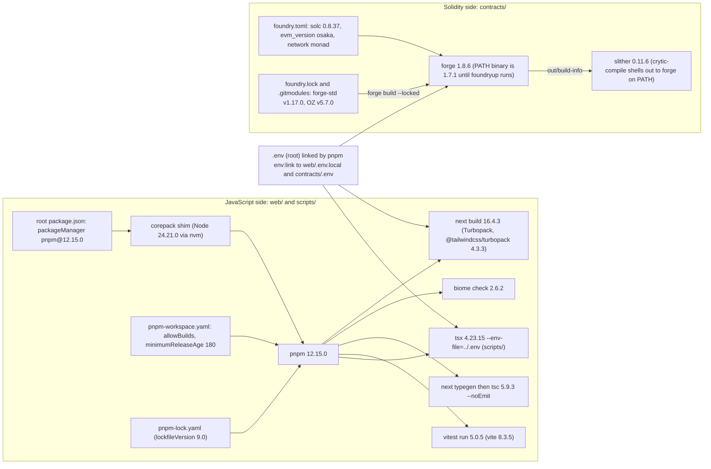

# Toolchain

Mavera is built with a deliberately boring, fully pinned toolchain so that the hacking window on 24 Oct 2026 (10:45–16:30 Europe/Istanbul) goes into product code, not into dependency surprises. This document is the record of what was verified and why. Every version below was checked against its primary source (npm registry, GitHub releases, the official documentation, or the binary itself) on 2026-10-24 between 02:20 and 04:20 Europe/Istanbul; the decisions behind the pins are stated together with the alternatives that were rejected; and the two CI workflows, the local-machine gotchas and the fresh-machine install commands are written so a teammate can copy and paste them without asking. The one rule for event day is at the end: do not upgrade anything. For the jury, the short version is that the contract side is Foundry 1.8.6 with native Monad execution (`network = "monad"`), Solidity 0.8.37 and OpenZeppelin 5.7.0, and the web side is Next.js 16.4.3 on Node 24 with pnpm 12.15.0, wagmi 3, viem 2 and the `@x402/*` 2.28.0 SDK, all installed from a committed lockfile that was proven to install cleanly tonight.

## Verified versions

All checks ran on 2026-10-24 (Europe/Istanbul). "Pinned" means the exact value in the repository: `web/package.json`, `scripts/package.json`, the root `package.json`, `contracts/foundry.toml`, `contracts/foundry.lock` and the two workflow files. Release dates come from the registry `time` field or the GitHub release; "not recorded" means the date was not captured tonight and must not be guessed.

### Contracts

| Component | Pinned version | Release date | How verified (command, 2026-10-24) |
| --- | --- | --- | --- |
| Foundry (forge, cast, anvil, chisel) | v1.8.6 | 2026-10-21 | `gh api repos/foundry-rs/foundry/releases`; `forge --version` on the downloaded binary prints commit `6bad0a66`, built 2026-10-21 |
| Foundry on this laptop's PATH | 1.7.1 (outdated, see gotchas) | 2026-05-08 (build) | `which forge` → `/Users/mericcintosun/.foundry/bin/forge`; `forge --version` → `1.7.1` |
| solc | 0.8.37 | 2026-09-10 | `gh api repos/ethereum/solidity/releases`; scratchpad probe `forge build` with `solc = "0.8.37"` compiled an OZ 5.7.0 ERC20 + ERC20Permit + ReentrancyGuardTransient contract (`Compiling 52 files with Solc 0.8.37 … Compiler run successful!`, metadata `0.8.37+commit.f401782d`, evm `osaka`); latest is 0.8.38 (2026-10-22) |
| `evm_version` | `osaka` (explicit) | n/a | `forge config --json` (1.8.6 default is already `osaka`); live `cast call --create` probes on testnet executed CLZ, TSTORE/TLOAD and MCOPY |
| OpenZeppelin Contracts | v5.7.0 | 2026-07-29 | `gh api repos/OpenZeppelin/openzeppelin-contracts/releases/tags/v5.7.0`; submodule `git describe --tags`; `foundry.lock` rev `cab19933c33c2ad1d4c7a84864a3601dddfd16f3` |
| forge-std | v1.17.0 | 2026-09-30 | `gh api repos/foundry-rs/forge-std/releases/latest`; `foundry.lock` rev `f3dae6e6ee381f25eb6a246f7da9b85c91a68219` |
| Effective Foundry config | solc 0.8.37, `evm_version` osaka, `network` monad, `chain_id` monad-testnet (10143), optimizer 200 runs, `bytecode_hash` ipfs, `use_literal_content` true | n/a | `forge config --json` with the 1.8.6 binary in `contracts/` |
| Slither | 0.11.6 | 2026-07-28 | `uv tool install --python 3.12 slither-analyzer`; `slither --version` → `0.11.6` (symlink at `/Users/mericcintosun/.local/bin/slither`) |
| crytic-compile (Slither dependency) | 0.4.2 | 2026-07-28 | GitHub releases; its `foundry.py` runs `forge build --build-info --skip ./test/** ./script/** --force` |

### Web and scripts

| Component | Pinned version | Release date | How verified (command, 2026-10-24) |
| --- | --- | --- | --- |
| Node.js | 24 LTS "Krypton" (`.nvmrc` = `24`; latest 24.22.1; local 24.21.0 via nvm) | 24.22.1: 2026-10-20 | `curl https://nodejs.org/dist/index.json`; `node --version` → `v24.21.0` |
| pnpm | 12.15.0 (`packageManager` in root `package.json`) | 2026-10-21 | `npm view pnpm dist-tags`; `pnpm --version` inside the repo (corepack shim downloads 12.15.0) |
| Next.js | 16.4.3 | 2026-10-23 13:40 UTC | `npm view next version`; `npm view next time --json`; `pnpm build` of the empty skeleton passes |
| React, react-dom | 19.3.1 | 2026-10-14 | `npm view react time --json` (date corrected by the verifier; the research draft said 2026-10-22) |
| TypeScript | 5.9.3 | 2025-09-30 | `npm view typescript dist-tags` (latest 7.0.2 native; 6.0.3 last JavaScript release) |
| Tailwind CSS | 4.3.3 | 2026-07-16 | `npm view tailwindcss version`; GitHub release v4.3.3 |
| @tailwindcss/turbopack | 4.3.3 | 2026-07-31 (package created) | `npm view @tailwindcss/turbopack time.created dependencies` (pins `tailwindcss 4.3.3`) |
| viem | 2.57.10 | 2026-10-22 | `npm view viem time --json` (verifier-corrected; draft said 2026-10-19) |
| wagmi | 3.7.9 | 2026-10-21 | `npm view wagmi@3.7.9 peerDependencies` → `viem 2.x`, `react >=18`, `@tanstack/react-query >=5.0.0`, `typescript >=5.9.3` (optional) |
| @tanstack/react-query | 5.104.5 | 2026-10-19 | `npm view @tanstack/react-query time --json` (verifier-corrected; draft said 2026-10-14) |
| @x402/core, @x402/evm, @x402/fetch, @x402/next | 2.28.0 | 2026-09-29 | `npm view @x402/core@2.28.0 --json`; tarball `package.json` shows `dependencies.zod ^3.24.2` and no `peerDependencies`; `@x402/next` peer `next >=16.2.6` |
| zod | 3.25.76 | 2025-07-08 | `npm view zod dist-tags` (latest 4.6.7); `npm view zod@3.25.76 exports` (ships `./v4` subpaths) |
| Vitest | 5.0.5 | 2026-10-15 | `npm view vitest@5.0.5 peerDependencies engines` (`vite ^6.4.0 \|\| ^7.0.0 \|\| ^8.0.0`, non-optional; `node ^22.12.0 \|\| ^24.0.0 \|\| >=26.0.0`) |
| Vite | 8.3.5 | 2026-10-21 | `npm view vite@8.3.5 dependencies` (rolldown-based; esbuild only an optional peer) |
| Biome | 2.6.2 | 2026-10-21 | `npm view @biomejs/biome dist-tags`; `biome migrate` applied (`rules.preset = recommended`, domains `next` and `react`) |
| tsx | 4.23.15 | not recorded | `npm view tsx version` (pulls `esbuild@0.28.2`, the only build script in the lockfile) |
| @types/node | 24.19.2 | 2026-10-09 | `npm view @types/node dist-tags` (latest 24.x; the `latest` tag is for Node 26) |
| @types/react, @types/react-dom | 19.3.0 | not recorded | `npm view @types/react version` |
| Vercel CLI | local 54.3.0; latest 65.2.0 | 65.2.0: 2026-10-22 | `npm view vercel version`; `vercel --version`; use `pnpm dlx vercel@65.2.0` rather than the stale global |

### Tooling and GitHub Actions

| Component | Version used | Release date | How verified (command, 2026-10-24) |
| --- | --- | --- | --- |
| actionlint | 1.7.12 (scratchpad binary) | not recorded | `actionlint .github/workflows/contracts.yml .github/workflows/web.yml` → both pass |
| Mermaid CLI | @mermaid-js/mermaid-cli 12.0.0 | not recorded | `npx @mermaid-js/mermaid-cli@12.0.0` rendered a test SVG |
| actions/checkout | `@v7` (= v7.0.1) | 2026-07-20 | `gh api repos/actions/checkout/releases/latest` |
| foundry-rs/foundry-toolchain | `@v1` (= v1.9.2, commit `dba66c27…`) | 2026-10-22 | `gh api repos/foundry-rs/foundry-toolchain/git/ref/tags/v1` and `…/v1.9.2` → same commit; `version` input is passed to `foundryup --install` |
| pnpm/setup | `@v3` (= v3.1.1) | 2026-10-10 | `gh api repos/pnpm/setup/releases/latest`; `action.yml` inputs `version`, `node-version-file`, `cache`, `install`, `require-lockfile` |
| pnpm/action-setup (fallback only) | `@v6` (= v6.1.0) | 2026-09-05 | `gh api repos/pnpm/action-setup/releases/latest`; README: successor is `pnpm/setup` for pnpm >= 11 |
| actions/setup-node (fallback only) | `@v7` (= v7.1.0) | 2026-10-08 | `gh api repos/actions/setup-node/releases/latest` |
| crytic/slither-action | `@v0.4.2` | 2026-01-16 | `gh api repos/crytic/slither-action/releases/latest`; Docker action, needs `ubuntu-latest` |
| github/codeql-action/upload-sarif | `@v4` | not recorded | tags v1–v4 exist; v4 runs on `node24` |

## Decisions and rejected alternatives

| Decision | Chosen | Why (evidence) | Rejected alternative (why not) |
| --- | --- | --- | --- |
| Lint and format | Biome 2.6.2: `biome check` (lint + format + import sorting), `rules.preset: "recommended"`, domains `next` and `react` | One Rust binary with no `typescript` or Node plugin graph; `next lint` was removed in Next 16 and `next build` no longer lints, so a standalone tool is needed anyway; `create-next-app --biome` is a supported path. Trade-off accepted: 12 of the 22 `@next/eslint-plugin-next` rules have no Biome equivalent, nearly all Pages-Router or `_document` checks that cannot fire in a single App Router page. | ESLint 10 + `eslint-config-next@16.4.3` + Prettier: two tools, eight-plus packages, `typescript-eslint ^8.56.0` (needs the TypeScript JavaScript API, which TS 7 does not ship) and `eslint-import-resolver-typescript` with the `unrs-resolver` postinstall. |
| TypeScript | 5.9.3 exact | wagmi 3 minimum is 5.9.3 and wagmi asks for patch-pinned `typescript`; Next's `"plugins": [{ "name": "next" }]` is a tsserver plugin, and the TS 7.0 announcement recommends TS 7 only "where language server plugins are not required". | 7.0.2 (native): `next build` would work through the default `tsc` CLI checker, but editor plugin and any TS-API tool break. 6.0.3: changes defaults (`types: []`, `strict`, `module esnext`, `target es2025`) for zero hackathon value. Re-evaluate after TS 7.1 ships an API. |
| zod | 3.25.76 exact in `web/` and `scripts/` | Corrected reasoning: `@x402/core` and `@x402/evm` 2.28.0 declare `zod ^3.24.2` as a regular dependency (not a peer), so pnpm resolves one copy, `zod@3.25.76`, for x402 and the app alike; the app's choice does not affect x402 at all. Keeping 3.25.76 avoids a second zod copy in the browser bundle (`@x402/fetch` → `@x402/core` → zod 3) and keeps one set of types. Advisory note: GHSA-mrhx-c7xc-m3w5 (High, CVSS 7.5, published 2026-10-01; memory exhaustion via unbounded arrays; affects `< 4.6.6`, no 3.x fix) applies to x402's own zod copy whatever the app pins; the real mitigation is request size (Node's 16 KiB default header cap), recorded in [docs/06-THREAT-MODEL.md](06-THREAT-MODEL.md). | 4.6.7: would work for app code (two copies installed side by side; the verifier even forced one copy and all 16 `@x402/core` schemas still parsed), but adds bundle weight and buys nothing for the event. The research draft's claim that zod 4 "breaks x402 at import time" was refuted by the verifier. |
| Wallet stack | wagmi 3.7.9 + viem 2.57.10 + @tanstack/react-query 5.104.5, connector `injected()` only | wagmi 3 is current (3.0.0 released 2025-11-19); connector dependencies are optional peers, so `injected()` needs no extra package; `monadTestnet` (id 10143) ships in viem 2.57.10 with Multicall3 `0xcA11bde05977b3631167028862bE2a173976CA11`. Renames to remember: `useAccount` → `useConnection`, `useConnect().connectors` deprecated in favour of `useConnectors()`; `createConfig({ ssr: true })`. Cheat-sheet in [docs/04-FRONTEND.md](04-FRONTEND.md). | wagmi 2.x (handoff): superseded; its docs moved to a legacy site. viem's `monadTestnet.blockTime: 400` and explorer `testnet.monadexplorer.com` are stale: the live block time is 300 ms (measured 302 ms) and links use `NEXT_PUBLIC_EXPLORER_URL`. |
| Package manager | pnpm 12.15.0 pinned in root `packageManager`; `pnpm-workspace.yaml` with `allowBuilds: { esbuild: true, sharp: false, unrs-resolver: false }` and `minimumReleaseAge: 180` | pnpm 11 removed `onlyBuiltDependencies` and friends; pnpm 12 parses them silently and then fails with `ERR_PNPM_IGNORED_BUILDS` (reproduced in a scratchpad probe), so `allowBuilds` is the only valid form. pnpm 11+ defaults `minimumReleaseAge` to 1440 minutes and re-applies it to every lockfile entry on every install; `next@16.4.3` was published 2026-10-23 13:40 UTC, so the default would block installs until 16:40 Europe/Istanbul, after submission closes. 180 minutes keeps a guard against minutes-old malicious releases. Setting it explicitly implies `minimumReleaseAgeStrict` (since pnpm 12.3.0): a package younger than 3 h fails instead of silently falling back; `minimumReleaseAgeExclude` is the escape hatch. Clean `pnpm install --frozen-lockfile` passed at 03:40. | pnpm 10.34.7 (Vercel's default for an unpinned lockfile): would need a regenerated lockfile and loses parity with the local shim. Default release age: blocks Next until after the deadline. |
| Next.js caching model | Cache Components off: `cacheComponents` and `partialPrefetching` deleted from `web/next.config.ts` (D1) | Mavera has no server data to cache; the only server code is the x402 route handler, which must run per request, and `GET /api/state`, which the server caches itself for about 1 s. With Cache Components on, `dynamic`/`revalidate`/`fetchCache` exports error, sync IO such as `Date.now()` during prerender is a build error, and the `runtime` export is forbidden. With it off, "Route Handlers are not cached by default". The x402 handler needs the Node runtime (the SDK uses `Buffer`), which is the default, so no `runtime` export is written. | Keeping the create-next-app default (`cacheComponents: true, partialPrefetching: true`): viable but adds a class of build-time validation failures under a six-hour clock. Reversible in one line later. |
| Solidity compiler | `solc = "0.8.37"` and `evm_version = "osaka"` explicit in `contracts/foundry.toml`; `pragma solidity 0.8.37;` in `Mavera.sol` | Without a pin, auto-detect picks 0.8.38, released 2026-10-22, two days before the event. 0.8.37 (six weeks old) compiles OZ 5.7.0 cleanly, is parsed by Slither 0.11.6 (29 contracts, 102 detectors in the probe), and is listed by Etherscan and by the Sourcify compiler list. `network = "monad"` does not change `evm_version`; it is Foundry's own default `osaka`, pinned explicitly so a future Foundry default change cannot alter verification metadata. Monad is Fusaka-level, and CLZ, TSTORE/TLOAD and MCOPY executed in live testnet `eth_call` probes. | 0.8.38: too new for the "three weeks old" rule and unverified by explorer UIs. Floating `^0.8.x` pragma: Slither's `solc-version` detector flags it and auto-detect drifts. Fallback if anything odd appears: 0.8.36. |
| Monad execution in Foundry | `network = "monad"` in `[profile.default]`; hardfork left at the default (MonadTen) | A runtime switch: Monad gas model, MIP-8 storage pages, precompiles and the 128 KB / 256 KB size limits apply in tests and simulation. If a pin is ever needed the spelling is `hardfork = "monad:MonadTen"`; unqualified `"MonadTen"` is rejected by forge 1.8.6, and the CLI form is `--hardfork monad:MonadTen` (the Monad docs' unqualified CLI example fails). | The `monad-developers/foundry-monad` template alone: last commit 2025-04-24, no `network` key at all, `metadata = true` and `metadata_hash = "none"` are unknown Foundry keys (the real key is `bytecode_hash`), OZ submodule pinned at v5.1.0, `actions/checkout@v4`. It was used only as the base; submodules were re-pinned to OZ v5.7.0 and forge-std v1.17.0. |
| Dependency locking (contracts) | `contracts/foundry.lock` committed; CI runs `forge build --locked` | `forge install` writes `foundry.lock` (tag name + resolved commit); the Foundry docs say to commit it; `--locked` makes the build fail if a submodule drifts from the lock. `.gitmodules` records the URLs, `foundry.lock` the revisions. | Unpinned submodules: a `forge update` by habit would silently move OZ. `forge install --no-git`: not locked at all. |
| CI install action for pnpm | `pnpm/setup@v3` (`node-version-file: .nvmrc`, `cache: true`, `install: true`, `require-lockfile: true`) | Documented successor of `pnpm/action-setup` for pnpm >= 11; reads `packageManager`, installs Node from `.nvmrc`, caches the store and runs `pnpm install --frozen-lockfile` in one step. | `pnpm/action-setup@v6` + `actions/setup-node@v7 (cache: pnpm)`: README says it "remains the action to use for installing pnpm v10 and older"; it bootstraps pnpm 11.19.0 and then `self-update`s, unverified for 12.15.0. Kept as the documented fallback (see CI section). |
| Vercel package-manager detection | Rely on the `packageManager` pin; set `ENABLE_EXPERIMENTAL_COREPACK=1` only if the first build log shows the wrong pnpm | `@vercel/build-utils` (published 15.0.2, 2026-10-23) selects pnpm 12 only from a pin (`packageManager`, `devEngines` or `engines.pnpm`); with Root Directory `web` it walks up to the lockfile and reads the root `package.json`. Expected log line: `Detected pnpm-lock.yaml version 9 generated by pnpm@12.x from package.json#packageManager pnpm@12.15.0`. Whether `/pnpm12` exists in today's build image is unverified. | Enabling Corepack up front: Vercel calls it experimental. Deploying `web/` as its own repo root: loses the workspace lockfile. |
| Node.js | 24 LTS (`.nvmrc` = `24`, root `engines.node >=24`, `web/package.json` `engines.node "24.x"`) | Vercel's default is 24.x and it reads `engines.node`; Vitest 5 requires `^22.12.0 \|\| ^24.0.0`; pnpm 11+ requires Node 22+; `pnpm/setup@v3` reads `.nvmrc`. | Node 22 LTS (handoff): supported everywhere but offers nothing over 24 on Vercel's default. Node 26: `@types/node` latest tag targets it, but Vercel and the local nvm are on 24. |
| Environment files | One root `.env`; `pnpm env:link` symlinks it to `web/.env.local` and `contracts/.env`; `scripts/` reads it via `tsx --env-file=../.env` | One file to fill after deployment, three consumers; the zod schema in `web/src/lib/env.ts` enforces the route lock `PAY_TO == MAVERA_ADDRESS`; `.gitignore` tracks only [.env.example](../.env.example). CI copies `.env.example` to `web/.env.local` so `next build` sees placeholder values. | Separate `.env` per package: three places to update `MAVERA_ADDRESS` under time pressure. |
| Styling pipeline | Tailwind CSS 4.3.3 through `@tailwindcss/turbopack` 4.3.3 (`turbopack.rules["*.css"]`), no PostCSS | create-next-app 16.4 default for Turbopack projects; Turbopack is the default bundler in Next 16. Caveat: the stale-CSS fix (tailwindlabs/tailwindcss PR #20582, merged 2026-10-16) postdates the 4.3.3 publish, so `next dev` may serve the previous CSS after editing `globals.css`; save again or restart. `next build --webpack` would emit no Tailwind CSS. | `@tailwindcss/postcss` + `postcss.config.mjs`: what Tailwind's own Next guide still documents; valid fallback if the dev-mode caveat bites. |
| Unit tests (web) | Vitest 5.0.5 + Vite 8.3.5, `environment: "node"`, `include: ["src/**/*.test.ts"]`, `passWithNoTests: true`, alias `@` → `./src` | `vite` is a non-optional peer of Vitest 5, so it is pinned explicitly; Vite 8 brings no esbuild build script. `next build` type-checks the whole tsconfig project including test files, so tests must compile. | Jest: no bundler integration needed for pure helpers. `resolve.tsconfigPaths: true` instead of the alias: verified to work, optional. |
| Deploy command | `forge create src/Mavera.sol:Mavera --broadcast --account mavera-deployer …` for the single contract | Gas limit = raw `eth_estimateGas` (no multiplier unless `--gas-estimate-multiplier` is passed); Monad bills the gas limit. | `forge script`: default gas-estimate multiplier is 130 %, so if a script is used pass `--slow --gas-estimate-multiplier 110`. Never `--legacy` (Monad is EIP-1559). Commands in [docs/07-RUNBOOK.md](07-RUNBOOK.md). |
| Source verification | Sourcify via `--verifier sourcify --verifier-url https://sourcify-api-monad.blockvision.org/` (no key) for MonadVision; Etherscan V2 via `--chain 10143 --verifier etherscan --etherscan-api-key $ETHERSCAN_API_KEY --watch` (free etherscan.io key) for Monadscan | Foundry 1.8.6 resolves chain 10143 to `monad-testnet` and uses `https://api.etherscan.io/v2/api?chainid=10143` automatically; since v1.8.0 an Etherscan run also submits to sourcify.dev. | The `https://api-testnet.monadscan.com/api` URL from the Monad block-explorers table: a deprecated Etherscan V1 endpoint (live response says so). |

### Foundry 1.8.6 behaviours worth remembering

- `[fuzz] fail_on_revert = true` is the 1.8.6 default, so fuzz tests must bound their inputs (`bound()`, not `vm.assume()`). The repo sets `[invariant] fail_on_revert = true` on purpose: handlers bound inputs, so any revert is a finding. See [docs/05-TEST-PLAN.md](05-TEST-PLAN.md).
- `forge lint` runs on every build (`lint_on_build = true`) and warns `unsafe-typecast` on `int256(...)` casts. Use `SafeCast`, or `// forge-lint: disable-next-line(unsafe-typecast)` with a justification. Do not add `forge lint --deny warnings` to CI on event day.
- `isolate = true` is the default: each top-level call runs in its own transaction context, so gas numbers differ from pre-1.8 snapshots.
- `cast wallet new --json` returns `{ "data": [ { "address", "private_key", "public_key" } ], … }`; `cast chain --rpc-url …` prints `unknown` for 10143 (cosmetic), so always pass `--chain 10143` or `--rpc-url` explicitly.
- `forge build --sizes` enforces Monad's 131,072 B runtime and 262,144 B initcode limits under `network = "monad"`.

## Repository layout and scripts

```text
mavera/
├── README.md  LICENSE (MIT)  .editorconfig  .gitignore  .gitmodules  .nvmrc (24)  .env.example
├── package.json                 workspace root, packageManager pnpm@12.15.0, engines.node >=24
├── pnpm-workspace.yaml          packages web, scripts; allowBuilds; minimumReleaseAge 180
├── pnpm-lock.yaml               lockfileVersion 9.0 with the pnpm 12 boot document
├── .github/workflows/           contracts.yml, web.yml
├── contracts/                   foundry.toml  foundry.lock  remappings.txt  slither.config.json  README.md
│   ├── lib/forge-std (v1.17.0)  lib/openzeppelin-contracts (v5.7.0)     git submodules
│   └── src/  test/  script/     README placeholders until 10:45
├── web/                         @mavera/web: package.json  next.config.ts  biome.json  tsconfig.json  vitest.config.mts
│   └── src/app/ (layout.tsx, page.tsx placeholder, globals.css, api/README.md)  src/lib/env.ts  src/components/README.md
├── scripts/                     @mavera/scripts: package.json  tsconfig.json  deploy.sh  verify.sh  customer.ts  load-test.ts  faucet-notes.md
└── docs/                        README.md index, 00 … 12, adr/, img/
```



Which configuration file feeds which tool: the pnpm pin and workspace file govern everything under `web/` and `scripts/`, `foundry.toml` plus `foundry.lock` govern `contracts/`, and one root `.env` is linked into both sides.

### Scripts

| Where | Command | What it runs |
| --- | --- | --- |
| root | `pnpm env:link` | `ln -sf ../.env web/.env.local && ln -sf ../.env contracts/.env` |
| root | `pnpm dev`, `pnpm build` | `pnpm --filter @mavera/web dev` / `build` |
| root | `pnpm lint`, `pnpm format`, `pnpm typecheck`, `pnpm test` | `pnpm -r --if-present <script>` across `web` and `scripts` |
| root | `pnpm contracts:build`, `pnpm contracts:test`, `pnpm contracts:fmt` | `forge build --root contracts`, `forge test --root contracts`, `forge fmt --root contracts` (uses the `forge` on PATH, which must be 1.8.6) |
| `web/` (`@mavera/web`) | `dev`, `build`, `start` | `next dev`, `next build`, `next start` |
| `web/` | `lint`, `format` | `biome check`, `biome format --write` |
| `web/` | `typecheck` | `next typegen && tsc --noEmit` (`next typegen` generates `next-env.d.ts` and the route type helpers; the file is git-ignored) |
| `web/` | `test` | `vitest run` |
| `scripts/` (`@mavera/scripts`) | `customer`, `load-test` | `tsx --env-file=../.env customer.ts`, `tsx --env-file=../.env load-test.ts` (TODO stubs until event hours) |
| `scripts/` | `typecheck` | `tsc --noEmit` (`module: NodeNext`, `types: ["node"]`) |
| `contracts/` | `forge build`, `forge test -vvv`, `FOUNDRY_PROFILE=ci forge test`, `forge fmt --check`, `slither .` | Settings in `foundry.toml` and `slither.config.json`; `[profile.ci]` raises fuzz runs to 2048 and invariants to 256 runs x depth 128 |

### Configuration excerpts (verbatim from the repository)

`contracts/foundry.toml`, the keys that matter (comments removed):

```toml
[profile.default]
solc = "0.8.37"
evm_version = "osaka"
optimizer = true
optimizer_runs = 200
via_ir = false
use_literal_content = true
network = "monad"
eth_rpc_url = "https://testnet-rpc.monad.xyz"
chain_id = 10143
ffi = false
fs_permissions = []
gas_reports = ["Mavera"]

[fuzz]
runs = 512
max_test_rejects = 65536

[invariant]
runs = 128
depth = 64
fail_on_revert = true
shrink_run_limit = 5000
show_metrics = true

[profile.ci]
fuzz = { runs = 2048 }
invariant = { runs = 256, depth = 128 }

[rpc_endpoints]
monad_testnet = "https://testnet-rpc.monad.xyz"
monad_testnet_ankr = "https://rpc.ankr.com/monad_testnet"
```

`pnpm-workspace.yaml`, effective keys:

```yaml
packages:
  - web
  - scripts
allowBuilds:
  esbuild: true
  sharp: false
  unrs-resolver: false
minimumReleaseAge: 180
# minimumReleaseAgeExclude:
#   - some-package@1.2.3
```

`contracts/remappings.txt` is two lines: `@openzeppelin/contracts/=lib/openzeppelin-contracts/contracts/` and `forge-std/=lib/forge-std/src/`. `contracts/slither.config.json` sets `filter_paths: "lib/"`, `exclude_dependencies: true`, `detectors_to_exclude: "solc-version,naming-convention"` and `fail_on: "none"`.

## Continuous integration

Two workflows under `.github/workflows/`, both validated with actionlint 1.7.12 tonight. Neither has run on `ubuntu-latest` yet, because the public repository is created on event morning; the first push is the real test.

```mermaid
flowchart TD
  subgraph C["contracts.yml, job forge (FOUNDRY_PROFILE=ci)"]
    C1["actions/checkout@v7 (submodules: recursive)"]
    C2["foundry-rs/foundry-toolchain@v1 (version: v1.8.6)"]
    C3["forge --version and forge config --json"]
    C4["forge fmt --check"]
    C5["forge build --locked --sizes"]
    C6["forge test -vvv"]
    C1 --> C2 --> C3 --> C4 --> C5 --> C6
  end
  subgraph S["contracts.yml, job slither (continue-on-error)"]
    S1["checkout + foundry-toolchain v1.8.6"]
    S2["forge build --build-info --skip test script --force"]
    S3["crytic/slither-action@v0.4.2 (ignore-compile, fail-on none, SARIF)"]
    S4["github/codeql-action/upload-sarif@v4"]
    S5["checklist appended to the job summary"]
    S1 --> S2 --> S3 --> S4 --> S5
  end
  subgraph W["web.yml, job web"]
    W1["actions/checkout@v7"]
    W2["pnpm/setup@v3 (packageManager, .nvmrc, cache, frozen install)"]
    W3["cp .env.example web/.env.local"]
    W4["pnpm -r --if-present lint"]
    W5["pnpm -r --if-present typecheck"]
    W6["pnpm -r --if-present test"]
    W7["pnpm --filter @mavera/web build"]
    W1 --> W2 --> W3 --> W4 --> W5 --> W6 --> W7
  end
```



The three CI jobs in step order; the Slither job is advisory and cannot block a merge.

### contracts.yml

Triggers: push to `main` and pull requests touching `contracts/**`, `.gitmodules` or the workflow file; `workflow_dispatch`. `env: FOUNDRY_PROFILE: ci`. Concurrency group `contracts-${{ github.ref }}` with `cancel-in-progress`.

| Step | What it proves |
| --- | --- |
| `actions/checkout@v7` with `submodules: recursive` | The OZ and forge-std submodules check out at the recorded commits |
| `foundry-rs/foundry-toolchain@v1` with `version: v1.8.6` | The same Foundry as the laptop after `foundryup`; `network = "monad"` parses |
| `forge --version && forge config --json \| jq '{solc, evm_version, network, chain_id}'` | The log shows the effective compiler and network settings for the run |
| `forge fmt --check` | Formatting matches `[fmt]` (`line_length = 120`, `bracket_spacing = true`, `number_underscore = "thousands"`) |
| `forge build --locked --sizes` | Submodules match `foundry.lock`; contract sizes are under Monad's 128 KB / 256 KB limits |
| `forge test -vvv` | Unit, fuzz (2048 runs) and invariant (256 runs x depth 128) tests pass under Monad execution rules |
| Job `slither` (`continue-on-error: true`): toolchain 1.8.6, then `forge build --build-info --skip test script --force` | Artifacts are compiled by the pinned Foundry, because `crytic/slither-action` would otherwise install latest-stable Foundry itself |
| `crytic/slither-action@v0.4.2` with `target: contracts`, `ignore-compile: true`, `fail-on: none`, `sarif: results.sarif`, `slither-config: contracts/slither.config.json`, `slither-args: --checklist --markdown-root <repo>/blob/<sha>/contracts/` | Slither 0.11.6 analyses the artifacts; `fail-on: none` lets the SARIF step run |
| `github/codeql-action/upload-sarif@v4` (needs `security-events: write`) and the job-summary step | Findings appear in code scanning and as a Markdown checklist in the run summary; the job is non-blocking by design, findings are triaged in [docs/05-TEST-PLAN.md](05-TEST-PLAN.md) |

### web.yml

Triggers: push to `main` and pull requests touching `web/**`, `scripts/**`, `package.json`, `pnpm-lock.yaml`, `pnpm-workspace.yaml`, `.nvmrc`, `.env.example` or the workflow file; `workflow_dispatch`. `env: NEXT_TELEMETRY_DISABLED: "1"`, `CI: "true"`.

| Step | What it proves |
| --- | --- |
| `pnpm/setup@v3` with `node-version-file: .nvmrc`, `cache: true`, `install: true`, `require-lockfile: true` | pnpm 12.15.0 from `packageManager`, Node 24 from `.nvmrc`, and `pnpm install --frozen-lockfile` succeeds, including the `minimumReleaseAge` supply-chain pass |
| `cp .env.example web/.env.local` | `next build` and `next typegen` load with placeholder values (zero addresses pass the schema shape, and `PAY_TO` equals `MAVERA_ADDRESS`) |
| `pnpm -r --if-present lint` | Biome 2.6.2 passes in `web/` |
| `pnpm -r --if-present typecheck` | `next typegen && tsc --noEmit` in `web/`, `tsc --noEmit` in `scripts/` |
| `pnpm -r --if-present test` | Vitest 5.0.5 passes (`passWithNoTests: true` until tests exist) |
| `pnpm --filter @mavera/web build` | `next build` 16.4.3 passes with Turbopack; it also type-checks test files |

Fallback if `pnpm/setup@v3` fails on the first run (replace the install step; everything else stays):

```yaml
      - uses: pnpm/action-setup@v6
      - uses: actions/setup-node@v7
        with:
          node-version-file: .nvmrc
          cache: pnpm
      - run: pnpm install --frozen-lockfile
```

## Local machine gotchas (this laptop, checked 04:30 on 2026-10-24)

| Symptom | Cause | Fix |
| --- | --- | --- |
| `forge config` fails with `unknown variant: found 'monad', expected one of 'ethereum', 'optimism', 'tempo'` | The `forge` on PATH is 1.7.1 (`/Users/mericcintosun/.foundry/bin/forge`, built 2026-05-08); the verified 1.8.6 lives only in the session scratchpad | Run `foundryup --install 1.8.6` (or plain `foundryup`) before 09:00, then `forge --version` must print `1.8.6` |
| `foundryup` refuses to install | Four orphaned `anvil` processes (ports 56749, 56752, 53807, 53821, started 19–20 Oct) still hold the binaries; still running at 04:30 | `pkill anvil && foundryup --install 1.8.6`; optionally `foundryup --update` (foundryup itself 1.8.3 → 2.0.0) |
| `slither .` fails with `failed to extract foundry config` | crytic-compile shells out to the `forge` on PATH, so with 1.7.1 it cannot read `network = "monad"` | Same fix: 1.8.6 first on PATH; check `forge --version` before `slither .` |
| First `pnpm` command in the repo downloads something | `pnpm` on PATH is the corepack shim shipped with Node 24.21.0 (nvm); it fetches 12.15.0 from the `packageManager` field on first use | Expected; needs network once. `pnpm --version` must print `12.15.0` inside the repo |
| `pnpm install` rejects a package added during the event | `minimumReleaseAge: 180` is strict: anything published less than 3 h ago fails resolution | Add `minimumReleaseAgeExclude: [name@version]` to `pnpm-workspace.yaml` only if the package is truly needed |
| Local Node is 24.21.0, not the latest 24.22.1 | nvm install from before 2026-10-20 | No action; `engines.node >=24` and Vercel `24.x` are satisfied |
| `vercel` prints version 54.3.0 | Stale global install; latest is 65.2.0 | Use `pnpm dlx vercel@65.2.0 <command>` as in [docs/07-RUNBOOK.md](07-RUNBOOK.md) |

## Fresh machine install (copy and paste, one command per line)

```sh
pkill anvil
foundryup --install 1.8.6
forge --version
uv tool install --python 3.12 slither-analyzer
slither --version
nvm install 24
nvm use
corepack enable
git clone --recurse-submodules <REPO_URL> mavera
cd mavera
pnpm --version
pnpm install --frozen-lockfile
cp .env.example .env
pnpm env:link
pnpm lint
pnpm typecheck
pnpm test
pnpm build
cd contracts
forge build --locked --sizes
forge test -vvv
forge fmt --check
slither .
```

Expected: `forge --version` → `1.8.6`, `slither --version` → `0.11.6`, `pnpm --version` → `12.15.0`, `node --version` → a `v24.x` line. `foundryup` itself is installed per the Foundry documentation at https://www.getfoundry.sh/ (accessed 2026-10-24). `<REPO_URL>` is TBD on event day (the public repository is created with `gh repo create mavera --public --source=. --push`). actionlint (`actionlint .github/workflows/*.yml`) and Mermaid CLI (`npx @mermaid-js/mermaid-cli@12.0.0 -i <diagram>.mmd -o docs/img/<name>.svg`) are optional and not part of the repository's dependencies.

## Reproducibility notes

- Clean install proven: the manifests and lockfile were copied to an empty scratchpad directory and `pnpm install --frozen-lockfile` with pnpm 12.15.0 finished with `Lockfile passes supply-chain policies`, `Done in 1.5s`, exit 0, at 03:40 Europe/Istanbul on 2026-10-24. The research draft's "blocker" about legacy build keys described an earlier revision of `pnpm-workspace.yaml`; the committed file already uses `allowBuilds`.
- `pnpm-lock.yaml` is `lockfileVersion: '9.0'` with the pnpm 12 boot document (`packageManagerDependencies: pnpm 12.15.0` and `@pnpm/exe.*@12.15.0` entries). The lockfile pins exact versions; `minimumReleaseAge` is re-checked against it on every install unless `trustLockfile` is set (it is not).
- `pnpm build` (Next 16.4.3, Turbopack) of the empty skeleton passes with the placeholder env.
- `contracts/foundry.lock` pins forge-std v1.17.0 (`f3dae6e6…`) and OZ v5.7.0 (`cab19933…`); `forge build --locked` in CI fails on drift. Clone with `--recurse-submodules` or run `git submodule update --init --recursive`.
- `forge config --json` with 1.8.6 resolves to solc 0.8.37, `evm_version` osaka, `network` monad, `chain_id` monad-testnet, optimizer 200 runs, `bytecode_hash` ipfs, `use_literal_content` true: the exact metadata both verifiers will see.
- `web/next-env.d.ts` and `*.tsbuildinfo` are generated and git-ignored; `next typegen` recreates them.
- Not yet reproduced anywhere: a CI run on `ubuntu-latest`, a Vercel build, and an end-to-end `forge create --verify` against chain 10143. All three happen for the first time on event day.

## Event-day rule: do not upgrade anything

From 09:00 on 24 Oct 2026 the toolchain is frozen. No `pnpm up`, no `pnpm add` of a new major, no `forge update`, no second `foundryup` after the morning install to 1.8.6, no solc change, no TypeScript 7, no zod 4, no ESLint, no Cache Components. If a tool misbehaves, work around it or use the documented fallback (action-setup, Corepack flag, PostCSS) rather than upgrading. The only sanctioned additions are packages already in the x402 or viem dependency tree, and only through `minimumReleaseAgeExclude` if they are younger than three hours. Every version in this document is older than 180 minutes; the newest, `next@16.4.3`, is 21 hours old at the opening of the hacking window.

## Primary sources (all accessed 2026-10-24)

- Foundry releases https://github.com/foundry-rs/foundry/releases ; Foundry docs https://www.getfoundry.sh/config/reference/testing and https://www.getfoundry.sh/guides/invariant-testing ; Monad Foundry guide https://docs.monad.xyz/tooling-and-infra/toolkits/foundry.md
- Solidity releases https://github.com/ethereum/solidity/releases ; Etherscan compiler list https://etherscan.io/solcversions ; Sourcify compiler list https://binaries.soliditylang.org/bin/list.json
- OpenZeppelin v5.7.0 https://github.com/OpenZeppelin/openzeppelin-contracts/releases/tag/v5.7.0 ; forge-std v1.17.0 https://github.com/foundry-rs/forge-std/releases/tag/v1.17.0
- Slither https://github.com/crytic/slither ; slither-action https://github.com/crytic/slither-action ; foundry-monad template https://github.com/monad-developers/foundry-monad
- Node.js releases https://nodejs.org/dist/index.json ; pnpm settings https://pnpm.io/settings/dependency-resolution and https://pnpm.io/settings/build ; pnpm v11.0.0 https://github.com/pnpm/pnpm/releases/tag/v11.0.0 ; pnpm v12.3.0 https://github.com/pnpm/pnpm/releases/tag/v12.3.0
- Next.js 16.4.3 https://github.com/vercel/next.js/releases/tag/v16.4.3 ; Cache Components https://nextjs.org/docs/app/api-reference/config/next-config-js/cacheComponents ; route handlers https://nextjs.org/docs/app/getting-started/route-handlers ; TypeScript CLI checker https://nextjs.org/docs/app/api-reference/config/next-config-js/useTypeScriptCli ; upgrade guide https://nextjs.org/docs/app/guides/upgrading/version-16
- TypeScript 7.0 https://devblogs.microsoft.com/typescript/announcing-typescript-7-0/ ; TypeScript 6.0 https://devblogs.microsoft.com/typescript/announcing-typescript-6-0/
- wagmi v3 migration https://wagmi.sh/react/guides/migrate-from-v2-to-v3 ; wagmi TypeScript https://wagmi.sh/react/typescript ; viem registry https://registry.npmjs.org/viem/2.57.10
- Biome https://biomejs.dev/ ; domains https://biomejs.dev/linter/domains/ ; schema https://biomejs.dev/schemas/2.6.2/schema.json
- Vitest https://vitest.dev/config.md ; Vite shared options https://vite.dev/config/shared-options.md
- Tailwind turbopack loader PR https://github.com/tailwindlabs/tailwindcss/pull/20367 and stale-CSS fix https://github.com/tailwindlabs/tailwindcss/pull/20582 ; create-next-app switch https://github.com/vercel/next.js/pull/96606
- zod advisory https://github.com/advisories/GHSA-mrhx-c7xc-m3w5 ; zod 4 changelog https://zod.dev/v4/changelog ; x402 packages https://registry.npmjs.org/@x402%2Fcore
- Vercel package managers https://vercel.com/docs/package-managers ; Corepack https://vercel.com/docs/builds/configure-a-build#corepack ; Node versions https://vercel.com/docs/functions/runtimes/node-js/node-js-versions ; build-utils source https://github.com/vercel/vercel/blob/main/packages/build-utils/src/fs/run-user-scripts.ts
- GitHub Actions: https://github.com/pnpm/setup , https://github.com/pnpm/action-setup , https://github.com/actions/checkout , https://github.com/actions/setup-node , https://github.com/foundry-rs/foundry-toolchain
- Related documents: [README.md](../README.md), [docs/README.md](README.md), [docs/03-X402-FLOW.md](03-X402-FLOW.md), [docs/10-MONAD-NOTES.md](10-MONAD-NOTES.md), [docs/12-SUBMISSION-CHECKLIST.md](12-SUBMISSION-CHECKLIST.md), [contracts/README.md](../contracts/README.md), [web/README.md](../web/README.md), [scripts/README.md](../scripts/README.md)

## Open questions

- Neither CI workflow has executed on `ubuntu-latest` (no remote yet). If `pnpm/setup@v3` fails on the first push, switch to the documented `pnpm/action-setup@v6` + `actions/setup-node@v7` fallback; whether action-setup self-updates from its 11.19.0 bootstrap to 12.15.0 is unverified.
- Whether Vercel's build image contains `/pnpm12` is unverified; read the `Detected pnpm-lock.yaml version 9 generated by pnpm@12.x …` line on the first deploy and set `ENABLE_EXPERIMENTAL_COREPACK=1` only if it shows another major.
- `foundryup` is still blocked at 04:30 by the four `anvil` processes; the user must run `pkill anvil && foundryup --install 1.8.6` before 09:00, and `forge --version` must print `1.8.6` before any `forge`, `cast` or `slither` command.
- Release dates for tsx 4.23.15, @types/react 19.3.0, actionlint 1.7.12, Mermaid CLI 12.0.0 and codeql-action v4 were not recorded tonight; the versions themselves are verified.
- `forge create --verify` and the Monadscan Etherscan V2 verification have not been executed end to end against chain 10143; plan a throwaway deploy plus both verifications right after the contract compiles (around 11:05), not at 15:50.
- The `@tailwindcss/turbopack` 4.3.3 dev-mode stale-CSS caveat may or may not bite; if it does, restart `next dev` or fall back to `@tailwindcss/postcss`.
- The public repository slug and `<REPO_URL>` are TBD on event day.
