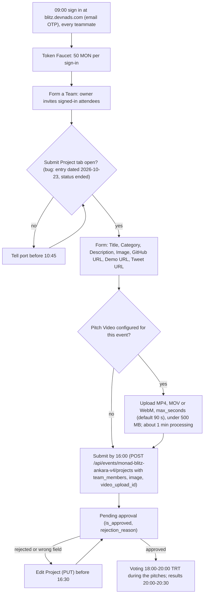

# Mavera — Submission checklist

This is the last document the team opens on 24 October 2026: what the Blitz platform (https://blitz.devnads.com, event slug `monad-blitz-ankara-v4`) needs, in which order, by when, and what the jury's own rubric will look for. The submission window closes at 16:30 Europe/Istanbul; because every submission needs admin approval before it appears for voting, our internal deadline is 16:00. Everything the form asks for has a prepared value below (title, category, a 114-word description, a 232-character tweet, image and video limits); everything that only exists after deployment is a bracketed placeholder such as `0x2C2FcAE97A0925c5c660E3Ea467F931AdE760F4B`. The checklist is deliberately conservative: a finance product that fails the platform's `deployed` or `honest_pitch` gate "was not ranked", whatever its score. Commands for deploying, verifying and running the app live in [docs/07-RUNBOOK.md](07-RUNBOOK.md); this file only checks their results. Platform facts were read from the platform's JSON API and form JavaScript on 2026-10-24 and may change in the morning (see "Open questions").

## 1. Platform facts

| Item | Value (accessed 2026-10-24) |
| --- | --- |
| Event | Monad Blitz Ankara v4, Saturday 24 Oct 2026, 09:00–21:00 TRT, THK & Orion Tekmer, Çankaya, Ankara; hosts port (@port_dev), Monad Foundation (@monad), ODTÜ Blockchain; 101 registered for 75 seats (https://luma.com/blitz-ankara-24-Oct) |
| Platform | https://blitz.devnads.com — event page https://blitz.devnads.com/events/monad-blitz-ankara-v4 (slug `monad-blitz-ankara-v4`, id `2cf91ced-ebc7-45bc-9d13-5f9c35e31f09`); sign-in by email OTP; tabs Token Faucet, Form a Team, Submit Project, Edit Project, Voting, Winners |
| Faucets | 50 MON per platform sign-in (`token_amount` "50"); official faucet https://faucet.monad.xyz; testnet USDC from https://faucet.circle.com, 20 USDC per address per 2 h (see [scripts/faucet-notes.md](../scripts/faucet-notes.md)) |
| Schedule | Registration 09:00–10:00 · Welcome & rules 10:00–10:15 · Monad 101 10:15–10:45 · **Hacking window 10:45–16:30** · Lunch 12:30–13:00 · Dinner & demo setup 17:00–18:00 · Pitches & demos 18:00–20:00 · Results & awards 20:00–20:30 |
| Submission window | opens 10:15 TRT (`submission_start_time` 07:15Z), **closes 16:30 TRT** (`submission_end_time` 13:30Z); `submission_mode` "live" |
| Our deadline | **Submit by 16:00.** The platform answers "Project submitted successfully! Your project is pending approval and will appear in the voting page shortly." — approval is manual, so leave 30 min of slack |
| Judging | `judgeWeight` 80 / `voteWeight` 20; three pass/fail gates and five weighted criteria (section 2); rubric `enabled: true`, `published: false` |
| Voting | audience vote 18:00–20:00 TRT (`voting_start_time` 15:00Z, `voting_end_time` 17:00Z), i.e. during the pitches |
| Prizes | USD 1,000 / 600 / 400 |
| Rules | "All project development (coding, asset creation, etc.) must begin during the official Monad Blitz event hours"; public repository; "deployed and operational on the Monad Testnet" (chain 10143); prior work must be disclosed |
| Team size | conflict: Notion info pack "maximum of 3 members" vs Luma "en fazla dört kişilik" (up to 4) — ask at 10:00 |
| Pitch length | conflict: organizer said 1–2 min; Notion pack says 3 min (heading) and 5 min (body) — rehearse 90 s and 3 min |
| Known bug | the event entry is dated **2026-10-23** with `status: "ended"`, `submissions_open: false`, `submission_closed: true`, `attendee_count: 3` (platform `server_time` 2026-10-24T00:23:05Z) |

Sources: `GET https://blitz.devnads.com/api/events/monad-blitz-ankara-v4`, `GET .../monad-blitz-ankara-v4/judging`, the form chunk `/_next/static/chunks/app/events/%5Bslug%5D/page-ae5a12df98b2e8d5.js`, https://monad-foundation.notion.site/blitz-ankara and https://luma.com/blitz-ankara-24-Oct, all accessed 2026-10-24.

### 1.1 The 09:00 check

- [ ] Every teammate signs in at https://blitz.devnads.com (email OTP) and claims the 50 MON on the Token Faucet tab. Team invites only find signed-in attendees.
- [ ] Run the two commands below. Expected after the organizer's fix: dates on `2026-10-24`, `status` not `"ended"`, `submissions_open: true` from 10:15 TRT.
- [ ] If the Submit Project tab still shows closed or the wrong date, tell port (@port_dev) immediately, before 10:45.
- [ ] While logged in, open the Submit Project tab once: if a "Pitch Video" fieldset is shown, the video is required (section 3.3). The same information is in `GET /api/events/monad-blitz-ankara-v4/my-project/video` (`configured`, `locked`, `max_seconds`, `max_upload_bytes`; 401 without login).
- [ ] At "Welcome & rules" (10:00) ask: team size (3 or 4) and pitch length (90 s or 3 min). Note whether the rubric announced differs from section 2.

```sh
curl -s https://blitz.devnads.com/api/events/monad-blitz-ankara-v4 | jq '{start_time, submission_start_time, submission_end_time, voting_start_time, voting_end_time, status, submissions_open, submission_closed}'
curl -s https://blitz.devnads.com/api/events/monad-blitz-ankara-v4/judging | jq '{enabled, published, judgeWeight, voteWeight}'
```

## 2. Gates and criteria self-check

The rubric below is live on the platform (`GET https://blitz.devnads.com/api/events/monad-blitz-ankara-v4/judging`, accessed 2026-10-24). A project that fails any gate is shown as "It was not ranked." The right-hand column is the evidence we point to; if a row has no evidence by 15:30, the pitch must not claim it.

| Key | Weight | Platform description (verbatim) | Our evidence |
| --- | --- | --- | --- |
| `built_at_event` | gate | "The repo shows the work happened during the event. Prior work must be disclosed." | [README.md](../README.md) section "Built at the event — prior work disclosure": pre-event scaffold = configuration, CI, docs, stubs, commit range `fec7bfa..<LAST_PRE_EVENT_COMMIT>`; first product commit after 10:45; public commit timestamps |
| `deployed` | gate | "A contract address is provided and has code on Monad testnet." | `0x2C2FcAE97A0925c5c660E3Ea467F931AdE760F4B` in the description and README; `cast code` non-empty (section 4.1); source-verified on Sourcify/MonadVision (exact match) with links |
| `honest_pitch` | gate | "The headline claim in the description and demo is actually implemented." | Headline = "every x402 call pays the holders within one Monad block"; the demo shows one paid call, its settlement tx, the `Synced` tx and the claimable increase; latency measured in section 4.4 — the wording changes if the measurement says so |
| `execution` | 30 | "How much of it actually works." | Live end to end: Buy → ~50 real paid calls (load test) → the fountain climbs → Claim → USDC in the wallet; Foundry unit + invariant tests and Vitest in CI ([docs/05-TEST-PLAN.md](05-TEST-PLAN.md)); reference bar = Kaskad (İstanbul v2 winner): 43 Foundry tests in CI, 3 invariants, 15 Vitest blocks, CI, verified contracts |
| `onchain` | 25 | "Whether the product needs the chain, and Monad specifically." | On-chain: shares, revenue custody, `sync()`, `claim()`. Off-chain: the API data and the 402 handshake. Why not Stripe: machine payers (agents) cannot open Stripe accounts; the operator never holds the revenue because x402 `payTo` is the contract; the claim is a transferable bearer asset. Why Monad: a 150k-gas distribution costs about $0.0003 at the minimum base fee of 100 MON-gwei and is final in about 600 ms ([docs/10-MONAD-NOTES.md](10-MONAD-NOTES.md)) |
| `promise` | 20 | "Who it is for and whether it can live past the hackathon." | Supply side exists: Monad API Hub lists 136 pay-per-call services on mainnet (`eip155:143`, https://app.monad.xyz/agents/api-hub, accessed 2026-10-24) — Mavera is built on testnet and says so; roadmap in [docs/00-OVERVIEW.md](00-OVERVIEW.md) |
| `originality` | 15 | "How new the idea is." | Honest prior-art line (ERC-1726 accounting, Terra at Blitz Mumbai V3, x402commit, Bondrail) from [docs/09-COMPETITIVE-LANDSCAPE.md](09-COMPETITIVE-LANDSCAPE.md); of 1,759 approved Blitz projects none combines an x402-paid API, ERC-20 shares and per-call distribution — never say "first" |
| `presentation` | 10 | "How clearly it was shown." | 90-s demo from [docs/08-DEMO-AND-PITCH.md](08-DEMO-AND-PITCH.md), the bear-and-honey frame, the uploaded video on the big screen, a QR so the room fires paid calls (audience vote = 20) |

## 3. Form fields and prepared values

| Field | Required | Platform rule (verbatim where quoted) | Prepared value |
| --- | --- | --- | --- |
| Project Title | yes | placeholder "Enter your project title" | `Mavera` |
| Category | yes (`collect_category: true`) | free text, placeholder "e.g., DeFi, NFT"; rendered as a chip, keep it short | `DeFi / Agentic Payments (x402)` |
| Description | yes | plain textarea: "Describe your project, what it does, and what makes it special..." | section 3.1 (114 words, limit 120) |
| Project image | yes | "PNG, JPG, or GIF up to 4 MB"; error "Image is too large. Please use an image under 4 MB." | 1200×630 px PNG, ≤ 4 MB, the bear + fountain hero; created during event hours (14:30–15:00 docs slot) because asset creation is covered by the rules |
| GitHub URL | yes | "Please enter a valid GitHub or GitLab repository URL" | https://github.com/mericcintosun/mavera (public since 24 Oct 2026 12:39 TRT) |
| Demo URL | yes (Submit stays disabled while empty; http/https only) | "If you don't have a demo URL, enter your repository link again." | https://mavera-ruby.vercel.app (Vercel, Root Directory `web`); fallback per the form's own text: `https://github.com/mericcintosun/mavera` |
| Tweet URL | optional (`collect_tweet_url: true`) | any `x.com` or `twitter.com` URL with a non-empty path; `/status/` appears only in the placeholder | `<TWEET_URL>` from section 3.2 |
| Team | via "Form a Team" | "Search attendees to invite..."; the form also sends `team_members` as member names joined with ", " (or "Owner") | names exactly as the platform shows them; team formed before Submit |
| Pitch Video | required when the event has it configured | section 3.3 | `<VIDEO_FILE>`, ≤ 90 s, landscape |
| monskills badge | — | `monskills_used` is displayed on cards but is not in the form payload; set by admins | the sentence "Built with monskills." in the description, only if true |

### 3.1 Description draft (plain text, 114 words)

```text
Mavera turns a paid API into shares; every x402 call pays the holders within one Monad block.
- One contract (Mavera): ERC-20 shares, fixed-price buy(), permissionless sync(), pull-based claim().
- One x402 endpoint, GET /api/price at $0.01 USDC, whose payTo is the contract itself; the client refuses to pay anywhere else.
- One page: the fountain shows revenue, claimable and the settlement tx live.
Contract 0x2C2FcAE97A0925c5c660E3Ea467F931AdE760F4B on Monad testnet (10143), source-verified on Sourcify/MonadVision (exact match). Settlement tx 0xdc3384666636bf00ee33e1a683faea03c55ad1b5c07759ae49272d438862aa1e.
Prior art: ERC-1726 accounting and Terra (Blitz Mumbai V3); x402commit and Bondrail put a company or a bond in the loop.
Testnet proof of concept with test USDC. Not an offer of securities.
```

- [ ] Replace both placeholders after deployment; delete "source-verified on Sourcify/MonadVision (exact match)" if either verification is not done; delete "Built with monskills." if it was not used.
- [ ] The first sentence is the headline the `honest_pitch` gate is judged on. It must match section 4.4's measurement and the README.

### 3.2 Tweet draft (232 characters with sample URLs, limit 280)

```text
Mavera turns a paid API into shares; every x402 call pays the holders within one Monad block. Built today at Monad Blitz Ankara v4 on @monad testnet. Live demo: https://mavera-ruby.vercel.app Code: https://github.com/mericcintosun/mavera
```

- [ ] Post only after `https://mavera-ruby.vercel.app` loads on a phone; attach the 16:9 variant of the hero image; copy the status URL into the Tweet URL field. `@monad` is the Monad Foundation handle listed on the Luma page; `@port_dev` is optional.

### 3.3 Pitch video (when the event has it enabled)

- [ ] Section 1.1 said `configured: true` → the video is **required**: the Submit button is disabled until a video is uploaded inside the form (`video_upload_id` is sent with the POST).
- [ ] Length ≤ `max_seconds` (platform default 90 s); size ≤ `max_upload_bytes` (default 500 MB); MP4, MOV or WebM (`.m4v` also accepted).
- [ ] Landscape, clear audio: the form says it "plays on the big screen during presentations".
- [ ] Content = the 90-s demo script in [docs/08-DEMO-AND-PITCH.md](08-DEMO-AND-PITCH.md), recorded as a screen capture with voice during event hours.
- [ ] Upload before pressing Submit; "Processing your video. This usually takes about a minute."
- [ ] It can be replaced "any time until the show starts" from the Pitch Video card (remove, then upload again).
- [ ] If `configured: false`, record it anyway: the Notion pack recommends "a short video fallback" for demo gremlins.

## 4. Pre-submit verification (15:30–15:55)

### 4.1 Chain and contract

```sh
cast chain-id --rpc-url https://testnet-rpc.monad.xyz
cast code 0x2C2FcAE97A0925c5c660E3Ea467F931AdE760F4B --rpc-url https://testnet-rpc.monad.xyz | head -c 20
cast call 0x2C2FcAE97A0925c5c660E3Ea467F931AdE760F4B "payTo()(address)" --rpc-url https://testnet-rpc.monad.xyz
cast balance <RELAYER_ADDRESS> --ether --rpc-url https://testnet-rpc.monad.xyz
cast call 0x534b2f3A21130d7a60830c2Df862319e593943A3 "balanceOf(address)(uint256)" <CUSTOMER_ADDRESS> --rpc-url https://testnet-rpc.monad.xyz
```

- [ ] Chain id prints `10143`; the code output is longer than `0x` (gate `deployed`); `payTo()` returns `0x2C2FcAE97A0925c5c660E3Ea467F931AdE760F4B` (route lock, [docs/03-X402-FLOW.md](03-X402-FLOW.md)).
- [ ] Relayer holds ≥ 10 MON plus gas; customer wallet holds ≥ 1,000,000 USDC units (1 USDC; 50 calls at 10,000 units = 500,000 units).
- [ ] Verified on both explorers: https://testnet.monadscan.com/address/0x2C2FcAE97A0925c5c660E3Ea467F931AdE760F4B shows "Exact Match" (not "Similar Match"), and the address page on https://testnet.monadvision.com shows the source (open it in a browser; curl receives 403). Commands: [docs/07-RUNBOOK.md](07-RUNBOOK.md).

### 4.2 App and demo URL

```sh
curl -si "https://mavera-ruby.vercel.app/api/price" | grep -i -E '^HTTP|^payment-required'
curl -s "https://mavera-ruby.vercel.app/api/state"
curl -s https://x402-facilitator.molandak.org/supported
```

- [ ] `GET /api/price` without payment answers 402 with a `PAYMENT-REQUIRED` header (base64 JSON) whose `payTo` is `0x2C2FcAE97A0925c5c660E3Ea467F931AdE760F4B`, asset `0x534b2f3A21130d7a60830c2Df862319e593943A3`, network `eip155:10143`, scheme `exact`.
- [ ] `GET /api/state` returns JSON; the page polls it every 2 s and never calls the public RPC from the browser.
- [ ] The facilitator's `/supported` lists `eip155:10143` with `exact`; the x402 payment path was last exercised less than 30 min ago.
- [ ] `https://mavera-ruby.vercel.app` loads on a phone over mobile data and in a private window: the fountain moves, Buy / Claim / Call API are present, explorer links open, the footer carries the disclaimer.
- [ ] Vercel production env (`vercel env ls`): `MAVERA_ADDRESS`, `PAY_TO` (must equal `MAVERA_ADDRESS`; `web/src/lib/env.ts` refuses otherwise), `NEXT_PUBLIC_MAVERA_ADDRESS`, `RELAYER_PRIVATE_KEY`, `DATA_MODE`, `X402_PRICE_ATOMIC=10000` ([.env.example](../.env.example)).

### 4.3 Repository and CI

```sh
git status --porcelain
git ls-files | grep -E '(^|/)\.env'
gh run list --limit 4
pnpm lint
pnpm typecheck
pnpm test
pnpm build
pnpm contracts:test
```

- [ ] Working tree clean; `git ls-files` prints only `.env.example` (`.gitignore` excludes `.env` and `.env.*`); no private key anywhere in the repo or in the README.
- [ ] Both workflows (`contracts`: fmt, build --locked, test with `FOUNDRY_PROFILE=ci`; `web`: lint, typecheck, test, build) are green on the latest `main` commit, and the local commands above pass.
- [ ] README has: the one sentence, an addresses table (`0x2C2FcAE97A0925c5c660E3Ea467F931AdE760F4B`, deploy tx, at least two settlement tx hashes, one `Synced` tx) with Monadscan and MonadVision links, "Built at the event — prior work disclosure", the prior-art paragraph, the securities disclaimer, how to run.
- [ ] Slither ran (CI job `slither (non-blocking)` writes its checklist to the job summary) and its findings are recorded, not merely claimed ([docs/05-TEST-PLAN.md](05-TEST-PLAN.md)).

### 4.4 Demo evidence

- [ ] Load test done: `pnpm --filter @mavera/scripts load-test` fired about 50 real paid calls; the fountain climbed; tx hashes noted for the README; one settlement = one transaction confirmed (the facilitator also advertises `batch-settlement`).
- [ ] Headline latency measured: for three calls, compare the settlement tx block with the `Synced` tx block. If they are more than one block apart, change "within one Monad block" in the description, the tweet and the README before submitting.
- [ ] `DATA_MODE=heartbeat` rehearsed once as the fallback if the Pyth MON/USD pusher stops.
- [ ] 90-s and 3-min pitches rehearsed with the prepared answers from [docs/08-DEMO-AND-PITCH.md](08-DEMO-AND-PITCH.md).

## 5. Timeline 15:30–16:30

| Time (TRT) | Action | Output |
| --- | --- | --- |
| 15:00–15:30 | Context: rehearsal and the 50-call load test ([docs/07-RUNBOOK.md](07-RUNBOOK.md)) | tx hashes, latency numbers |
| 15:30–15:35 | Freeze product code: last commit pushed, CI running; export the 1200×630 image if it is not done | `<LAST_COMMIT>` |
| 15:35–15:45 | Record the pitch video in one take (≤ 90 s, landscape, clear audio); export MP4 | `<VIDEO_FILE>` |
| 15:40–15:45 | Fill the README addresses table and disclosure section; push; wait for green CI | README |
| 15:45–15:50 | Post the tweet (3.2); copy the status URL | `<TWEET_URL>` |
| 15:50–15:57 | Fill the form (section 3); upload image and video; wait about 1 min for processing | all fields valid, Submit enabled |
| 15:57–16:00 | Press Submit; read "Project submitted successfully! Your project is pending approval..." | submitted |
| 16:00–16:15 | Approval check on the Voting tab; on `rejection_reason`, fix via Edit Project (the form sends PUT for an existing project) | approved |
| 16:15–16:30 | Buffer. No new features. Re-open `https://mavera-ruby.vercel.app` on a phone once | — |
| 16:30 | Submission closes (13:30Z) | — |

```mermaid
gantt
  title Final hour, 24 Oct 2026, Europe/Istanbul
  dateFormat HH:mm
  axisFormat %H:%M
  section Freeze
  Last product commit pushed, CI running        :f1, 15:30, 15:35
  Hero image 1200x630 exported if missing        :f2, 15:30, 15:35
  section Assets
  Record pitch video, under 90 s, landscape      :a1, 15:35, 15:45
  README addresses and disclosure, CI green      :a2, 15:40, 15:45
  Post tweet, copy status URL                    :a3, 15:45, 15:50
  section Platform
  Fill form, upload image and video              :p1, 15:50, 15:57
  Press Submit                                   :milestone, p2, 15:57, 1m
  Approval check, Edit Project if rejected       :p3, 16:00, 16:15
  Buffer, no new features                        :p4, 16:15, 16:30
  Submission closes                              :milestone, p5, 16:30, 1m
```



The Gantt shows the last hour: code freeze and assets first, the platform form from 15:50, Submit at 15:57, and a 30-minute approval buffer before the 16:30 close.

## 6. Submission flow on the platform



The flow follows the platform's own tabs and API routes, from sign-in and team formation through the form, the optional-but-blocking video upload, Submit, admin approval and the 18:00–20:00 vote.

## 7. Post-submit (16:00–20:30)

- [ ] Approval: the project appears on the Voting tab. If it has not by 16:15, show port the "pending approval" message; approval is a platform admin action.
- [ ] Video: if the live demo changed after recording, re-record and replace it from the Pitch Video card before 17:00 (allowed "until the show starts").
- [ ] Pitch order: TBD on event day — ask at Dinner & demo setup (17:00–18:00); be ready to present from 18:00 with both the 90-s and the 3-min version.
- [ ] Demo setup 17:00–18:00: laptop on the venue screen; wallet on chain 10143; relayer running; `DATA_MODE` confirmed; Monadscan open on `0x2C2FcAE97A0925c5c660E3Ea467F931AdE760F4B`; the customer script ready in a terminal.
- [ ] Audience vote (20): one QR to `https://mavera-ruby.vercel.app` so the room can fire a $0.01 paid call from their phones — only if the x402 path has been stable since 15:00; otherwise the load script runs on screen during the pitch.
- [ ] Prepared answers (securities, Stripe, Pump.fun, x402commit and Bondrail, `payTo` redirect) open on a phone: [docs/08-DEMO-AND-PITCH.md](08-DEMO-AND-PITCH.md).
- [ ] Results & awards 20:00–20:30; once the rubric is published the results view exposes `rank`, `final_score`, `failed_gates` and `comments` — read the comments, they are the jury's feedback.

## Open questions

- Will the platform entry be re-dated from 2026-10-23 to 2026-10-24 and reopened, or will a new event slug be created? Until 09:00 the submission URL above is unconfirmed.
- Is the Pitch Video `configured` for Ankara v4, and with which `max_seconds` and `max_upload_bytes`? Visible only after login; `video_instructions` was `null` on 2026-10-24.
- The rubric is `published: false`; the 10:00 announcement may change the 80/20 split, the weights, or add a gate (for example monskills usage). Re-check section 2 against what is said.
- Team size (3 vs 4) and pitch length (1–2 vs 3 vs 5 min) conflict between the organizer, Notion and Luma; unresolved until 10:00.
- Who sets `monskills_used` and whether it carries weight; the form does not send it.
- Pitch order and whether the venue plays the uploaded video or our live screen first; unknown until demo setup at 17:00.
