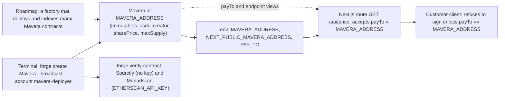

# ADR-0001: One `Mavera` contract per API, deployed from the terminal, instead of a factory or launchpad

Mavera ships as a single immutable contract per paid API: `contracts/src/Mavera.sol`, contract `Mavera`, deployed on event day with `forge create` and verified on Sourcify and Monadscan. There is no factory, no registry, no admin key and no upgrade path. "Launch an API's shares in 10 seconds" is demonstrated from the terminal, not from a launchpad page. A factory that deploys and indexes many `Mavera` contracts is roadmap. The decision trades discoverability and multi-API convenience for the smallest possible trust surface and for a contract that fits the 11:00–11:40 build slot.

## Status

Accepted, 2026-10-24. Token name and symbol are TBD on event day (suggested "Mavera Shares: <API name>" / "mAPI").

## Context

- The product is one sentence: a paid API sells its future revenue as on-chain shares; every x402 call's payment is distributed to share holders within one Monad block ([docs/00-OVERVIEW.md](../00-OVERVIEW.md)). The organizer's advice, quoted in the handoff brief, is "one thing, done very well, explainable in one sentence".
- The Blitz rubric (`https://blitz.devnads.com/api/events/monad-blitz-ankara-v4/judging`, accessed 2026-10-24) weights Execution at 30 of 100 ("How much of it actually works") and has a pass/fail gate `deployed`: "A contract address is provided and has code on Monad testnet." One verified contract satisfies the gate; a factory adds a second contract, a registry and a UI that must all work by 16:00.
- The hacking window is 10:45–16:30. The runbook gives 40 minutes (11:00–11:40) to write, deploy and verify the contract and 40 minutes (11:40–12:20) for tests ([docs/07-RUNBOOK.md](../07-RUNBOOK.md)).
- The revenue mechanism needs a dedicated address. x402 `exact` settlement is a plain `transferWithAuthorization` on USDC to `payTo`; the receiving contract is not notified. `sync()` therefore works by balance delta, `pending = usdc.balanceOf(this) - accounted` ([docs/02-CONTRACT-SPEC.md](../02-CONTRACT-SPEC.md)). One address can account for exactly one revenue stream.
- Trust story for the jury ("why not Stripe"): payments land in a contract nobody administers, not in the developer's account. Prior art that puts a company in the middle: x402commit (pilot stage, company-operated splitbox, vault and ERC-8004 identity, no public code) and Bondrail (Monad testnet, Metropolis entry). See [docs/09-COMPETITIVE-LANDSCAPE.md](../09-COMPETITIVE-LANDSCAPE.md).
- Monad facts that make per-API deployment cheap (docs.monad.xyz, accessed 2026-10-24; collected in [docs/10-MONAD-NOTES.md](../10-MONAD-NOTES.md)): a transaction is visible in about 300 ms (Proposed) and final in about 600 ms; a 200,000-gas transaction costs about 0.02 MON (about USD 0.0005) at the 100 MON-gwei minimum base fee; contract size limit 128 KB and initcode limit 256 KB (MIP-8).
- Positioning: Mavera is "the capital layer for API Hub" (https://app.monad.xyz/agents/api-hub, 136 services on mainnet, accessed 2026-10-24). A factory is the natural product for many APIs; the hackathon proves the mechanism for one.

## Decision

1. One `Mavera` contract per API. Constructor arguments: `usdc`, `creator`, `sharePrice`, `maxSupply` (stored as immutables), `creatorShares` (minted to the creator at deployment so `totalSupply > 0` from the first block) and the `endpoint` string. No owner, no pause, no upgrade, no burn.
2. The "registry" is the contract itself: `payTo()` returns the contract's own address and `endpoint()` returns the URL it serves, so anyone can pair contract and API from the chain and the README.
3. Deployment and verification are shell commands run from the terminal (copy-paste versions in [docs/07-RUNBOOK.md](../07-RUNBOOK.md); stubs described in [scripts/README.md](../../scripts/README.md) and [contracts/README.md](../../contracts/README.md)). `forge create ... --broadcast --account mavera-deployer` is preferred over `forge script` for a single contract (`forge script` would need `--slow --gas-estimate-multiplier 110`; never `--legacy`). Verification: Sourcify via `--verifier sourcify --verifier-url https://sourcify-api-monad.blockvision.org/ --chain 10143` (no key) and Monadscan via the Etherscan V2 API with `ETHERSCAN_API_KEY`, as documented in `contracts/foundry.toml`.
4. After deployment three variables are filled in `.env` ([.env.example](../../.env.example)): `MAVERA_ADDRESS`, `NEXT_PUBLIC_MAVERA_ADDRESS` and `PAY_TO`. `PAY_TO` must equal `MAVERA_ADDRESS`; the schema in `web/src/lib/env.ts` rejects any other value.
5. Factory, launchpad UI, multiple APIs per deployment, agent directory and ERC-8004 registration are roadmap and are named as such in the pitch ([docs/08-DEMO-AND-PITCH.md](../08-DEMO-AND-PITCH.md)).

Diagram: the launch path is one deploy command, one verification step and three environment variables; the dashed factory is not built.

## Consequences

### Positive

- Smallest audit surface: one contract, no admin functions, no proxy. The jury can read the whole trust model in one file.
- "No company in the middle" is literally true on the Mavera side: nobody can redirect, pause or upgrade the revenue path (the USDC side is Circle's; see [ADR-0005](ADR-0005-usdc-choice.md)).
- Each API's shares are a separate ERC-20, so holders of one API never share balances or dust with another.
- Fits the clock: `forge create` plus two verification commands fit the 11:00–11:40 slot, and the test suite targets one contract.
- The route lock stays trivial: `payTo()` and `endpoint()` are two views, and the client-side check compares one address ([docs/06-THREAT-MODEL.md](../06-THREAT-MODEL.md)).

### Negative

- No on-chain discovery: there is no list of Mavera contracts. Pairing a URL with a contract relies on `endpoint()` and the README; a factory emitting an index event would fix this.
- No shared upgrade: a bug means a redeploy, a new address and new shares. Acceptable for a hackathon, not for mainnet.
- One web app serves one contract (`MAVERA_ADDRESS` is a single variable). Showing a second API means a second deployment and a second `.env`.
- Deployment gas is paid per API by whoever deploys. The amount is TBD on event day (`forge create` prints it; Monad charges the gas limit, not the gas used).

### Neutral

- "Launch in 10 seconds" is a demo phrase, not a benchmark: the deploy transaction itself is visible in about 300 ms and final in about 600 ms; end-to-end wall time (compile, broadcast, verify) is measured at the 15:00–15:30 rehearsal and written into the README.
- A future factory does not change `Mavera`: it would call the same constructor and emit an index event.

## Alternatives considered

| Option | What it would mean | Why not now |
| --- | --- | --- |
| A. One immutable contract per API, deployed from the terminal (chosen) | `forge create`, `payTo()` and `endpoint()` views, three env variables | Smallest surface, fits the slot, matches the one-sentence pitch |
| B. Factory contract plus launchpad page | a factory with a create function, index events, a form on `/` | A second contract and a UI to build and test by 16:00; adds nothing to the mechanism being judged; roadmap |
| C. One singleton contract holding many APIs (one ledger per API id) | one address, per-API accounting inside | Breaks balance-delta `sync()`: all APIs would share one `payTo` and one USDC balance, so arriving USDC could not be attributed to an API without a notified deposit call, which x402 settlement never makes |
| D. Upgradeable proxy with an admin key | fix bugs in place | Reintroduces the operator trust the product removes; contradicts "payments land in a contract nobody controls" |
| E. ERC-4626 vault per API | share price derived from assets held | Mavera is not a vault: revenue is flow to split, not assets backing a price; the inflation-attack machinery is irrelevant ([docs/02-CONTRACT-SPEC.md](../02-CONTRACT-SPEC.md)) |

## References

- Handoff brief, section 3 (scope out: factory and launchpad UI; "launch in 10 seconds" shown from the terminal) and section 4.2 (immutables, constructor mint).
- Blitz platform rubric `https://blitz.devnads.com/api/events/monad-blitz-ankara-v4/judging` (accessed 2026-10-24): gates `built_at_event`, `deployed`, `honest_pitch`; criteria Execution 30, On-chain necessity and Monad fit 25, Problem and promise 20, Originality 15, Presentation 10.
- Monad gas and limits: https://docs.monad.xyz/developer-essentials/gas-pricing.md and https://docs.monad.xyz/developer-essentials/opcode-pricing.md (accessed 2026-10-24).
- Research report `dividend-accounting-review.md`, sections 2.3 (ERC-4626 inapplicable), 5.1 (balance-delta `pending`) and 7 row A12 (proceeds to the creator keep `pending` pure); verification `dividend-accounting-review.verify.md` (all 11 claims confirmed).
- Repository configuration: `contracts/foundry.toml` (verification commands), [.env.example](../../.env.example), `web/src/lib/env.ts` (`PAY_TO` equals `MAVERA_ADDRESS`).
- Related documents: [docs/00-OVERVIEW.md](../00-OVERVIEW.md), [docs/01-ARCHITECTURE.md](../01-ARCHITECTURE.md), [docs/02-CONTRACT-SPEC.md](../02-CONTRACT-SPEC.md), [docs/07-RUNBOOK.md](../07-RUNBOOK.md), [docs/09-COMPETITIVE-LANDSCAPE.md](../09-COMPETITIVE-LANDSCAPE.md), [docs/adr/README.md](README.md).

## Open questions

- Token name and symbol: TBD on event day (suggestion "Mavera Shares: <API name>" / "mAPI").
- Is `endpoint` an immutable constructor string or a creator-settable value? The specification draft stores it as a string; immutable is simpler and stronger for the route-lock story.
- Deployment gas and wall time behind the "launch in 10 seconds" line: measure at the 15:00–15:30 rehearsal.
- If the jury asks for a launchpad: answer "roadmap; a factory only calls this constructor", and show a second deploy from the terminal if time allows.
