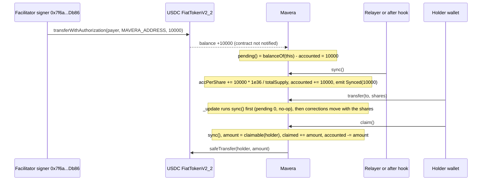

# ADR-0002: Pull-based claims with a permissionless `sync()` instead of push distribution

Revenue is not pushed to holders. Every USDC payment lands in the `Mavera` contract; anyone may call `sync()`, which folds the newly arrived amount into a per-share accumulator (`accPerShare`, magnifier 1e36) in constant gas; each holder later pulls their share with `claim()`. The alternative, transferring USDC to every holder on every payment, costs more gas than a 1-cent payment is worth and can be bricked by a single blacklisted holder. The attribution sub-decision is: `sync()` runs inside the ERC-20 `_update` hook before balances move, so each payment is split among the holders of record at that instant; the relayer-only variant (attribution at sync time) is kept as the fallback if the measured transfer gas is unacceptable. The variant is confirmed before 11:00 on event day.

## Status

Accepted, 2026-10-24. The attribution sub-decision (sync inside `_update`) is "confirm before 11:00": measure `transfer` gas with `forge test --gas-report` or `forge snapshot` under `network = "monad"`; if the extra cost is far above about 45k gas, switch to relayer-only attribution and record it in [docs/adr/README.md](README.md).

## Context

- How money arrives. x402 `exact` settlement is `transferWithAuthorization(from = payer, to = payTo = MAVERA_ADDRESS, value = 10000)` on USDC, sent by the facilitator. The receiving contract is not called; USDC arrives silently. Distribution therefore needs a trigger that detects `pending = usdc.balanceOf(this) - accounted` ([docs/03-X402-FLOW.md](../03-X402-FLOW.md), [docs/02-CONTRACT-SPEC.md](../02-CONTRACT-SPEC.md)).
- Payment size versus push cost. One call pays 10,000 units (0.01 USDC). An ERC-20 transfer on Monad costs about 65,000 gas, about 0.0065 MON, about USD 0.00016 at the 100 MON-gwei minimum base fee (docs.monad.xyz, accessed 2026-10-24). Pushing to 100 holders would cost about USD 0.016 per payment, more than the payment itself, and the gas grows with the holder count.
- Blacklist risk of push. Circle's FiatTokenV2_2 `transfer` carries `whenNotPaused notBlacklisted(msg.sender) notBlacklisted(to)`; one blacklisted holder would make a push loop revert for everyone (research `dividend-accounting-review.md`, row A2).
- Reference pattern. The accumulator plus per-holder correction design is EIP-1726 (Roger Wu, 2019). It exists only as GitHub issue `ethereum/EIPs#1726` and the repository `Roger-Wu/erc1726-dividend-paying-token`; `eips.ethereum.org/EIPS/eip-1726` returns 404 (accessed 2026-10-24). FDT is ERC-2222 by Johannes Pfeffer (atpar) with Roger Wu as co-author. SushiSwap MasterChef uses the same accumulator (`accSushiPerShare`) with a pending-inclusive view (`pendingSushi`) and the rule "update before every balance change".
- Correctness. The research report proves with an exact-integer model (1,800 random sequences): balance moves never change a holder's entitlement (Lemma 1); entitlement is non-negative and grows only at `sync` (Lemma 2); conservation reads `sum of entitlements = M * totalDistributed - R`, with R the sum of sync remainders; dust is bounded by the number of holders, `dust <= H` (the handoff bound `totalSupply / 1e18 + 1` was wrong). Overflow needs more revenue than all USDC in existence: with `creatorShares >= 1e18`, `maxSupply <= 1e24` and lifetime revenue of 1e15 units the magnified product is 1e57, below 2^255.
- Attribution problem. A payment is allocated to balances at the moment of the sync that absorbs it. With relayer-only syncing there is a window of about one block (about 300 ms) plus relayer lag in which a transfer can move shares before the sync; the worked example gives a third party 4,000 units of a 20,000-unit payment made when it held nothing (research section 8.2). Calling `sync()` inside `_update` before `super._update` removes the window exactly. Estimated cost: about +38k to +40k gas per transfer when `pending == 0`, about +43k to +45k when `pending > 0` (MIP-8 estimate, NEEDS-TEST; the verifier notes the USDC proxy's admin-slot read may add about 8,100), about 0.0045 MON, about USD 0.0001. A plain OpenZeppelin transfer on Monad is about 45k to 65k, so transfers roughly double; `buy` and `claim` are unaffected because they sync anyway.
- Permissionless sync. `sync()` takes no parameters and only moves `pending` into `accounted` pro-rata to current balances; nobody can direct funds. The only lever is timing, which the `_update` hook removes (research rows A9 and A10).
- Relayer trigger. The route's `onAfterSettle` hook sees the settlement hash (the handler never does) and hands a `sync()` transaction to `after()` from `next/server`. A 1-second polling relayer (`RELAYER_PRIVATE_KEY`, funded with more than 10 MON) is the source of truth; `sync()` is idempotent, so double triggers are harmless. Because Monad charges the gas limit, the relayer reads `pending()` first and skips when it is 0.

## Decision

1. Pull-based claims: `claim()` syncs, pays exactly `claimable(holder)`, updates `claimed` and `accounted` before the transfer (checks, effects, interactions) under `nonReentrant` (OpenZeppelin 5.7.0 `ReentrancyGuardTransient`; EIP-1153 confirmed live on testnet), and reverts with `NothingToClaim()` when the amount is 0 so wallets show the error before gas is spent.
2. Permissionless, idempotent `sync()`: early return when `pending == 0` or `totalSupply == 0`; no `Synced(0)` events; `pending()` exposed as a view.
3. Pending-inclusive views: `claimable(h)` simulates the sync, so the fountain shows exactly what `claim()` will pay and moves within one block of settlement even before the relayer acts.
4. Attribution default: `_update` calls `sync()` before `super._update`; `buy()` still calls `sync()` first explicitly. Fallback kept: relayer-only sync with the documented one-block window. `test_Transfer_BeforeSync_Attribution` encodes whichever variant is chosen.
5. The relayer loop stays in either variant so the fountain never depends on a user transaction.

Diagram: one payment, one permissionless `sync()`, one pull. The transfer step shows the attribution hook running before balances move.

## Consequences

### Positive

- Constant gas per payment regardless of holder count: one `sync()` of about 150,000 gas costs about USD 0.0003 at the 100 MON-gwei floor, under 4 % of a 1-cent call ([docs/10-MONAD-NOTES.md](../10-MONAD-NOTES.md)).
- A blacklisted or lost holder address affects only that holder's claim; everyone else is paid.
- Past revenue stays with past holders: a holder who transfers all shares keeps an unchanged `claimable` (Lemma 2), which is what "a share of revenue" should mean.
- With the `_update` hook the pitch can say "every payment is split among the holders of record at that instant" without a "within one block" caveat.
- Nobody needs the operator's key for payouts: `sync()` is permissionless and `claim()` is the holder's own transaction.

### Negative

- Holders pay gas to claim, so a holder wallet needs MON. Monad charges the gas limit, so the UI disables Claim when `claimable == 0`; the `NothingToClaim()` revert also surfaces at gas estimation.
- Transfer gas roughly doubles with the hook (about +40k gas, about USD 0.0001). Measured at 11:00; the fallback loses exactness.
- Sub-unit remainders stay in the contract: up to 1 unit (0.000001 USDC) per holder, recoverable at the next sync that crosses the boundary; sync remainders below 1e-12 unit per sync are never allocated.
- The fountain's `Synced` feed depends on `sync()` being called; a stopped relayer delays events and payouts of pending revenue, but not entitlements (the pending-inclusive view still shows them).
- The relayer is a funded hot wallet (more than 10 MON) that must survive the demo.

### Neutral

- Both attribution variants reconcile totals exactly (`totalDistributed = sum claimed + sum claimable + dust`); only the split of a payment inside the window differs.
- `claim()` reverting on zero differs from the EIP-1726 reference (a no-op); the test handler and the UI must agree with the choice.
- `Synced(amount)` is emitted per effective sync; many 1-unit payments produce many events but no storage growth.

## Alternatives considered

| Option | Mechanism | Why not |
| --- | --- | --- |
| Pull with accumulator, sync in `_update` (chosen default) | EIP-1726 corrections; exact attribution | Costs about +40k gas per transfer; measured before 11:00 |
| Pull with accumulator, relayer-only sync (kept as fallback) | same accounting; attribution at sync time | One-block window; a transfer in the same block can capture pending revenue (worked example: 4,000 of 20,000 units) |
| Push: loop over holders per payment | `transfer` to each holder | Gas grows with holders and exceeds a 1-cent payment at about 100 holders; needs a holder list; one blacklisted holder reverts the loop |
| Push by an off-chain splitter (x402commit-style splitbox and vault) | operator software splits and pays | Reintroduces the operator as the trusted party; not the product |
| MasterChef `rewardDebt` harvest on every balance change | pay out inside `transfer` | An ERC-20 `transfer` must not send USDC to the sender; incompatible with transferable shares |
| `claim()` as a no-op on zero (EIP-1726 reference behaviour) | idempotent | Wastes the full gas limit on Monad for nothing; the wallet cannot warn beforehand |

## References

- EIP-1726 issue https://github.com/ethereum/EIPs/issues/1726 and reference implementation https://github.com/Roger-Wu/erc1726-dividend-paying-token (accessed 2026-10-24); magnitude discussion in issue comment 472352728.
- SushiSwap MasterChef https://github.com/sushiswap/masterchef/blob/master/contracts/MasterChef.sol (accessed 2026-10-24).
- OpenZeppelin Contracts 5.7.0: `token/ERC20/ERC20.sol` (`_update`), `utils/ReentrancyGuardTransient.sol`, `utils/math/SafeCast.sol`.
- Monad gas model: https://docs.monad.xyz/developer-essentials/gas-pricing.md and https://docs.monad.xyz/developer-essentials/opcode-pricing.md (accessed 2026-10-24).
- Research report `dividend-accounting-review.md`, sections 3 to 7, 8.2 and 11 (recommendation 2), with `dividend-accounting-review.verify.md` (11 claims confirmed; gap 4 on proxy gas, gap 5 on `[fuzz] fail_on_revert = true`).
- Related documents: [docs/02-CONTRACT-SPEC.md](../02-CONTRACT-SPEC.md) section 6, [docs/05-TEST-PLAN.md](../05-TEST-PLAN.md) (`test_Gas_TransferWithSyncInUpdate`, `test_Transfer_BeforeSync_Attribution`), [docs/06-THREAT-MODEL.md](../06-THREAT-MODEL.md), [docs/01-ARCHITECTURE.md](../01-ARCHITECTURE.md), [docs/04-FRONTEND.md](../04-FRONTEND.md).

## Open questions

- Measured gas of `transfer` with the hook under `network = "monad"` (before 11:00); the decision flips only if the extra cost is far above about 45k.
- Should the relayer also sync on a timer (for example every 10 s when `pending() > 0`) to catch direct USDC transfers that bypass the route? Cheap on Monad; recommended, cost not analysed.
- `claimTo(address)` for agent wallets: not needed for the demo and does not affect the accounting.
- Can `after()` from `next/server` be called from inside the `onAfterSettle` hook? Unverified; the polling relayer is the fallback trigger.
