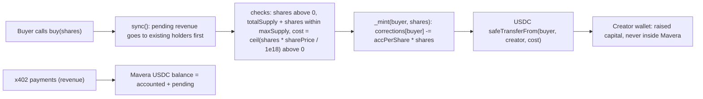

# ADR-0003: Fixed share price and capped supply instead of a bonding curve or AMM

Shares are sold at one immutable price (`sharePrice`, USDC units per 1e18 share-wei) up to a hard cap (`maxSupply`), and the proceeds go straight to the creator as raised capital. There is no bonding curve, no sell-back path and no in-app secondary market. The reasons are investor clarity (a holder can compute what one share earns from the call count alone), accounting purity (the contract's USDC balance is revenue only, never a price reserve) and time (the sale is a few checks and a few tests). Demo parameters: `sharePrice = 10_000` units (0.01 USDC per share), `creatorShares = 60e18`, `maxSupply = 100e18`, so the whole public float of 40 shares costs 0.4 USDC.

## Status

Accepted, 2026-10-24. The mechanism is final; the demo parameter values are specification defaults to be confirmed before the deploy command in the 11:00–11:40 slot (they are constructor arguments, so nothing in the code changes).

## Context

- Jury framing. The organizer rewards financial products that are explainable in one sentence and dislikes hype mechanics. Prepared answer to "Pump.fun?": there, revenue goes to creators and hype; here every call pays holders. A fixed price keeps the sentence "1 share costs 0.01 USDC, 100 shares exist, every call splits one cent among them" ([docs/08-DEMO-AND-PITCH.md](../08-DEMO-AND-PITCH.md)).
- Accounting constraint. `sync()` detects revenue by balance delta: `pending = usdc.balanceOf(this) - accounted`. Any USDC that sits in the contract for another reason (a curve's reserve, escrowed capital) would be distributed as revenue at the next sync, or would need a second ledger. Sending `buy` proceeds directly to the creator keeps `pending` pure and avoids a flow in which later buyers' capital becomes earlier holders' "dividends" (research `dividend-accounting-review.md`, row A12).
- Fairness of entry. `buy()` calls `sync()` first, so a buyer never shares in revenue that landed before the purchase; without it, buying would be profitable whenever unsynced revenue per share exceeds `sharePrice / 1e18` (research section 3.4). New shares dilute future revenue only.
- Rounding. Cost must round up: `cost = mulDiv(shares, sharePrice, 1e18, Ceil)` with `shares > 0` and `cost > 0`. Floor division would mint up to 99,999,999,999,999 share-wei for 0 USDC at `sharePrice = 10_000` (research row A6, correction C4).
- Supply bounds. `creatorShares > 0` and `creatorShares <= maxSupply`, so the first buy can succeed and revenue is never stranded; `creatorShares >= 1e18` and `maxSupply <= 1e24` keep the magnified entitlement at or below 1e57, below 2^255, for lifetime revenue up to 1e15 units (research section 6).
- Budget. Circle's faucet gives 20 USDC per address every 2 hours (https://faucet.circle.com, accessed 2026-10-24). A buyer taking the whole float (40e18 share-wei) pays 0.4 USDC; 50 paid calls cost 0.5 USDC; one faucet request funds both.
- Time. Contract and tests share 80 minutes (11:00–12:20). The fixed sale adds a handful of unit tests and three invariants (`INV-8` supply bounds, `INV-10` buy isolation, `INV-13` no zero-cost mint); a curve would add a reserve ledger, a sell path, a burn path and price invariants ([docs/05-TEST-PLAN.md](../05-TEST-PLAN.md)).
- Secondary market. Shares are a plain ERC-20, so any venue can list them later. A Uniswap v4 deployment exists on Monad testnet (PoolManager `0x451D64ab3b650040d2aE1886602b97ed6eDc643d`; "This is not an official Uniswap deployment", registry `monad-crypto/protocols`, accessed 2026-10-24). Nothing in Mavera needs to know about it.

## Decision

1. `sharePrice` and `maxSupply` are immutable constructor arguments; `buy(shares)` is the only mint path; there is no burn, no sell-back and no price function.
2. `buy()` order: `sync()`, checks (`shares > 0`, `totalSupply + shares <= maxSupply`, `cost > 0`), mint, then `safeTransferFrom(buyer, creator, cost)`, all under `nonReentrant`.
3. Proceeds go to `creator`, never to the contract (`creator != address(0)` and `creator != address(this)` are constructor requirements).
4. Demo parameters (confirm before deploy): `sharePrice = 10_000` units, `creatorShares = 60e18`, `maxSupply = 100e18`; x402 price 10,000 units per call (`X402_PRICE_ATOMIC=10000` in [.env.example](../../.env.example)).
5. Bonding curve, Dutch auction and in-app secondary market are roadmap and are named as such.

Diagram: capital and revenue take different roads; only revenue ever enters the contract, so `pending` is always revenue.

## Consequences

### Positive

- Investor arithmetic is trivial and verifiable on the explorer. With the demo parameters, 50 calls at 0.01 USDC are 0.5 USDC of revenue; a holder of 40 of 100 shares receives 0.2 USDC, half of the 0.4 USDC paid for the shares (an illustration of the mechanism, not a forecast).
- No price manipulation surface: no reserve to drain, no curve to front-run, no inflation or donation attack (the ERC-4626 machinery is inapplicable).
- Dilution is bounded and known in advance: at most `maxSupply` share-wei will ever exist.
- Small code, small test matrix, fits the slot.

### Negative

- No price discovery: the creator must choose `sharePrice` up front. Too high means no buyers; too low means capital left on the table; the sale ends when the cap is hit.
- No exit inside the app: holders can transfer or list the ERC-20 elsewhere, but Mavera offers no buy-back.
- Capital is not escrowed: the holders' claim is on revenue, not on the raised capital; they trust the creator to keep the API running ([docs/06-THREAT-MODEL.md](../06-THREAT-MODEL.md)).
- A new price means a new contract (immutables), consistent with [ADR-0001](ADR-0001-single-contract-vs-factory.md).

### Neutral

- The creator holds 60 of the 100 demo shares and therefore earns 60 % of revenue once the float is sold; this is a parameter, not a rule.
- The 0.4 USDC whole-float cost is a demo convenience sized to the 20 USDC faucet; a real deployment chooses its own numbers.
- Disclaimer carried in the README and the page footer: "Testnet proof of concept with test USDC. Not an offer of securities. A production deployment would require a KYC allow-list and a licensed issuance wrapper in the relevant jurisdiction."

## Alternatives considered

| Option | Mechanism | Why not |
| --- | --- | --- |
| Fixed price, hard cap, proceeds to the creator (chosen) | immutable `sharePrice` and `maxSupply` | One sentence; pure `pending`; smallest tests |
| Linear or exponential bonding curve with a reserve | price rises with supply; selling burns shares and refunds from the reserve | A reserve inside the contract breaks balance-delta `sync()` or needs a second ledger; adds burn and sell paths; reads as a hype token |
| Pump.fun-style curve with graduation to an AMM | curve, then liquidity migration | The opposite of the "cash-flow token, not hype token" positioning; far beyond the slot |
| Dutch auction | descending price over time | Needs time logic and a settlement step; not demonstrable in a 90-second demo |
| ERC-4626 vault share pricing | price derived from assets held | Mavera is not a vault; revenue is flow to split, not backing |
| Uncapped fixed price | no `maxSupply` | Unbounded dilution; investors cannot bound their future share; the cap costs one check |
| Proceeds held in the contract (escrow) | capital kept on-chain | Capital would be distributed as "revenue" at the next sync unless tracked separately; a Ponzi-shaped flow (row A12) |

## References

- Handoff brief, sections 1 (organizer quotes), 3 (scope out: bonding curve, secondary market; prepared answers) and 4.2.
- Research report `dividend-accounting-review.md`, sections 2.3 (ERC-4626), 3.4 (sync first in `buy`), 6 (overflow bounds), 7 rows A5, A6 and A12, and recommendation 7 (demo parameters); `dividend-accounting-review.verify.md`, claim 5 (free-share arithmetic reproduced independently).
- OpenZeppelin Contracts 5.7.0: `utils/math/Math.sol` (`mulDiv` with `Rounding.Ceil`), `token/ERC20/extensions/ERC4626.sol` (`previewMint` rounds up, the rounding discipline copied here).
- Circle faucet https://faucet.circle.com (accessed 2026-10-24): 20 USDC per request, one request per asset and network per address every 2 hours.
- Uniswap v4 on Monad testnet: https://docs.monad.xyz/guides/uniswap-v4-hooks/customize-and-publish.md and https://github.com/monad-crypto/protocols (`testnet/uniswap_v4.jsonc`), accessed 2026-10-24.
- Related documents: [docs/02-CONTRACT-SPEC.md](../02-CONTRACT-SPEC.md), [docs/05-TEST-PLAN.md](../05-TEST-PLAN.md), [docs/04-FRONTEND.md](../04-FRONTEND.md) (Buy flow), [docs/00-OVERVIEW.md](../00-OVERVIEW.md), [.env.example](../../.env.example).

## Open questions

- Final demo parameters (`sharePrice`, `creatorShares`, `maxSupply`) and the token name and symbol: confirm before the deploy command and record them in [docs/adr/README.md](README.md).
- Minimum lot for `buy` (for example multiples of 1e15 share-wei): pure UX; the ceil cost already removes free shares.
- Should the page show "revenue per share so far" next to the price? Helpful for the jury and cheap to derive from `totalDistributed` and `totalSupply`.
- `permit`-based one-signature buy versus approve-then-buy is a frontend decision ([docs/04-FRONTEND.md](../04-FRONTEND.md)); front-running of a submitted permit is handled by proceeding when the allowance already suffices (research row A16).
