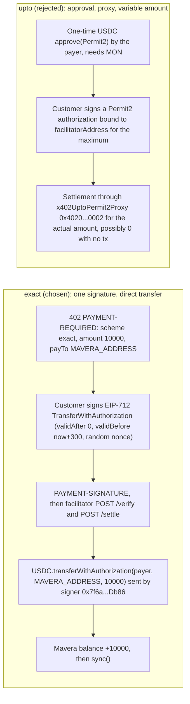

# ADR-0004: x402 `exact` scheme (EIP-3009) instead of `upto`

The paid route `GET /api/price` (working name, TBD on event day) uses the x402 v2 `exact` scheme on network `eip155:10143`: the server advertises one fixed amount, 10,000 USDC units (0.01 USDC); the customer signs one EIP-712 `TransferWithAuthorization` message; the facilitator settles it as a direct `transferWithAuthorization` on USDC with `to = MAVERA_ADDRESS`. `upto` was rejected: it is meant for metered use, it settles through the facilitator's Permit2 proxy, it needs a one-time on-chain approval by the payer, and it allows a $0 settlement with no transaction, which would break the promise that every call pays holders. If the facilitator fails inside the 60-minute integration box, the fallback keeps the same signing primitive: F2 `receiveWithAuthorization` first, F1 EIP-2612 `permit` second.

## Status

Accepted, 2026-10-24. Event-day checkpoint (12:20–13:15 slot): confirm with `cast receipt <hash>` that one settlement is one USDC transaction to `MAVERA_ADDRESS` sent by the facilitator signer; if checkpoint C is not green by T+40 minutes, switch to the fallback ([docs/03-X402-FLOW.md](../03-X402-FLOW.md), section 14).

## Context

- What the facilitator offers. `GET https://x402-facilitator.molandak.org/supported` (live, 2026-10-24) lists for `eip155:10143` three kinds, all `x402Version: 2`: `exact` (`extra: {}`), `upto` (`extra.facilitatorAddress 0x7f6a2850669202519f0fe8aa912451238820db86`) and `batch-settlement`; the same three for `eip155:143`; signer `0x7f6a2850669202519f0FE8aa912451238820Db86` for both networks. The wire scheme ids are `exact` and `upto`; the Monad guide's `v2-eip155-exact` is a table label, not a value.
- `exact` semantics (https://docs.x402.org/schemes/exact.md, accessed 2026-10-24): "The seller advertises one amount, the buyer signs for that exact amount, and the facilitator settles that payment for the request." On EVM the default transfer method is `eip3009`: the facilitator calls `transferWithAuthorization` on the token with the signed authorization. The payer needs no MON, no approval and no prior transaction. The facilitator pays gas: a settlement estimates at 141,817 gas, about 0.014 MON at the 100 MON-gwei floor; the signer held about 4,964 MON on 2026-10-24.
- `upto` semantics (https://docs.x402.org/schemes/upto.md, accessed 2026-10-24): "lets a seller advertise a maximum price for one request, then settle for the actual amount used. The buyer signs once for the maximum"; "`upto` on EVM uses Permit2 because the settled amount is not known when the buyer signs. The facilitator advertises a `facilitatorAddress` in the payment requirements, and the client binds the authorization to that facilitator." It needs Permit2 `0x000000000022d473030f116ddee9f6b43ac78ba3` and the proxy `x402UptoPermit2Proxy` `0x4020A4f3b7b90ccA423B9fabCc0CE57C6C240002` (both have code on testnet), a one-time `approve(Permit2, max)` by the payer (needs MON) or a gas-sponsoring extension (otherwise HTTP 412 / `permit2_allowance_required`), the server-side `UptoEvmScheme` with per-request settlement overrides, and it "Supports $0 settlement (no on-chain tx)". The Monad guide recommends `exact` for USDC on Monad and reserves `upto` for "Variable-amount / metered payments (LLM tokens, bandwidth, compute)".
- What Mavera needs. One fixed price per call; a real on-chain USDC transfer into the contract on every paid call, because `sync()` can only distribute what arrived ([ADR-0002](ADR-0002-pull-vs-push-dividends.md)); a customer that may be a machine holding only USDC; and a route lock the client can check before signing: `payTo == MAVERA_ADDRESS`, `asset == USDC`, `network == eip155:10143`, `scheme == exact`.
- Pricing facts. `@x402/evm@2.28.0` already contains Monad testnet USDC in its default asset table, so `price: "$0.01"` resolves without a custom money parser (the handoff and the Monad guide are stale on this point). The deterministic option is an explicit asset amount, which the route configuration carries as data:

```json
{ "amount": "10000", "asset": "0x534b2f3A21130d7a60830c2Df862319e593943A3", "extra": { "name": "USDC", "version": "2" } }
```

- Settlement order. `withX402` verifies before the handler and settles only after the handler returns a status below 400; the handler never sees the transaction hash; the server observes it in the `onAfterSettle` hook and the client in the `PAYMENT-RESPONSE` header. Headers are `PAYMENT-REQUIRED` (402), `PAYMENT-SIGNATURE` (request) and `PAYMENT-RESPONSE` (200), all base64 JSON.
- `batch-settlement` caveat. The facilitator also advertises `batch-settlement` (an escrow channel with off-chain vouchers redeemed in batches). Mavera never requests it, but the runbook tests early that one `exact` settlement is one transaction, because a batched path would make the fountain move in steps.
- Fallbacks on the same token. Circle's testnet USDC exposes EIP-3009 `receiveWithAuthorization` (the token requires `to == msg.sender`, so the Mavera contract pulls the funds itself; a relayer pays gas; the customer needs no MON) and EIP-2612 `permit` (`permit` alone estimates at 149,028 gas; sequential nonces). Both were exercised with real signatures by `eth_call` on 2026-10-24.

## Decision

1. Scheme `exact`, network `eip155:10143` (`X402_NETWORK`), asset `0x534b2f3A21130d7a60830c2Df862319e593943A3` (`USDC_ADDRESS`), amount `10000` (`X402_PRICE_ATOMIC`), `payTo = MAVERA_ADDRESS` (`PAY_TO`), `maxTimeoutSeconds = 300` (`X402_MAX_TIMEOUT_SECONDS`), explicit asset amount with `extra { name: "USDC", version: "2" }`. All variables are in [.env.example](../../.env.example).
2. Server: `withX402` around the App Router route handler, bare route configuration (no path key), Node runtime (the default), `onAfterSettle` hands the `sync()` transaction to `after()`; the 1-second relayer stays the source of truth.
3. Client (customer script, load test, browser button): the `exact` EVM scheme with the route lock enforced before any signature is produced (payment-requirements selector or `onBeforePaymentCreation` abort); the default spend cap of $1 per payment is kept.
4. `upto`, `batch-settlement` and the `exact` `upfront` flow variant are not used. `upto` is the roadmap answer if an endpoint ever meters its work.
5. Fallback order if the facilitator fails: F2 `receiveWithAuthorization` via a contract helper, then F1 `permit` plus `transferFrom`; same page, same contract, same fountain.



Diagram: `exact` moves the cent straight into the contract with one signature; `upto` adds an approval step and a proxy and may settle nothing.

## Consequences

### Positive

- The customer is gasless: one EIP-712 signature, no MON, no approval; machines holding only USDC can pay.
- Funds go straight to `MAVERA_ADDRESS`; no proxy sits in the path, and the signed authorization's `to` field is the contract, so a captured signature can only move money into Mavera.
- One call equals one on-chain transaction visible on https://testnet.monadscan.com, which the fountain story needs.
- SDK default for USDC on Monad: the `exact` EVM scheme on both sides, no custom parser, the 2.28.0 default table.
- The fallback reuses the same EIP-3009 signing path (F2), so a facilitator outage does not change the demo narrative.

### Negative

- No metering: a heavy request costs the same cent as a light one.
- The facilitator is a hard dependency even for emitting a 402 (the server fetches `/supported` at initialization); unreachable means HTTP 502 and no revenue until the fallback is wired.
- Every call is a transaction paid by the facilitator (about 141,817 gas); fine for 50 demo calls, a cost question for the facilitator operator at scale.
- The protocol does not bind an authorization to the resource; a replayed `PAYMENT-SIGNATURE` could be settled by anyone for the same `payTo`, which for Mavera only moves money into the contract (harmless; documented in [docs/06-THREAT-MODEL.md](../06-THREAT-MODEL.md)).
- ERC-7702 "strict delegate" wallets cannot sign EIP-3009 authorizations; EOAs and EIP-1271 smart accounts can.

### Neutral

- The facilitator does not enforce `validBefore <= now + maxTimeoutSeconds`; it rejects only already-expired authorizations (`invalid_payment_expired`). Keep `maxTimeoutSeconds` at the 300 s default.
- Error vocabulary to expect: `insufficient_funds`, `invalid_payment_amount`, `unsupported_scheme`, `invalid_format`, `unexpected_error`, `settlement_pending`, `invalid_payment_expired`, `accepted_requirements_mismatch`; on-chain `FiatTokenV2: authorization is expired`, `authorization is not yet valid`, `authorization is used or canceled`, `invalid signature`, `caller must be the payee`.
- The facilitator accepts a contract address as `payTo` (verified live with Multicall3 as `payTo`); `payTo` must never be the USDC address itself (Circle blacklists its own token address; the facilitator answers HTTP 500 `unexpected_error`).

## Alternatives considered

| Option | Mechanism | Why not |
| --- | --- | --- |
| `exact` with `eip3009` (chosen) | one signature, `transferWithAuthorization` to `payTo` | Fixed price, gasless payer, direct transfer, SDK default |
| `exact` with the `permit2` transfer method | `x402ExactPermit2Proxy` `0x402085c248EeA27D92E8b30b2C58ed07f9E20001` | Needs a payer approval and routes through a proxy; no benefit for an EIP-3009 token |
| `upto` | Permit2 authorization for a maximum, settle the actual amount | Metered use case; approval step; proxy; $0 settlement possible; no counterfactual wallets |
| `batch-settlement` | escrow deposit, off-chain vouchers, batched redemption | Payments would not reach the contract per call; the fountain would move in batches |
| `exact` with `paymentFlow: "upfront"` | settle before the handler runs | Pays even when the handler fails; the default `authorization` flow already settles only after a successful handler |
| No x402 (F1 `permit` or F2 `receiveWithAuthorization` only) | customer signs, relayer submits | Loses the standard 402 protocol and the facilitator; kept as the fallback, not the product |

## References

- Facilitator `GET https://x402-facilitator.molandak.org/supported` (live, 2026-10-24) and the probes in research report `x402-monad-integration.md`, sections 6 and 7, with `x402-monad-integration.verify.md` (claim 11 corrected: the facilitator also accepts a bare payload body when `resource` is present; gaps 1 to 5).
- x402 documentation: https://docs.x402.org/schemes/exact.md, https://docs.x402.org/schemes/upto.md, https://docs.x402.org/schemes/batch-settlement.md, https://docs.x402.org/core-concepts/http-402.md, https://docs.x402.org/advanced-concepts/lifecycle-hooks.md (accessed 2026-10-24); specification https://github.com/x402-foundation/x402/blob/main/specs/schemes/exact/scheme_exact_evm.md.
- Monad x402 guide https://docs.monad.xyz/guides/x402.md and canonical contracts https://docs.monad.xyz/developer-essentials/network-information.md (accessed 2026-10-24).
- `@x402/core`, `@x402/evm`, `@x402/fetch`, `@x402/next` 2.28.0 (published 2026-09-29; pinned in `web/package.json` and `scripts/package.json`).
- Circle EIP-3009 and EIP-2612 sources https://github.com/circlefin/stablecoin-evm (`contracts/v2/EIP3009.sol`, `contracts/v2/EIP2612.sol`), accessed 2026-10-24.
- Related documents: [docs/03-X402-FLOW.md](../03-X402-FLOW.md), [docs/06-THREAT-MODEL.md](../06-THREAT-MODEL.md), [docs/07-RUNBOOK.md](../07-RUNBOOK.md), [docs/01-ARCHITECTURE.md](../01-ARCHITECTURE.md), [ADR-0005](ADR-0005-usdc-choice.md), [web/README.md](../../web/README.md), [scripts/README.md](../../scripts/README.md).

## Open questions

- Does the facilitator wait for the receipt before answering `POST /settle`, and what is the end-to-end latency of a paid call on Monad? Measure at checkpoint F (expected about one second).
- Is one `exact` settlement always one transaction, given that `batch-settlement` is advertised? Verify with `cast receipt <hash>` at checkpoint C.
- Per-IP or per-payer rate limits on `/verify` and `/settle`: none documented, none observed; keep the 50-call load sequential.
- Can `after()` be called from inside `onAfterSettle`? Unverified; the polling relayer covers it.
- Should a future metered endpoint adopt `upto`? Not analysed beyond the facts above.
