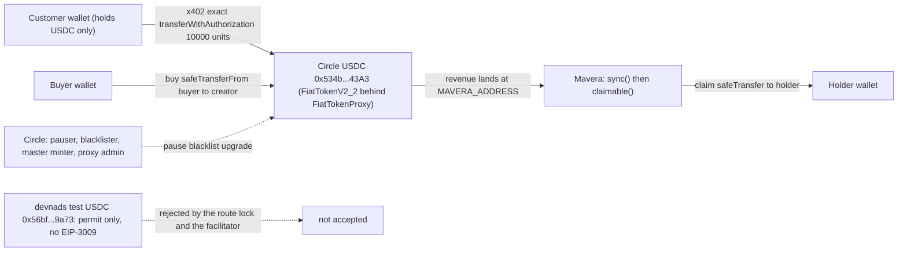

# ADR-0005: Circle USDC on Monad testnet as the only asset (not the devnads test USDC, not native MON)

Mavera uses one token for everything: Circle's USDC on Monad testnet at `0x534b2f3A21130d7a60830c2Df862319e593943A3` is the x402 payment asset, the currency shares are bought with, and the currency dividends are paid in. It is Circle's own FiatTokenV2_2 code behind a FiatTokenProxy (Sourcify full match), it exposes both EIP-3009 and EIP-2612, it is the built-in default asset for `eip155:10143` in `@x402/evm@2.28.0`, and https://faucet.circle.com gives 20 USDC per address every 2 hours. The devnads test USDC at `0x56bf9CDc3C1876F3F22655a0016C2743E9e39a73` has no EIP-3009 and is not an x402 asset; native MON has no x402 path and is volatile. The price of this choice is trust in Circle: pause, blacklist and upgrade are Circle's powers, disclosed as a known limit.

## Status

Accepted, 2026-10-24.

## Context

- The x402 `exact` scheme on EVM settles with EIP-3009 `transferWithAuthorization`, so the payment asset must implement EIP-3009 and the facilitator must be willing to settle it ([ADR-0004](ADR-0004-x402-exact-vs-upto.md)). The SDK's default table and the Monad x402 guide name exactly one testnet asset: `0x534b2f3A21130d7a60830c2Df862319e593943A3`.
- Live facts for that token (cast 1.8.6 against https://testnet-rpc.monad.xyz, 2026-10-24): `name()` "USDC", `symbol()` "USDC", `decimals()` 6, `version()` "2", `DOMAIN_SEPARATOR()` `0xf1090f5a61ddee19528cecc447be0f91c7205fc2b34dd271fc0de87809a0a48d` (recomputed from name "USDC", version "2", chain 10143; the Base-mainnet name "USD Coin" gives a different separator and `FiatTokenV2: invalid signature`), `TRANSFER_WITH_AUTHORIZATION_TYPEHASH()` `0x7c7c6cdb67a18743f49ec6fa9b35f50d52ed05cbed4cc592e13b44501c1a2267`, EIP-2612 `PERMIT_TYPEHASH()` and `nonces()` present, `paused()` false, `totalSupply()` 9,227,675,640.016803 USDC. Implementation `0x21240161521D6854BE79F7D3a0A65c6BeDDB42fb` (FiatTokenV2_2, Sourcify full match, solc 0.6.12, verified 2026-10-10); proxy admin `0x667b894bcc6899f5df1eba73c006b94c661a2d95`.
- Circle's official list (https://developers.circle.com/stablecoins/usdc-contract-addresses, accessed 2026-10-24) has the rows "Monad Testnet `0x534b2f3A21130d7a60830c2Df862319e593943A3`" and "Monad `0x754704Bc059F8C67012fEd69BC8A327a5aafb603`" (mainnet, `eip155:143`).
- Circle's controls, read live: owner and pauser `0x7A154EA9156D354504ad9A401380AA548039BE8b`, blacklister `0xA5a9723c4D658a6F92701ce3A5246Fa7d4723c26`, master minter `0x87f2e95621D8f12b83bb4a3E9975c0eAd524D437`; `transferWithAuthorization` and `transfer` carry `whenNotPaused notBlacklisted(from) notBlacklisted(to)`; `isBlacklisted(USDC itself)` is true (Circle blacklists the token's own address).
- The devnads test USDC `0x56bf9CDc3C1876F3F22655a0016C2743E9e39a73` (devnads.com/tokens, read live 2026-10-24): `name()` "Test USD Coin", `symbol()` "USDC", 6 decimals, `totalSupply()` 12,469 USDC, `DOMAIN_SEPARATOR()` `0x42226ed7098fb378edf77499929fca94cf9c441da4d5f1c2fbf2ba3ed0e4d26c`; `version()` and `authorizationState()` revert; the bytecode has `permit` (`0xd505accf`) but not `transferWithAuthorization` (`0xe3ee160e`) or `authorizationState` (`0xe94a0102`). It is EIP-2612 only, so the `exact` scheme cannot settle it and facilitator verification would fail.
- Other tokens with the same symbol on testnet: Kuru Test USDC `0xb01DC575a7ef75e58A05D2bde73ab79f8e7dd0Be`, Kuru old `0x3bA3d39AFcf8bb994f7964B3e0171Ea2Ba361570`, Garden `0x6c8f9d333964328f7ae2f0ea35389730d88f3d29`; two pre-reset addresses (`0x5d876d73f4441d5f2438b1a3e2a51771b337f27a`, `0x62534e4bbd6d9ebac0ac99aeaa0aa48e56372df0`) have had no code since the 2025-12-16 testnet reset.
- Native MON: no ERC-20 interface, no EIP-3009, absent from the facilitator's and the SDK's asset tables, and MON/USD was about 0.0213 USD on 2026-10-24 (Pyth and Stork reads), so a "1-cent call" priced in MON would drift with the market. API Hub prices in USDC, which is the market Mavera positions against.
- Faucet: https://faucet.circle.com (accessed 2026-10-24): "Send 20 USDC", one request per asset and test network per address every 2 hours; the handoff's "1 USDC" is outdated. One full demo run needs about 0.9 USDC (0.4 USDC for the float, 0.5 USDC for 50 calls).
- Accounting assumptions the token must satisfy: exact-value transfers (no fee-on-transfer), no rebasing, no transfer hooks. FiatToken's `_transfer` only updates balances and emits `Transfer`; no callbacks exist, so no reentrancy path exists today (CEI and `nonReentrant` are kept anyway).

## Decision

1. `USDC_ADDRESS` and `NEXT_PUBLIC_USDC_ADDRESS` are `0x534b2f3A21130d7a60830c2Df862319e593943A3` ([.env.example](../../.env.example)); the `Mavera` constructor takes it as the immutable `usdc`; the x402 route advertises it as `asset` with `extra { name: "USDC", version: "2" }`; `buy` pulls it and `claim` pays it.
2. Token assertions on the server (`chainId == 10143`, `name() == "USDC"`, `version() == "2"`, `decimals() == 6`; implemented on event day, where exactly they run is TBD) and the client-side route lock (refuse any 402 whose `asset` or `payTo` differs) guard against the four other "USDC" tokens.
3. Trust in Circle is disclosed in the README and [docs/06-THREAT-MODEL.md](../06-THREAT-MODEL.md): if Mavera's address were blacklisted, `claim` and x402 settlement would both fail; a blacklisted holder loses only its own claim; a blacklisted creator blocks `buy`; a pause stops everything. `pending` is computed defensively (0 when the balance is below `accounted`) and transfers use `SafeERC20`.
4. The devnads, Kuru and Garden tokens are never accepted; native MON is used only for gas.
5. Mainnet would use the same code at `0x754704Bc059F8C67012fEd69BC8A327a5aafb603` on `eip155:143`; out of scope for the event.

Diagram: every USDC movement in Mavera goes through one Circle contract; the dashed edges show Circle's powers and the rejected token.

## Consequences

### Positive

- Same code as mainnet USDC (FiatTokenV2_2), so the demo's token behaviour is the production behaviour.
- EIP-3009 enables the gasless x402 customer and the F2 fallback; EIP-2612 enables the F1 fallback and a one-signature `permit` buy.
- `price: "$0.01"` resolves through the SDK's default table; the explicit asset amount `10000` is the deterministic alternative.
- One faucet request (20 USDC) funds the buyer and about 50 paid calls; the relayer needs MON only.
- Dollar-denominated revenue makes the yield arithmetic legible to the jury and matches API Hub's USDC pricing.

### Negative

- Centralised counterparty: Circle can pause the token, blacklist any address and upgrade the implementation. Mavera inherits this fully; the only mitigations are disclosure and the defensive `pending`.
- Faucet pacing: 20 USDC per address per 2 hours means several customer and buyer wallets are funded the night before and topped up at 09:00 ([docs/07-RUNBOOK.md](../07-RUNBOOK.md)).
- The devnads faucet (the Blitz platform's convenience token) is useless for Mavera; a teammate who funds a wallet there by habit will see `insufficient_funds` from the facilitator.
- Four live tokens share the symbol "USDC"; the UI shows the address next to balances to avoid confusion.

### Neutral

- All amounts are 6-decimal integer units: 10,000 units = 0.01 USDC; `sharePrice` is units per 1e18 share-wei.
- `extra.name` must be "USDC" and `extra.version` "2" exactly; the Base-mainnet value "USD Coin" is the known copy-paste pitfall.
- `payTo` must never be the USDC contract itself: it is blacklisted by Circle and the facilitator surfaces this as HTTP 500 `unexpected_error`.
- The chain id is part of the EIP-712 domain, so an authorization signed for 10143 cannot be replayed on 143.

## Alternatives considered

| Option | Facts | Why not |
| --- | --- | --- |
| Circle testnet USDC `0x534b2f3A21130d7a60830c2Df862319e593943A3` (chosen) | EIP-3009 and EIP-2612; SDK default asset; Circle faucet 20 USDC per 2 h; FiatTokenV2_2 | The only asset the x402 path supports on testnet; production code |
| devnads test USDC `0x56bf9CDc3C1876F3F22655a0016C2743E9e39a73` | "Test USD Coin"; EIP-2612 only; `authorizationState` reverts; not in any x402 table | `exact` cannot settle it; facilitator verification fails; it would force the F1 fallback to be the main path |
| Native MON | gas token; no ERC-20 or EIP-3009 interface | No x402 asset path; a price of about 0.0213 USD per MON drifts; a payable accounting variant has no facilitator |
| Canonical WMON `0xFb8bf4c1CC7a94c73D209a149eA2AbEa852BC541` | ERC-20 wrapper ("Wrapped MON", 18 decimals); not in the x402 default asset table | Not an x402 asset; EIP-3009 support not verified by the research; same volatility as MON |
| Kuru or Garden test USDC | 6 decimals, same symbol | Not x402 assets; no facilitator support |
| A Mavera-minted mock stablecoin with EIP-3009 | full control | Test money nobody else holds; no faucet; the client's default spend controls do not recognise it; weakens the "real USDC rail" story |
| Mainnet USDC `0x754704Bc059F8C67012fEd69BC8A327a5aafb603` | `eip155:143` | Blitz requires testnet; mainnet gives no advantage |

## References

- Circle: https://developers.circle.com/stablecoins/usdc-contract-addresses and https://faucet.circle.com (accessed 2026-10-24); sources https://github.com/circlefin/stablecoin-evm (`contracts/v1/FiatTokenV1.sol`, `contracts/v2/FiatTokenV2.sol`, `contracts/v2/FiatTokenV2_2.sol`, `contracts/v2/EIP3009.sol`, `contracts/v2/EIP2612.sol`).
- Sourcify https://sourcify.dev/server/v2/contract/10143/0x534b2f3A21130d7a60830c2Df862319e593943A3 and the implementation `0x21240161521D6854BE79F7D3a0A65c6BeDDB42fb` (accessed 2026-10-24).
- x402 default assets: https://docs.x402.org/core-concepts/network-and-token-support.md (accessed 2026-10-24); `@x402/evm@2.28.0` default asset table (`eip155:10143` entry).
- Monad x402 guide https://docs.monad.xyz/guides/x402.md and the registry https://github.com/monad-crypto/protocols (`testnet/circle_usdc.jsonc`), accessed 2026-10-24.
- Research reports `x402-monad-integration.md` (section 5) and `price-data-source.md` (section 5, token table), with their `.verify.md` files (claims 8, 9 and 12, and claim 8, respectively, confirmed).
- Research report `dividend-accounting-review.md`, rows A1 and A2 (reentrancy, pause and blacklist trust).
- Related documents: [docs/03-X402-FLOW.md](../03-X402-FLOW.md) section 9, [docs/02-CONTRACT-SPEC.md](../02-CONTRACT-SPEC.md) section 11, [docs/06-THREAT-MODEL.md](../06-THREAT-MODEL.md), [docs/07-RUNBOOK.md](../07-RUNBOOK.md), [docs/10-MONAD-NOTES.md](../10-MONAD-NOTES.md), [scripts/faucet-notes.md](../../scripts/faucet-notes.md), [.env.example](../../.env.example).

## Open questions

- How many customer and buyer wallets to pre-fund tonight given the 2-hour faucet window (one full demo run needs about 0.9 USDC; more runs mean more wallets or a request on Circle's Discord).
- Where the token assertions run (server start versus first request) is an implementation detail for event day.
- Whether to show Circle's pause and blacklist powers in the page footer or only in the README.
- Mainnet: the licensed issuance wrapper and KYC allow-list question is out of scope ([docs/00-OVERVIEW.md](../00-OVERVIEW.md)).
