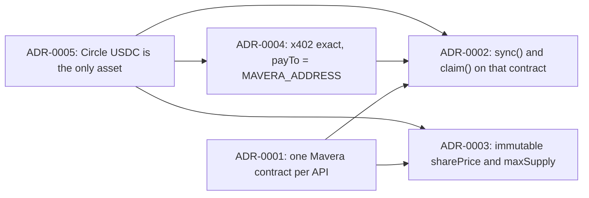

# Architecture decision records

Five decisions shape Mavera's design: one contract per API, pull-based dividends with a permissionless `sync()`, a fixed share price with a hard cap, the x402 `exact` scheme, and Circle's USDC as the only asset. Each record follows the same template (Status, Context, Decision, Consequences, Alternatives considered, References, Open questions), quotes only facts verified on 2026-10-24, and contains no implementation code. Two items carry an event-day confirmation: the attribution hook in ADR-0002 ("confirm before 11:00", a gas measurement) and the demo parameter values in ADR-0003 (constructor arguments, confirmed before the deploy command). The table at the end of this index is where those confirmations are recorded.

## Index

| ID | Title | Status | Date | Decision in one line |
| --- | --- | --- | --- | --- |
| [ADR-0001](ADR-0001-single-contract-vs-factory.md) | Single contract per API vs factory or launchpad | Accepted | 2026-10-24 | One immutable `Mavera` contract per API, deployed with `forge create` from the terminal; factory and launchpad are roadmap |
| [ADR-0002](ADR-0002-pull-vs-push-dividends.md) | Pull-based claims vs push distribution | Accepted; attribution hook: confirm before 11:00 | 2026-10-24 | Holders `claim()`; anyone may `sync()`; default attribution is `sync()` inside `_update`, relayer-only kept as the fallback |
| [ADR-0003](ADR-0003-fixed-price-vs-bonding-curve.md) | Fixed share price and capped supply vs bonding curve or AMM | Accepted; parameter values: confirm before deploy | 2026-10-24 | Immutable `sharePrice` and `maxSupply`, proceeds to the creator; demo values 10,000 units per share, 60e18 creator shares, 100e18 cap |
| [ADR-0004](ADR-0004-x402-exact-vs-upto.md) | x402 `exact` vs `upto` | Accepted | 2026-10-24 | `exact` on `eip155:10143` at 10,000 USDC units per call with EIP-3009; `upto` needs Permit2 and is for metered use; fallbacks F2 then F1 |
| [ADR-0005](ADR-0005-usdc-choice.md) | USDC choice | Accepted | 2026-10-24 | Circle testnet USDC `0x534b2f3A21130d7a60830c2Df862319e593943A3` for payments, purchases and dividends; devnads test USDC and native MON rejected |

## Template

Every record has, in this order: H1 `ADR-000N: <title>`, a one-paragraph summary, `## Status` (Accepted, 2026-10-24, plus "confirm before 11:00" where the contract specification says so), `## Context`, `## Decision`, `## Consequences` (positive, negative, neutral), `## Alternatives considered` (a table), `## References` (primary sources with the access date) and `## Open questions`. Facts come from the research reports verified on 2026-10-24 and from the repository configuration; anything unknown is an explicit placeholder such as "TBD on event day" or `<MAVERA_ADDRESS>`. Records describe mechanisms in words, math and diagrams, never in code.

## Event-day confirmations (fill in during the event)

| Item | Owner | When | Result |
| --- | --- | --- | --- |
| ADR-0002: measured `transfer` gas with `sync()` inside `_update` (`forge test --gas-report`) and the variant chosen | contract author | before 11:00 | TBD on event day |
| ADR-0003: final `sharePrice`, `creatorShares`, `maxSupply`, token name and symbol | contract author | before the deploy command (11:00–11:40 slot) | TBD on event day |
| ADR-0004: one `exact` settlement is one USDC transaction (`cast receipt <hash>`), checkpoint C by T+40 min of the 12:20 slot | web author | 12:20–13:15 slot | TBD on event day |
| ADR-0005: token assertions pass (`chainId` 10143, `name()` "USDC", `version()` "2", `decimals()` 6) | web author | first run of the paid route | TBD on event day |

## How the records relate

Diagram: the asset choice feeds the payment scheme and the accounting; the single-contract decision frames both the sale and the dividend design.

## Related documents

[docs/README.md](../README.md) (documentation index), [docs/00-OVERVIEW.md](../00-OVERVIEW.md) (scope in and out), [docs/02-CONTRACT-SPEC.md](../02-CONTRACT-SPEC.md) (the accounting these decisions produce), [docs/03-X402-FLOW.md](../03-X402-FLOW.md) (the payment path), [docs/06-THREAT-MODEL.md](../06-THREAT-MODEL.md) (the risks each decision accepts), [docs/07-RUNBOOK.md](../07-RUNBOOK.md) (where the confirmations happen), [README.md](../../README.md).

## Open questions

- Whether a sixth record is needed for the data served by `GET /api/price` (two oracles via Multicall3 versus heartbeat only). Today that decision lives in [docs/03-X402-FLOW.md](../03-X402-FLOW.md) and is driven by the `DATA_MODE` variable.
- Who writes the event-day confirmations into the table above (suggested: whoever runs the measurement, immediately after, in the same commit as the code it confirms).
